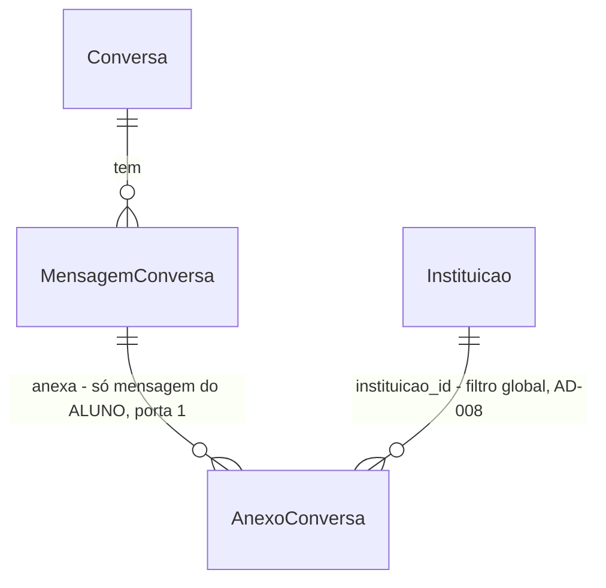

# Anexos na conversa com o assistente

## Problem

O aluno só consegue descrever o problema por texto no assistente. Quem tem um boleto com valor
estranho, a tela de erro do portal ou uma declaração em PDF precisa digitar o que vê. Para mostrar o
documento, tem de pedir um atendente e anexá-lo depois, no chamado. O assistente responde sem ver o
que o aluno está vendo, e o atendente que recebe a transferência também não vê, porque a conversa não
guarda arquivo nenhum. A fonte não dá números de volume; o pedido é do usuário, em 04/11/2026.

Depois desta feature, o aluno anexa fotos (JPG, PNG) e PDFs junto da mensagem. A IA lê os anexos
para entender o caso, mas continua respondendo só com as fontes da instituição. E o atendente
recebe os anexos na transcrição do chamado transferido.

O modelo continua `gpt-6-luna` (AD-015), por decisão do usuário em 04/11/2026. Na tabela oficial da
OpenAI, o `gpt-4o-mini` custa mais (US$ 0,15 de entrada, 0,075 em cache e 0,60 de saída por 1M de
tokens, contra 0,10, 0,01 e 0,50 do `gpt-6-luna`). Cada imagem custa 2.833 tokens no `gpt-4o-mini`
mesmo em `detail: low`, e o modelo tem desligamento marcado para 14/01/2027, com o `gpt-6-luna`
como substituto recomendado.

## Flow

Reaproveita a leitura e a validação de arquivo dos chamados (`Arquivos.Ler`, a mesma regra de 10 MB e
PDF/JPG/PNG por assinatura), o `Armazenamento` do MinIO e o `Assistente.Corpo` que já monta o pedido
ao provedor. Não cria uma segunda forma de guardar arquivo nem de chamar a OpenAI.

1. Entra `POST /api/conversas` ou `POST /api/conversas/{id}/mensagens`, em JSON como hoje ou em
   `multipart/form-data` com `mensagem` e `anexos` (porta 2). Seguem para `NovaConversa` e
   `NovaMensagem` (existem), que validam o texto como hoje e depois cada arquivo com `Arquivos.Ler`
   (existe) e o limite da conversa.
2. `ConversaRotas.Responder` (existe) grava os objetos pelo `Armazenamento` (existe) só depois de
   tudo aceito, e salva a mensagem do aluno com as linhas `AnexoConversa` (porta 1).
3. `Assistente.Responder` (exists): a busca de fontes segue só pelo texto (`Consulta`, sem mudança).
   `Corpo` baixa do MinIO os anexos das mensagens do aluno que estão no histórico de 10 e os põe como
   partes de conteúdo da mensagem `user` (porta 3).
4. `Assistente.Chamar` (exists) e `Classificar` (exists) seguem como hoje. A conferência de trechos e links só
   aceita as fontes citadas, então nada do anexo passa por ela.
5. Saída: a mesma resposta de hoje. `GET /api/conversas/{id}` (exists) e a transcrição de
   `GET /api/chamados/{numero}` (`DetalheChamado`, existe) passam a listar os anexos de cada mensagem
   do aluno, e `GET /api/conversas/anexos/{id}` (porta 4) entrega o arquivo.
6. Web: `Assistente.tsx` (exists) ganha o botão de anexar e os anexos no balão do aluno;
   `Conversa.tsx` (existe, `Transcricao`) mostra os anexos ao atendente.

## Impact

| Front | What changes |
| --- | --- |
| domain | termo novo: `AnexoConversa`, o arquivo que o aluno anexou a uma mensagem da conversa com o assistente. Vive em `api/Dados/Conversas/` |
| domain | termo existente: `Anexo` continua sendo só o anexo de mensagem de chamado. `BaixarAnexo`, `DetalheChamado.Anexos` e `ResponderChamado` não mudam |
| contrato | `POST /api/conversas` e `POST /api/conversas/{id}/mensagens` passam a aceitar `multipart/form-data` também. O JSON continua igual, e os testes e o e2e que mandam JSON não mudam |
| contrato | `GET /api/conversas/{id}` ganha `anexos` em cada mensagem, e a transcrição de `GET /api/chamados/{numero}` ganha `anexos` nas linhas do aluno **na resposta da equipe** (a do aluno não muda, ver a linha 5 de `Landing`). Os dois campos são novos e nenhum campo existente muda |
| prompt | `Regras` ganha uma regra 8 sobre anexos, e a mensagem `user` com anexo vira uma lista de partes (`content: [...]`). Muda a asserção do corpo do pedido em `LlmRequisicaoTests` só para mensagens com anexo; as outras continuam com `content` em texto |
| custo | uma mensagem com anexo é reenviada ao provedor a cada turno enquanto estiver entre as 10 últimas. São no máximo 3 anexos por conversa |
| stored data | tabela nova `anexo_conversa` por migração, sem nada a migrar. Os objetos vão para o mesmo bucket, com o prefixo `{instituicaoId}/anexos-conversa/` |
| LGPD | o texto continua mascarado (`Mascara.Aplicar`), mas a imagem e o PDF vão inteiros para a OpenAI, com CPF e nome visíveis se o aluno os mostrar. Isso amplia a pergunta 2 do roadmap |

## Relations

Restrições de mão única: `AnexoConversa` pertence a exatamente uma `MensagemConversa` (chave estrangeira
não nula, porta 1) e nunca é apagado nem alterado (append-only como `Anexo`, e o bucket é versionado).
Sem colunas e sem tipos aqui.

## Surface

| Route | In | Out | Status |
| --- | --- | --- | --- |
| `POST /api/conversas` | JSON `mensagem`, ou multipart `mensagem` + `anexos` (0 a 3 arquivos) | `conversaId` · `resposta {tipo, texto}` (sem mudança) | `201`, `400`, `403`, `413`, `415`, `429`, `503` |
| `POST /api/conversas/{id}/mensagens` | JSON `mensagem`, ou multipart `mensagem` + `anexos` | `resposta {tipo, texto}` (sem mudança) | `200`, `400`, `404`, `409`, `413`, `415`, `429`, `503` |
| `GET /api/conversas/{id}` | - | `mensagens[].anexos[] {id, nome, tipo, tamanho}` (campo novo) | `200`, `404` |
| `GET /api/chamados/{numero}` | - | `transcricao[]` do aluno com `anexos[] {id, nome, tipo, tamanho}` (campo novo) | `200`, `404` |
| `GET /api/conversas/anexos/{id}` | - | o arquivo, com `Content-Type`, `Content-Disposition` com o nome e `Content-Length` | `200`, `404`, `503` |

## Landing

| One-way door | Literal shape | Alternative rejected |
| --- | --- | --- |
| 1. Tabela própria para o anexo da conversa | `anexo_conversa (id, instituicao_id, mensagem_conversa_id NOT NULL → mensagem_conversa, nome, tipo, tamanho, chave, hash)`; chave `{instituicaoId}/anexos-conversa/{guid}` por `Armazenamento.NovaChave(id, "anexos-conversa")` | reusar `anexo` com `mensagem_chamado_id` anulável e um `mensagem_conversa_id`: `BaixarAnexo` e `DetalheChamado` partem do princípio de que todo anexo é de um chamado, e cada leitor passaria a ramificar |
| 2. Contrato de envio | as mesmas rotas aceitam `multipart/form-data` com o campo `mensagem` e o campo `anexos` repetido (mesmo nome do chamado), e continuam aceitando `application/json` `{ "mensagem": "..." }` | subir o arquivo antes, por `POST /api/conversas/{id}/anexos`, e referenciar o id: são duas requisições, deixam objeto órfão quando a mensagem não chega e não servem para a primeira mensagem, que ainda não tem conversa |
| 3. Forma do anexo no pedido ao provedor | mensagem `user` com anexo: `"content": [{"type":"text","text":"<texto mascarado>"}, {"type":"image_url","image_url":{"url":"data:image/jpeg;base64,..."}}, {"type":"file","file":{"filename":"anexo-1.pdf","file_data":"data:application/pdf;base64,..."}}]`; sem anexo, `content` continua string. O nome original nunca vai ao provedor | `file_id` pela Files API da OpenAI: deixa o documento do aluno guardado na OpenAI além da requisição e exige um ciclo de exclusão. Extrair o texto do PDF localmente: perde foto e PDF escaneado, e traz uma dependência nova |
| 4. Rota de download do anexo da conversa | `GET /api/conversas/anexos/{id:long}`: o aluno dono da conversa, ou quem abre o chamado criado dela (`ChamadoRotas.Carregar`); qualquer outro caso dá `404 "Anexo não encontrado."` | `GET /api/anexos/{id}` com os dois tipos: o id do `anexo` e o do `anexo_conversa` colidem, e o handler teria de adivinhar a tabela |
| 5. Quem recebe `anexos` na transcrição do chamado (achada no build) | só `TranscricaoDaEquipe` ganha `anexos` (omitido nas linhas do assistente, `[]` nas do aluno sem arquivo); `TranscricaoDoAluno` segue com `autor`, `texto`, `criadaEm`. O aluno já lista os próprios anexos em `GET /api/conversas/{id}` | `anexos` também em `TranscricaoDoAluno`: o AC 27 e o AC 29 são só da equipe, e `ArquiteturaTests.Nenhum_corpo_tipado_object` congela as 3 propriedades desse record, então ampliar o contrato do aluno exigiria editar essa asserção sem necessidade |

- Nada mais nesta mudança é difícil de reverter: o modelo continua sendo `Llm:Modelo` e o limite de 3 é uma constante

## Criteria

### S1: o aluno anexa e a IA lê (P1)

O aluno manda foto ou PDF junto da mensagem, e a resposta do assistente leva o anexo em conta.

**Acceptance Criteria**

1. WHEN o aluno envia `POST /api/conversas` ou `POST /api/conversas/{id}/mensagens` em `multipart/form-data` com `mensagem` de 1 a 1000 caracteres e de 1 a 3 arquivos em `anexos` THEN o sistema SHALL gravar cada arquivo no MinIO com a chave `{instituicaoId}/anexos-conversa/{guid}` e uma linha `AnexoConversa` (nome, tipo, tamanho, chave, hash SHA-256) ligada à mensagem do aluno, e SHALL responder `201`/`200` com o mesmo corpo de hoje
2. WHEN o assistente chama o provedor THEN o sistema SHALL mandar cada anexo das mensagens do aluno que estão entre as 10 últimas como parte de conteúdo dessa mensagem `user`: JPEG e PNG como `image_url` com a URL `data:<tipo>;base64,<bytes>`, e PDF como `file` com `file_data` `data:application/pdf;base64,<bytes>` e `filename` `anexo-<n>.pdf`
3. The system SHALL nunca mandar ao provedor o nome original do arquivo, e SHALL continuar mandando o texto da mensagem por `Mascara.Aplicar`
4. WHEN a mensagem do aluno não tem anexo THEN o sistema SHALL mandar `content` como texto, igual a hoje
5. The system SHALL aceitar o corpo `application/json` `{ "mensagem": "..." }` nas duas rotas com as mesmas respostas de hoje
6. The system SHALL incluir em `Regras` a regra 8: "Anexos do aluno servem só para entender o caso; não são fontes. Não copie trechos de anexos nem repita dados pessoais que aparecem neles."
7. IF o modelo devolve `resposta` com um trecho copiado do anexo e não da fonte citada THEN o sistema SHALL responder `sem_base` com o motivo `trecho_invalido`, como já faz com qualquer trecho que não confere
8. IF um arquivo passa de 10 MB THEN o sistema SHALL responder `413` "O arquivo {nome} passa de 10 MB." sem gravar mensagem nem objeto
9. IF um arquivo não é PDF, JPEG nem PNG pela assinatura THEN o sistema SHALL responder `415` "O arquivo {nome} não é PDF, JPG nem PNG." sem gravar mensagem nem objeto
10. IF os anexos já gravados na conversa mais os enviados passam de 3 THEN o sistema SHALL responder `400` no campo `anexos` "A conversa aceita até 3 anexos." sem gravar mensagem nem objeto
11. IF chegam anexos com `mensagem` vazia ou acima de 1000 caracteres THEN o sistema SHALL responder `400` "A mensagem deve ter de 1 a 1000 caracteres." sem gravar objeto
12. IF a conversa está encerrada, não é do aluno ou chegou ao limite de 10 mensagens THEN o sistema SHALL responder com o mesmo status e texto de hoje (`409`, `404`, `409`) sem gravar objeto
13. IF o MinIO está fora ao gravar THEN o sistema SHALL responder `503` "Armazenamento de arquivos indisponível." sem gravar a mensagem
14. IF o MinIO está fora ao ler os anexos para o provedor THEN o assistente SHALL responder `sem_base`, registrar o motivo `anexo_indisponivel` e não chamar o provedor
15. WHEN o assistente chama o provedor THEN a linha de log "Chamada ao provedor de IA" SHALL trazer `anexos=<quantidade de anexos enviados>`
16. WHEN um pedido traz 3 arquivos de 10 MB cada THEN o sistema SHALL aceitá-lo, sem o `413` do limite de corpo do servidor

**Independent test:** pelo Swagger ou `curl`, mandar uma foto de boleto com "esse valor está certo?" e ver no log `anexos=1`, com a imagem no corpo do pedido ao provedor simulado.

### S2: o aluno vê e baixa os anexos na conversa (P1)

A tela do assistente anexa, mostra o que vai ser enviado e o que já foi.

**Acceptance Criteria**

17. WHEN o aluno abre `GET /api/conversas/{id}` THEN cada mensagem SHALL trazer `anexos` com `id`, `nome`, `tipo` e `tamanho`, ou `[]` quando não tem anexo
18. WHEN o aluno dono da conversa pede `GET /api/conversas/anexos/{id}` THEN o sistema SHALL devolver `200` com o arquivo, `Content-Type` igual ao tipo, `Content-Disposition` com o nome e `Content-Length` igual ao tamanho
19. IF quem pede `GET /api/conversas/anexos/{id}` não é o aluno dono da conversa nem alguém que abre o chamado criado dela, ou o anexo é de outra instituição THEN o sistema SHALL responder `404` "Anexo não encontrado."
20. IF o MinIO está fora ao baixar THEN o sistema SHALL responder `503`
21. The system SHALL mostrar na tela Assistente, ao lado do campo de mensagem, um botão com o rótulo acessível "Anexar arquivo" (ícone de clipe) que abre o seletor com `accept=".pdf,.jpg,.jpeg,.png"` e `multiple`
22. WHEN o aluno escolhe arquivos THEN a tela SHALL mostrar cada um como um selo com o nome e um botão "Remover {nome}" antes do envio
23. WHILE a conversa já tem 3 anexos, somando os enviados e os escolhidos, a tela SHALL desabilitar "Anexar arquivo"
24. WHEN a mensagem com anexos é enviada com sucesso THEN a tela SHALL limpar os selos e mostrar no balão do aluno cada anexo como link com o nome para `GET /api/conversas/anexos/{id}`
25. IF a API responde `400`, `413`, `415` ou `503` THEN a tela SHALL mostrar o texto do erro da API no alerta de erro que já existe e SHALL manter o texto e os selos
26. The system SHALL mostrar na tela Assistente, abaixo do campo, o texto "Fotos e PDFs de até 10 MB, até 3 por conversa. Mostre só os dados de que o atendimento precisa."

**Independent test:** no app, anexar uma foto e um PDF, enviar, ver os dois links no balão e baixar cada um.

### S3: o atendente recebe os anexos no chamado transferido (P1)

Quando a conversa vira chamado, os anexos vão junto na transcrição.

**Acceptance Criteria**

27. WHEN alguém da equipe abre `GET /api/chamados/{numero}` de um chamado vindo de conversa THEN cada linha da transcrição do aluno SHALL trazer `anexos` com `id`, `nome`, `tipo` e `tamanho`, ou `[]`
28. WHEN quem abre o chamado pede `GET /api/conversas/anexos/{id}` de um anexo daquela conversa THEN o sistema SHALL devolver `200` com o arquivo
29. WHEN o atendente vê a transcrição na tela do chamado THEN cada anexo do aluno SHALL aparecer como link com o nome para `GET /api/conversas/anexos/{id}`

**Independent test:** anexar uma foto na conversa, pedir atendente, entrar como atendente do setor e baixar a foto pela transcrição.

## Out of scope

| Excluded | Why |
| --- | --- |
| Trocar o modelo para `gpt-4o-mini` | mais caro por token e por imagem que o `gpt-6-luna`, e desligado em 14/01/2027. Decisão do usuário em 04/11 |
| Anexo sem texto (só a foto) | a busca de fontes é pelo texto, e a chamada extra para descrever o anexo dobraria custo e espera. Decisão do usuário em 04/11 |
| Anexos em "Falar com atendente" sem conversa (`/api/atendimento-direto`) | o chamado já aceita anexos na primeira resposta; a feature é a leitura pela IA |
| HEIC, WEBP, DOCX e outros tipos | segue a regra dos chamados (PDF, JPG, PNG); outro tipo seria uma regra nova para os dois |
| Apagar anexo enviado | anexos são append-only como os do chamado |
| Usar o anexo como fonte da resposta (ler valor do boleto e confirmar) | AD-012: a resposta só se apoia em fontes da instituição conferidas no servidor |

## Assumptions

| Assumption | Chosen default | Rationale | Confirmed? |
| --- | --- | --- | --- |
| Nível de detalhe da imagem | sem `detail` (o padrão `auto` do provedor) | `low` no `gpt-6-luna` reduz a 512×512 px, e o texto de um boleto fica ilegível; o preço por token do `gpt-6-luna` é baixo | n |
| iPhone tira foto em HEIC | o seletor com `accept` de JPG e PNG faz o Safari entregar JPEG | comportamento do Safari conhecido, mas não verificado neste repositório; se vier HEIC, o `415` explica | n |
| Perfil de verificação | `standard` | precedente do `mvp-one` e do `rag`; muda prompt, contrato e tela, mas sem design obrigatório para comparar (`ui` só acrescentaria isso) | n |

**Open questions:**

| # | Kind | Question | Until answered |
| --- | --- | --- | --- |
| 1 | blocks go-live | A Univag aceita que fotos e PDFs do aluno, sem máscara de CPF e nome, sejam processados pela OpenAI fora do Brasil (LGPD art. 33)? Amplia a pergunta 2 do roadmap | os anexos funcionam em teste e na banca, com o aviso do critério 26; não vão para alunos reais do piloto |

## Observable

| Surface | Decision | Landing |
| --- | --- | --- |
| tela Assistente | estado vazio (nenhum arquivo escolhido) | AC 21 e AC 26: só o botão e o texto de ajuda |
| tela Assistente | carregando (enviando) | existente: o envio já mostra o "digitando" e desabilita o campo; os selos ficam até o fim (AC 24) |
| tela Assistente | erro | AC 25 |
| tela Assistente | não autorizado | existente: o assistente é só para aluno com matrícula ativa (`403`) |
| tela Assistente | densidade e ordem | AC 22: selos na ordem em que foram escolhidos; AC 24: links no balão na ordem de envio |
| tela Assistente | ação destrutiva confirma | n/a - remover um selo antes do envio não apaga nada gravado |
| tela do chamado (transcrição) | vazio, carregando, erro, não autorizado | existente: a tela do chamado já trata os quatro; AC 29 só acrescenta links |
| API `POST /api/conversas*` | forma e códigos de erro | AC 8 a AC 13, no formato `Problemas` que já existe |
| API `POST /api/conversas*` | quem chama | existente: aluno com matrícula ativa, conversa do próprio aluno |
| API `POST /api/conversas*` | limite de taxa | existente: política `mensagens` |
| API `GET /api/conversas/anexos/{id}` | quem chama e códigos | AC 18 a AC 20, AC 28 |
| todas as rotas novas ou alteradas | versionamento | n/a - a API só é consumida pelo `web/` deste repositório, e os campos novos são aditivos |
| texto de ajuda da tela | estrutura, tom e o que o leitor faz | AC 26: o que pode ser enviado e o cuidado com dados pessoais |

## Sources

- Pedido do usuário em 04/11/2026: anexar arquivos e fotos para a IA analisar, e a pergunta sobre o `gpt-4o-mini`
- [Preços da API da OpenAI](https://developers.openai.com/api/docs/pricing) e [descontinuações](https://developers.openai.com/api/docs/deprecations), lidos em 04/11/2026: preços do `gpt-6-luna` e do `gpt-4o-mini`, e o desligamento do `gpt-4o-mini-2024-07-18` em 14/01/2027
- `.specs/STATE.md` AD-012, AD-015, AD-021: fonte única da resposta, provedor e modelo, arquivos no MinIO
