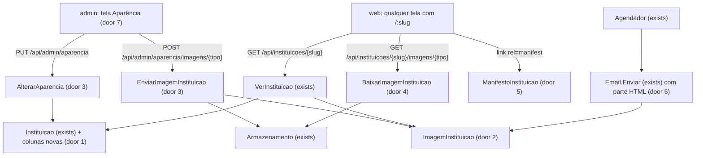
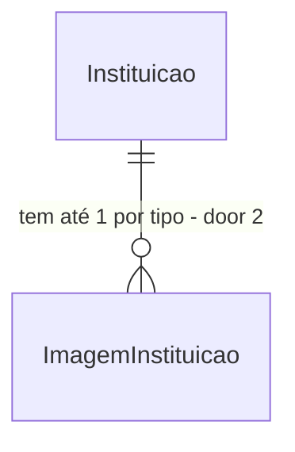

# Aparência da instituição e revisão visual

## Problem

Toda instituição vê o mesmo produto: a palavra "One", o mesmo azul (`oklch(0.45 0.15 262)`, AD-027), o
mesmo ícone de app e os mesmos textos no login. A Univag não consegue pôr o logo, a cor, uma foto do campus,
o nome do assistente ou o contato do atendimento sem mudar o código. Para quem vende o One a várias
instituições (AD-008), cada cliente novo parece usar um sistema de terceiros, e não o seu.

As telas também são só texto, cinza e azul. A auditoria de 04/11/2026 (15 telas a 390 px e a 1440 px, sem
rolagem horizontal em nenhuma) achou:
- Todo alerta (`ui/alert.tsx`) quebra a mensagem em uma palavra por linha, porque o texto cai na coluna de
  0 px do grid. "Há erros no arquivo." sai em 4 linhas em Matrículas, e isso afeta todas as mensagens de
  erro, aviso e sucesso.
- As listas vazias mostram uma linha cinza, o assistente sem conversa é uma tela em branco com uma frase, e a
  raiz `/` é um cartão com "One".
- No celular, os botões têm de 24 a 36 px de altura (abaixo dos 44 px de toque), e as tabelas espremem o
  título em 5 linhas numa coluna estreita.
- No detalhe do chamado, as ações ficam no fim de uma página de cerca de 1.900 px.
- O estado do chamado é sempre um selo cinza.

A fonte não traz números de uso. O pedido é do usuário, em 04/11/2026.

Depois desta feature:
- O administrador da instituição define numa tela "Aparência" o logo, o ícone do app, a cor, a imagem e os
  textos do login, o nome, a foto, as boas-vindas e as perguntas sugeridas do assistente, e o contato do
  atendimento. Login, app, e-mails e app instalado passam a mostrar a instituição.
- As telas ganham ilustrações próprias nos estados vazios, cores por estado e cartões no celular.
- Os alertas voltam a ser legíveis.

## Flow

Reaproveita o `Armazenamento` (MinIO) e a validação por assinatura de `Arquivos.Ler` para as imagens, a rota
pública `GET /api/instituicoes/{slug}` (`VerInstituicao`) como única fonte da aparência para o `web/`, o
`Agendador` e o `Email` que já enviam os e-mails, e os tokens de cor do `index.css`, que já pintam o app
inteiro a partir de `--primary`.

- O `web/` aplica a aparência num ponto só (placement), que lê `GET /api/instituicoes/{slug}` com o React
  Query. Ele põe `--marca` no `<html>` e troca `<title>`, `<link rel="icon">`, `apple-touch-icon`,
  `<meta name="theme-color">` e `<link rel="manifest">`. As telas leem dele o logo, os textos, o assistente
  e o contato.
- Antes e depois do login vale a mesma rota pública, então `/api/auth/me` (exists) não muda.

## Impact

| Front | What changes |
| --- | --- |
| domain | termo novo: `Aparência`, o conjunto do que a instituição personaliza (cor, textos, assistente, contato, imagens). Vive em `api/Instituicoes/` |
| domain | termo novo: `ImagemInstituicao`, uma imagem da instituição por `tipo` (`logo`, `icone`, `login`, `assistente`) |
| domain | termo existente: `Instituicao` ganha os campos da aparência. Quem lê `Instituicao` hoje (`VerInstituicao`, `Eu`, `Transferencia`, o comando `instituicao criar`) continua igual; todos os campos novos são opcionais |
| contrato | `GET /api/instituicoes/{slug}` ganha campos novos ao lado de `nome`. `nome` não muda |
| tokens | `--primary`, `--sidebar-primary`, `--primary-subtle` e `--ring` passam a derivar de `--marca` quando a instituição tem cor, nos temas Claro, Escuro e Preto. Sem cor, ficam com os valores de hoje (AD-027) |
| componentes | `ui/alert.tsx` (o bug), `ui/button.tsx`, `ui/input.tsx` e `ui/native-select.tsx` (altura no celular), `Tabela.tsx` (vazio ilustrado, esqueleto e cartões no celular). Mudam todas as telas que os usam |
| e-mail | todo e-mail passa a ir como `multipart/alternative`: o texto de hoje e uma parte HTML com a marca. O texto puro não muda, e os testes que o leem continuam |
| PWA | `index.html` e o `manifest` do `vite.config.ts` continuam como padrão do One. Com o `slug` conhecido, o `web/` troca os links para os da instituição |
| stored data | colunas novas em `instituicao`, todas anuláveis, e a tabela nova `imagem_instituicao`, por migração, sem nada a migrar. As instituições existentes ficam com a aparência padrão |
| decisão | amplia a AD-027: a cor padrão continua a de hoje, mas cada instituição pode trocá-la |

## Relations

Restrições de mão única:
- `ImagemInstituicao` é única por (`instituicao_id`, `tipo`). Trocar a imagem atualiza a linha com chave nova
  e versão nova. O objeto antigo fica no bucket versionado e nunca é apagado.
- `tipo` está no conjunto fechado `logo`, `icone`, `login`, `assistente` (door 2).
- Os campos de aparência de `Instituicao` são anuláveis (door 1).

Sem colunas e sem tipos aqui.

## Surface

| Route | In | Out | Status |
| --- | --- | --- | --- |
| `GET /api/instituicoes/{slug}` (anônima) | - | `nome` (sem mudança) · `nomeCurto` · `cor` · `login {titulo, frase, itens[]}` · `assistente {nome, boasVindas, perguntas[]}` · `contato {horario, telefone, email}` · `imagens {logo, icone, login, assistente}`, cada uma com a versão ou `null` | `200`, `404` |
| `GET /api/instituicoes/{slug}/imagens/{tipo}?v={versao}` (anônima) | - | os bytes da imagem, com `Content-Type` e `Cache-Control: public, max-age=31536000, immutable` | `200`, `404`, `503` |
| `GET /api/instituicoes/{slug}/manifest.webmanifest` (anônima) | - | manifesto `application/manifest+json` com `name`, `short_name`, `start_url`, `scope`, `display`, `theme_color`, `background_color` e `icons` | `200`, `404` |
| `GET /api/admin/aparencia` | - | a mesma forma da aparência de `GET /api/instituicoes/{slug}`, sem `nome` | `200`, `401`, `403` |
| `PUT /api/admin/aparencia` | `nomeCurto`, `cor`, `login {titulo, frase, itens[]}`, `assistente {nome, boasVindas, perguntas[]}`, `contato {horario, telefone, email}` | a aparência gravada | `200`, `400`, `401`, `403` |
| `POST /api/admin/aparencia/imagens/{tipo}` | multipart `arquivo` | `{tipo, versao}` | `200`, `400`, `401`, `403`, `404`, `413`, `415`, `503` |
| `DELETE /api/admin/aparencia/imagens/{tipo}` | - | - (volta ao padrão; o objeto fica no bucket) | `204`, `401`, `403`, `404` |

## Landing

| One-way door | Literal shape | Alternative rejected |
| --- | --- | --- |
| 1. Campos de aparência na tabela `instituicao` | colunas anuláveis em `instituicao`: `nome_curto`, `cor` (`#rrggbb`), `login_titulo`, `login_frase`, `login_itens text[]`, `assistente_nome`, `assistente_boas_vindas`, `assistente_perguntas text[]`, `contato_horario`, `contato_telefone`, `contato_email` | tabela `aparencia` 1:1: um `JOIN` a mais em toda leitura, para dados que só existem por instituição e que `Instituicao` já carrega. JSON numa coluna só: perde a validação por campo e o nome de coluna que a migração e os testes conferem |
| 2. Imagens numa tabela por tipo | `imagem_instituicao (id, instituicao_id, tipo, conteudo, tamanho, hash, chave, versao)`, com índice único `(instituicao_id, tipo)` e `tipo` em `logo`, `icone`, `login`, `assistente`; chave `{instituicaoId}/aparencia/{guid}` | 4 colunas de chave em `instituicao`: cada imagem precisa de chave, tipo de conteúdo, tamanho, hash e versão, e seriam 20 colunas |
| 3. Endpoints de admin da aparência | `GET` e `PUT /api/admin/aparencia`, `POST` e `DELETE /api/admin/aparencia/imagens/{tipo}`, no grupo `/admin` que já exige `ADMINISTRADOR`; a instituição vem do cookie, nunca da URL | `PUT /api/admin/instituicoes/{slug}`: o slug na URL abre a porta para um admin tentar outra instituição, e o grupo `/admin` já resolve a instituição pelo cookie |
| 4. Imagens públicas com versão na URL | `GET /api/instituicoes/{slug}/imagens/{tipo}?v={versao}` anônima, com `Cache-Control: public, max-age=31536000, immutable`; a versão sobe a cada envio | sem versão e com `no-cache`: o login de toda visita revalidaria 3 imagens. URL assinada do MinIO: expõe o MinIO ao navegador, o que a AD-021 evitou |
| 5. Manifesto por instituição | `GET /api/instituicoes/{slug}/manifest.webmanifest` com `start_url` `/{slug}/`, `scope` `/{slug}/`, `display` `standalone`, `icons` com o ícone da instituição em `192x192` e `512x512`, ou os ícones do One sem ícone; o `web/` troca o `href` de `<link rel="manifest">` | um build por instituição: contraria a AD-008, um deploy para todas |
| 6. E-mail em duas partes | `multipart/alternative` com o texto de hoje e um HTML com cabeçalho na cor da instituição e o logo inline (`cid:logo`), montado no envio a partir de `EmailSaida.Corpo`, que não muda | logo por URL pública: depende do domínio da API no e-mail, e muitos clientes bloqueiam imagem remota. Guardar o HTML na fila: duplica o corpo e congela a marca do dia em que foi enfileirado |
| 7. Tela nova `/:slug/aparencia` | link "Aparência" (ícone `Palette`) no grupo "Administração", só para `ADMINISTRADOR`; a prévia é uma réplica pequena do login e do balão do assistente com os valores do formulário antes de salvar | aba dentro de Cadastros: a tela tem formulário e imagens, e Cadastros é uma lista de tabelas |
| 8. Cor validada por contraste | `cor` aceita só `^#[0-9a-fA-F]{6}$` com contraste de pelo menos 4,5:1 contra o branco (WCAG 2.x, luminância relativa sRGB); no Escuro e no Preto, `--primary` é `color-mix(in oklch, var(--marca) 55%, white)` com texto `oklch(0.17 0 0)` | aceitar qualquer cor: o texto branco dos botões fica ilegível com amarelo ou verde-claro. Sintaxe de cor relativa (`oklch(from …)`): suporte mais novo; `color-mix` já é Baseline |
| 9. Ilustrações próprias | SVGs desenhados no repositório em `web/src/ilustracoes/`, só formas e ícones, pintados com `currentColor` e `var(--primary)`/`var(--primary-subtle)`, para pegar a cor da instituição | unDraw: a licença proíbe redistribuir os arquivos. Imagens rasterizadas: não pegam a cor da instituição e pesam no precache do PWA |

- Nada mais nesta mudança é difícil de reverter: os textos padrão, os limites de tamanho e o desenho das
  ilustrações são constantes

## Screens

O arranjo de cada tela que muda. A cor, o espaçamento e o peso de fonte seguem os tokens.

- **Login, Primeiro acesso, Criar senha (≥ 1024 px):** a grade `login-02` da AD-030 continua. O topo da coluna do
  formulário mostra o logo da instituição (até 40 px de altura) no lugar de "One"; sem logo, as iniciais num
  quadrado `bg-primary`. O painel direito mostra a imagem do login ocupando o painel inteiro (`object-cover`),
  com o título, a frase e os 3 itens sobre uma faixa escura na base. Sem imagem, mostra a ilustração `Boas-vindas`
  sobre `bg-primary-subtle`, com os textos embaixo.
- **Login e afins (< 1024 px):** acima do formulário, uma faixa de 128 px de altura com a imagem do login (ou a
  ilustração) e o logo; abaixo, o formulário como hoje.
- **Raiz `/`:** a ilustração `Boas-vindas`, o título "One", a frase de hoje e o texto para entrar pelo endereço
  da instituição.
- **Casca autenticada:** o cabeçalho da barra lateral mostra o ícone da instituição (32 px) no lugar das
  iniciais, ou o logo quando ela está aberta; sem imagem, as iniciais em `bg-primary`. No celular, o topo mostra o
  ícone (24 px) antes do título da tela.
- **Assistente sem conversa:** centralizados, a foto do assistente (64 px, redonda; sem foto, a ilustração
  `Conversa`), "Olá! Eu sou {nome}." e as boas-vindas, e abaixo até 4 perguntas sugeridas como botões em
  pílula, em grade de 1 coluna no celular e 2 no desktop. O compositor fica no fundo, como hoje.
- **Assistente com conversa:** o balão do assistente ganha a foto (24 px) à esquerda, ou nada sem foto.
- **Transferido:** abaixo do número do chamado, o bloco "Contato do atendimento" com horário, telefone (link
  `tel:`) e e-mail (link `mailto:`), só com os campos preenchidos.
- **Menu (barra lateral e gaveta):** quando há contato, um item "Contato" no rodapé, acima do usuário, que abre um
  `Dialog` com os mesmos 3 campos.
- **Listas (Fila, Minhas solicitações, Artigos, Documentos, Usuários, Cadastros):**
  - Carregando: 3 linhas de `Skeleton`.
  - Vazio: a ilustração da lista (`CaixaVazia`, `Documento` ou `Pessoas`), um título, uma frase e, quando a
    lista tem, o botão de ação.
  - Abaixo de 768 px, cada linha vira um cartão: na primeira linha o número ou nome à esquerda e o selo de
    estado à direita; o título embaixo; o detalhe em `text-xs`; o menu de ações no canto.
- **Detalhe do chamado (< 1024 px):** uma barra fixa no rodapé com o botão "Ações" (altura 44 px), que abre um
  `Sheet` de baixo com o mesmo cartão de ações de hoje. A partir de 1024 px, como hoje.
- **Indicadores:** as frases dos destaques quebram linha em vez de cortar. Os rótulos das barras quebram em
  até 2 linhas. Sem dados no período, a ilustração `Grafico` com "Sem atendimentos neste período".
- **Cadastros (< 768 px):** o seletor de lista e o botão "Novo" na mesma linha.
- **Aparência (nova):** em ≥ 1024 px, duas colunas: o formulário à esquerda, com as seções "Marca", "Login",
  "Assistente" e "Contato" e um botão "Salvar" ao fim, e a prévia fixa à direita. Abaixo de 1024 px, a prévia
  vem acima do formulário e pode ser recolhida. Cada imagem tem a miniatura, "Enviar imagem" e "Remover".

## Criteria

### S1: Alertas legíveis e toque confortável no celular (P1)

Correções que valem para todas as telas.

**Acceptance Criteria**

1. The system SHALL renderizar o texto de todo `Alert` numa coluna de largura total quando não há ícone, de modo que "Há erros no arquivo." caiba em 1 linha a 390 px
2. WHILE a largura da janela é menor que 768 px, o sistema SHALL dar pelo menos 44 px de altura a todo `Button`, `Input`, `NativeSelect` e ao botão do menu de ações da `Tabela`
3. The system SHALL pintar o selo de estado do chamado por grupo: `ABERTO` e `EM_ATENDIMENTO` em `primary-subtle`; `AGUARDANDO_ALUNO` em `warning-subtle`; `RESOLVIDO` e `FECHADO` em verde-claro de `success`; o texto do selo continua o de hoje
4. WHEN uma lista está carregando THEN a `Tabela` SHALL mostrar 3 linhas de `Skeleton` no lugar do `Spinner`
5. The system SHALL mostrar a frase de cada destaque de Indicadores inteira, quebrando linha, sem reticências, e os rótulos das barras em até 2 linhas, sem reticências
6. WHILE a largura é menor que 768 px, Cadastros SHALL mostrar o seletor de lista e o botão "Novo" na mesma linha

**Independent test:** a 390 px, provocar o erro de Matrículas e ver a mensagem em 1 linha; medir a altura dos botões.

### S2: Listas e chamado pensados para o celular (P1)

As listas viram cartões e as ações do chamado ficam ao alcance do polegar.

**Acceptance Criteria**

7. WHILE a largura é menor que 768 px, cada linha da `Tabela` SHALL virar um cartão com a primeira coluna e o selo de estado na primeira linha, a coluna principal embaixo e o detalhe em texto pequeno, sem `<table>` visível
8. WHILE a largura é menor que 1024 px, o detalhe do chamado SHALL mostrar uma barra fixa no rodapé com o botão "Ações" de 44 px, que abre um `Sheet` de baixo com as mesmas ações do cartão de hoje
9. WHEN uma ação do `Sheet` é concluída THEN o sistema SHALL fechar o `Sheet` e mostrar o chamado atualizado
10. The system SHALL manter Fila, Minhas solicitações, Artigos, Documentos, Usuários, Cadastros e o detalhe do chamado sem rolagem horizontal a 360 px

**Independent test:** a 390 px, abrir a Fila e ver cartões; abrir um chamado e assumir pelo botão "Ações".

### S3: A tela Aparência (P1)

O administrador define a aparência e vê a prévia antes de salvar.

**Acceptance Criteria**

11. WHEN um `ADMINISTRADOR` pede `GET /api/admin/aparencia` THEN o sistema SHALL devolver `200` com `nomeCurto`, `cor`, `login`, `assistente`, `contato` e `imagens` da sua instituição, com `null` nos campos não definidos
12. WHEN um `ADMINISTRADOR` envia `PUT /api/admin/aparencia` válido THEN o sistema SHALL gravar os campos na sua instituição e devolver `200` com a aparência gravada; campo ausente ou `null` volta ao padrão
13. IF `cor` não casa com `^#[0-9a-fA-F]{6}$` ou tem contraste menor que 4,5:1 contra o branco THEN o sistema SHALL responder `400` no campo `cor` "Escolha uma cor mais escura: o texto branco precisa de contraste 4,5:1 sobre ela." sem gravar nada
14. IF um texto passa do limite (`nomeCurto` 12, `login.titulo` 60, `login.frase` 160, cada `login.itens` 80 e no máximo 3, `assistente.nome` 40, `assistente.boasVindas` 300, cada `assistente.perguntas` 100 e no máximo 4, `contato.horario` 120, `contato.telefone` 30, `contato.email` 120) ou `contato.email` não é um e-mail válido THEN o sistema SHALL responder `400` no campo, com o limite no texto, sem gravar nada
15. WHEN um `ADMINISTRADOR` envia `POST /api/admin/aparencia/imagens/{tipo}` com uma imagem válida THEN o sistema SHALL gravar o objeto em `{instituicaoId}/aparencia/{guid}`, gravar ou atualizar a `ImagemInstituicao` daquele tipo com versão nova, e devolver `200` com `{tipo, versao}`
16. IF a imagem não é PNG nem JPEG pela assinatura (o `icone` só PNG) THEN o sistema SHALL responder `415` sem gravar nada
17. IF a imagem passa do limite (`logo` 1 MB, `icone` 1 MB, `assistente` 1 MB, `login` 3 MB) THEN o sistema SHALL responder `413` sem gravar nada
18. IF o `icone` não é quadrado ou tem lado menor que 512 px, pelo cabeçalho `IHDR` do PNG, THEN o sistema SHALL responder `400` "O ícone deve ser um PNG quadrado de pelo menos 512 px." sem gravar nada
19. IF `{tipo}` não é `logo`, `icone`, `login` nem `assistente` THEN o sistema SHALL responder `404`
20. IF o MinIO está fora ao gravar THEN o sistema SHALL responder `503` sem mudar a `ImagemInstituicao`
21. WHEN um `ADMINISTRADOR` pede `DELETE /api/admin/aparencia/imagens/{tipo}` THEN o sistema SHALL apagar a linha daquele tipo, deixar o objeto no bucket e responder `204`; sem linha, `404`
22. IF quem chama as rotas de `/api/admin/aparencia` não é `ADMINISTRADOR` THEN o sistema SHALL responder `403`, e sem sessão, `401`
23. The system SHALL mostrar o link "Aparência" no grupo "Administração" da barra lateral e da gaveta só para `ADMINISTRADOR`
24. WHEN o admin muda um campo na tela Aparência THEN a prévia SHALL mostrar o valor novo antes de salvar: a cor nos botões, o logo, a imagem e os textos do login, e o nome, a foto e as boas-vindas do assistente
25. WHEN o admin salva THEN a tela SHALL mostrar "Aparência salva." e a aparência nova SHALL valer no app sem recarregar a página
26. IF a API recusa (`400`, `413`, `415`, `503`) THEN a tela SHALL mostrar o texto da API no campo ou no alerta, sem perder o que foi digitado
27. The system SHALL mostrar na tela Aparência, ao lado do campo de cor, a cor como amostra e o contraste calculado contra o branco, e SHALL desabilitar "Salvar" enquanto o contraste for menor que 4,5:1

**Independent test:** entrar como admin, trocar a cor e enviar um logo, ver a prévia mudar, salvar e ver a barra lateral com o logo.

### S4: A marca da instituição no app (P1)

Login, casca, aba do navegador e cor passam a ser os da instituição.

**Acceptance Criteria**

28. WHEN alguém pede `GET /api/instituicoes/{slug}` de uma instituição ativa THEN o sistema SHALL devolver `200` com `nome` como hoje e os campos da aparência, com `imagens.{tipo}` igual à versão atual ou `null`
29. WHEN alguém pede `GET /api/instituicoes/{slug}/imagens/{tipo}?v={versao}` de uma imagem que existe THEN o sistema SHALL devolver `200` com os bytes, `Content-Type` do arquivo e `Cache-Control: public, max-age=31536000, immutable`, sem sessão
30. IF a instituição não existe, está inativa ou não tem imagem daquele tipo THEN a rota de imagem SHALL responder `404`; IF o MinIO está fora THEN `503`
31. WHERE a instituição tem `cor`, o `web/` SHALL pôr `--marca` no `<html>` com essa cor, e `--primary`, `--sidebar-primary`, `--primary-subtle` e `--ring` SHALL derivar dela nos temas Claro, Escuro e Preto; sem `cor`, os tokens SHALL ficar com os valores de hoje
32. WHERE a instituição tem `logo`, as telas de acesso SHALL mostrar o logo no topo do formulário com `alt` igual ao nome da instituição, e a barra lateral aberta SHALL mostrar o logo no cabeçalho
33. WHERE a instituição tem `icone`, o `web/` SHALL usar o ícone em `<link rel="icon">`, em `apple-touch-icon`, na barra lateral recolhida e no topo do celular; sem ícone, as iniciais em `bg-primary`
34. The system SHALL pôr em `<title>` o `nomeCurto` da instituição (ou o `nome`, sem `nomeCurto`) nas telas com `slug`, e em `<meta name="theme-color">` a cor da instituição
35. WHERE a instituição tem imagem de `login`, as telas de acesso SHALL mostrar a imagem no painel direito a partir de 1024 px e numa faixa de 128 px acima do formulário abaixo de 1024 px, com `alt=""` (decorativa)
36. The system SHALL mostrar no painel do login o `login.titulo`, a `login.frase` e os `login.itens` da instituição, ou os textos de hoje para os campos não definidos ("Atendimento ao estudante", a frase de hoje e os 3 itens de hoje)
37. The system SHALL mostrar na raiz `/` a ilustração `Boas-vindas` acima do título "One"

**Independent test:** com uma instituição com cor, logo, ícone e imagem, abrir o login no celular e no desktop e conferir a aba do navegador.

### S5: Assistente com identidade e contato do atendimento (P1)

O aluno sabe com quem fala, tem por onde começar, e sabe como falar com a instituição.

**Acceptance Criteria**

38. WHILE o assistente não tem conversa, a tela SHALL mostrar a foto do assistente (ou a ilustração `Conversa`), "Olá! Eu sou {assistente.nome}." (com "Assistente" sem nome definido), as `assistente.boasVindas` (ou o texto de exemplo de hoje) e um botão por pergunta sugerida
39. WHERE a instituição não definiu perguntas, a tela SHALL mostrar como sugestões "Como emito o boleto do semestre?" e "Posso abonar falta com atestado?"
40. WHEN o aluno toca numa pergunta sugerida THEN o sistema SHALL enviar a pergunta como a primeira mensagem da conversa, como se ele a tivesse digitado
41. WHERE a instituição tem foto do assistente, cada balão do assistente SHALL mostrar a foto de 24 px à esquerda, com `alt` igual ao nome do assistente
42. WHERE a instituição tem algum campo de contato, a tela "Transferido" SHALL mostrar "Contato do atendimento" com o horário, o telefone como link `tel:` e o e-mail como link `mailto:`, só com os campos preenchidos
43. WHERE a instituição tem algum campo de contato, o menu SHALL ter o item "Contato", que abre um diálogo com os mesmos campos; sem contato, o item não aparece

**Independent test:** com nome, foto, boas-vindas, 4 perguntas e contato definidos, entrar como aluno, tocar numa pergunta, pedir atendente e ver o contato.

### S6: Ilustrações nos estados vazios (P2)

A tela vazia diz o que fazer em vez de ficar em branco.

**Acceptance Criteria**

44. The system SHALL desenhar as ilustrações `Boas-vindas`, `Conversa`, `CaixaVazia`, `Documento`, `Pessoas` e `Grafico` como SVG inline com `aria-hidden="true"`, pintadas só por `currentColor`, `var(--primary)` e `var(--primary-subtle)`
45. WHEN uma lista não tem itens THEN a `Tabela` SHALL mostrar a ilustração da lista, o título e a frase abaixo, e o botão de ação quando a lista tem:
    - Fila: `CaixaVazia`, "Fila em dia" e "Nenhum chamado na fila dos seus setores.";
    - Minhas solicitações: `CaixaVazia`, "Nenhuma solicitação" e o texto de hoje, com o botão "Falar com o assistente";
    - Artigos: `Documento`, "Nenhum artigo" e "Os artigos são a base das respostas do assistente.", com o botão "Novo artigo";
    - Documentos: `Documento`, "Nenhum documento" e "PDFs como regulamentos e calendários também alimentam o assistente.", com o botão "Novo documento";
    - Usuários: `Pessoas`, "Nenhum usuário" e "Cadastre a equipe ou importe as matrículas.";
    - Cadastros: `CaixaVazia`, "Nada cadastrado" e o texto de hoje.
46. WHEN Indicadores não tem atendimento no período THEN a tela SHALL mostrar a ilustração `Grafico` e "Sem atendimentos neste período."
47. The system SHALL usar a ilustração `Boas-vindas` nas telas de acesso quando a instituição não tem imagem de login (AC 35)

**Independent test:** numa instituição nova, abrir cada lista como admin e ver a ilustração e o botão.

### S7: E-mails com a marca (P2)

O aluno reconhece a instituição no e-mail.

**Acceptance Criteria**

48. WHEN o `Agendador` envia um `EmailSaida` THEN o sistema SHALL mandar `multipart/alternative` com a parte `text/plain` igual a `EmailSaida.Corpo` e uma parte `text/html`
49. The system SHALL montar a parte HTML com um cabeçalho de fundo na cor da instituição (ou `#224fa7` sem cor), com o logo inline `cid:logo` quando a instituição tem logo e o nome da instituição em texto, e o corpo com cada linha de `Corpo` escapada como HTML
50. IF o MinIO está fora ao ler o logo para o e-mail THEN o sistema SHALL mandar o e-mail sem o logo, com o nome em texto, e não adiar o envio

**Independent test:** no Mailpit, abrir o e-mail de primeiro acesso e ver o cabeçalho com logo e cor.

### S8: App instalado com a marca (P2)

No celular, o app instalado tem o nome e o ícone da instituição.

**Acceptance Criteria**

51. WHEN alguém pede `GET /api/instituicoes/{slug}/manifest.webmanifest` THEN o sistema SHALL devolver `200` com `Content-Type: application/manifest+json` e `name` igual ao `nome`, `short_name` igual ao `nomeCurto` (ou às iniciais do nome), `start_url` e `scope` `/{slug}/`, `display` `standalone`, `theme_color` igual à cor (ou `#224fa7`), `background_color` `#ffffff` e `icons` com o ícone da instituição em `192x192` e `512x512` (ou os 2 ícones do One sem ícone)
52. IF a instituição não existe ou está inativa THEN o manifesto SHALL responder `404`
53. WHEN uma tela com `slug` carrega THEN o `web/` SHALL trocar o `href` de `<link rel="manifest">` para `/api/instituicoes/{slug}/manifest.webmanifest`

**Independent test:** no Chrome, abrir `/univag` e ver no painel Application o manifesto com o nome e o ícone da instituição.

## Out of scope

| Excluded | Why |
| --- | --- |
| Logo em SVG | um SVG enviado pelo admin e servido pela mesma origem pode carregar script; PNG e JPEG bastam |
| Recortar ou redimensionar imagem no servidor | exigiria uma biblioteca de imagem nova; o navegador ajusta com `object-cover`/`object-contain`, e o ícone já chega quadrado |
| Fonte, raio dos cantos e mais de uma cor | cada um multiplica as combinações a testar; a cor principal já leva a marca |
| Nome do assistente no prompt da IA | o nome aparece só na tela; mudar o prompt mexe nos testes do RAG e no comportamento conferido |
| Domínio próprio por instituição | infraestrutura; continua `/{slug}` (AD-008) |
| Tema por instituição (forçar Escuro) | o tema continua escolha do usuário (AD-027) |
| Revisão do tema Escuro e Preto além da cor | a auditoria cobriu só o Claro; os tokens novos valem nos três (AC 31) |

## Assumptions

| Assumption | Chosen default | Rationale | Confirmed? |
| --- | --- | --- | --- |
| Quem edita a aparência | o `ADMINISTRADOR` da instituição, na tela nova | a pergunta ao usuário propôs a tela "Aparência" com prévia, e ele escolheu os itens sem objetar | n |
| Logo × ícone | duas imagens: o logo (qualquer proporção) para cabeçalhos e o ícone (PNG quadrado ≥ 512 px) para aba, app instalado e barra recolhida | um logo largo não vira ícone de app; recortar no servidor ficou fora | n |
| Mistura do Escuro | `color-mix(in oklch, var(--marca) 55%, white)` | a cor mais escura aceita (contraste 4,5:1 com o branco) fica perto da luminosidade do azul do Escuro de hoje (`0.72`) | n |
| Ilustrações | 6 SVGs próprios, simples, com ícones e formas | decisão do usuário ("Próprias e simples") | y |
| Itens personalizáveis | logo, cor, imagem e textos do login, assistente, e-mails, app instalado, contato | decisão do usuário em 04/11 | y |
| Perfil de verificação | `ui` | a feature muda 15 telas e cria uma; o Verifier enumera arranjo e textos por tela | n |

**Open questions:** none - all resolved or logged above.

## Observable

| Surface | Decision | Landing |
| --- | --- | --- |
| tela Aparência | vazio (instituição sem aparência) | AC 11: campos `null`, a prévia mostra o padrão (AC 24) |
| tela Aparência | carregando | existing - o padrão `Situacao`/`Skeleton` das telas de admin |
| tela Aparência | erro | AC 26 |
| tela Aparência | não autorizado | AC 22 e AC 23 |
| tela Aparência | ação destrutiva confirma | AC 21: "Remover" imagem pede confirmação no `Confirmar` que já existe |
| listas | vazio, carregando | AC 45, AC 4 |
| listas | densidade e ordem no celular | AC 7 |
| detalhe do chamado | ações no celular | AC 8, AC 9 |
| Assistente | vazio | AC 38, AC 39 |
| telas de acesso | sem imagem nem logo | AC 33, AC 36, AC 47 |
| `GET /api/instituicoes/{slug}*` | quem chama | anônima, como a de hoje; só instituição ativa (AC 30, AC 52) |
| `GET /api/instituicoes/{slug}/imagens/{tipo}` | limite de taxa | n/a - imagens com cache `immutable` e versão na URL; a política global atual vale |
| `/api/admin/aparencia*` | forma e códigos de erro | AC 13 a AC 22, no formato `Problemas` |
| todas as rotas novas | versionamento | n/a - consumidas só pelo `web/` deste repositório e por navegadores (manifesto, imagens) |
| e-mail | estrutura e o que o leitor faz | AC 48, AC 49: o mesmo texto de hoje, com a marca |
| manifesto | erro | AC 52 |

## Sources

- Pedido do usuário em 04/11/2026 e as respostas: os itens personalizáveis e as ilustrações próprias
- Auditoria de design de 04/11/2026 (15 telas a 390 e 1440 px): os achados do `## Problem` e das slices S1, S2 e S6
- `.specs/STATE.md` AD-008, AD-021, AD-027, AD-029, AD-030: multi-instituição, MinIO, tokens e temas, casca, login
