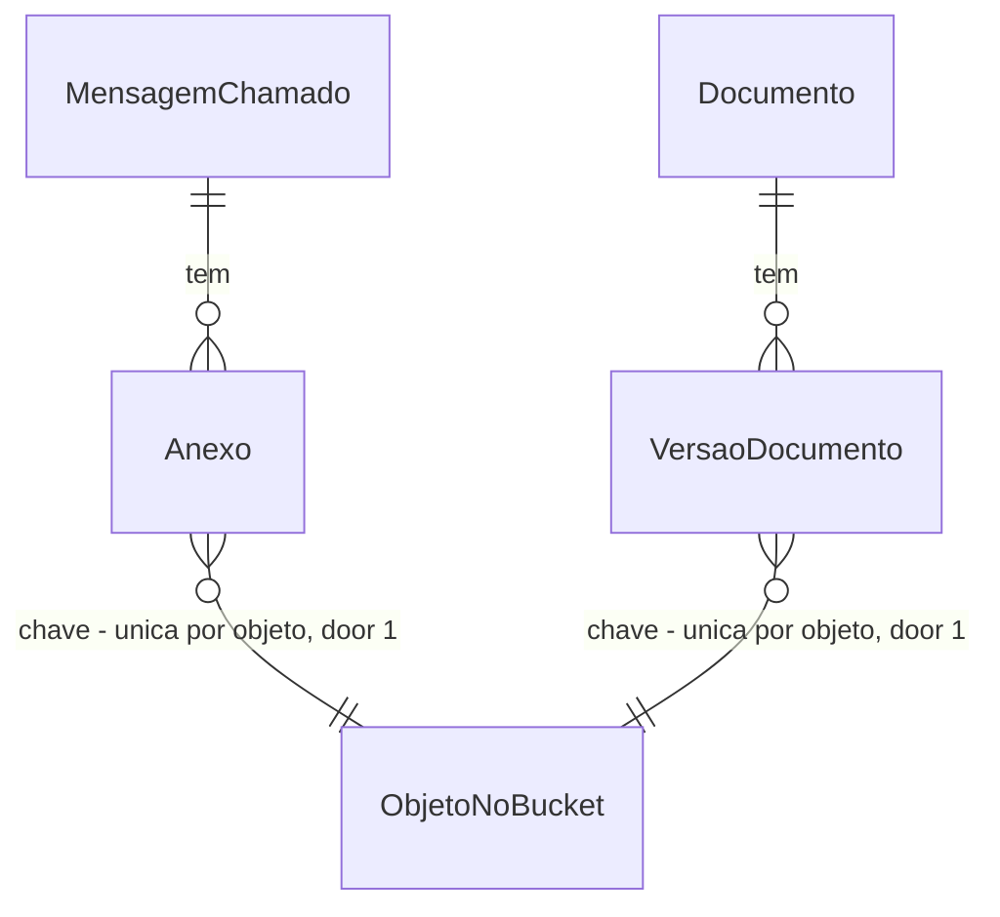

# Arquivos no MinIO (AD-021)

## Problem

Hoje os anexos de chamado (até 10 MB) e os PDFs da instituição (até 20 MB) moram dentro do PostgreSQL, em colunas `bytea` (door 13 do `mvp-one`):

- **o arquivo infla o banco e o backup**: cada anexo e cada versão de PDF entra na mesma tabela que as linhas de negócio. Um PDF de 20 MB lido em consulta traz 20 MB junto com a linha;
- **o download lê o arquivo inteiro na memória**: `BaixarAnexo` e `BaixarVersaoDocumento` fazem `Select` do `byte[]` e devolvem `Results.File(byte[])`. Há um `shortcut:` em `api/Dados/Entidades.cs` que registra isso como dívida;
- **o banco não sabe se o arquivo é o que foi enviado**: não há hash gravado; `Tamanho` existe só no anexo.

Quem paga: a operação (backup e memória do servidor) e a banca de 03–05/11, que avalia a arquitetura. O usuário decidiu em 02/11 (AD-021) trazer a troca para antes da banca: "será trago pra antes da banca todos os assuntos discutidos". Não há falha em produção: não há produção.

**O que muda quando isto estiver pronto:**
- os bytes de anexos e PDFs ficam num bucket MinIO (API S3) do `docker-compose.yml`; o banco guarda só chave, hash e tamanho;
- o caminho do objeto começa pela instituição, e o bucket tem versionamento ligado;
- para o aluno, o atendente e o administrador nada muda: rotas, status, corpos JSON e bytes baixados ficam iguais, e os retratos e os testes de download provam. A única novidade visível é um 503 quando o armazenamento está fora do ar.

## Flow

Reusa as duas rotas de download e os dois casos de envio como estão (mesmas rotas, mesma checagem de acesso ao chamado, mesmo filtro de instituição do `OneDb`), o `Arquivos.Ler` (valida tamanho e tipo pela assinatura e já entrega os bytes em memória), o `Problemas` como única fonte de erro e a rede de segurança da `dominio-e-contratos` (`RetratoTests`, `ArquiteturaTests`). A decisão de armazenamento é: **download por streaming pela API**, não URL pré-assinada.

Anexo, `POST /api/chamados/{numero}/mensagens` (PDF de instituição é igual, em `CriarDocumento` e `NovaVersaoDocumento`):

1. requisição -> `Program`, `Sessao.Validar` e `AgirNoChamado` (exists) - cookie, instituição, 404/403/400/409 como hoje
2. `ResponderChamado` (exists) - `Arquivos.Ler` valida e devolve os bytes; a validação não muda
3. `ResponderChamadoHandler` (exists) - para cada arquivo chama `Armazenamento.Gravar` (door 2), que calcula o SHA-256, grava o objeto em `{instituicaoId}/anexos/{guid}` e devolve chave e hash; monta `Anexo` com chave, hash e tamanho (door 1) e o entrega a `Chamado.ResponderComoAluno`/`ResponderComoEquipe`/`Rejeitar` (exists, domínio sem mudança de forma)
4. `AgirNoChamado` (exists) - um `SaveChangesAsync` grava mensagem, eventos e anexos; os bytes já estão no bucket
5. out: o mesmo `DetalheChamado` (exists), que lista nome, tipo e tamanho do anexo, sem chave nem hash

Download, `GET /api/anexos/{id}` e `GET /api/documentos/versoes/{id}`:

1. `BaixarAnexo`/`BaixarVersaoDocumento` (exists) - consulta a linha pelo `OneDb` (filtro de instituição) e checa o acesso ao chamado como hoje; lê chave, nome, tipo e tamanho, nunca bytes
2. `Armazenamento.Baixar` (door 2) - abre o objeto pela chave que veio do banco
3. out: `Results.Stream` com o mesmo tipo, nome de download e `Content-Length` de hoje, 200

Na subida: `Program` (exists) chama `Armazenamento.Preparar` (door 2) depois do `Migrate`: cria o bucket se não existe e liga o versionamento.

## Impact

| Front | What changes |
| --- | --- |
| domain | termo existente: `Anexo` e `VersaoDocumento` tinham `Conteudo` (os bytes); passam a ter chave e hash e nenhum byte. Quem lê: `BaixarAnexo`, `BaixarVersaoDocumento`, `ResponderChamado`, `DocumentoRotas.Versao`, `Chamado` (só repassa a coleção), `DetalheChamado` (lê nome, tipo, tamanho e não muda) |
| domain | termo novo: `Armazenamento` - o único código que fala com o MinIO (`Gravar`, `Baixar`, `Preparar`); vive em `api/Armazenamento.cs` na raiz do `api/` (código compartilhado fica só em `api/Dados/` e na raiz, AD-017) |
| código | 2 casos de envio de PDF (`CriarDocumento`, `NovaVersaoDocumento`) e 1 de anexo (`ResponderChamado`) chamam `Armazenamento.Gravar`; 2 de download trocam `Results.File(byte[])` por `Results.Stream`. `Arquivos.Ler` e o domínio do `Chamado` não mudam |
| testes | `OneFactory` ganha as configurações do MinIO e um bucket por instância; testes que liam `Conteudo` (`EmailAnexoTests`, `ChamadoDominioTests`, `DocumentoDominioTests`, `AvaliarBuscaTests`) passam a usar chave e hash e a ler o objeto pelo `Armazenamento` |
| infra | `docker-compose.yml` ganha o serviço `minio` e o volume dele; `api` passa a depender dele. `Dockerfile` não muda |
| stored data | uma migração troca as colunas de bytes por chave e hash nas duas tabelas e **recusa rodar se houver linha**; não há cópia dos bytes antigos (door 1, e a razão em Assumptions) |
| AD-021 | `planned` -> `active` em `.specs/STATE.md`, com a decisão de streaming e versionamento; door 13 do `mvp-one` fica superseded |

## Relations

One-way constraints: a chave é obrigatória e única em cada tabela (door 1) e o hash é obrigatório (door 1). `ObjetoNoBucket` não é tabela: é o objeto no MinIO, imutável depois de gravado. Sem colunas e sem tipos aqui.

## Surface

Nenhuma rota nova e nenhum corpo muda. As quatro rotas abaixo ganham um status novo, o 503, para armazenamento fora do ar; os demais status ficam como estão.

| Route | In | Out | Status |
| --- | --- | --- | --- |
| `POST /api/chamados/{numero}/mensagens` | corpo de hoje, com `anexos` | o `DetalheChamado` de hoje | `503` novo; os de hoje seguem |
| `POST /api/admin/documentos` | corpo de hoje, com `arquivo` | o corpo de hoje | `503` novo; os de hoje seguem |
| `POST /api/admin/documentos/{id}/versoes` | corpo de hoje, com `arquivo` | o corpo de hoje | `503` novo; os de hoje seguem |
| `GET /api/anexos/{id}` | `id` | os bytes do anexo, `Content-Type` e nome de hoje | `503` novo, `404` e `200` como hoje |
| `GET /api/documentos/versoes/{id}` | `id` | os bytes do PDF, `application/pdf` e nome de hoje | `503` novo, `404` e `200` como hoje |

## Landing

| One-way door | Literal shape | Alternative rejected |
| --- | --- | --- |
| 1. Esquema: o banco guarda chave, hash e tamanho, nenhum byte | em `Anexo` e `VersaoDocumento`: `Conteudo` (bytes) sai; entram `Chave` (texto, obrigatória, índice único) e `Hash` (SHA-256 em hexadecimal minúsculo, 64 caracteres, obrigatório); `Anexo.Tamanho` já existe e `VersaoDocumento` ganha o tamanho dos bytes se não o tiver. A migração `ArquivosMinio` começa com um guarda que lança erro se alguma das duas tabelas tem linha | (a) coluna `Chave` anulável com a linha antiga: deixaria linha sem arquivo respondendo 200 vazio ou 500, e o nulo numa tabela populada é migração dependente de dados. (b) migração mais comando de cópia dos bytes antigos para o MinIO: código único para dados que só existem em desenvolvimento e teste, ver Assumptions |
| 2. Dependência e forma do código: `AWSSDK.S3` 4.x e uma classe concreta `Armazenamento` | `<PackageReference Include="AWSSDK.S3" Version="4.*" />` (versão exata fixada no build); `IAmazonS3` singleton criado com `ServiceURL` do compose, `ForcePathStyle = true`, `RequestChecksumCalculation = WHEN_REQUIRED` e `ResponseChecksumValidation = WHEN_REQUIRED`; `Armazenamento` com `Gravar(instituicaoId, tipo, bytes)`, `Baixar(chave)` e `Preparar()`; sem interface, sem repositório | (a) SDK `Minio` (terceiros): amarra o código ao MinIO, enquanto o `AWSSDK.S3` fala S3 com qualquer implementação, inclusive a AWS em hospedagem. (b) interface `IArmazenamento` com uma implementação real e um falso: os testes conseguem rodar contra o MinIO do compose, então o falso só testaria a si mesmo. (c) URL pré-assinada: o navegador falaria direto com o MinIO, fora do filtro de instituição e do cookie, e as rotas de download deixariam de ser as de hoje |
| 3. Chave do objeto: prefixo da instituição, tipo, identificador aleatório | `{instituicaoId}/anexos/{guid-N}` e `{instituicaoId}/documentos/{guid-N}`; a chave é opaca, nasce no servidor e nunca vem do cliente | (a) usar o `Id` da linha ou o nome do arquivo: o `Id` só existe depois do `SaveChanges`, o que obriga gravar no bucket depois do banco; o nome do arquivo repete e vem do usuário. (b) prefixo pelo `slug` da instituição: o `slug` aparece na URL e pode mudar; o `Id` não |
| 4. Append-only do bucket: versionamento ligado, sem código que apague | `Preparar` cria o bucket se falta e chama `PutBucketVersioning` com `VersioningConfig.Status = Enabled`; o código do `api/` não chama `DeleteObject` nem `DeleteObjects` (regra em `ArquiteturaTests`) | object lock (modo de retenção): precisa ser ligado na criação do bucket, impede apagar também o resíduo de uma requisição que falhou e o bucket dos testes, e a retenção em dev vira dor sem ganho; fica como passo de produção, ver Out of scope |
| 5. Serviço no compose | serviço `minio` com a imagem `cgr.dev/chainguard/minio` fixada por digest (decisão do usuário em 02/11/2026; a `minio/minio` comunitária deixou de ser publicada), `server /data --console-address ":9001"`, portas 9000 e 9001, volume `miniodata`, `MINIO_ROOT_USER`/`MINIO_ROOT_PASSWORD` de desenvolvimento no mesmo estilo do postgres, healthcheck, e `api` com `depends_on` em `service_healthy`; chaves `Armazenamento__Endpoint`, `__Chave`, `__Segredo`, `__Bucket` | subir o MinIO só nos testes (Testcontainers): é dependência nova e outro jeito de subir serviço, quando o `OneFactory` já usa o PostgreSQL e o Mailpit do compose |

- Nada mais nesta mudança é difícil de reverter: a classe `Armazenamento` e os nomes das chaves de configuração se trocam em um commit

## Criteria

### S1: o anexo enviado vai para o bucket e o banco guarda só a referência (P1)

Quem responde um chamado com anexo continua recebendo o mesmo `DetalheChamado`, mas o arquivo está no MinIO.

**Acceptance Criteria**

1. WHEN uma resposta de chamado traz um anexo válido THEN the system SHALL gravar o objeto no bucket com a chave `{instituicaoId}/anexos/{guid}` e gravar na linha do `Anexo` a chave, o SHA-256 em hexadecimal dos bytes e o tamanho em bytes
2. The system SHALL NOT gravar bytes do arquivo em nenhuma coluna de `Anexo` ou de `VersaoDocumento`
3. WHEN a resposta traz um anexo THEN the system SHALL devolver o `DetalheChamado` com os mesmos membros de hoje (`Id`, `Nome`, `Tipo`, `Tamanho`) e sem `Chave` nem `Hash`
4. IF a resposta é recusada antes da gravação (nota com anexo, tipo diferente de PDF/JPG/PNG, mais de 10 MB, estado que não aceita) THEN the system SHALL manter a mesma recusa e o mesmo status de hoje e NOT gravar objeto no bucket

**Independent test:** enviar um PNG por `POST .../mensagens`, ler a linha no banco (chave, hash, tamanho) e o objeto no bucket pela chave; os bytes do objeto têm o SHA-256 gravado.

### S2: o download devolve os mesmos bytes pela mesma rota e só a quem já podia (P1)

O aluno e a equipe baixam o anexo como antes, e o isolamento entre instituições continua valendo.

**Acceptance Criteria**

5. WHEN quem tem acesso ao chamado pede `GET /api/anexos/{id}` THEN the system SHALL responder 200 com os bytes enviados, o `Content-Type` do anexo, o nome de download do anexo e `Content-Length` igual ao `Tamanho`
6. IF o anexo não existe, é de outra instituição ou é de um chamado que o usuário não vê THEN the system SHALL responder 404 "Anexo não encontrado." sem abrir objeto no bucket
7. The system SHALL obter a chave do objeto sempre da linha lida pelo `OneDb` com o filtro de instituição, e NOT aceitar chave, caminho ou nome de objeto vindos da requisição
8. WHEN `GET /api/documentos/versoes/{id}` é pedido por quem já podia THEN the system SHALL responder 200 com os bytes do PDF enviado e `Content-Type` `application/pdf`
9. WHEN um arquivo de 10 MB é baixado THEN the system SHALL entregá-lo ao cliente sem carregar o `byte[]` inteiro na memória da API

**Independent test:** baixar um anexo como aluno e como atendente da mesma instituição (bytes iguais) e como atendente de outra (404).

### S3: PDFs da instituição vão para o bucket e o texto continua no banco (P1)

O administrador cria um documento ou sobe uma nova versão como antes; a busca da IA não muda.

**Acceptance Criteria**

10. WHEN o administrador cria um documento ou sobe uma nova versão com PDF válido THEN the system SHALL gravar o objeto em `{instituicaoId}/documentos/{guid}` e gravar na `VersaoDocumento` a chave, o SHA-256 e o tamanho, mantendo `Texto`, `Paginas` e `NomeArquivo` como hoje
11. WHEN um PDF é recusado (mais de 20 MB, não é PDF, sem texto, ilegível) THEN the system SHALL manter a recusa e o status de hoje e NOT gravar objeto no bucket
12. WHEN uma nova versão é enviada THEN the system SHALL manter o objeto da versão anterior intacto no bucket

**Independent test:** criar documento e subir versão 2; os dois objetos existem, e o download de cada versão devolve o PDF dela.

### S4: armazenamento fora do ar é recusado de forma clara e não deixa linha sem arquivo (P1)

**Acceptance Criteria**

13. IF a gravação do objeto falha (MinIO inacessível, erro do bucket) THEN the system SHALL responder 503 com o Problem Details "Armazenamento de arquivos indisponível." e NOT gravar mensagem, evento, anexo, versão nem texto no banco
14. IF a leitura do objeto falha ou o objeto da chave não existe THEN the system SHALL responder 503 com o mesmo Problem Details, e NOT responder 200 com corpo vazio
15. WHEN o banco falha depois de o objeto já estar gravado (conflito de concorrência no `SaveChanges`) THEN the system SHALL manter o status de hoje da recusa e deixar o objeto órfão no bucket sem linha que o aponte
16. IF o `Preparar` não consegue falar com o MinIO na subida THEN the system SHALL falhar a subida com mensagem que cita o endpoint e o bucket

**Independent test:** apontar o endpoint para uma porta fechada e repetir o envio e o download: 503, nenhuma linha nova.

### S5: o bucket mantém o histórico e o código não apaga (P2)

**Acceptance Criteria**

17. WHEN a API sobe THEN the system SHALL criar o bucket se ele não existe e ligar o versionamento, sem erro quando o bucket já existe e já está versionado
18. The system SHALL NOT chamar `DeleteObject` nem `DeleteObjects` em nenhum arquivo de `api/`, e `ArquiteturaTests` falha se alguém passar a chamar
19. The system SHALL gravar cada objeto sob chave nova e NOT sobrescrever objeto existente

**Independent test:** subir a API duas vezes seguidas contra o mesmo MinIO e consultar o status de versionamento do bucket.

### S6: a migração não perde dado em silêncio (P2)

**Acceptance Criteria**

20. WHEN a migração `ArquivosMinio` roda sobre um banco sem linha em `Anexo` e `VersaoDocumento` THEN the system SHALL aplicá-la e deixar as tabelas com chave e hash obrigatórios e sem coluna de bytes
21. IF a migração roda sobre um banco com ao menos uma linha em `Anexo` ou em `VersaoDocumento` THEN the system SHALL abortar com mensagem que diz para recriar o banco de desenvolvimento, e NOT alterar nenhuma tabela
22. The system SHALL manter o `OneDbModelSnapshot` igual ao modelo, de modo que `dotnet ef migrations has-pending-model-changes` não aponte diferença

**Independent test:** em banco descartável, aplicar até `Rag`, inserir um anexo, aplicar `ArquivosMinio` e ver o erro; repetir sem a linha e ver a migração passar.

### S7: nada muda para o cliente fora do 503 (P1)

**Acceptance Criteria**

23. The system SHALL manter `rotas.txt`, `sucessos.txt`, `gravacoes.txt`, `importacao.txt` e `erros.txt` byte a byte, exceto as linhas novas de 503 acrescentadas em `erros.txt`
24. The system SHALL manter as regras de `ArquiteturaTests`: domínio sem ASP.NET Core nem `Mediator`, um arquivo por caso de uso, `Entrada`/`Resposta`, CA1502 até 10 e `MSG0005` como erro
25. WHERE `Armazenamento:Endpoint` aponta para o serviço `minio` do compose THEN the system SHALL subir com `docker compose up` e aceitar envio e download sem configuração manual além do `.env` de hoje

**Independent test:** `RetratoTests` e `ArquiteturaTests` verdes; `docker compose up` e um envio/download feitos à mão.

## Out of scope

| Excluded | Why |
| --- | --- |
| URL pré-assinada para o download | o streaming mantém cookie, filtro de instituição e as rotas de hoje; a URL pré-assinada tiraria o acesso da API |
| Object lock (retenção) no bucket | exige criar o bucket já com lock e impede apagar resíduos; versionamento cobre o append-only de desenvolvimento; retenção entra no passo de produção |
| Envio direto do navegador para o MinIO | o `Arquivos.Ler` valida tipo pela assinatura e tamanho dentro da API, e o PDF precisa dos bytes para extrair texto |
| Limpeza de objetos órfãos | o órfão do critério 15 é inofensivo e raro; uma varredura é outra feature |
| Cópia dos anexos e PDFs que já existem em `bytea` | o banco é só de desenvolvimento e teste; ver Assumptions |
| Antivírus, criptografia em repouso, cotas por instituição | não pedidos; o MinIO de produção decide |
| Mudar limites (10 MB, 20 MB), tipos aceitos ou o formato de `DetalheChamado` | o usuário decidiu que nada muda |

## Assumptions

| Assumption | Chosen default | Rationale | Confirmed? |
| --- | --- | --- | --- |
| Dados antigos em `bytea` | sem cópia: a migração aborta se houver linha, e o desenvolvedor recria o banco (`docker compose down -v`) | o banco é de desenvolvimento e teste (decisão do usuário em 02/11/2026: recriar o banco, sem cópia); o aborto impede perder dado em silêncio, sem escrever comando de cópia | y |
| Cliente S3 | `AWSSDK.S3` 4.x, com `RequestChecksumCalculation` e `ResponseChecksumValidation` em `WHEN_REQUIRED` | a documentação do SDK diz que desde a 3.7.412 o SDK calcula CRC32 por padrão e que `WHEN_REQUIRED` desliga isso; implementações S3 de terceiros costumam recusar os cabeçalhos novos. Compatibilidade com .NET 10 (pacote para `net8.0` e `netstandard2.0`) e com o MinIO escolhido: confirmar no build com um envio real | n |
| Credenciais | usuário e senha raiz do MinIO no compose, no estilo do postgres, e chaves de configuração por ambiente | é desenvolvimento; produção usa uma conta de serviço sem permissão de apagar | n |
| Falha do banco depois do objeto | o objeto fica órfão, sem compensação por `DeleteObject` | apagar quebraria a regra de código sem exclusão (critério 18); a chave é um guid novo, nada aponta para ele | n |
| Hash | SHA-256 dos bytes recebidos, calculado na API, conferido só nos testes | o hash prova o que foi gravado; conferir a cada download custaria ler o objeto duas vezes | n |
| Testes contra o MinIO | `OneFactory` usa o MinIO do compose em `localhost:9000` com um bucket por instância e o apaga, com as versões, no `DisposeAsync`; um `PortaMinio` virtual leva uma fábrica derivada a uma porta fechada para o 503 | segue o que já existe para PostgreSQL e Mailpit; nenhuma dependência nova nos testes e nenhum falso | n |
| `Content-Length` e demais cabeçalhos do download | iguais aos de `Results.File` hoje; a prova compara os cabeçalhos antes e depois | `Results.Stream` não deduz o tamanho, então ele vem de `Anexo.Tamanho` e do tamanho gravado na versão | n |

**Open questions:** none - all resolved or logged above. Respondidas pelo usuário em 02/11/2026: (1) nenhum banco precisa preservar anexos ou PDFs: a migração aborta se houver linha e o banco é recriado; (2) imagem `cgr.dev/chainguard/minio` fixada por digest, porque a imagem comunitária `minio/minio` deixou de ser publicada (o MinIO Community virou só código-fonte, AGPLv3; `docker manifest inspect minio/minio:latest` falhou em 02/11/2026).

## Observable

| Surface | Decision | Landing |
| --- | --- | --- |
| API `POST /api/chamados/{numero}/mensagens` | response shape | AC 3 |
| API `POST /api/chamados/{numero}/mensagens` | error shape and codes | AC 4 e AC 13 |
| API `POST /api/admin/documentos` e `.../versoes` | response shape | AC 10 |
| API `POST /api/admin/documentos` e `.../versoes` | error shape and codes | AC 11 e AC 13 |
| API `GET /api/anexos/{id}` | response shape | AC 5 |
| API `GET /api/anexos/{id}` | error shape and codes | AC 6 e AC 14 |
| API `GET /api/documentos/versoes/{id}` | response shape | AC 8 |
| API `GET /api/documentos/versoes/{id}` | error shape and codes | AC 14 |
| all four routes | who may call | existing - `AgirNoChamado`, `ChamadoRotas.Carregar` e o grupo `/admin` não mudam; AC 6 e AC 7 |
| all four routes | versioning, rate limits | n/a - as rotas e os limites de hoje não mudam |
| `docker-compose.yml` | command output, flags and failure halfway | AC 16 e AC 25 |

## Sources

- `.specs/STATE.md` AD-021 - decisão do usuário de trazer o MinIO para antes da banca; AD-008 (filtro por instituição), AD-017/AD-024 (onde mora o código compartilhado e o domínio), AD-019 (Mediator, `MSG0005`)
- `ROADMAP.md`, Etapa 4c, "Arquivos no MinIO (AD-021)" - o que o banco guarda, prefixo por instituição e versionamento
- Documentação do AWS SDK for .NET (Context7, `/aws/aws-sdk-net`) - `AmazonS3Config`, `ServiceURL`, `ForcePathStyle`, `RequestChecksumCalculation`
