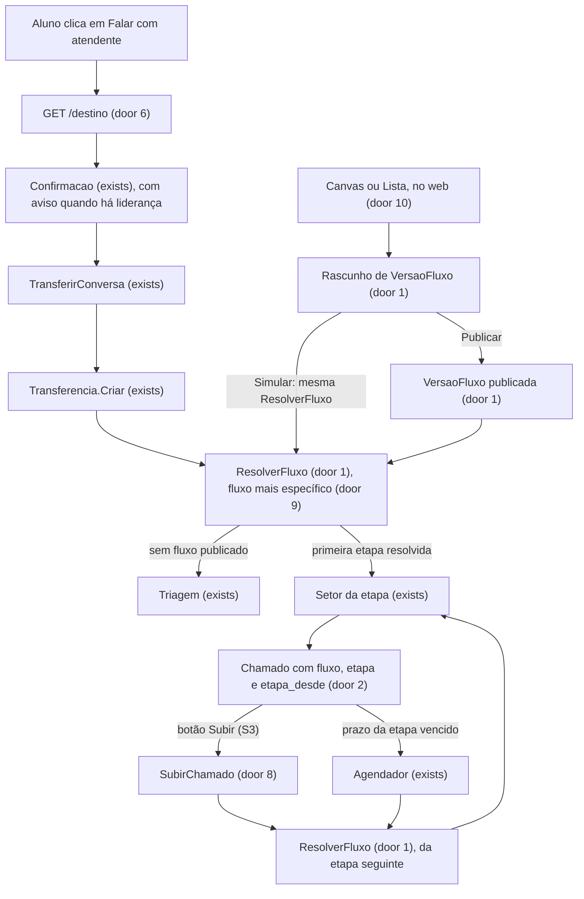
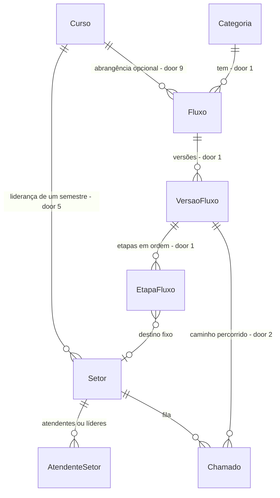

# Fluxos de atendimento configuráveis

## Problem

O One decide para onde vai uma dúvida com uma única regra por categoria: um setor fixo ou a coordenação do curso do aluno (`Transferencia.Setor`). A instituição não consegue descrever uma cadeia de atendimento, como "assistente, depois líder do semestre, depois coordenação", nem dizer que uma cadeia vale para todos os cursos e outra só para um curso ou um semestre. Toda dúvida de turma que poderia ser resolvida pelo líder chega direto à coordenação. Quem paga é a coordenação, com a fila, e o aluno, com a espera.

Cada instituição atende de um jeito: uma quer a cadeia com o líder, outra quer só o atendente comum, uma terceira quer quatro níveis, e dentro da mesma instituição um curso pode seguir um caminho e os outros outro. Hoje qualquer cadeia nova exige código novo, e o gestor não tem como ver nem desenhar o caminho. O plano `lider-semestre` (não aprovado) resolveria um único desses jeitos, fixo no código, com `LIDER_SEMESTRE` dentro de `RegraRoteamento.Destino`.

Evidência: as afirmações do usuário em 08/11 de que "atualmente as dúvidas estão indo direto pra coordenação", de que outras instituições podem seguir direto para o atendente normal, e o pedido de um editor arrasta-e-solta estilo n8n com abrangência por todos os cursos, por curso ou por semestre. Não há volume medido de dúvidas de turma nem pedido formal da instituição.

Depois disto, o gestor cria, por categoria, um fluxo que vale para todos os cursos, para um curso ou para um semestre de um curso. Ele monta a cadeia de etapas arrastando e soltando num canvas (ou por uma lista equivalente), simula o caminho de um aluno antes de publicar, e o chamado sobe de etapa pelo atendente ou por prazo. Quem não configura nada continua com o comportamento de hoje.

## Flow

Reusa `Transferencia.Criar`, `Setor`, `AtendenteSetor`, a fila, o tempo real, `Chamado.Encaminhar` e o `Agendador`. A regra por categoria (AD-010) continua decidindo, só que a decisão passa a ser uma cadeia escolhida pela abrangência mais específica. O `lider-semestre` é absorvido: a liderança vira um tipo de destino, e os critérios de aviso, aceite e visão restrita dele são os de S4.

`ResolverFluxo` é uma única função, usada pela transferência, pela subida e pelo simulador. O simulador mostra exatamente o que o roteamento real faria. O canvas e a lista são duas telas que editam o mesmo rascunho, e a API não sabe qual delas foi usada.

## Impact

| Front | What changes |
| --- | --- |
| domain | novo termo: `Fluxo` - cadeia de etapas de uma categoria e de uma abrangência (todos os cursos, um curso, ou um semestre de um curso), com versões. Entra no `GLOSSARIO.md` |
| domain | novo termo: `Abrangência` - o par curso e semestre de um fluxo, ambos vazios quando vale para todos |
| domain | novo termo: `Etapa` - posição da cadeia com um tipo de destino, um prazo opcional e a posição no canvas |
| domain | novo termo: `Liderança` - setor com curso e semestre; quem é atendente dele é o líder daquela turma |
| domain | novo termo: `Subir` - passar o chamado à etapa seguinte do próprio fluxo. Não conta como encaminhamento |
| domain | termo que muda: `RegraRoteamento` deixa de existir; "regra da categoria" (AD-010) passa a ser o fluxo publicado mais específico da categoria. Quem ramifica nele hoje: `Transferencia.Setor`, `RegraRotas`, `SalvarRegra`, `AlterarRegra`, `ListarRegras`, `CargaValidacao`, `CargaInicial`, `OneDb`, `web/src/administracao/Cadastros.tsx` e `comum.tsx` |
| indicadores | `RoteamentoCorreto` conta resolvidos com `Encaminhamentos == 0`. Se Subir somasse em `Encaminhamentos`, o caminho previsto "líder, depois coordenação" contaria como roteamento errado. Por isso Subir tem evento próprio e não incrementa o contador |
| histórico | novo tipo de evento `SUBIDA`; `GLOSSARIO.md` e a frase do Histórico no `web/` ganham o tipo |
| permissões | nova ação `subir` e novo papel `LIDER` em `PermissoesChamado`, calculado pelo setor do chamado e nunca gravado no usuário; quem ramifica: `DetalheChamado.Montar`, `BaixarAnexoConversa.PodeVer`, `ChamadoRotas.Carregar` |
| contrato do detalhe | `matricula.numero` pode ser `null` e `transcricao` pode ser `[]` só para `LIDER`; o `web/` deixa de mostrar o que não vem |
| carga JSON | a chave `regras` mantém a forma e passa a gerar um fluxo para todos os cursos, de uma etapa, por regra; a saída dos comandos `criar` e `carga` não muda |
| rotas removidas | `GET/POST /api/admin/regras` e `PUT /api/admin/regras/{id}`; só o `web/` deste repositório as consome |
| stored data | cada `regra_roteamento` existente vira um fluxo para todos os cursos com a versão 1 publicada e uma etapa do mesmo tipo e setor; `chamado` ganha 3 colunas anuláveis e os chamados atuais ficam fora de fluxo; `setor` ganha 2 colunas anuláveis; a tabela `regra_roteamento` é apagada na mesma migration |
| web, dependência | entra `@xyflow/react` (MIT); `web/src/test/setup.ts` ganha as simulações de `ResizeObserver` e `DOMMatrixReadOnly` que a biblioteca pede no jsdom; a regra de estrutura passa a permitir o import só em `web/src/administracao/` |
| web, gates | o canvas entra nos gates de CRAP < 10 e de `dryer` (AD-018); nós e arestas ficam em componentes pequenos |
| AD-010 e AD-012 | conformes: a categoria decide, e a liderança nunca recebe a transcrição, então nunca vê fontes internas |

## Relations

One-way constraints: no máximo um fluxo por categoria, curso e semestre, tratando vazio como um valor (door 1); número de versão único por fluxo e no máximo um rascunho por fluxo (door 1); versão publicada nunca muda (door 1); ordem única por versão (door 1); semestre só existe com curso (door 1); no máximo um setor ativo por instituição, curso e semestre (door 5); curso e semestre do setor existem juntos ou faltam juntos (door 5).

## Surface

| Route | In | Out | Status |
| --- | --- | --- | --- |
| `GET /api/admin/fluxos` | - | por fluxo: `id` · `categoriaId` · `cursoId` · `semestre` · `vigente` · `rascunho`, cada versão com `numero` · `etapas` (`destino` · `setorId` · `prazoHoras` · `x` · `y`) | `200` |
| `POST /api/admin/fluxos` | `categoriaId`, `cursoId` opcional, `semestre` opcional | fluxo sem versões | `201`, `400`, `409` |
| `PUT /api/admin/fluxos/{id}/rascunho` | `etapas` em ordem: `destino` · `setorId` · `prazoHoras` · `x` · `y` | rascunho | `200`, `400`, `404` |
| `DELETE /api/admin/fluxos/{id}/rascunho` | - | - | `204`, `404` |
| `POST /api/admin/fluxos/{id}/publicar` | - | versão publicada | `201`, `404`, `409` |
| `POST /api/admin/fluxos/{id}/simular` | `versao` (`RASCUNHO` ou `VIGENTE`), `cursoId`, `semestre`, `aceitaLideranca` | `etapas` com `ordem` · `destino` · `setor` · `situacao`, `inicial`, e `escolhido` (o fluxo que o roteamento real usaria para esse aluno) | `200`, `400`, `404` |
| `GET /api/conversas/{id}/destino` | `matriculaId` opcional | `lideranca` | `200`, `400`, `404`, `409` |
| `POST /api/conversas/{id}/transferir` | `matriculaId` opcional, `aceitaLideranca` opcional | `numero` · `estado` · `setor` | `201`, `400`, `404`, `409` |
| `POST /api/chamados/{numero}/subir` | `motivo` | detalhe do chamado | `200`, `400`, `403`, `404`, `409` |
| `GET /api/chamados/{numero}` | `numero` | novo `fluxo`: `versao` · `etapa` · `total` · `destino` · `abrangencia` (ou `null`); no papel `LIDER`: `transcricao: []`, `matricula.numero: null`, `categorias: null` | `200`, `404` |
| `POST` e `PUT /api/admin/setores` | `nome`, `triagem`, `ativo`, na criação `cursoId` e `semestre` opcionais | setor com `cursoId` · `semestre` | `201`/`200`, `400`, `404`, `409` |
| `GET /api/admin/setores` | - | setores com `cursoId` · `semestre` | `200` |

## Landing

| One-way door | Literal shape | Alternative rejected |
| --- | --- | --- |
| 1. Modelo do fluxo | `fluxo (id, instituicao_id, categoria_id, curso_id NULL, semestre NULL)` com `CHECK (semestre IS NULL OR curso_id IS NOT NULL)`, `CHECK (semestre BETWEEN 1 AND 12)` e `UNIQUE (instituicao_id, categoria_id, curso_id, semestre) NULLS NOT DISTINCT` (PostgreSQL 15+, `AreNullsDistinct(false)` no Npgsql); `versao_fluxo (id, instituicao_id, fluxo_id, numero, publicada_em NULL)` com `UNIQUE (fluxo_id, numero)` e `CREATE UNIQUE INDEX ux_versao_rascunho ON versao_fluxo (fluxo_id) WHERE publicada_em IS NULL`; `etapa_fluxo (id, instituicao_id, versao_fluxo_id, ordem, destino, setor_id NULL, prazo_horas NULL, pos_x NULL, pos_y NULL)` com `UNIQUE (versao_fluxo_id, ordem)`, `CHECK (ordem BETWEEN 1 AND 5)`, `CHECK (prazo_horas IS NULL OR prazo_horas BETWEEN 1 AND 720)` e `CHECK ((pos_x IS NULL) = (pos_y IS NULL))`; versão publicada é imutável | Editar o fluxo no lugar: um chamado em andamento ficaria numa etapa que já mudou de significado, e não haveria como mostrar "por que caiu aqui". JSON do grafo numa coluna única: não deixa o banco impor a ordem, a chave estrangeira do setor, a unicidade da abrangência nem o rascunho único. Tabela de ligações entre etapas: a cadeia tem uma saída por etapa, então a ordem já diz a ligação; a tabela entra com a primeira etapa que tiver duas saídas |
| 2. Caminho do chamado | `chamado.versao_fluxo_id BIGINT NULL`, `chamado.etapa_ordem INT NULL`, `chamado.etapa_desde timestamptz NULL`; `etapa_ordem NULL` significa fora de fluxo (categoria padrão, atendimento direto, sem fluxo publicado, fim da cadeia ou encaminhamento manual) | Gravar só o setor, como hoje: não dá para saber qual é a etapa seguinte nem desde quando o prazo corre |
| 3. Tipos de destino | `etapa_fluxo.destino` com os textos `SETOR` (com `setor_id`), `COORDENACAO_CURSO` e `LIDERANCA_SEMESTRE` (os dois últimos com `setor_id` nulo, resolvidos pela matrícula do chamado). O que cada tipo enxerga e se exige aceite do aluno é decidido no código a partir do tipo e nunca é coluna nem opção do gestor | Visão e aceite configuráveis por etapa: um clique errado do gestor mostraria a transcrição e o número de matrícula a um estudante líder |
| 4. Fim da regra por categoria | A migration cria `fluxo`, `versao_fluxo` e `etapa_fluxo`, converte cada `regra_roteamento` num fluxo para todos os cursos com a versão 1 publicada de uma etapa e apaga `regra_roteamento`; as rotas `/api/admin/regras` deixam de existir; a chave `regras` da carga JSON continua e gera um fluxo | Manter as duas tabelas: duas fontes para a mesma decisão, e a tela e a transferência teriam de escolher qual vale |
| 5. Liderança como setor | `setor.curso_id` e `setor.semestre` anuláveis; `CHECK ((curso_id IS NULL) = (semestre IS NULL))`; `CHECK (semestre BETWEEN 1 AND 12)`; `CREATE UNIQUE INDEX ux_setor_lideranca ON setor (instituicao_id, curso_id, semestre) WHERE curso_id IS NOT NULL AND ativo`; o `PUT` não aceita os dois campos | Tabela `curso + semestre -> usuário`: `Chamado.SetorId` é obrigatório e fila, acesso e tempo real são por setor, então duplicaria os três |
| 6. Aceite do aluno | `POST /transferir` com `{"aceitaLideranca": true}`; ausente ou `false` nunca vai à liderança, e as etapas `LIDERANCA_SEMESTRE` são puladas; `GET /destino` só informa. A liderança só pode ser a etapa 1 de um fluxo, e a última etapa nunca é liderança | `semLider` com padrão de ir ao líder: uma falha da prévia mandaria dados a um colega sem aviso. Liderança no meio da cadeia: exigiria um segundo aceite depois que a equipe já viu os dados |
| 7. Papel de acesso | `PermissoesChamado.Lider = "LIDER"`, devolvido por `ChamadoRotas.Carregar` quando o setor do chamado tem `curso_id`; pode `responder`, `nota`, `assumir`, `resolver` e `subir` | `Papeis.Lider` no usuário: quem atende um setor comum e uma liderança teria uma visão só, e trocar o líder exigiria outra regra de acesso |
| 8. Subir não é encaminhar | evento `SUBIDA` (`de` e `para` com os nomes dos setores, `detalhe` com o motivo ou `Sem resposta em N horas`); `chamado.encaminhamentos` não muda | Reusar `ENCAMINHAMENTO` e o contador: faz `RoteamentoCorreto` tratar o caminho previsto como erro |
| 9. Abrangência e precedência | A transferência usa, entre os fluxos publicados da categoria, o primeiro que existir nesta ordem: curso e semestre da matrícula, só o curso, todos os cursos. O fluxo só existe para a transferência quando tem versão publicada; o escopo não muda depois de criado (para mudar, cria-se outro fluxo) | Prioridade numérica ordenada pelo gestor, como a lista de gatilhos do Zendesk: dois fluxos que se sobrepõem passam a depender de uma ordem que o gestor precisa lembrar, e o simulador teria de explicá-la. Nó "Condição" dentro do fluxo: o modelo da cadeia deixa de ser uma lista e a escolha do fluxo passa a depender de percorrer o grafo |
| 10. Biblioteca do canvas | `@xyflow/react` na versão exata `12.12.1` em `web/package.json` (MIT; `react` e `react-dom` como peer `>=17`), importada só por `web/src/administracao/` e carregada por `import()` dinâmico quando o canvas abre | Canvas próprio em SVG: refaria foco por teclado, setas, pan, zoom e conexão de nós, que a biblioteca traz e documenta (`nodesFocusable`, `edgesFocusable`, `isValidConnection`). Importar a biblioteca no pacote principal: o aluno e o atendente baixariam o editor sem usá-lo |

- Nothing else in this change is hard to reverse

## Criteria

### S1: o fluxo substitui a regra sem mudar o comportamento (P1)

Quem não mexer em nada vê o mesmo roteamento de antes, agora guardado como fluxo.

**Acceptance Criteria**

1. WHEN the migration runs THEN the system SHALL create, for each existing rule, a flow for all courses of its category with version 1 published and one stage with the same destination and sector
2. WHEN the migration runs THEN the system SHALL leave every existing ticket with `versao_fluxo_id`, `etapa_ordem` and `etapa_desde` null
3. WHEN a student is transferred and the category has published flows THEN the system SHALL use the flow of the course and semester of the enrolment, else the flow of the course, else the flow for all courses, and SHALL open the ticket in the sector of its first stage that resolves, recording the flow version, the stage order and the entry time
4. IF a more specific flow has no published version THEN the system SHALL ignore it and use the next less specific one
5. IF no published flow applies, or the category is the default category THEN the system SHALL open the ticket in the triage sector with the three columns null
6. WHEN a `COORDENACAO_CURSO` stage is resolved THEN the system SHALL use the coordination sector of the course of the ticket's enrolment
7. IF a stage does not resolve (course without coordination, or leadership unavailable) THEN the system SHALL try the next stage, and if none remains SHALL open the ticket in triage with `etapa_ordem` null
8. WHEN the ticket comes from `POST /api/atendimento-direto` THEN the system SHALL never open it in a leadership sector
9. WHEN the JSON load has `regras` THEN the system SHALL create, for each, a flow for all courses with version 1 published and one stage, with the same output counts as before
10. IF a rule of the JSON load repeats a category that already has a flow for all courses THEN the system SHALL reject the file with the error already used for "já tem regra"
11. The system SHALL no longer answer `GET`, `POST` or `PUT` on `/api/admin/regras`

**Independent test:** com uma regra `SETOR` e outra `COORDENACAO_CURSO` migradas, transferir um aluno por categoria e conferir que os dois chamados caem nos mesmos setores de antes.

### S2: o gestor cria o fluxo, define a abrangência, simula e publica (P1)

O gestor escolhe a categoria e a abrangência, edita um rascunho, vê o caminho de um aluno de teste e só então publica.

**Acceptance Criteria**

12. WHEN an admin creates a flow with `categoriaId` and optional `cursoId` and `semestre` THEN the API SHALL store it without versions and return it with `201`
13. IF `semestre` is sent without `cursoId` THEN the API SHALL return `400` with field `semestre`
14. IF `semestre` is outside 1 to 12, or `cursoId` is not a course of the institution THEN the API SHALL return `400` with field `semestre` or `cursoId`
15. IF the category is the default category or does not exist THEN the API SHALL return `400` with field `categoriaId`
16. IF a flow already exists for that category, course and semester THEN the API SHALL return `409`
17. WHEN an admin saves a draft with an ordered list of stages THEN the API SHALL replace the whole draft of the flow and return it with `200`
18. IF the list has zero stages or more than 5 THEN the API SHALL return `400` with field `etapas`
19. IF a stage has `destino` outside `SETOR`, `COORDENACAO_CURSO` and `LIDERANCA_SEMESTRE` THEN the API SHALL return `400` with field `destino`
20. IF a `SETOR` stage has no `setorId`, or a `setorId` that is not an active, non-leadership sector of the institution THEN the API SHALL return `400` with field `setorId`
21. IF a stage other than `SETOR` sends `setorId` THEN the API SHALL return `400` with field `setorId`
22. IF `prazoHoras` is outside 1 to 720, or is sent on the last stage THEN the API SHALL return `400` with field `prazoHoras`
23. IF `LIDERANCA_SEMESTRE` is not the first stage, or is the last stage THEN the API SHALL return `400` with field `destino`
24. IF only one of `x` and `y` is sent on a stage THEN the API SHALL return `400` with field `etapas`
25. WHEN an admin publishes THEN the API SHALL create the next version number from the draft, remove the draft, and return `201` with the version
26. IF there is no draft THEN publishing SHALL return `409`
27. WHEN a version is published THEN the system SHALL keep every earlier version and SHALL not change the tickets that point to it
28. WHEN an admin discards a draft THEN the API SHALL return `204` and keep the published versions
29. WHEN an admin simulates with a course and a semester THEN the API SHALL return each stage with the resolved sector name or a `situacao` of `NAO_RESOLVIDA` with the reason, plus `inicial` and `escolhido`, and SHALL write nothing
30. The simulation SHALL call the same resolution function as the real transfer
31. WHEN the admin opens the Fluxos tab THEN the web SHALL list the flows by category with the abrangência written as "Todos os cursos", the course name, or the course name with the semester, and the published stages in order
32. WHEN the admin creates a flow THEN the web SHALL ask for the category and offer the abrangência as "Todos os cursos", "Um curso" and "Um semestre de um curso"
33. WHEN the admin edits a flow THEN the web SHALL offer Simular with course, semester and acceptance, and Publicar only after the draft passes the API validation
34. WHEN the Fluxos tab has no flow THEN the web SHALL show the empty state with the sentence "Sem fluxo, os chamados vão para a Triagem."

**Independent test:** criar um fluxo para ADS 3º semestre com a cadeia "Liderança do semestre, depois Coordenação do curso (48 h)", simular um aluno de ADS 3º semestre e publicar.

### S3: o chamado sobe de etapa (P1)

O aluno não fica preso na etapa errada e o gestor não precisa de encaminhamento manual para o caminho previsto.

**Acceptance Criteria**

35. WHEN an attendant or leader of the ticket's sector calls `POST /subir` with a motivo on a ticket with a next stage THEN the system SHALL move it to the sector of the next stage that resolves, set `etapa_ordem` and `etapa_desde`, clear the responsible and set the state to `ABERTO`
36. WHEN a ticket goes up THEN the system SHALL record the `SUBIDA` event with the old and new sector names, store the motivo as an internal note, and SHALL keep `Encaminhamentos` unchanged
37. IF the ticket is outside a flow, or on the last stage, or no later stage resolves THEN `POST /subir` SHALL return `409`
38. IF the ticket state is not `ABERTO`, `EM_ATENDIMENTO` or `AGUARDANDO_ALUNO` THEN `POST /subir` SHALL return `409`
39. IF the motivo is empty THEN `POST /subir` SHALL return `400` with field `motivo`
40. IF the caller is the student THEN `POST /subir` SHALL return `403`
41. WHEN the ticket detail is requested in a state that allows it THEN `acoes` SHALL contain `subir` only while the ticket has a later stage
42. WHEN a ticket has state `ABERTO` or `EM_ATENDIMENTO`, its stage has `prazoHoras`, that time has passed since `etapa_desde` and no public team message was sent since then THEN the scheduler SHALL move it to the next stage as in 35
43. WHEN the scheduler moves a ticket THEN the system SHALL record `SUBIDA` with no author and detail `Sem resposta em N horas`, with N from the stage, and SHALL clear the responsible and set `ABERTO`
44. WHEN two scheduler runs, or the scheduler and an attendant, reach the same ticket THEN the system SHALL move it once, by a conditional update on the current `etapa_ordem`
45. IF a public team message exists since `etapa_desde` THEN the scheduler SHALL leave the ticket in its stage
46. WHILE the ticket state is `AGUARDANDO_ALUNO` the scheduler SHALL not move it
47. WHEN a ticket goes up THEN the web SHALL show the Histórico sentence for `SUBIDA` with the sector names
48. WHEN a ticket is manually forwarded with `encaminhar` THEN the system SHALL set `etapa_ordem` and `etapa_desde` to null

**Independent test:** com o relógio falso, passar o prazo da etapa 1 sem resposta e ver o chamado na fila da etapa 2, com a linha `SUBIDA` no Histórico.

### S4: a liderança é avisada, vê só o necessário e sobe (P2)

Nenhum dado chega a um colega sem o aluno saber antes, e o líder não vê o que é da equipe.

**Acceptance Criteria**

49. WHEN an admin creates a sector with `cursoId` and `semestre` THEN the API SHALL store both and return them with `201`
50. IF only one of `cursoId` and `semestre` is sent THEN the API SHALL return `400` with field `semestre`
51. IF `semestre` is outside 1 to 12, or `cursoId` is not a course of the institution, or the sector is `triagem` THEN the API SHALL return `400` with field `semestre`, `cursoId` or `triagem`
52. IF an active sector already leads that course and semester THEN the API SHALL return `409` on create and on reactivation
53. WHEN an admin updates a sector THEN the API SHALL keep its `cursoId` and `semestre`
54. IF a `SETOR` stage or a course coordination points to a leadership sector THEN the API SHALL return `400` with field `setorId` or `setorCoordenacaoId`
55. The system SHALL treat a leadership as available only when its sector is active and has at least one active attendant other than the student
56. WHEN the student's flow starts with `LIDERANCA_SEMESTRE` and the leadership is available THEN `GET /destino` SHALL return `lideranca: true`, and otherwise `false` with nothing written
57. WHEN `lideranca` is true THEN the web SHALL show in the confirmation dialog "Sua dúvida vai primeiro para a liderança do seu semestre, formada por estudantes da sua turma. A liderança vê seu nome, curso, semestre e um resumo da dúvida. A conversa com o assistente e os anexos dela não são mostrados." with `Cancelar`, `Prefiro a coordenação` and `Enviar à liderança`
58. IF `GET /destino` fails THEN the web SHALL show the current dialog and send no `aceitaLideranca`
59. IF `aceitaLideranca` is absent or false THEN the system SHALL skip the `LIDERANCA_SEMESTRE` stage and open the ticket in the next stage that resolves
60. WHILE the ticket's sector is a leadership and the viewer is its attendant, `GET /api/chamados/{numero}` SHALL return `transcricao: []`, `matricula.numero: null` and `categorias: null`, and SHALL still return `solicitante`, `resumo`, `matricula.curso`, `matricula.semestre`, `mensagens`, `eventos` and `fluxo`
61. IF a leader calls `reclassificar`, `duplicado` or `encaminhar`, THEN the API SHALL return `403`
62. IF a leader requests a conversation attachment of a ticket in their leadership THEN `GET /api/conversas/anexos/{id}` SHALL return `404`
63. WHEN a leader sends the ticket up THEN the leader SHALL receive `404` on that ticket afterwards
64. IF anyone forwards a ticket to a leadership sector THEN the API SHALL return `400` with field `setorId`
65. WHILE a user is both the requester of a ticket and an attendant of its sector, the API SHALL give that user the `ALUNO` view
66. The system SHALL never route a ticket of one institution to a leadership of another institution

**Independent test:** entrar como líder, responder um colega e subir à coordenação, e ver o chamado sumir da fila do líder.

### S5: o gestor vê por que o chamado caiu ali (P2)

**Acceptance Criteria**

67. WHEN the team opens a ticket that has a flow THEN `GET /api/chamados/{numero}` SHALL return `fluxo` with the version number, the current stage, the total of stages, the destination type and the abrangência
68. WHEN the ticket is outside a flow THEN `GET /api/chamados/{numero}` SHALL return `fluxo: null`
69. WHEN the web receives `fluxo` THEN it SHALL show "Etapa X de Y" and the abrangência in the ticket side column, and nothing when it is null

**Independent test:** abrir um chamado vindo de um fluxo de duas etapas e ver "Etapa 1 de 2".

### S6: o gestor monta o fluxo arrastando e soltando (P2)

O canvas é uma segunda tela para o mesmo rascunho. Tudo que ele faz a lista também faz.

**Acceptance Criteria**

70. WHEN the admin opens a draft THEN the web SHALL offer the views "Lista" and "Canvas" of the same draft and SHALL keep the unsaved edits when switching
71. WHEN the Canvas view opens THEN the web SHALL show a fixed "Início" node and one node per stage linked in order, each with the type icon, the sector name or type label, and "sobe após N h" when the stage has `prazoHoras`
72. WHEN the admin drags a destination type from the palette onto the canvas THEN the web SHALL add an unlinked stage node at the drop position
73. WHEN the admin links two nodes THEN the web SHALL accept the link only from a node with no outgoing link to a node with no incoming link, and never one that closes a cycle
74. IF the canvas has a node not on the path from "Início", or has more than 5 stage nodes THEN the web SHALL mark it and disable Salvar rascunho and Publicar with the sentence "Ligue todas as etapas ao Início, em uma única cadeia, com até 5 etapas."
75. WHEN the admin saves THEN the web SHALL send the stages in path order with the `x` and `y` of each node, and reopening the draft SHALL show each node where it was left
76. WHEN the admin removes a node that has a sector or a deadline THEN the web SHALL ask for confirmation first, and removing it SHALL reconnect nothing
77. WHILE the Canvas view is shown the nodes SHALL be reachable by Tab and movable by the arrow keys
78. The List view SHALL offer every operation the canvas offers: add, remove, move up and down, choose the destination and set the deadline
79. WHILE the viewport is under 768 px the web SHALL show only the List view, with the sentence "O canvas está disponível em telas maiores."
80. The system SHALL load the canvas library only when the Canvas view opens
81. WHEN the admin simulates while the Canvas view is shown THEN the web SHALL mark each node with "Vai por aqui" or "Pulada: motivo" from the simulation answer

**Independent test:** arrastar "Liderança do semestre" e "Coordenação do curso" ao canvas, ligar Início → Liderança → Coordenação, salvar, simular um aluno e ver os dois nós marcados.

## Out of scope

| Excluded | Why |
| --- | --- |
| Nó de condição e várias saídas por nó (ramificação) | o fluxo é uma cadeia; a abrangência já cobre curso e semestre. A tabela de ligações entra com a primeira etapa de duas saídas (door 1) |
| Condição por situação da matrícula, horário ou palavra-chave | nenhum cliente pediu; entra junto com a ramificação |
| Mudar a abrangência de um fluxo depois de criado | para mudar, cria-se outro fluxo; evita um fluxo trocar de significado com chamados presos nele |
| Prioridade numérica entre fluxos | a precedência é fixa (door 9) |
| Devolver da coordenação à etapa anterior | dados vistos pela equipe não devem voltar a um colega |
| Aviso por e-mail ou push à etapa nova | hoje nenhum atendente recebe esse aviso; o prazo cobre o atendente ausente |
| Prazo em horas úteis | o prazo é em horas corridas, como os outros prazos do sistema |
| Redistribuição automática por carga ou habilidade | o One não tem capacidade de atendente nem habilidade cadastrada |
| Tela própria de líderes e troca automática a cada semestre | o admin troca o atendente do setor na tela Usuários |
| Líderes pela carga JSON | a carga é para o início da instituição |
| Coordenação enxergar a fila da liderança | a privacidade fica mais simples se o chamado só sobe |
| Desfazer e refazer, mapa em miniatura, notas e arranjo automático no canvas | extras de editor que nenhum critério pede |

## Assumptions

| Assumption | Chosen default | Rationale | Confirmed? |
| --- | --- | --- | --- |
| Como o chamado sobe | botão do atendente e prazo opcional por etapa | respostas do usuário em 08/11 ("use o que for recomendado") | y |
| Abrangência do fluxo | todos os cursos, um curso, ou um semestre de um curso, escolhida na criação | pedido do usuário em 08/11 | y |
| Editor | canvas arrasta-e-solta estilo n8n, mais uma lista equivalente | pedido do usuário em 08/11; a lista garante teclado, leitor de tela e celular | y |
| Qual fluxo vale quando vários se aplicam | o mais específico: curso e semestre, depois curso, depois todos | é a regra que menos exige que o gestor memorize ordem | n |
| O canvas desenha uma cadeia, sem ramificação | uma saída por nó | o pedido não traz nenhuma bifurcação concreta; o modelo comporta a tabela de ligações depois | n |
| Máximo de etapas | 5 | cadeias reais têm 2 ou 3 níveis; o limite mantém o canvas legível | n |
| Prazo máximo da etapa | 720 horas (30 dias) | limite de segurança do campo | n |
| Canvas em tela pequena | só a lista abaixo de 768 px | arrastar e ligar nós no celular é frágil; é o ponto de quebra que o `web/` já usa | n |
| O líder é estudante e pode ter informação sensível de colegas | aviso antes, aceite explícito, sem transcrição e sem número de matrícula | é o menor acesso que ainda deixa o líder responder | n |
| O que o líder vê | título, resumo da IA, nome, curso, semestre e as mensagens trocadas depois da transferência | a transcrição traria fontes internas (AD-012) e anexos | n |
| Anexos enviados depois da transferência | ficam visíveis ao líder | o aluno envia sabendo que o líder atende | n |
| Categoria sem fluxo publicado | vai para a Triagem | é o que acontece hoje sem regra | n |
| Edição concorrente do rascunho | a última gravação vence, em uma transação | o rascunho é de um único fluxo e raramente editado por duas pessoas | n |

**Open questions:**

| # | Kind | Question | Until answered |
| --- | --- | --- | --- |
| 1 | blocks go-live | A Univag aceita estudante atendendo estudante e vendo nome e resumo, e com qual termo de confidencialidade? | S4 pode ser mostrado com dados de exemplo, mas não ligado para alunos reais. S1 a S3, S5 e S6 não dependem disso |
| 2 | open | Isto entra antes do congelamento de 17/11 ou depois da banca de 20/11? | o plano vale nos dois casos; a recomendação é depois, porque a Etapa 5 (09 a 19/11) já está ocupada |

## Observable

| Surface | Decision | Landing |
| --- | --- | --- |
| screen Cadastros, aba Fluxos | empty state | AC 34 |
| screen Cadastros, aba Fluxos | loading, error | existing - padrão de `Cadastros.tsx`, erro por campo vindo da API |
| screen Cadastros, aba Fluxos | unauthorised | existing - rotas `/api/admin` |
| screen Cadastros, aba Fluxos | density and ordering | AC 31 |
| screen Cadastros, aba Fluxos | destructive action confirms | AC 76; descartar rascunho e remover etapa na lista pedem confirmação no diálogo de confirmação do admin, e publicar mostra a versão que passa a valer |
| screen Cadastros, aba Fluxos | keyboard use | AC 77, AC 78 |
| screen Cadastros, aba Fluxos | small screen | AC 79 |
| screen Canvas | empty (nenhuma etapa) | AC 71: só o nó "Início" e a paleta, com a frase "Arraste um destino para começar." |
| screen Canvas | loading, error | existing - o carregamento tardio mostra o indicador de carga já usado nas telas; falha ao carregar a biblioteca mostra a Lista (AC 80) |
| screen Canvas | invalid chain | AC 74 |
| dialog de transferência | loading, error | AC 58; a escolha fica desligada até a prévia responder ou falhar |
| dialog de transferência | empty, unauthorised | n/a - só abre para o dono da conversa ativa |
| dialog de transferência | destructive action confirms | AC 57 |
| screen Detalhe do chamado (líder) | empty, loading, error | existing - `ChamadoDetalhe`; sem transcrição o bloco some |
| screen Detalhe do chamado (líder) | unauthorised | AC 63 |
| screen Detalhe do chamado | destructive action confirms | existing - o diálogo de Encaminhar pede o motivo; Subir pede o motivo do mesmo jeito (AC 39) |
| API `/api/admin/fluxos*` | response and error shape | AC 12 a AC 29, erros por campo |
| API `/api/admin/fluxos*` | who may call | existing - rotas `/api/admin` |
| API `GET /destino`, `POST /transferir` | response and error shape | AC 56, AC 59; recusas existentes de matrícula, conversa e desfecho |
| API `POST /subir` | response and error shape | AC 35 a AC 40 |
| API `POST /subir` | who may call | AC 40 e AC 61 |
| API `POST /subir` | concurrency | AC 44 |
| API `POST /fluxos`, `PUT /rascunho`, `POST /publicar` | concurrency | os índices únicos da door 1; a segunda criação ou publicação responde `409` (AC 16, AC 26) |
| scheduled task Agendador | output, flags, exit codes | existing - log por chamado como os outros prazos |
| scheduled task Agendador | failure halfway | AC 44 |
| all new and changed routes | versioning, rate limits | n/a - contrato lido só pelo `web/` deste repositório, sem limite próprio além da sessão |
| document aviso do diálogo | structure, tone, next step | AC 57 |
| collection Fluxos e Etapas | grouping, naming, ordering, duplicates | AC 16 e AC 31; etapas por ordem de 1 a 5, sem repetir ordem |

## Sources

- Mensagens do usuário em 08/11/2026: a cadeia "bot, líder do semestre, coordenadora do curso" varia por instituição e hoje tudo vai à coordenação; pedido de um canvas estilo n8n e de abrangência por todos os cursos, curso ou semestre
- `.specs/STATE.md` AD-010 e AD-012, `.specs/features/lider-semestre/plan.md` (absorvido), `One.Api/Chamados/Transferencia.cs` e `CalculoIndicadores.cs`
- React Flow (documentação de acessibilidade e de testes) e `@xyflow/react` 12.12.1, licença MIT, lidos em 08/11; Npgsql `AreNullsDistinct` para `NULLS NOT DISTINCT`
- Mercado: Freshdesk Advanced Builder (canvas, versão e publicar), Intercom Workflows, Salesforce Omni-Channel flows e Zendesk triggers (lista de regras), lidos em 08/11
