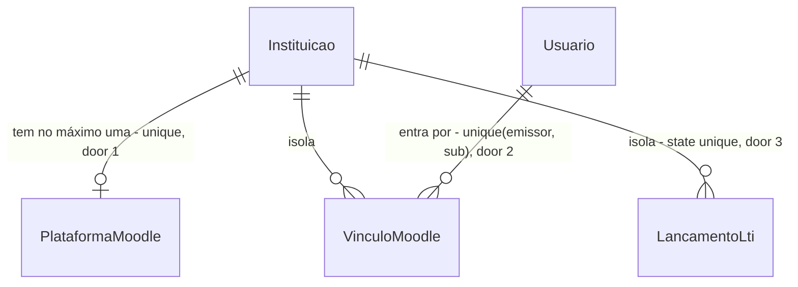

# Entrar no One pelo Moodle da Univag (LTI 1.3)

## Problem

O aluno da Univag vive no Moodle (o AVA da instituição, uma versão modificada dele) e hoje, para falar com o assistente do One, precisa sair de lá, abrir o endereço do One e entrar com CPF e uma senha própria, criada por um link de "Primeiro acesso" enviado por e-mail. O One é um segundo cadastro e uma segunda senha ao lado da que o aluno já usa todo dia. O marco de 13/11 do `ROADMAP.md` ("1ª versão no AVA: entrar, conversar com o assistente e ver a resposta conferida") só se cumpre se o aluno chegar ao One a partir do AVA, sem esse desvio.

Evidência: a linha de 13/11 do `ROADMAP.md` e a linha "Moodle com botão 'Preciso de ajuda'" da etapa Integrações. Não há medida de abandono no primeiro acesso, porque ainda não há produção.

Depois disto, o aluno clica numa atividade "One" dentro do Moodle e cai no assistente já identificado, sem digitar CPF nem senha. O One continua independente do Portal e do Moodle, um PWA que o aluno instala: o login por CPF e senha segue sendo o acesso principal, para quem entra direto pelo One e para toda a equipe, e o Moodle é um atalho a mais.

## Flow

Reusa a sessão por cookie (`Sessao.Principal`, `Sessao.Validar`) e a mesma resposta de entrada do `Login`, sem criar outro mecanismo de sessão; o Moodle só prova quem é a pessoa.

1. Moodle (aluno clica na atividade "One") -> `GET` ou `POST /api/moodle/{slug}/login` (door 5) - confere `iss` e `client_id` com a plataforma da instituição, grava `state` e `nonce` em `lti_lancamento` (door 3) e responde 302 para o `authUrl` do Moodle
2. Moodle autentica o aluno (já está logado) -> `POST /api/moodle/{slug}/lancamento` (door 5) com `id_token` e `state` (form post)
3. `LancamentoMoodle` (new, no door - placement per conventions, em `One.Api/Acesso/`) - consome o `state` (uso único), valida o `id_token` com as chaves de `jwksUrl` do Moodle (door 4) e extrai `sub` e o parâmetro personalizado `username`
4. `LancamentoMoodle` - acha o usuário por `vinculo_moodle` (door 2); sem vínculo, acha o aluno ativo cujo CPF é o `username` e cria o vínculo
5. `Sessao.Principal` (exists) + `SignInAsync` (exists) - grava o cookie `one.auth` e responde 302 para `/{slug}`
6. `PlataformaMoodleRotas` (new, no door - `One.Api/Administracao/`) - o admin cadastra e lê a plataforma (door 1) e recebe as 3 URLs para colar no Moodle
7. `Agendador` (exists) - apaga `lti_lancamento` expirado há mais de 1 dia

## Impact

| Front | What changes |
| --- | --- |
| domain | new term: `PlataformaMoodle` - o cadastro do Moodle de uma instituição (emissor, `client_id`, URLs), um por instituição |
| domain | new term: `VinculoMoodle` - a ligação estável entre um `sub` do Moodle e um `Usuario`; quem depende dele é só o `LancamentoMoodle` |
| domain | existing term: "entrar" tinha um caminho só (CPF e senha, `Login`); passa a ter dois. Quem depende de "como o usuário entrou": ninguém hoje, a sessão não guarda o método |
| routes | `Program.cs` monta `/api` com `RequireAuthorization`; as 3 rotas `/api/moodle/{slug}/*` são anônimas, como `/api/auth/login`, e entram na política de limite `auth` |
| web | `Login` passa a ler `?moodle=` e mostrar o motivo; nova tela de admin "Moodle". As telas de acesso e a barra lateral têm testes de arranjo que medem o menu |
| stored data | 3 tabelas novas, todas com `instituicao_id` e filtro global (AD-008); nada a migrar. Alunos já importados por CSV ganham o vínculo no primeiro clique pelo Moodle |
| unchanged | importação por CSV, `Login` por CPF, "Primeiro acesso", papéis e a regra de que a equipe entra só por senha |

## Relations

One-way constraints: `PlataformaMoodle` unique por instituição (door 1); `VinculoMoodle` unique por instituição, emissor e `sub` (door 2); `LancamentoLti` com `state` unique (door 3). Sem colunas nem tipos aqui.

## Surface

Rotas novas. Nenhuma rota existente muda de assinatura.

| Route | In | Out | Status |
| --- | --- | --- | --- |
| `GET` e `POST /api/moodle/{slug}/login` | `iss`, `login_hint`, `target_link_uri`, `lti_message_hint`, `client_id` | redireciona ao `authUrl` com `state`, `nonce`, `client_id`, `redirect_uri`, `login_hint`, `lti_message_hint`, `scope=openid`, `response_type=id_token`, `response_mode=form_post`, `prompt=none` | `302`, `400`, `404`, `429` |
| `POST /api/moodle/{slug}/lancamento` | form `id_token`, `state` | redireciona a `/{slug}` (sessão aberta) ou a `/{slug}?moodle=<motivo>` | `302`, `400`, `404`, `429` |
| `GET /api/moodle/{slug}/jwks` | `slug` | `keys[]` com a chave pública da ferramenta | `200`, `404` |
| `GET /api/admin/moodle` | nada | `configurada` · `ativa` · `emissor` · `clientId` · `deploymentId` · `authUrl` · `jwksUrl` · `urlLogin` · `urlLancamento` · `urlJwks` | `200`, `401`, `403` |
| `PUT /api/admin/moodle` | `ativa`, `emissor`, `clientId`, `deploymentId`, `authUrl`, `jwksUrl` | o mesmo objeto do `GET` | `200`, `400`, `401`, `403`, `409` |

Motivos de `?moodle=`: `sem-cadastro`, `inativo`, `use-senha`. A API não devolve JSON para erro que o aluno vê; o navegador está navegando, não chamando `fetch`.

## Landing

| One-way door | Literal shape | Alternative rejected |
| --- | --- | --- |
| 1. Tabela `plataforma_moodle` | uma linha por instituição: `UNIQUE (instituicao_id)`; campos `emissor`, `client_id`, `deployment_id`, `auth_url`, `jwks_url`, `ativa` | várias plataformas por instituição: a rota é `/{slug}` e a instituição é escolhida por ela (AD-008), então um segundo Moodle não tem como ser escolhido sem mudar a rota |
| 2. Tabela `vinculo_moodle` | `UNIQUE (instituicao_id, emissor, sub)` -> `usuario_id`; depois do vínculo, a entrada usa só `emissor` e `sub` | achar o usuário por CPF ou e-mail do token a cada clique: o aluno edita o próprio e-mail e `username` no Moodle e entraria na conta de outro (tomada de conta) |
| 3. Tabela `lti_lancamento` | `UNIQUE (state)`, com `nonce`, `instituicao_id`, `expira_em` (10 min) e `usado_em`; o `state` é consumido uma vez | cookie com `state` e `nonce`: `one.auth` é `SameSite=Strict` (`Program.cs`) e a volta do Moodle é um POST de outro site, que o cookie não acompanha; memória do processo: reiniciar a API ou ter 2 instâncias perde o `state` |
| 4. Pacote `Microsoft.IdentityModel.JsonWebTokens` (versão exata a fixar no build, conferida na Context7) | `JsonWebTokenHandler.ValidateTokenAsync` com `ValidIssuer`, `ValidAudience = client_id`, `IssuerSigningKeys` do `jwksUrl` do Moodle | validar a assinatura RS256 à mão: criptografia própria, sem ganho; pacote LTI de terceiros: traz modelo próprio de plataforma e sessão que duplicaria o nosso, e não li a manutenção de nenhum |
| 5. Caminhos que o admin do Moodle cola na configuração | `/api/moodle/{slug}/login`, `/api/moodle/{slug}/lancamento`, `/api/moodle/{slug}/jwks` | `/{slug}/moodle/...` fora de `/api`: o proxy do Vite e o `MapFallbackToFile` tratariam como tela do SPA; `slug` no `client_id` em vez de na rota: o Moodle manda o `client_id` só depois do primeiro passo |

- Nada mais nesta mudança é difícil de desfazer. A restrição "só `ALUNO` entra por aqui" e o uso do `username` como CPF são regra de código e de configuração e saem num commit.

## Criteria

### S1: o aluno entra no One pelo Moodle (P1)

Do clique na atividade "One" no Moodle até o assistente aberto, sem digitar nada.

**Acceptance Criteria**

1. WHEN `/api/moodle/{slug}/login` recebe `iss` e `client_id` iguais aos da plataforma ativa da instituição THEN the system SHALL gravar um `lti_lancamento` com `state` e `nonce` aleatórios de 128 bits ou mais, válido por 10 minutos, e responder `302` ao `authUrl` com os parâmetros da Surface
2. IF `iss` ou `client_id` diferem dos cadastrados, ou a plataforma está inativa, THEN the system SHALL responder `400` e não gravar nenhum `lti_lancamento`
3. IF o `slug` não existe ou a instituição está inativa THEN the system SHALL responder `404` em `login`, `lancamento` e `jwks`
4. WHEN `/api/moodle/{slug}/lancamento` recebe um `id_token` válido e um `state` vigente THEN the system SHALL marcar o `state` como usado, abrir a sessão e responder `302` a `/{slug}`
5. The system SHALL considerar válido um `id_token` só quando a assinatura confere com as chaves de `jwksUrl`, `iss` é o `emissor` cadastrado, `aud` contém o `client_id`, `exp` está no futuro, `nonce` é o do `state`, `deployment_id` é o cadastrado, `https://purl.imsglobal.org/spec/lti/claim/message_type` é `LtiResourceLinkRequest` e `.../claim/version` é `1.3.0`
6. IF o `id_token` falha em qualquer item do critério 5 THEN the system SHALL responder `400` e não abrir sessão
7. IF o `state` não existe, expirou ou já foi usado THEN the system SHALL responder `400` e não abrir sessão
8. WHEN já existe `vinculo_moodle` para (`emissor`, `sub`) e o usuário é um `ALUNO` ativo THEN the system SHALL abrir a sessão desse usuário sem olhar CPF, e-mail ou nome do token
9. WHEN não existe vínculo e o parâmetro personalizado `username` normalizado é o CPF de um `ALUNO` ativo da instituição THEN the system SHALL criar o `vinculo_moodle` e abrir a sessão
10. IF não existe vínculo e nenhum `ALUNO` ativo tem o CPF do `username` (ou o `username` não é um CPF válido) THEN the system SHALL responder `302` a `/{slug}?moodle=sem-cadastro` e não criar vínculo
11. IF o usuário vinculado ou achado está desativado THEN the system SHALL responder `302` a `/{slug}?moodle=inativo` e não abrir sessão
12. IF o usuário vinculado ou achado tem outro papel além de `ALUNO` (equipe) THEN the system SHALL responder `302` a `/{slug}?moodle=use-senha` e não abrir sessão
13. WHILE o `id_token` e o `state` de um lançamento já foi aceito, WHEN o mesmo par é reenviado THEN the system SHALL responder `400` (reuso)
14. WHEN `/api/moodle/{slug}/jwks` é chamada THEN the system SHALL responder `200` com a chave pública da ferramenta, sem exigir sessão
15. WHEN o `Agendador` roda THEN the system SHALL apagar os `lti_lancamento` cujo `expira_em` passou há mais de 1 dia, de todas as instituições

**Independent test:** com um Moodle de teste (o do `docker compose` ou o sandbox público) e uma plataforma cadastrada, clicar na atividade e ver o assistente aberto; repetir o mesmo `POST /lancamento` e ver `400`.

### S2: o admin cadastra o Moodle da instituição (P1)

Sem comando nem acesso ao banco: o admin copia 3 URLs para o Moodle e cola 5 dados do Moodle no One.

**Acceptance Criteria**

16. WHEN o `ADMIN` envia `PUT /api/admin/moodle` com `emissor`, `clientId`, `deploymentId`, `authUrl` e `jwksUrl` válidos THEN the system SHALL gravar a plataforma da instituição dele e responder `200` com o objeto e as URLs `urlLogin`, `urlLancamento`, `urlJwks` montadas com o `slug`
17. IF `authUrl` ou `jwksUrl` não é `https` (exceto `http://localhost` e `http://127.0.0.1` em ambiente de desenvolvimento) THEN the system SHALL responder `400` apontando o campo
18. IF algum campo obrigatório está vazio ou passa de 500 caracteres THEN the system SHALL responder `400` apontando o campo
19. WHEN o `ADMIN` envia `PUT` de novo THEN the system SHALL atualizar a mesma linha, sem criar outra
20. WHEN o `ADMIN` chama `GET /api/admin/moodle` sem plataforma cadastrada THEN the system SHALL responder `200` com `configurada: false` e as 3 URLs montadas
21. IF o usuário não é `ADMIN` THEN the system SHALL responder `403`, e sem sessão `401`, em `GET` e `PUT`
22. WHEN o `OPERADOR` ou o `ADMIN` de outra instituição envia `PUT` THEN the system SHALL alterar só a instituição da própria sessão
23. IF dois `PUT` simultâneos competem pela criação THEN the system SHALL manter uma linha e responder `409` a um deles

**Independent test:** na tela "Moodle", preencher os 5 campos, salvar, ver as 3 URLs e recarregar com os dados mantidos.

### S3: a tela diz o que houve (P2)

O aluno que não entra vê o motivo e o caminho; o admin vê o estado da integração.

**Acceptance Criteria**

24. WHEN `Login` abre com `?moodle=sem-cadastro` THEN the web SHALL mostrar o alerta "Não encontramos seu cadastro no One. Fale com a secretaria." acima do formulário
25. WHEN `Login` abre com `?moodle=inativo` THEN the web SHALL mostrar "Seu acesso ao One está desativado. Fale com a secretaria."
26. WHEN `Login` abre com `?moodle=use-senha` THEN the web SHALL mostrar "Equipe entra com CPF e senha."
27. IF o valor de `?moodle=` é desconhecido THEN the web SHALL não mostrar alerta
28. WHILE o `GET /api/admin/moodle` carrega, WHEN falha, WHEN `configurada` é falso, the screen "Moodle" SHALL mostrar respectivamente o esqueleto, o erro com "Tentar de novo" e o formulário vazio com as 3 URLs e o botão "Copiar" em cada uma
29. The screen "Moodle" SHALL aparecer no grupo "Administração" da barra só para o `ADMIN`

**Independent test:** abrir `/univag?moodle=sem-cadastro` e ver o alerta; entrar como admin e abrir "Moodle".

## Out of scope

| Excluded | Why |
| --- | --- |
| Sincronizar alunos, cursos e matrículas do Moodle (web services) no lugar do CSV | Um curso do Moodle é uma disciplina, não "curso + semestre" como o One resolve fluxos (AD-041). Não sei como a Univag modificou isso. Vira a feature seguinte, `moodle-matriculas`, depois da pergunta 1 e 2 abaixo. O CSV continua |
| Criar usuário no One a partir do primeiro clique no Moodle | O One precisa de curso e semestre da matrícula para escolher o fluxo; um aluno sem matrícula cairia sem destino. Quem não está no One vê `sem-cadastro` |
| Botão "Preciso de ajuda" dentro do curso com o contexto do curso/disciplina na conversa | Depende do lançamento funcionar; o contexto do curso é um dado a mais no `id_token` e muda o assistente (AD-012, AD-016). Fica para depois do marco de 13/11 |
| Equipe (atendente, admin, líder, operador) entrar pelo Moodle | Conta de professor ou admin do Moodle comprometida abriria o painel de atendimento. A equipe segue com CPF e senha |
| Botão `One` no Portal do Aluno, que já abre o Protocolo por link assinado (`descoberta.md`, fato 10) | O One não depende do Portal (decisão de 10/11). Entra depois como outro atalho, com feature própria |
| Mostrar o One dentro de um `iframe` do Moodle | Cookie `SameSite=Strict` e `Secure` não fica em `iframe` de outro site. A atividade abre em nova janela |
| Serviços LTI (notas, lista de membros, deep linking) e LTI 1.1 | O One não devolve nota nem lê turma; só precisa provar quem é o aluno |
| Sair do One também sair do Moodle (logout único) | Não pedido; o cookie do One expira em 8 h |
| Mais de um Moodle por instituição | Landing, porta 1 |

## Assumptions

| Assumption | Chosen default | Rationale | Confirmed? |
| --- | --- | --- | --- |
| Mecanismo de entrada | LTI 1.3 com o Moodle como plataforma e o One como ferramenta ("External tool" no Moodle) | É o recurso que o Moodle traz de fábrica para abrir um sistema externo com a identidade já provada, assinada pelo Moodle; a ferramenta é registrada na administração do site (Plugins > Atividades > Ferramenta externa). Rejeitados: OpenID Connect com o Moodle como provedor (o núcleo do Moodle só consome OIDC, não emite), `iframe`, plugin próprio no Moodle da Univag (cada atualização do Moodle modificado quebra) | n |
| Como achar o aluno no primeiro clique | O Moodle manda o parâmetro personalizado `username=$User.username`, que na Univag é o CPF | O One identifica por CPF (AD-009) e o Moodle não manda CPF no `id_token`. **Observado em 10/11** (`descoberta.md`, fato 6): o `username` de uma conta de aluno é um CPF válido, não a matrícula, e o aluno não o edita. Não confirmei que o parâmetro `$User.username` chega no `id_token` do Moodle 4.5; a prova do build é contra um Moodle de teste | n |
| O que a Univag modificou no Moodle | Nada que desligue o LTI 1.3 nem mude o formato do `id_token` | **Observado**: Moodle 4.5 ou mais novo, tema Moove e o plugin de terceiros `auth_userkey` para o Portal do Aluno (`descoberta.md`, fatos 3 e 4); nenhum dos três mexe no LTI. Não vi a administração do site (pergunta 2) | n |
| A chave da ferramenta | O One publica 1 chave RSA pública em `/jwks`, lida de configuração (`Moodle:ChavePrivada`, segredo) | O formulário do Moodle pede a chave da ferramenta no LTI 1.3; não confirmei se aceita em branco quando não há serviços. Para uma nova chave, troca-se o `kid` | n |
| Onde abre | Nova janela ("Lançar em: nova janela") | Ver Out of scope, `iframe` | n |
| Quem entra | Só usuário com o papel `ALUNO` e mais nenhum | Ver Out of scope, equipe | y (decisão do projeto: o painel só abre com senha) |
| Independência do Portal | O One é um PWA instalado, independente do Portal do Aluno e do Moodle: o acesso principal é o login por CPF e senha dentro do PWA, e o Moodle é um atalho a mais | **Decisão do dono do projeto em 10/11** (`siga como se o One não precisasse do Portal`). Um botão `One` no Portal fica para depois, como outro atalho, sem mudar este plano | y |
| Sessão do atalho e o PWA instalado | O atalho do Moodle abre uma janela do navegador e a sessão nasce ali; o cookie `one.auth` não chega ao PWA instalado quando ele guarda os dados à parte (suspeita para o iOS, não verificada). Nesse caso o aluno vê o assistente no navegador e instala o PWA entrando com CPF e senha | Vale o que o Moodle entrega; carregar a sessão para o PWA exigiria um código de troca, que seria outra porta e não foi pedido | n |
| Prazo do `state` | 10 minutos | Cobre um Moodle lento e uma aba parada; um clique novo gera outro `state` | n |
| Nome da atividade no Moodle | "One - Atendimento ao estudante" | Só aparece no Moodle e muda no Moodle | n |
| Rate limit | Política `auth` existente (5 por minuto por IP) nas 2 rotas POST/GET anônimas | Reusa o que `Login` já usa. Atrás de NAT da universidade 5 por minuto pode bloquear: medir em `lancamento` antes de 20/11 | n |
| Validação do `id_token` | Tolerância de relógio de 60 s em `exp` | Relógio entre o servidor do One e o do Moodle | n |

**Open questions:**

| # | Kind | Question | Until answered |
| --- | --- | --- | --- |
| 1 | blocks go-live | O Moodle da Univag tem o LTI 1.3 liberado, e quem é o administrador do site que registra a ferramenta externa "One"? (Versão e username já respondidos em `descoberta.md`.) | Nenhum critério pode ser provado contra o Moodle real; as provas usam um Moodle de teste (`moodlehq/moodle-php-apache` ou o sandbox) |
| 2 | open | O formulário do Moodle aceita a ferramenta sem chave pública quando não há serviços? | O One publica o `/jwks` de qualquer forma (AC 14) |

## Observable

| Surface | Decision | Landing |
| --- | --- | --- |
| screen `Login` com `?moodle=` | motivos, valor desconhecido | AC 24, 25, 26, 27 |
| screen `Login` com `?moodle=` | loading | n/a - o alerta vem da URL, não de chamada |
| screen `Moodle` (admin) | loading, erro, vazio (não configurada) | AC 28 |
| screen `Moodle` (admin) | não autorizado | AC 21, 29 |
| screen `Moodle` (admin) | ação destrutiva pede confirmação | n/a - o `PUT` só atualiza a configuração, não apaga dado; `ativa: false` desliga a entrada e se liga de novo |
| screen `Moodle` (admin) | densidade e ordem | n/a - formulário de 5 campos e 3 URLs, na ordem do passo a passo no Moodle |
| API `/api/moodle/{slug}/login` (GET e POST) | formato de resposta e erros | AC 1, 2, 3 (redirect `302`; erro `400` e `404` em `ProblemDetails`, como o resto da API) |
| API `POST /api/moodle/{slug}/lancamento` | formato de resposta e erros | AC 4, 6, 7, 10, 11, 12 (erros que o aluno vê vão como `302` com `?moodle=`; erros de protocolo, `400`) |
| API `GET /api/moodle/{slug}/jwks` | formato de resposta | AC 14 |
| API `/api/admin/moodle` (GET e PUT) | formato, quem chama | AC 16, 20, 21 |
| API `PUT /api/admin/moodle` | erro de validação | AC 17, 18 |
| all new `/api/moodle/{slug}/*` | versionamento | n/a - os caminhos são colados no Moodle e mudam só por AD (door 5) |
| all new `/api/moodle/{slug}/*` | limite de uso | existing - política `auth` de `Program.cs`, na tabela de Assumptions |
| `/api/admin/moodle` | versionamento, limite de uso | n/a - rota autenticada, de baixo volume, como o resto de `/api/admin` |

## Sources

- `ROADMAP.md`, linhas de 13/11 ("1ª versão no AVA") e Integrações ("Moodle com botão 'Preciso de ajuda'") - fixam o objetivo e a data
- IMS Global, LTI 1.3 (OIDC third-party initiated login, `id_token` do `LtiResourceLinkRequest`) e a configuração de "Ferramenta externa" do Moodle em docs.moodle.org (`Publicar como ferramenta LTI` e `Manage tools`) - fixam os parâmetros e os caminhos; **lidos só nos trechos da busca, não abri a especificação inteira nem testei contra um Moodle**, então a prova do build é contra um Moodle de teste
- `descoberta.md` desta pasta (10/11) - o que vi no Portal do Aluno e no AVA com uma conta de aluno de teste: `username` é o CPF, Moodle 4.5+, `auth_userkey`, `idnumber` e e-mail editáveis pelo aluno
- AD-008 (instituição pelo `/{slug}`), AD-009 (CPF identifica), AD-012 e AD-016 (assistente não muda) - restrições que a feature respeita

