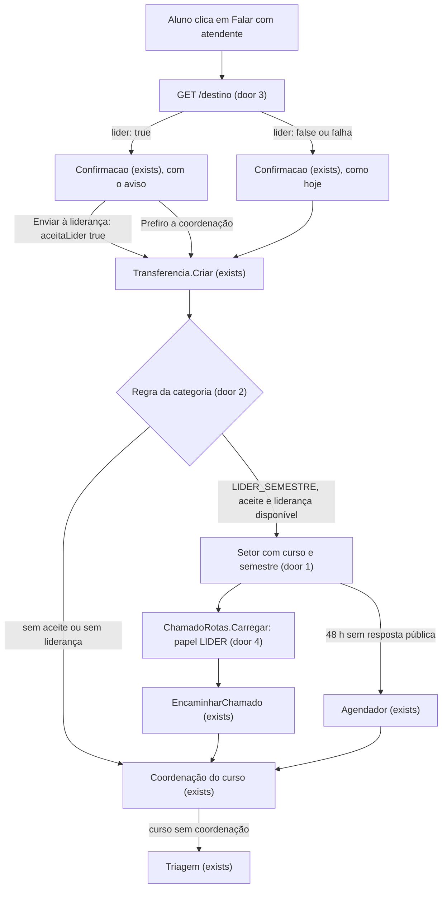
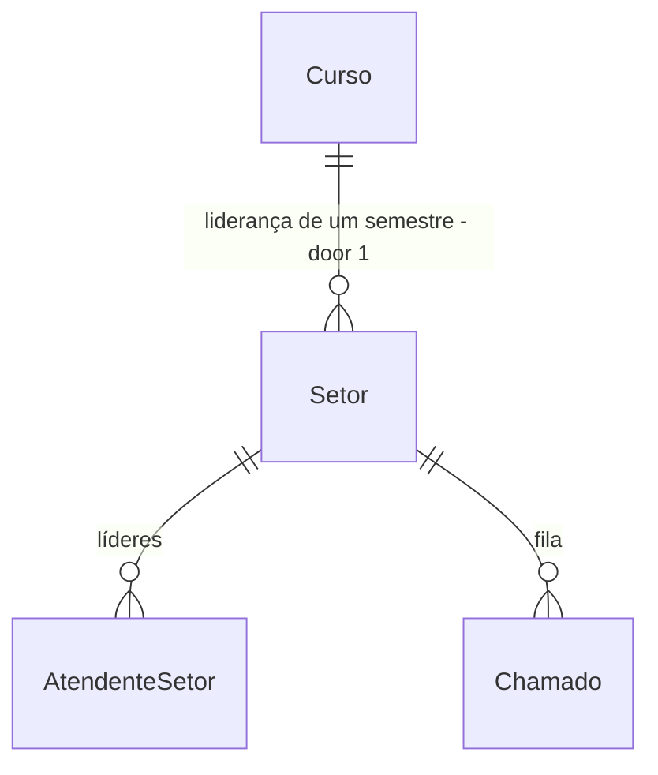

# Líder de semestre entre o assistente e a coordenação

> Absorvido por `.specs/features/fluxos-atendimento/plan.md` (proposta de 08/11): a liderança vira o tipo de destino `LIDERANCA_SEMESTRE`, e os critérios 1 a 34 daqui viram os de S4 de lá (49 a 66). Este plano não deve ser construído à parte.

## Problem

O assistente só consegue passar a dúvida a um setor fixo ou à coordenação do curso. Toda dúvida simples de turma chega à coordenação, e o líder de semestre, que poderia responder antes, não aparece no fluxo. Quem paga é a coordenação, com a fila, e o aluno, com a espera.

A saída sem código, um setor "Líderes de turma", mostra a todos os líderes a mesma fila, de todos os cursos e semestres, com a conversa inteira do aluno, as fontes internas e os anexos.

Evidência: só a pergunta do usuário em 05/11 ("o bot manda pra lider semestre > caso necessário vai para a coordenação"). Não há pedido da instituição registrado nem número de volume.

Depois disto, a dúvida de uma categoria escolhida pelo admin vai primeiro à liderança do curso e semestre do aluno, se o aluno aceitar. A liderança vê só o necessário e encaminha à coordenação quando precisa.

## Flow

Reusa `Setor`, `AtendenteSetor`, a fila, o tempo real e o `Encaminhar`: a liderança é um setor marcado com curso e semestre, sem tabela de líderes, tela nova ou papel novo de usuário.

## Impact

| Front | What changes |
| --- | --- |
| domain | novo termo: `Liderança` - setor com curso e semestre; quem é atendente dele é o líder daquela turma. Entra no `GLOSSARIO.md` |
| domain | novo valor: `LIDER_SEMESTRE` em `RegraRoteamento.Destino`; quem ramifica nele: `Transferencia.Setor`, `RegraRotas.Validar`, `web/src/administracao/comum.tsx` e `Cadastros.tsx` |
| domain | novo papel de acesso ao chamado: `PermissoesChamado.Lider`, calculado pelo setor do chamado e nunca gravado no usuário; quem ramifica: `DetalheChamado.Montar`, `BaixarAnexoConversa.PodeVer` e a tabela `Permitidas` |
| contrato do detalhe | `matricula.numero` passa a poder ser `null` só para `LIDER`; o `web/` deixa de mostrar a linha quando não vem |
| transferência | `POST /transferir` ganha `aceitaLider`; sem ele nunca vai à liderança. `AtendimentoDireto` não muda, porque a categoria padrão não tem regra |
| Encaminhar e cadastros | a lista `setores` do detalhe e as listas de destino em Regras e Cursos deixam de oferecer lideranças |
| Indicadores | a passagem da liderança à coordenação soma em `Encaminhamentos`, como qualquer encaminhamento. A conta não muda, mas a leitura do número muda |
| carga JSON | nada: `CargaValidacao` só gera `SETOR` e `COORDENACAO_CURSO`, e líder se configura depois pela tela |
| AD-010 e AD-012 | conformes: a regra por categoria continua decidindo o setor, e a liderança não recebe transcrição, então nunca vê fontes internas |
| stored data | duas colunas anuláveis em `setor`, sem backfill: os setores atuais ficam sem curso e sem semestre, e o comportamento deles não muda |

## Relations

One-way constraints: no máximo 1 setor ativo por instituição, curso e semestre (door 1); curso e semestre existem juntos ou faltam juntos (door 1); curso e semestre não mudam depois de criar o setor (door 1).

## Surface

| Route | In | Out | Status |
| --- | --- | --- | --- |
| `GET /api/conversas/{id}/destino` | `matriculaId` opcional | `lider` | `200`, `400`, `404`, `409` |
| `POST /api/conversas/{id}/transferir` | `matriculaId` opcional, `aceitaLider` opcional | `numero` · `estado` · `setor` | `201`, `400`, `404`, `409` |
| `POST /api/admin/setores` | `nome`, `triagem`, `ativo`, `cursoId` opcional, `semestre` opcional | setor com `cursoId` · `semestre` | `201`, `400`, `409` |
| `PUT /api/admin/setores/{id}` | `nome`, `triagem`, `ativo` | setor com `cursoId` · `semestre` | `200`, `400`, `404`, `409` |
| `GET /api/admin/setores` | - | setores com `cursoId` · `semestre` | `200` |
| `POST /api/admin/regras` | `categoriaId`, `destino` com `LIDER_SEMESTRE`, `setorId` | regra | `200`, `201`, `400` |
| `PUT /api/admin/regras/{id}` | `categoriaId`, `destino` com `LIDER_SEMESTRE`, `setorId` | regra | `200`, `400`, `404` |
| `GET /api/chamados/{numero}` | `numero` | no papel `LIDER`: `transcricao: []`, `matricula.numero: null`, `categorias: null` | `200`, `404` |

## Landing

| One-way door | Literal shape | Alternative rejected |
| --- | --- | --- |
| 1. Liderança como setor | `setor.curso_id` e `setor.semestre` anuláveis; `CHECK ((curso_id IS NULL) = (semestre IS NULL))`; `CHECK (semestre BETWEEN 1 AND 12)`; `CREATE UNIQUE INDEX ux_setor_lideranca ON setor (instituicao_id, curso_id, semestre) WHERE curso_id IS NOT NULL AND ativo`; o `PUT` não aceita os dois campos | Tabela `curso + semestre -> usuário`: `Chamado.SetorId` é obrigatório e fila, acesso e tempo real são por setor, então duplicaria os três. Tabela `curso + semestre -> setor`: apagar a linha devolveria a visão completa a quem ainda tem chamados abertos |
| 2. Destino da regra | `RegraRoteamento.Destino = "LIDER_SEMESTRE"`, com `SetorId` nulo; a liderança sai do curso e do semestre da matrícula do chamado | Regra por curso e semestre: multiplica as regras e tira da categoria a decisão de AD-010 |
| 3. Aceite do aluno | `POST /transferir` com `{"aceitaLider": true}`; ausente ou `false` nunca vai à liderança; `GET /destino` só informa | `semLider` com padrão de ir ao líder: uma falha da prévia mandaria dados a um colega sem aviso |
| 4. Papel de acesso | `PermissoesChamado.Lider = "LIDER"`, devolvido por `ChamadoRotas.Carregar` quando o setor do chamado tem `curso_id`; pode `responder`, `nota`, `assumir`, `resolver` e `encaminhar` | `Papeis.Lider` no usuário: quem atende um setor comum e uma liderança teria uma visão só, e trocar o líder exigiria outra regra de acesso |

- Nothing else in this change is hard to reverse

## Criteria

### S1: o admin configura a liderança (P1)

O admin marca um setor como liderança de um curso e semestre e aponta categorias para ela.

**Acceptance Criteria**

1. WHEN an admin creates a sector with `cursoId` and `semestre` THEN the API SHALL store both and return them with `201`
2. IF only one of `cursoId` and `semestre` is sent THEN the API SHALL return `400` with field `semestre`
3. IF `semestre` is outside 1 to 12 THEN the API SHALL return `400` with field `semestre`
4. IF `cursoId` is not an existing course of the institution THEN the API SHALL return `400` with field `cursoId`
5. IF the sector is `triagem` and has `cursoId` THEN the API SHALL return `400` with field `triagem`
6. IF an active sector already leads that course and semester THEN the API SHALL return `409` on create and on reactivation
7. WHEN an admin updates a sector THEN the API SHALL keep its `cursoId` and `semestre`
8. WHEN an admin saves a rule with `LIDER_SEMESTRE` THEN the API SHALL store a null `setorId`
9. IF a rule with `SETOR` or a course coordination points to a leadership sector THEN the API SHALL return `400` with field `setorId` or `setorCoordenacaoId`
10. WHEN the admin opens the Setores form on create THEN the web SHALL offer "Liderança de semestre" with course and semester, and on edit SHALL show them read-only
11. WHEN the admin opens the Regras form THEN the web SHALL offer `Liderança do semestre do aluno` and SHALL not list leadership sectors as a destination

**Independent test:** criar a liderança de ADS 3º, dar a ela um atendente e apontar uma categoria, tudo pela tela Cadastros e pela tela Usuários.

### S2: o aluno é avisado e decide (P1)

Nenhum dado chega a um colega sem o aluno saber antes.

**Acceptance Criteria**

12. WHEN the student's category rule is `LIDER_SEMESTRE` and a leadership is available THEN `GET /destino` SHALL return `lider: true`
13. WHEN any other case applies THEN `GET /destino` SHALL return `lider: false` and SHALL write nothing
14. The system SHALL treat a leadership as available only when its sector is active and has at least one active attendant other than the student
15. WHEN `lider` is true THEN the web SHALL show in the confirmation dialog `Sua dúvida vai primeiro para a liderança do seu semestre, formada por estudantes da sua turma. A liderança vê seu nome, curso, semestre e um resumo da dúvida. A conversa com o assistente e os anexos dela não são mostrados.`
16. WHEN `lider` is true THEN the dialog SHALL offer `Cancelar`, `Prefiro a coordenação` and `Enviar à liderança`
17. WHEN the student has more than one active enrolment THEN the web SHALL call `GET /destino` only after one is chosen and again when it changes
18. IF `GET /destino` fails THEN the web SHALL show the current dialog and send no `aceitaLider`
19. WHEN `POST /transferir` has `aceitaLider: true` and a leadership is available THEN the ticket SHALL open in that sector
20. IF `aceitaLider` is absent or false THEN the ticket SHALL open in the course coordination, or in triage when the course has none
21. IF `aceitaLider` is true and no leadership is available at that moment THEN the ticket SHALL open in the course coordination, or in triage when the course has none
22. WHEN the ticket comes from `POST /api/atendimento-direto` THEN the system SHALL never open it in a leadership sector

**Independent test:** com a mesma categoria, transferir uma vez aceitando e outra escolhendo a coordenação, e conferir o setor de cada chamado.

### S3: a liderança vê só o necessário e passa adiante (P1)

O líder responde colegas da sua turma sem acesso ao que é da equipe.

**Acceptance Criteria**

23. WHILE the ticket's sector is a leadership and the viewer is its attendant, `GET /api/chamados/{numero}` SHALL return `transcricao: []`, `matricula.numero: null` and `categorias: null`
24. WHILE in that state the API SHALL return `solicitante`, `resumo`, `matricula.curso`, `matricula.semestre`, `mensagens` and `eventos`
25. WHILE in that state `acoes` SHALL contain only actions among `responder`, `nota`, `assumir`, `resolver` and `encaminhar`
26. IF a leader calls `reclassificar` or `duplicado` THEN the API SHALL return `403`
27. IF a leader requests a conversation attachment of a ticket in their leadership THEN `GET /api/conversas/anexos/{id}` SHALL return `404`
28. WHEN the leader opens the ticket THEN the web SHALL show neither the "Conversa com o assistente" block nor the enrolment number
29. WHEN a leader forwards a ticket to another sector THEN the leader SHALL receive `404` on that ticket afterwards
30. IF anyone forwards a ticket to a leadership sector THEN the API SHALL return `400` with field `setorId`
31. The `setores` list of the ticket detail SHALL contain no leadership sector
32. WHILE a user is both the requester of a ticket and an attendant of its sector, the API SHALL give that user the `ALUNO` view
33. WHEN a person with `ALUNO` and `ATENDENTE` signs in THEN the web SHALL offer both Assistente and Fila
34. The system SHALL never route a ticket of one institution to a leadership of another institution

**Independent test:** entrar como líder, responder um colega, encaminhar à coordenação e ver o chamado sumir da fila do líder.

### S4: dúvida sem resposta sobe sozinha (P2)

O aluno não fica preso quando o líder não responde.

**Acceptance Criteria**

35. WHEN a ticket in a leadership has state `ABERTO` or `EM_ATENDIMENTO`, has no public team message and `Prazos:LiderHoras` (default 48) have passed since creation THEN the scheduler SHALL move it to the course coordination, or to triage when the course has none
36. WHEN the scheduler moves a ticket THEN the system SHALL record `ENCAMINHAMENTO` with no author and detail `Sem resposta da liderança em 48 horas`, using the configured number
37. WHEN the scheduler moves a ticket THEN the system SHALL clear the responsible, set state `ABERTO` and add 1 to `Encaminhamentos`
38. WHEN two scheduler runs reach the same ticket THEN the system SHALL move it once, by a conditional update on its current sector
39. IF the leader has already sent a public message THEN the scheduler SHALL leave the ticket in the leadership

**Independent test:** com o relógio falso, passar 48 horas sem resposta e ver o chamado na fila da coordenação, com a linha no Histórico.

## Out of scope

| Excluded | Why |
| --- | --- |
| Aviso por e-mail ou push ao líder sobre chamado novo | hoje nenhum atendente recebe esse aviso; o prazo de S4 cobre o líder ausente |
| Coordenação enxergar a fila da liderança | a privacidade fica mais simples se o chamado só sobe; o admin pode tornar alguém atendente do setor |
| Devolver da coordenação à liderança | dados vistos pela equipe não devem voltar a um colega |
| Tela própria de líderes e troca automática a cada semestre | o admin troca o atendente do setor na tela Usuários |
| Líderes pela carga JSON | a carga é para o início da instituição; configurar pela tela basta para o piloto |

## Assumptions

| Assumption | Chosen default | Rationale | Confirmed? |
| --- | --- | --- | --- |
| O líder é estudante e pode ter informação sensível de colegas | aviso antes, aceite explícito, sem transcrição e sem número de matrícula | é o menor acesso que ainda deixa o líder responder | n |
| O que o líder vê | título, resumo da IA, nome, curso, semestre e as mensagens trocadas depois da transferência | a transcrição traria fontes internas (AD-012) e anexos | n |
| Categorias enviadas à liderança | só as que o admin apontar; nenhuma por padrão | financeiro e saúde continuam na regra atual | n |
| Prazo sem resposta | 48 horas corridas, em `Prazos:LiderHoras` | é um número de partida, sem dado de uso; a instituição pode trocar | n |
| Anexos depois da transferência | anexos que o aluno enviar ao líder ficam visíveis ao líder | o aluno envia esses arquivos sabendo que o líder atende | n |

**Open questions:**

| # | Kind | Question | Until answered |
| --- | --- | --- | --- |
| 1 | open | É pedido real da instituição ou ideia para a banca? | decide se o build entra antes do congelamento de 17/11, disputando com a Etapa 5, ou fica para depois de 20/11. O plano vale nos dois casos |
| 2 | blocks go-live | A Univag aceita estudante atendendo estudante e vendo nome e resumo, e com qual termo de confidencialidade? | o fluxo pode ser mostrado com dados de exemplo, mas não ligado para alunos reais |

## Observable

| Surface | Decision | Landing |
| --- | --- | --- |
| screen Cadastros (Setores, Regras) | empty, loading, error | existing - padrão de `Cadastros.tsx`, erro por campo vindo da API |
| screen Cadastros (Setores, Regras) | unauthorised | existing - rotas `/api/admin` |
| screen Cadastros (Setores, Regras) | density and ordering | AC 10, AC 11 |
| screen Cadastros (Setores, Regras) | destructive action confirms | n/a - não há exclusão; o setor só é desativado, como hoje |
| dialog de transferência | loading | AC 17 e AC 18: a escolha fica desligada até a prévia responder ou falhar |
| dialog de transferência | error | AC 18 |
| dialog de transferência | empty, unauthorised | n/a - só abre para o dono da conversa ativa |
| dialog de transferência | destructive action confirms | AC 16 |
| screen Detalhe do chamado (líder) | empty, loading, error | existing - `ChamadoDetalhe`; sem transcrição o bloco some (AC 28) |
| screen Detalhe do chamado (líder) | unauthorised | AC 29 |
| screen Detalhe do chamado (líder) | density and ordering | existing - `estrutura-visual` |
| screen Detalhe do chamado (líder) | destructive action confirms | existing - o diálogo de Encaminhar pede o motivo |
| API `GET /destino` e `POST /transferir` | response and error shape | AC 12, AC 13, AC 19 a AC 21; recusas existentes de matrícula, conversa e desfecho |
| API `GET /destino` e `POST /transferir` | who may call | existing - `DoAluno` restringe ao dono da conversa |
| API `POST` e `PUT /setores`, `POST` e `PUT /regras` | response and error shape | AC 1 a AC 9 |
| API `GET /api/chamados/{numero}` | response shape | AC 23, AC 24 |
| all new and changed routes | versioning, rate limits | n/a - contrato lido só pelo `web/` deste repositório, sem limite próprio além da sessão |
| scheduled task Agendador | output, flags, exit codes | existing - log por chamado como os outros prazos; a config `Prazos:LiderHoras` tem o padrão de AC 35 |
| scheduled task Agendador | failure halfway | AC 38 |
| document aviso do diálogo | structure, tone, next step | AC 15, AC 16 |
| collection Setores | grouping, naming, duplicates, exception | AC 6; o nome é livre, como hoje; a triagem nunca é liderança (AC 5) |

## Sources

- Resposta na sessão de 05/11 sobre o fluxo "bot, líder de semestre, coordenação" - o que falta e o risco de LGPD
- `.specs/STATE.md` AD-010 e AD-012 - a regra decide o setor, e fontes internas não chegam a estudantes
