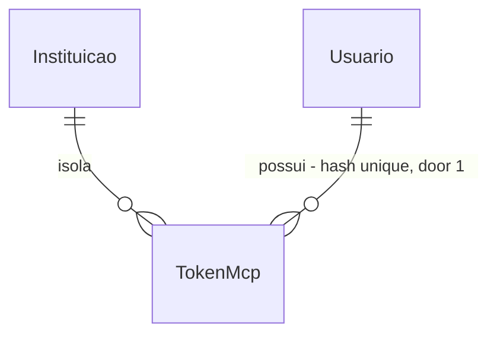

# MCP do One: a equipe usa a própria IA com os dados do One (somente leitura)

## Problem

Um atendente do One que quer ajuda de uma IA (Claude, Cursor, Codex) para entender um chamado, achar o artigo certo ou ler os indicadores precisa copiar o texto do One e colar na ferramenta, e colar de volta o que a IA devolveu. Cada cópia é manual, sai do controle de papel e de instituição do One, e o atendente decide sozinho o que colar. A aba "MCP" da área Integrações (feature `integracoes-admin`) existe desde 10/11, mas só diz "Em breve": o administrador não tem como conectar nada.

Evidência: o pedido do dono do projeto em 10/11 ("construir o MCP do One e adicionar na aba de integrações"). Não há medida de uso nem de tempo gasto copiando, porque o One ainda não está em produção.

Depois disto, o administrador gera na aba MCP um token pessoal, cola a URL e o token no Claude Code ou no Cursor, e a IA passa a listar e abrir chamados, buscar na base de conhecimento e ler os indicadores com o papel e a instituição dele. Nada é escrito no One por esse caminho.

## Flow

Reusa os casos de uso de leitura que já existem (`ListarChamados`, `VerChamado`, `ConsultarIndicadores`), a busca `Fontes.Buscar` com `Embeddings` e as mesmas regras de visibilidade; o MCP só troca a porta de entrada (token em vez de cookie) e o formato da saída.

1. Administrador na aba MCP -> `POST /api/admin/mcp/tokens` (door 1, 2) - `CriarTokenMcp` (new, `One.Api/Administracao/`, montado em `AdminRotas`) gera o token, grava só o hash em `token_mcp` e devolve o token uma vez; `VerMcp` e `RevogarTokenMcp` (new, mesma pasta) listam e revogam
2. Cliente MCP (Claude Code, Cursor) -> `POST /api/mcp/{slug}` com `Authorization: Bearer` (door 3) - o esquema `mcp` (new, `AutenticacaoMcp`, `One.Api/Mcp/`, door 5) acha o hash em `token_mcp` dentro do tenant do slug, confere validade, usuário e instituição como `Sessao.Validar` (exists), define `db.InstituicaoAtual` e `HttpContext.Items[Usuario]`
3. `MapMcp` do SDK `ModelContextProtocol.AspNetCore` (door 4, new) em modo stateless - entrega a chamada à classe de ferramentas (door 5)
4. `FerramentasMcp` (new, `One.Api/Mcp/`) - `listar_chamados`, `ver_chamado`, `ver_indicadores` enviam as mensagens existentes `ListarChamados`, `VerChamado`, `ConsultarIndicadores` por `IMediator` (exists); `buscar_conhecimento` chama `Embeddings.Gerar` e `Fontes.Buscar` (exist); cada uma devolve um record nomeado (door 3)
5. out: o resultado da ferramenta; `token_mcp.ultimo_uso_em` atualizado (no máximo 1 vez por minuto) e uma linha de log com ferramenta, usuário e resultado

## Impact

| Front | What changes |
| --- | --- |
| domain | new term: `TokenMcp` - credencial pessoal e revogável de um usuário da equipe para a porta MCP; vive em `Dados/Mcp/` |
| domain | existing term: "quem pode ver um chamado" e "quem pode ver indicadores" continuam sendo as regras de `ChamadoRotas.Carregar` e `ConsultarIndicadores`; quem depende delas hoje: as rotas `/api/chamados*` e `/api/indicadores`. O MCP passa a ser o terceiro chamador e não pode ter regra própria |
| routes | `Program.cs` monta `/api` com `RequireAuthorization` pelo cookie; `/api/mcp/{slug}` fica fora desse grupo e só aceita o esquema `mcp`; o cookie não vale nela e o token não vale em `/api/*` |
| architecture | nova fatia `Mcp` (door 5): muda `Fatias`, `Fatias_do_api`, `ReferenciasEntreFatias` (4 pares novos) e as contagens de casos de uso e de `Map*` em `ArquiteturaTests`; AD-017 é emendado |
| web | a aba `MCP` de `Integracoes.tsx` deixa de ser "Em breve"; o teste `integracoes.test.tsx` (C3, C8 de `integracoes-admin`) afirma o selo e o aviso e precisa mudar |
| stored data | 1 tabela nova com `instituicao_id` e filtro global (AD-008); nada a migrar |
| privacy | chamado aberto por MCP leva nome do solicitante e texto do aluno para a IA que o atendente escolheu (ver `Assumptions`, `blocks go-live`) |
| unchanged | login, papéis, `ListarChamados`, `VerChamado`, `ConsultarIndicadores`, `Fontes`, `Embeddings` e as regras do AD-011/AD-012 (o MCP não responde ao aluno) |

## Relations

One-way constraints: `hash` único em toda a tabela (door 1). Sem colunas nem tipos aqui.

## Surface

| Route | In | Out | Status |
| --- | --- | --- | --- |
| `GET /api/admin/mcp` | nada | `url` · `tokens[]` (`id` · `nome` · `usuario` · `final` · `criadoEm` · `expiraEm` · `ultimoUsoEm` · `estado`) | `200`, `401`, `403` |
| `POST /api/admin/mcp/tokens` | `nome`, `dias` (30, 90 ou 365) | `id` · `nome` · `token` (só nesta resposta) · `final` · `criadoEm` · `expiraEm` | `201`, `400`, `401`, `403`, `409` |
| `DELETE /api/admin/mcp/tokens/{id}` | `id` | sem corpo | `204`, `401`, `403`, `404` |
| `POST /api/mcp/{slug}` | JSON-RPC do MCP (Streamable HTTP, sem sessão) com `Authorization: Bearer` | resposta JSON-RPC do SDK | `200`, `401`, `429` |

As 4 ferramentas (door 3) são mensagens JSON-RPC sobre a rota acima, não rotas:

| Ferramenta | In | Out |
| --- | --- | --- |
| `listar_chamados` | `escopo` (`fila` padrão, ou `meus`), `estado` opcional | `total` · `itens[]` (até 50): `numero` · `titulo` · `estado` · `criadoEm`, e na fila `categoria` · `responsavel` · `dias` |
| `ver_chamado` | `numero` (`ONE-n`) | `numero` · `titulo` · `estado` · `categoria` · `setor` · `responsavel` · `solicitante` · `curso` · `semestre` · `criadoEm` · `resolvidoEm` · `resumo` · `mensagens[]` · `eventos[]` |
| `buscar_conhecimento` | `consulta` (1 a 500 caracteres), `limite` (1 a 10, padrão 5) | `fontes[]`: `tipo` (`ARTIGO` ou `DOCUMENTO`) · `titulo` · `texto` · `links[]` |
| `ver_indicadores` | `de`, `ate` (`yyyy-MM-dd`), `setorId` opcional | o mesmo `Resultado` de `GET /api/indicadores` |

## Landing

| One-way door | Literal shape | Alternative rejected |
| --- | --- | --- |
| 1. Tabela `token_mcp` | `UNIQUE (hash)`; `hash` = SHA-256 hex de `Tokens.Hash`; campos `usuario_id`, `nome`, `final` (4 últimos caracteres), `criado_em`, `expira_em` (obrigatório), `ultimo_uso_em`, `revogado_em`; o token em claro nunca é gravado | guardar o token em claro: quem lê o banco ou um backup passa a ser a equipe inteira; reusar `token_acesso`: é de uso único e 60 min, não tem nome, validade longa, revogação nem último uso |
| 2. Formato do token | `onemcp_<slug>.<base64url de 32 bytes>`; o slug no prefixo permite achar o tenant antes de consultar o hash, como `DefinirSenha` faz, sem `IgnoreQueryFilters` (regra do `ArquiteturaTests`); o prefixo `onemcp_` deixa um scanner de segredos reconhecê-lo | token opaco sem slug: exige buscar fora do tenant, o que só `Agendador` e `InstituicaoComando` podem; JWT assinado: não se revoga sem lista de bloqueio, e o hash por linha já resolve |
| 3. Contrato exposto: caminho e ferramentas | caminho `/api/mcp/{slug}`; ferramentas `listar_chamados`, `ver_chamado`, `buscar_conhecimento`, `ver_indicadores` com as entradas da tabela de `Surface`; resposta de cada uma é um record nomeado, texto de erro em português | `/{slug}/mcp` fora de `/api`: o `MapFallbackToFile` trataria como tela do SPA; `/api/{slug}/mcp`: o primeiro segmento colidiria com `auth`, `admin` e `chamados`, e `/api/moodle/{slug}` já é o precedente; nome de ferramenta mudado depois quebra o prompt e a configuração de quem já conectou |
| 4. Pacote `ModelContextProtocol.AspNetCore` 2.4.0 (exato; a versão estável mais nova no NuGet em 10/11), transporte HTTP em `HttpServerSessionMode.Stateless` | `AddMcpServer().WithHttpTransport(o => o.SessionMode = HttpServerSessionMode.Stateless).WithTools<FerramentasMcp>()` e `MapMcp` | escrever o JSON-RPC e o Streamable HTTP à mão: protocolo em evolução, nenhum ganho; modo com sessão: guarda estado por processo, e a ferramenta precisa do escopo da requisição (o `OneDb` com `InstituicaoAtual`), que só é seguro quando cada requisição é independente |
| 5. Nova fatia `Mcp` e emenda do AD-017 | pasta `One.Api/Mcp/`, namespace `One.Api.Mcp`, com `AutenticacaoMcp.cs`, `FerramentasMcp.cs` e as respostas das ferramentas; pares novos `Mcp -> Chamados, Conhecimento, Indicadores, Assistente`; a gestão do token (3 casos de uso) fica em `Administracao`, junto do Moodle | ferramentas dentro de `Administracao`: criaria `Administracao -> Chamados, Indicadores, Assistente` e misturaria a tela de admin com a porta de leitura; fatia sem emenda: o `ArquiteturaTests` falha, e a regra é mudar o AD primeiro |
| 6. Esquema de autenticação `mcp` separado do cookie | `AddScheme<AuthenticationSchemeOptions, AutenticacaoMcp>("mcp")` e `RequireAuthorization` com `AuthenticationSchemes = "mcp"` só na rota do door 3 | reusar o cookie `one.auth`: `SameSite=Strict`, feito para navegador, um cliente de IA não o usa; OAuth 2.1 com registro dinâmico de cliente: exige servidor de autorização próprio, fora do menor passo (ver `Out of scope`) |

- Nada mais nesta mudança é difícil de desfazer

## Criteria

### S1: o administrador gera, vê e revoga tokens (P1)

O administrador controla quais credenciais MCP existem na instituição dele.

**Acceptance Criteria**

1. WHEN um `ADMINISTRADOR` envia `POST /api/admin/mcp/tokens` com `nome` de 1 a 60 caracteres e `dias` 30, 90 ou 365 THEN o sistema SHALL responder `201` com `id`, `nome`, `token` no formato `onemcp_<slug>.<43 caracteres base64url>`, `final` (os 4 últimos caracteres do token), `criadoEm` e `expiraEm` igual a `criadoEm` mais `dias`, e gravar só o SHA-256 do token
2. IF `nome` vem vazio ou com mais de 60 caracteres, ou `dias` não é 30, 90 nem 365 THEN o sistema SHALL responder `400` com o erro no campo (`errors.nome` ou `errors.dias`) e não criar token
3. IF o usuário já tem 5 tokens ativos (nem revogados, nem vencidos) THEN o sistema SHALL responder `409` com "Você já tem 5 tokens ativos. Revogue um para criar outro." e não criar token
4. WHEN um `ADMINISTRADOR` envia `GET /api/admin/mcp` THEN o sistema SHALL responder `200` com `url` igual a `{App:UrlBase}/api/mcp/{slug}` e, em `tokens`, todos os tokens da instituição do mais novo para o mais antigo, cada um com `estado` `ATIVO`, `EXPIRADO` ou `REVOGADO`, e sem o token nem o hash
5. WHEN um `ADMINISTRADOR` envia `DELETE /api/admin/mcp/tokens/{id}` de um token da instituição THEN o sistema SHALL responder `204`, gravar `revogado_em` e, repetido, responder `204` sem mudar o `revogado_em` já gravado
6. IF o `id` não existe na instituição do administrador (inclusive de outra instituição) THEN o sistema SHALL responder `404`
7. IF quem chama as 3 rotas de `/api/admin/mcp` não é `ADMINISTRADOR` THEN o sistema SHALL responder `403`, e sem sessão `401`

**Independent test:** criar, listar e revogar um token por HTTP contra o Postgres do compose.

### S2: o cliente MCP entra com o token (P1)

Só um token válido abre a porta, e ela abre com o papel e a instituição do dono.

**Acceptance Criteria**

8. WHEN um cliente envia `POST /api/mcp/{slug}` com `Authorization: Bearer` de um token ativo e `initialize` e `tools/list` THEN o sistema SHALL responder `200` listando exatamente `listar_chamados`, `ver_chamado`, `buscar_conhecimento` e `ver_indicadores`
9. IF o cabeçalho falta, não tem o formato `onemcp_<slug>.<...>` ou o hash não existe THEN o sistema SHALL responder `401` com `WWW-Authenticate: Bearer` e não executar ferramenta
10. IF o token está revogado ou vencido THEN o sistema SHALL responder `401` e não executar ferramenta
11. IF o slug da URL difere do slug do token THEN o sistema SHALL responder `401`
12. IF a instituição está inativa, o usuário está inativo, o usuário deve trocar a senha ou o usuário não tem mais o papel `ATENDENTE` nem `ADMINISTRADOR` THEN o sistema SHALL responder `401`
13. WHEN um token autentica THEN o sistema SHALL gravar `ultimo_uso_em` no máximo uma vez por minuto por token
14. IF um token faz mais de `Limites:McpPorMinuto` (padrão 60) requisições em 60 segundos THEN o sistema SHALL responder `429`
15. The sistema SHALL recusar com `401` o cookie `one.auth` em `/api/mcp/{slug}` e o token MCP em qualquer rota `/api/*` fora dela

**Independent test:** ligar com `curl` e cada estado de token, e ver `tools/list`.

### S3: as quatro ferramentas leem com as regras do One (P1)

A IA enxerga o que o dono do token já enxerga no One, e nada além.

**Acceptance Criteria**

16. WHEN `listar_chamados` é chamada THEN o sistema SHALL devolver a mesma lista que `GET /api/chamados` dá ao dono do token (`escopo=fila` por padrão, `meus` o que ele abriu), no máximo 50 itens, com `total` igual ao número de chamados antes do corte
17. IF `escopo` não é `fila` nem `meus`, ou `estado` não é um estado de chamado THEN o sistema SHALL responder com erro de ferramenta que lista os valores aceitos
18. WHEN `ver_chamado` é chamada com um número que o dono do token pode ver (a regra de `ChamadoRotas.Carregar`) THEN o sistema SHALL devolver os campos da tabela de `Surface`, com as mensagens e eventos que `DetalheChamado` dá a esse papel, sem anexos e sem o número da matrícula
19. IF o chamado não existe, é de outra instituição ou o dono do token não pode vê-lo THEN o sistema SHALL responder com erro de ferramenta "Chamado não encontrado." igual nos três casos
20. WHEN `buscar_conhecimento` é chamada por `ATENDENTE` ou `ADMINISTRADOR` que não é só liderança THEN o sistema SHALL devolver até `limite` trechos de artigos ativos e documentos ativos da instituição, do mais próximo ao mais distante, com `tipo`, `titulo`, `texto` e `links`
21. IF o dono do token só tem setor de liderança de curso THEN o sistema SHALL responder com erro de ferramenta "Seu papel não tem acesso à base de conhecimento."
22. IF a geração do embedding da consulta falha THEN o sistema SHALL responder com erro de ferramenta "A busca está indisponível agora. Tente de novo em instantes."
23. IF `consulta` vem vazia ou com mais de 500 caracteres, ou `limite` fora de 1 a 10 THEN o sistema SHALL responder com erro de ferramenta que diz o limite
24. WHEN `ver_indicadores` é chamada THEN o sistema SHALL devolver o `Resultado` que `GET /api/indicadores` daria ao dono do token para os mesmos `de`, `ate` e `setorId`
25. IF `GET /api/indicadores` responderia `400`, `403` ou `422` para esses parâmetros THEN o sistema SHALL responder com erro de ferramenta com a mesma mensagem
26. The sistema SHALL NOT gravar nada no banco ao executar uma ferramenta, exceto `ultimo_uso_em` do critério 13
27. WHEN uma ferramenta é executada THEN o sistema SHALL registrar uma linha de log `Information` com o nome da ferramenta, o id do usuário, o id da instituição e `ok` ou `erro`, sem argumentos nem texto do resultado

**Independent test:** chamar cada ferramenta por `tools/call` com um token de ATENDENTE e outro de ADMINISTRADOR e comparar com a rota HTTP equivalente.

### S4: a aba MCP da área Integrações (P1)

O administrador cria o token e copia o que precisa para conectar, sem sair do One.

**Acceptance Criteria**

28. WHEN o administrador abre `/{slug}/integracoes?aba=mcp` THEN o sistema SHALL mostrar a aba `MCP` selecionada, sem o selo "Em breve", com a URL do servidor e o botão `Copiar`, e uma tabela de tokens com `Nome`, `Dono`, `Final`, `Criado`, `Vence`, `Último uso` e `Estado`
29. WHEN o administrador preenche `Nome`, escolhe a validade (30, 90 ou 365 dias, 90 por padrão) e envia THEN o sistema SHALL mostrar o token inteiro uma única vez com `Copiar`, o aviso "Copie agora: o token não será mostrado de novo." e o comando `claude mcp add --transport http one <url> --header "Authorization: Bearer <token>"` já preenchido, e a tabela ganhar a linha
30. WHEN o painel do token recém-criado é fechado THEN o sistema SHALL deixar na tela só o `Final` do token
31. WHEN o administrador clica em `Revogar` numa linha ativa THEN o sistema SHALL pedir confirmação ("Revogar o token «nome»?") e, ao confirmar, mostrar a linha como `REVOGADO` e o aviso "Token revogado."
32. IF a lista não tem token THEN o sistema SHALL mostrar "Nenhum token ainda." e o formulário de criação
33. WHILE a lista carrega o sistema SHALL mostrar esqueleto, e IF o `GET` falha THEN mostrar o erro com `Tentar de novo`
34. IF a criação responde `400` ou `409` THEN o sistema SHALL mostrar a mensagem no campo ou acima do botão, sem fechar o formulário
35. The sistema SHALL mostrar na aba o bloco "Como conectar" com o comando do Claude Code e o JSON `{"mcpServers":{"one":{"url":"<url>","headers":{"Authorization":"Bearer <seu-token>"}}}}` para clientes que leem `mcp.json`, e a nota de que Claude.ai e ChatGPT na web ainda não conectam (pedem OAuth)

**Independent test:** `npm --prefix web test` na aba; e abrir a tela no navegador contra a API.

## Out of scope

| Excluded | Why |
| --- | --- |
| Ferramentas que escrevem (assumir, responder, encaminhar, criar artigo) | Opção B da conversa de 10/11; precisa de plano próprio (histórico append-only, AD-011/AD-012, quem responde ao aluno) |
| O assistente do One consumir MCPs externos | Opção C: outro produto e outra direção |
| OAuth 2.1 com registro dinâmico de cliente | Conectores web (Claude.ai, ChatGPT) tendem a pedir OAuth, conforme a documentação dos clientes (não verificado aqui); exige servidor de autorização próprio. O token pessoal cobre Claude Code, Cursor e clientes que aceitam cabeçalho |
| Atendente sem papel de administrador gerar o próprio token | A área Integrações é só do `ADMINISTRADOR` (`integracoes-admin`, C2); abrir a aba a atendentes muda um check já fechado e o menu. Ver `Assumptions` |
| Chave global para desligar o MCP da instituição, escopo por ferramenta no token, lista de IPs | Sem token ativo a porta já está fechada; cada um é um recurso a mais sem pedido |
| `resources` e `prompts` do MCP, ferramentas para o aluno | Só as 4 ferramentas pedidas |

## Assumptions

| Assumption | Chosen default | Rationale | Confirmed? |
| --- | --- | --- | --- |
| Quem gera tokens | só `ADMINISTRADOR`, na aba MCP, para si mesmo | A área Integrações é de administrador. Consequência: `listar_chamados` com `escopo=fila` só devolve itens se o administrador também tiver o papel `ATENDENTE` e setor (regra de `ListarChamados`); para ele, `ver_indicadores` e `buscar_conhecimento` funcionam sempre | n |
| Validade do token | obrigatória; 30, 90 ou 365 dias, 90 por padrão | Token sem vencimento vira credencial esquecida | n |
| Limite de tokens ativos por usuário | 5 | Número pequeno e suficiente (um por ferramenta de IA); muda por configuração depois | n |
| Dados do aluno saem para a IA do atendente | `ver_chamado` devolve nome do solicitante, texto das mensagens, resumo e eventos; não devolve anexos, matrícula, CPF nem e-mail | Menor exposição que ainda deixa a IA útil. Vale a regra do papel: o líder de semestre não vê a conversa com o assistente nem a matrícula, como na tela | n |
| Servidor sem sessão (stateless) responde só `POST` | `GET` e `DELETE` em `/api/mcp/{slug}` ficam com a resposta que o SDK dá (esperado `405`) | É o padrão do modo stateless na documentação do SDK; o comportamento exato é conferido no build | n |
| `MapMcp` sob um padrão com parâmetro `{slug}` | funciona; o slug é lido do `RouteValues` pelo esquema `mcp` | A documentação do SDK mostra `MapMcp` num padrão fixo; se não aceitar o parâmetro, o fallback é um endpoint por `MapMcp("/api/mcp")` com o slug só no prefixo do token, e o plano é emendado antes do código | n |
| Cliente com `Origin` de navegador | sem tratamento especial | O token é bearer em cabeçalho, não cookie: página de terceiro não o envia sozinha | n |

**Open questions:** 1, abaixo.

| # | Kind | Question | Until answered |
| --- | --- | --- | --- |
| 1 | blocks go-live | A Univag aceita que o texto de chamados (nome do aluno e mensagens) seja enviado pelo atendente a uma IA externa que ele escolhe (LGPD, art. 33 e a mesma pergunta 2 do `ROADMAP.md` sobre anexos, AD-031)? | A feature pode ser construída e testada; ligar para atendentes reais espera a resposta |

## Observable

| Surface | Decision | Landing |
| --- | --- | --- |
| screen `Integrações › MCP` | empty state | AC 32 |
| screen `Integrações › MCP` | loading state | AC 33 |
| screen `Integrações › MCP` | error state | AC 33, 34 |
| screen `Integrações › MCP` | unauthorised state | existing - `Autenticado.tsx` esconde o item e o redirect da `Fila` cobre atendente (C2 de `integracoes-admin`) |
| screen `Integrações › MCP` | density and ordering | AC 28 (mais novo primeiro, AC 4) |
| screen `Integrações › MCP` | destructive action confirms | AC 31, no componente `Confirmar` já usado em `Usuarios` e `Aparencia` |
| API `GET`/`POST`/`DELETE /api/admin/mcp*` | response shape, error shape and codes | AC 1 a 7, erros como ProblemDetails (`Problemas.Erro`, `Problemas.Invalido`) |
| API `GET`/`POST`/`DELETE /api/admin/mcp*` | who may call | AC 7 |
| API `GET`/`POST`/`DELETE /api/admin/mcp*` | versioning, rate limits | n/a - rotas internas da SPA, sem versão; como as outras rotas de `/api/admin`, sem limite próprio |
| API `POST /api/mcp/{slug}` | response shape, error shape and codes | AC 8 a 12, 17, 19, 21, 22, 23, 25 |
| API `POST /api/mcp/{slug}` | who may call | AC 9 a 12, 15 |
| API `POST /api/mcp/{slug}` | versioning | n/a - o protocolo MCP negocia a versão no `initialize` (SDK); o contrato do One são os nomes do door 3 |
| API `POST /api/mcp/{slug}` | rate limit | AC 14 |

Nove dimensões: o registro de onde cada uma pousou vai em `checks.md`, `## Swept`.

## Sources

- Pedido do dono do projeto em 10/11/2026 e a escolha da opção A ("vamos só essa parte")
- `.specs/features/integracoes-admin/checks.md` (C2, C3, C8): a aba MCP em construção e o que o teste hoje afirma
- SDK C# do MCP: <https://github.com/modelcontextprotocol/csharp-sdk>; documentação de `HttpServerSessionMode.Stateless`, `ConfigureSessionOptions` e injeção de `ClaimsPrincipal` nas ferramentas lidas pela Context7 (biblioteca `/modelcontextprotocol/csharp-sdk`, v2.3.0); versão 2.4.0 conferida no índice do NuGet em 10/11
- Claude Code, `claude mcp add --transport http <nome> <url> --header "Authorization: Bearer <token>"`: <https://code.claude.com/docs/en/mcp>, confirmado em resultados de busca de 10/11
