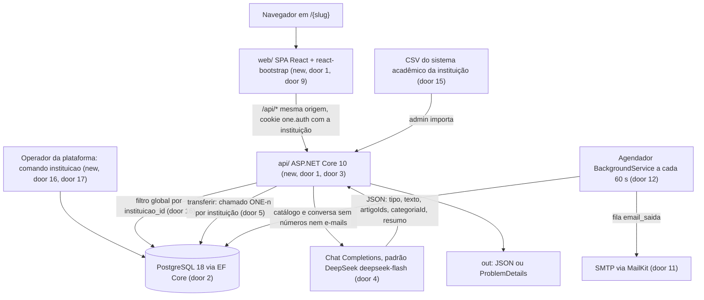
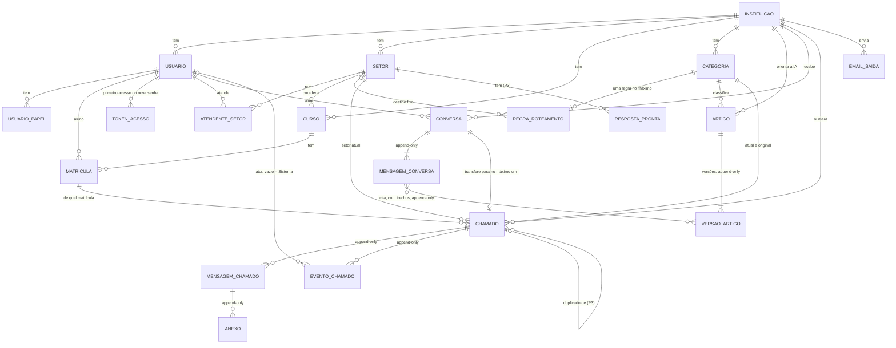

# MVP do One: helpdesk acadêmico automatizado, multi-instituição, com a Univag como primeiro cliente

## Problem

Os alunos de uma instituição de ensino superior mandam dúvidas e pedidos à coordenação por WhatsApp,
e-mail e AVA. Na Univag, primeiro cliente do One, chegaram cerca de 256 mensagens nos 7 dias
anteriores à 2ª entrevista: 171 por WhatsApp, 70 por e-mail e 15 pelo AVA. Metade eram demandas
reais, atendidas uma de cada vez em 10 a 60 minutos cada (`conteudo.md`, Quadro 5).

Não fica registrado quem recebeu, quem respondeu, quando nem se o pedido foi resolvido. O aluno não
sabe qual setor procurar. A coordenadora passa a maior parte do tempo localizando curso e semestre
do aluno, mesmo em perguntas que já têm resposta fixa: boleto e atestado estão no Portal do Aluno,
e o Estatuto do Aluno não abona falta.

A falta de registro também custa na avaliação do MEC. Os instrumentos do INEP vigentes em 2026
(versão de outubro de 2017) pedem:
- "indicadores de desempenho da coordenação disponíveis e públicos" (cursos, 2.3);
- "uma instância que permite o atendimento discente em todos os setores pedagógico-administrativos"
  (institucional, 3.11);
- ouvidoria que "fomenta a manifestação da comunidade" (institucional, 3.10).

O Decreto 12.456/2025 exige que o PDI descreva os "procedimentos de atendimento aos estudantes".
Hoje nenhuma instituição consegue mostrar isso com dados.

O problema não é só da Univag. Os bancos já atendem assim: um assistente tenta resolver, a qualquer
momento o cliente pode pedir um atendente humano, a demanda ganha um número de protocolo, o cliente
não precisa repetir o que já disse e a resposta tem prazo. O Decreto 11.034/2022 (SAC) escreve isso
em regra para os setores regulados (arts. 4º §4º, 10, 12 e 13). Uma instituição de ensino que queira
o mesmo hoje tem duas saídas, e as duas deixam metade do caminho de fora
(`One_Pesquisa_Mercado_Helpdesks.md`):
- um helpdesk que começa pelo chamado, como GLPI, Movidesk ou Jira, em que todo pedido ocupa um
  atendente;
- uma plataforma de conversa, como Intercom, Octadesk ou Blip, cobrada por conversa ou por
  resolução e sem a estrutura acadêmica de curso, semestre e coordenação.

Um assistente que escreve respostas traz um risco que a resposta copiada de um texto aprovado não traz: ele pode resumir
errado ou inventar um detalhe, por exemplo dizer que uma falta pode ser abonada. A instituição
responde pelo que o assistente dela diz. Em 2024, o Tribunal de Resolução Civil da Colúmbia
Britânica condenou a Air Canada a cumprir uma política de reembolso inventada pelo chatbot da
empresa (Moffatt v. Air Canada, 2024 BCCRT 149). Para o aluno, uma resposta errada sobre falta,
prazo ou cobrança custa mais do que nenhuma resposta.

**O que muda quando isto estiver pronto:**
- Cada instituição tem o seu One, no mesmo sistema e com dados separados.
- O aluno entra com o CPF e o One já sabe as matrículas dele.
- O aluno conversa com um assistente que responde só com a base interna de orientações da
  instituição. Os artigos dessa base não são públicos: servem de fonte para a IA e aparecem só para
  atendentes e administradores. Toda resposta precisa estar apoiada em trechos que o servidor
  confere nos artigos. Quando o trecho não confere ou não há artigo, o aluno vê "não encontrei" e
  pode falar com um atendente. Tudo o que o assistente mostrou fica gravado como foi exibido, com
  as fontes usadas.
- Se o assistente não resolver, ou se o aluno pedir, o caso passa a um atendente na mesma conversa, com
  protocolo `ONE-n`, setor certo, matrícula, curso, semestre, transcrição e um resumo. O atendente
  não pede nada de novo, e nada é apagado.
- A instituição mede quanto o assistente resolveu sozinho, quanto foi transferido, para qual setor
  e em quanto tempo.

O calendário da disciplina não é critério deste plano, mas define a ordem dos slices:
- 13/11/2026: 1ª versão no AVA;
- 20/11/2026: aplicação para a banca;
- 27/11/2026: entrega final.

Por isso os slices P1 formam sozinhos uma demonstração de ponta a ponta.

## Flow

O plano reusa o que o ASP.NET Core já traz e não acrescenta bibliotecas para isso:
- autenticação por cookie e `PasswordHasher`;
- limitador de taxa e `ProblemDetails`;
- `BackgroundService` e `HttpClient`;
- filtros globais do EF Core.

A interface usa componentes do Bootstrap. As regras de chamado seguem o GLPI 12 (ver
`glpi-referencia.md`) sem copiar o código dele.

1. O operador cria a instituição com o comando `instituicao criar` (new, door 1, doors 16 e 17), que monta o
   setor de triagem, a categoria "Não classificado" e o primeiro administrador. O comando
   `instituicao carga` aplica o arquivo de setores, cursos, categorias, regras e artigos da
   instituição.
2. O administrador importa o CSV do sistema acadêmico (door 15). `api/` cria ou atualiza alunos
   pelo CPF e matrículas pelo número, dentro da instituição e numa única transação.
3. O aluno abre `/{slug}`, faz o primeiro acesso com o CPF e recebe um link no e-mail importado
   (door 3). Depois entra com CPF e senha do One. O cookie `one.auth` carrega a instituição, e toda
   consulta passa pelo filtro dela (door 16).
4. Assistente: `api/` tira números longos e e-mails das mensagens e manda ao modelo os artigos
   ativos da instituição, as categorias ativas e a conversa (door 4). O modelo devolve resposta
   com trechos literais dos artigos, pergunta de esclarecimento, "sem base" ou "transferir". `api/`
   confere cada trecho contra a versão ativa do artigo e cada link contra os links do artigo
   (door 19):
   - tudo confere: exibe ao aluno só o texto do modelo e o aviso de IA;
   - algo não confere ou nenhum artigo citado: exibe "não encontrei" e o botão de atendente.

   O texto exibido, os trechos e as versões citadas são gravados append-only (door 6). Só atendentes
   e administradores veem as fontes.
5. Transferência: o aluno pede um atendente a qualquer momento. `api/` numera o chamado com o
   contador da instituição (door 5), escolhe a categoria (a sugerida pela IA, senão a do artigo
   citado, senão "Não classificado"), aplica a regra de roteamento e grava chamado, mensagens e
   eventos numa transação. A mesma conversa passa a mostrar o chamado (door 18).
6. Atendimento: o atendente do setor assume, responde, pede informação, encaminha e resolve. O aluno
   acompanha na mesma tela e confirma ou rejeita. As tabelas de histórico são append-only, com
   trigger (door 6).
7. E-mails de chamado são gravados em `email_saida` na transação da ação. O agendador os envia e
   tenta de novo se falhar (doors 11 e 12). O agendador também encerra conversas paradas e fecha
   chamados resolvidos vencidos, usando os prazos e o fuso da instituição de cada item.
8. out: JSON para a SPA. Os erros saem como `ProblemDetails` (door 8).

## Impact

| Front | What changes |
| --- | --- |
| domain | novo termo `Instituicao`: cliente do One, identificado por `slug` na URL, com nome, fuso e situação. Dona de todos os outros dados. Substitui as menções fixas à Univag no plano anterior |
| domain | novo termo `Operador`: quem administra a plataforma pelo comando `instituicao`. Não é papel de usuário nem tem tela |
| domain | termos do ABNT mantidos em português: `Usuario`, `Curso`, `Setor`, `Categoria`, `RegraRoteamento`, `Artigo`, `VersaoArtigo`, `Conversa`, `MensagemConversa`, `Chamado`, `MensagemChamado`, `Anexo`, `EventoChamado`, `Matricula`. Todos ganham a instituição |
| domain | `Conversa` mudou de sentido: antes era uma pergunta e uma resposta (BR-B9), agora tem até 10 mensagens do aluno com o assistente. Desfechos: `RESOLVIDA_AUTOATENDIMENTO`, `TRANSFERIDA` (era `ESCALADA`), `ENCERRADA_PELO_ALUNO` (era `RECUSADA`) e `ABANDONADA`. Quem depende disso: os indicadores do Quadro 12 e o modelo lógico do ABNT |
| domain | `MensagemConversa` do assistente: guarda o texto exato exibido, o tipo final, os trechos oficiais, as versões de artigo citadas e o modelo usado. Antes guardava só a versão do artigo, porque o texto exibido era o do artigo |
| domain | `Artigo` mudou de sentido: não é página pública nem FAQ, é orientação interna que a IA usa como fonte. Estados `RASCUNHO`, `ATIVO` (antes `PUBLICADO`) e `ARQUIVADO`; ativar põe o artigo na base da IA. Quem depende disso: a tela de artigos do administrador e o arquivo de carga |
| domain | novo termo `TrechoOficial`: pedaço de 20 a 400 caracteres de uma versão de artigo, devolvido pelo modelo e aceito só se aparece literalmente nela (door 19). Nunca é mostrado ao aluno |
| domain | `Chamado` ganha `resumo` (gerado pela IA, marcado como tal) e a origem da categoria (`IA`, `ARTIGO` ou `PADRAO`) para medir o acerto da triagem |
| domain | `CPF`: identifica o login dentro de uma instituição. A mesma pessoa em duas instituições tem duas contas |
| domain | `Sistema`: ator dos eventos sem usuário (criação, fechamento automático, abandono), representado por ator vazio |
| stored data | nada a migrar: o banco é novo, criado pelas migrações do EF Core. A carga da Univag vira um arquivo de `instituicao carga`, não uma carga embutida |
| documento ABNT | o modelo lógico de `D:\One\One` fica desatualizado em: `instituicao` em todas as tabelas; CPF, senha e troca obrigatória em `usuario`; `matricula` no lugar de `aluno_curso`; conversa com várias mensagens; `resumo` e origem da categoria em `chamado`; token de primeiro acesso; `email_saida`. Atualizar o documento é tarefa do repositório de documentação |
| requisitos | spec anterior marcava "roteamento por IA" como fora do MVP. Agora a IA sugere a categoria, a regra por categoria continua decidindo o setor e o atendente pode reclassificar (AD-010). RNF-08, sem integração com o Portal do Aluno, continua valendo |

## Relations

Toda tabela, menos `instituicao`, tem `instituicao_id` não nulo (door 16). O diagrama mostra só as
ligações diretas com a instituição.

Restrições difíceis de desfazer:
- `instituicao.slug` é único e imutável (door 17).
- São únicos dentro da instituição: CPF (door 3), e-mail do usuário, número da matrícula (door 15)
  e número do chamado (door 5).
- Uma conversa gera no máximo um chamado: chave única em `chamado.conversa_id`.
- Cada instituição tem exatamente um setor de triagem (door 7).
- Cada categoria tem no máximo uma regra.
- O número da versão é único por artigo.
- O token é guardado só como hash e vale uma vez.
- Mensagens, eventos, versões e anexos não aceitam UPDATE nem DELETE (door 6).

## Surface

Consumida só pela SPA deste repositório e pelo comando do operador. Todas as rotas exigem cookie
válido, exceto `GET /api/instituicoes/{slug}`, login, primeiro acesso e definição de senha por token.
Um recurso que o usuário não pode ver, inclusive de outra instituição, responde 404 e nunca 403,
para não revelar que existe.

| Route | In | Out | Status |
| --- | --- | --- | --- |
| `GET /api/instituicoes/{slug}` | nada | `nome` | `200`, `404` |
| `POST /api/auth/login` | `instituicao`, `cpf`, `senha` | `id` · `nome` · `papeis` · `deveTrocarSenha` · `instituicao{slug, nome}` | `200`, `400`, `401`, `429` |
| `POST /api/auth/primeiro-acesso` | `instituicao`, `cpf` | mensagem fixa | `202`, `400`, `429` |
| `POST /api/auth/definir-senha` | `token`, `novaSenha` | nada | `204`, `400` |
| `POST /api/auth/logout` | nada | nada | `204` |
| `GET /api/auth/me` | nada | `id` · `nome` · `cpfMascarado` · `papeis` · `deveTrocarSenha` · `instituicao` · `matriculas[]` | `200`, `401` |
| `POST /api/auth/senha` | `senhaAtual`, `novaSenha` | nada | `204`, `400`, `401` |
| `POST /api/conversas` | `mensagem` | `conversaId` · `resposta{tipo, texto}` | `201`, `400`, `401`, `403`, `429` |
| `POST /api/conversas/{id}/mensagens` | `mensagem` | `resposta{tipo, texto}` | `200`, `400`, `404`, `409`, `429` |
| `GET /api/conversas/{id}` | nada | `conversa` · `mensagens` · `desfecho` · `chamadoNumero?` | `200`, `401`, `404` |
| `POST /api/conversas/{id}/avaliacao` | `resolveu` | `desfecho?` | `200`, `400`, `404`, `409` |
| `POST /api/conversas/{id}/encerrar` | nada | `desfecho` | `200`, `404`, `409` |
| `POST /api/conversas/{id}/transferir` | `matriculaId?` | `numero` · `estado` · `setor` | `201`, `400`, `404`, `409` |
| `POST /api/atendimento-direto` | `descricao`, `matriculaId?` | `numero` · `estado` · `setor` | `201`, `400`, `403`, `429` |
| `GET /api/chamados` | `escopo` (`meus` ou `fila`), `estado?` | lista de `numero` · `titulo` · `categoria` · `estado` · `responsavel` · `criadoEm` | `200`, `401` |
| `GET /api/chamados/{numero}` | nada | chamado · matrícula · resumo · transcrição · mensagens visíveis ao papel · eventos · `acoes` | `200`, `401`, `404` |
| `POST /api/chamados/{numero}/mensagens` | multipart `tipo`, `texto`, `aguardaAluno`, `anexos[]` | mensagem | `201`, `400`, `403`, `404`, `409`, `413`, `415` |
| `POST /api/chamados/{numero}/assumir` | nada | chamado | `200`, `403`, `404`, `409` |
| `POST /api/chamados/{numero}/resolver` | `texto` | chamado | `200`, `400`, `403`, `404`, `409` |
| `POST /api/chamados/{numero}/confirmar` | nada | chamado | `200`, `403`, `404`, `409` |
| `POST /api/chamados/{numero}/rejeitar` | `motivo` | chamado | `200`, `400`, `403`, `404`, `409` |
| `POST /api/chamados/{numero}/cancelar` | `motivo?` | chamado | `200`, `403`, `404`, `409` |
| `POST /api/chamados/{numero}/encaminhar` | `setorId`, `motivo` | chamado | `200`, `400`, `403`, `404`, `409` |
| `POST /api/chamados/{numero}/reclassificar` | `categoriaId` | chamado | `200`, `400`, `403`, `404`, `409` |
| `POST /api/chamados/{numero}/duplicado` (P3) | `numeroOriginal` | chamado | `200`, `400`, `403`, `404`, `409` |
| `GET /api/respostas-prontas` (P3) | `setorId` | lista de `id` · `titulo` · `texto` | `200`, `401`, `404` |
| `GET /api/anexos/{id}` | nada | arquivo com `Content-Type` original | `200`, `401`, `404` |
| `GET /api/artigos/versoes/{id}` (atendente e administrador) | nada | `titulo` · `texto` · `links` da versão citada · `versaoAtivaAtualId?` | `200`, `401`, `404` |
| `GET /api/admin/artigos`, `POST /api/admin/artigos`, `PUT /api/admin/artigos/{id}` | `titulo`, `perguntas[]`, `categoriaId`, `resposta`, `links[]`, `visivelDe?`, `visivelAte?` (P3) | artigo com versão atual | `200`, `201`, `400`, `403`, `404` |
| `POST /api/admin/artigos/{id}/ativar`, `POST /api/admin/artigos/{id}/arquivar` | nada | artigo | `200`, `403`, `404`, `409` |
| `GET /api/admin/usuarios`, `POST /api/admin/usuarios`, `PUT /api/admin/usuarios/{id}` | `cpf`, `nome`, `email`, `senhaTemporaria?`, `papeis[]`, `setores[]` | usuário | `200`, `201`, `400`, `403`, `404`, `409` |
| `POST /api/admin/usuarios/{id}/desativar` | nada | usuário | `200`, `403`, `404` |
| `POST /api/admin/matriculas/importacao` | arquivo CSV | `criados` · `atualizados` ou `erros[{linha, motivo}]` | `200`, `400`, `403` |
| `GET`, `POST` e `PUT {id}` em `/api/admin/setores`, `/api/admin/categorias`, `/api/admin/cursos`, `/api/admin/regras` e `/api/admin/respostas-prontas` (P3) | campos de cada cadastro | item | `200`, `201`, `400`, `403`, `404`, `409` |
| `GET /api/indicadores` | `de`, `ate`, `setorId?` | os 14 indicadores · `semDados` | `200`, `400`, `403` |

Comando do operador, sem HTTP, rodado dentro do contêiner da `api/` (`dotnet One.Api.dll instituicao ...`).
Os códigos de saída são os da `Coverage` em `checks.md`:

| Comando | In | Out | Saída |
| --- | --- | --- | --- |
| `instituicao criar` | `--slug`, `--nome`, `--fuso`, `--admin-cpf`, `--admin-nome`, `--admin-email` | link de primeiro acesso do administrador na saída padrão | `0` sucesso, `1` erro de validação |
| `instituicao carga` | `--slug`, `--arquivo` (JSON de setores, cursos, categorias, regras e artigos) | quantidades criadas, ou caminho e motivo de cada item com erro | `0` sucesso, `1` erro de validação |

## Landing

| One-way door | Literal shape | Alternative rejected |
| --- | --- | --- |
| 1. Layout do repositório | monorepo com `api/` (ASP.NET Core 10, `net10.0`, inclui o comando `instituicao`), `api.Tests/` (xUnit), `web/` (Vite 8 + React 19 + TypeScript) e `docker-compose.yml` com `postgres:18` e `axllent/mailpit` | dois repositórios: toda mudança de contrato vira dois PRs coordenados, e o grupo tem 19 dias |
| 2. Persistência | EF Core 10 + `Npgsql.EntityFrameworkCore.PostgreSQL` 10.0.3; migrações do EF; nomes `snake_case` em português como no modelo lógico (`chamado`, `versao_artigo`, `matricula`, `instituicao`); datas `timestamptz` em UTC | Dapper com SQL à mão: o grupo escreveria e manteria as migrações e o mapeamento de 20 tabelas |
| 3. Autenticação | login por `(instituicao_id, cpf)`: `cpf` `char(11)`, só dígitos, dígito verificador conferido, único dentro da instituição. Senha própria do One em `usuario.senha_hash` com `PasswordHasher<Usuario>` (PBKDF2). Cookie `one.auth` `HttpOnly`, `Secure`, `SameSite=Strict`, 8 h deslizante, com as claims `sub` e `instituicao_id`. `ativo` do usuário e da instituição reconferido a cada requisição em `OnValidatePrincipal`. Primeiro acesso e nova senha por `token_acesso`: 32 bytes aleatórios, só o SHA-256 guardado, uso único, 60 min | CPF único global: a mesma pessoa não poderia ser aluna de duas instituições clientes. Senha do Portal do Aluno: ver door 15. ASP.NET Identity completo: cria `AspNetUsers` em paralelo a `usuario`. JWT em `localStorage`: token legível por qualquer XSS |
| 4. Assistente | `HttpClient` + `System.Text.Json` em `POST {Llm:BaseUrl}/chat/completions` (formato OpenAI); `Llm:BaseUrl` = `https://api.deepseek.com`, `Llm:Modelo` = `deepseek-flash`, chave em `Llm:ChaveApi` por variável de ambiente; `response_format: {"type":"json_object"}`, `temperature` 0, `max_tokens` 800, tempo limite 20 s. O prompt traz, nesta ordem: regras fixas, artigos ativos da instituição (id, título, perguntas, resposta, links) e categorias ativas (id, nome), para aproveitar o cache de contexto; depois as últimas 10 mensagens da conversa já sem números nem e-mails. As regras fixas mandam responder só com o que está nos artigos, sem citar nem mencionar os artigos ao aluno, copiar literalmente no campo `trechos` de 1 a 3 trechos que sustentam a resposta, usar só links que estão nos artigos e devolver `sem_base` quando nenhum artigo responde. Saída `{"tipo":"resposta"\|"pergunta"\|"sem_base"\|"transferir","texto":"...","artigoIds":[12],"trechos":[{"artigoId":12,"texto":"..."}],"categoriaId":3,"resumo":"..."}`. `api/` rebaixa para `sem_base` toda `resposta` sem `artigoIds` ativos da instituição e passa trechos e links pela door 19 | só escolher o id do artigo e mostrar o artigo (plano anterior): expõe ao aluno a base interna, que não é pública. Resposta livre sem trechos: o modelo pode inventar regra (caso Air Canada) sem nada que o servidor possa conferir. SDK `OpenAI`: dependência para uma única requisição. Embeddings com pgvector: extensão e provedor a mais para 10 a 30 artigos. `shortcut:` o catálogo inteiro vai no prompt; acima de cerca de 100 artigos por instituição, pré-filtrar com busca textual `portuguese` |
| 5. Número do chamado | `instituicao.ultimo_numero_chamado` incrementado por `UPDATE instituicao SET ultimo_numero_chamado = ultimo_numero_chamado + 1 WHERE id = @id RETURNING ultimo_numero_chamado` na transação do chamado; `numero` = `ONE-` + valor, `varchar(20)`, único em `(instituicao_id, numero)` | sequência global `chamado_numero_seq`: o número de uma instituição saltaria com o volume das outras e revelaria o tamanho dos outros clientes. `max(numero)+1`: duas transferências simultâneas geram o mesmo número |
| 6. Histórico imutável | trigger `BEFORE UPDATE OR DELETE` que lança exceção em `mensagem_conversa` (inclui os trechos e as versões citadas), `mensagem_chamado`, `evento_chamado`, `versao_artigo` e `anexo` | só não expor rota de edição: um bug ou um script altera o registro que a CPA ou o MEC podem pedir |
| 7. Um setor de triagem por instituição | `CREATE UNIQUE INDEX ux_setor_triagem ON setor (instituicao_id) WHERE triagem`, mais validação que recusa ficar sem setor de triagem | só validação na aplicação: duas requisições paralelas deixam dois setores marcados |
| 8. Contrato de erro | `ProblemDetails` (RFC 9457) do ASP.NET: `type`, `title`, `status`, `detail` em pt-BR, `errors` por campo em 400 | formato próprio `{erro}`: o framework já gera `ProblemDetails` para 400 de validação e o grupo manteria dois formatos |
| 9. Kit de interface | `bootstrap` 5.3.8 + `react-bootstrap` 2.10.10 + `bootstrap-icons` 1.13.2 (classes `bi bi-*`); `react-router` 8; `vite-plugin-pwa` 2.0.0 (aceita Vite 8) | `react-bootstrap-icons`: pacote de terceiros sobre os mesmos ícones. Bootstrap 6: ainda em alfa |
| 10. Implantação e endereço | um contêiner: `api/` serve a API e a SPA compilada em `wwwroot`, mais o PostgreSQL. A instituição vem do caminho: a SPA em `/{slug}/...`, a API em `/api/*` com a instituição tirada do cookie | subdomínio por instituição (`univag.one...`): DNS e certificado curinga para a banca, e o cookie teria de ser por subdomínio. SPA em host separado: cookie entre sites exige `SameSite=None` e CORS com credenciais |
| 11. E-mail | MailKit 4.18.2 por SMTP em `Smtp:Host`, `Smtp:Porta`, `Smtp:Usuario`, `Smtp:Senha`, `Smtp:Remetente`; Mailpit no desenvolvimento. E-mails de chamado: linha em `email_saida` (destinatário, assunto, corpo, `tentativas`, `proxima_tentativa`, `enviado_em`) gravada na transação da ação e enviada pelo agendador, como a `QueuedNotification` do GLPI. E-mail de primeiro acesso: envio direto depois do commit, sem fila | envio direto para tudo: o e-mail de chamado que falha se perde e o aluno não sabe que foi respondido. Fila também para o primeiro acesso: o corpo traria o link com o token em texto puro no banco, anulando o hash da door 3, e o aluno que espera o link pode pedir de novo |
| 12. Agendador | `BackgroundService` dentro de `api/`, ciclo de 60 s, uma transação por item; lê com `IgnoreQueryFilters()` explícito e aplica a cada item a instituição dele | Hangfire ou Quartz: dependência e tabelas próprias para quatro consultas. Um agendador por instituição: N laços para o mesmo trabalho |
| 13. Anexos | conteúdo em coluna `bytea` de `anexo`, tipo conferido pela assinatura do arquivo (`%PDF`, `FF D8 FF`, `89 50 4E 47`) | disco local: some em hospedagem com disco efêmero e fica de fora do backup do banco |
| 14. Concorrência no chamado | coluna de sistema `xmin` do PostgreSQL como token de concorrência do EF; conflito vira 409 | lock pessimista: segura a linha durante chamadas de e-mail e de rede |
| 15. Dados acadêmicos | CSV `cpf;nome;email;matricula;curso;semestre;situacao` (UTF-8, `;`) exportado pelo sistema acadêmico da instituição e importado pelo admin; atualiza por CPF e por número de matrícula dentro da instituição; tudo ou nada; `matricula.numero` `varchar(20)` | entrar no portal do aluno com a senha dele: na Univag o portal pede matrícula e tem captcha, então seria preciso contornar a proteção anti-robô e receber a senha de outro sistema. Integração por API com cada ERP acadêmico: um conector por fornecedor; fica para depois, mantendo a mesma atualização por CPF e matrícula |
| 16. Isolamento entre instituições | `instituicao_id bigint not null` com FK em toda tabela exceto `instituicao`; filtro global do EF Core `HasQueryFilter(e => e.InstituicaoId == tenant.Id)` em toda entidade; `SaveChanges` preenche `InstituicaoId` das entidades novas com a instituição da sessão e lança exceção se vier outra; `IgnoreQueryFilters()` só no agendador e no comando do operador | Row Level Security do PostgreSQL: exige `SET` da instituição em cada conexão do pool e repete o filtro em SQL. Schema por instituição: as migrações rodam N vezes. Banco por instituição: opção descartada pelo grupo em 01/11/2026 |
| 17. Identificador da instituição | `instituicao.slug` `varchar(30)`, `^[a-z0-9-]{3,30}$`, único e imutável; aparece em URLs, favoritos e e-mails | id numérico na URL: revela a ordem e o número de clientes. Slug editável: quebra links já enviados por e-mail |
| 18. Transferência na mesma conversa | depois da transferência, a tela do Assistente mostra o chamado na mesma linha do tempo e, enquanto está aberta, a SPA pede `GET /api/chamados/{numero}` a cada 15 s | SignalR ou WebSocket: estado de conexão e backplane para escalar, num atendimento em que o atendente responde em minutos ou horas. Mandar o aluno para outra tela: quebra a continuidade que o modelo de banco promete |
| 19. Resposta conferida pelo servidor | cada trecho devolvido pelo modelo é aceito só se, depois de `ToLowerInvariant()` e de trocar `\s+` por um espaço nos dois textos, aparece com `string.Contains` na resposta da versão ativa do artigo citado e tem de 20 a 400 caracteres; todo endereço `http(s)://` do texto precisa estar nos links dos artigos citados. Se algo falhar, o texto do modelo é descartado e o aluno vê "não encontrei". Trechos aceitos e versões citadas ficam em `mensagem_conversa`, append-only (door 6), e só saem da API para atendente e administrador | mostrar o artigo ao aluno quando o trecho não confere (plano anterior): a base é interna e não pode vazar. Confiar no texto do modelo: um detalhe inventado passa sem nenhum sinal. Segunda chamada a um modelo para julgar a resposta: dobra custo e latência, e o juiz também erra; a conferência literal é determinística e testável. Comparação por similaridade (embeddings ou distância de edição): aceita paráfrase, e é na paráfrase que a regra muda de sentido |
| 20. Arquivo de `instituicao carga` | JSON `{"setores":[{"nome"}],"cursos":[{"nome","coordenacao?"}],"categorias":[{"nome"}],"regras":[{"categoria","setor"}\|{"categoria","coordenacaoDoCurso":true}],"artigos":[{"titulo","perguntas":[],"categoria","resposta","links":[]}]}`; referências entre itens pelo `nome` (setor, categoria), resolvidas contra o arquivo e o que já existe na instituição; erros por caminho `artigos[2].categoria` | referências por id: o operador não conhece os ids antes da carga e o mesmo arquivo não serviria para duas instituições |

- Nothing else in this change is hard to reverse

## Criteria

### S1: Instituições separadas no mesmo sistema (P1)

O operador cria uma instituição, carrega os dados dela e nada vaza entre instituições.

**Acceptance Criteria**

1. WHEN o operador roda `instituicao criar` com slug, nome, fuso, CPF, nome e e-mail do administrador válidos THEN o comando SHALL criar a instituição ativa, o setor "Triagem" marcado como triagem, a categoria "Não classificado" e um administrador sem senha, imprimir o link de primeiro acesso do administrador (válido por 60 minutos) e sair com código 0.
2. IF o slug não casar com `^[a-z0-9-]{3,30}$` ou já existir, o fuso não for um id IANA, ou o CPF ou o e-mail do administrador forem inválidos THEN o comando SHALL imprimir o motivo na saída de erro, não gravar nada e sair com código 1.
3. WHEN o operador roda `instituicao carga` com um arquivo válido THEN o comando SHALL criar numa transação os setores, cursos, categorias, regras e artigos ativos do arquivo, imprimir as quantidades e sair com código 0.
4. IF algum item do arquivo de carga for inválido THEN o comando SHALL não gravar nenhum item, imprimir o caminho e o motivo de cada item com erro e sair com código 1.
5. WHEN a SPA abre `/{slug}` de uma instituição ativa THEN o sistema SHALL mostrar o nome da instituição na tela de login.
6. IF o slug não existir ou a instituição estiver inativa THEN `GET /api/instituicoes/{slug}` SHALL responder 404 e a SPA SHALL mostrar "Instituição não encontrada."
7. The system SHALL filtrar toda leitura e escrita pela instituição da sessão, de modo que o id ou número de um recurso de outra instituição receba a mesma resposta de um inexistente: 404 na rota e 400 no corpo.
8. The system SHALL aceitar o mesmo CPF, e-mail e número de matrícula em instituições diferentes e responder 409 à repetição dentro da mesma instituição.
9. The system SHALL exibir datas e calcular períodos e prazos no fuso da instituição.
10. WHEN o agendador processa um item THEN o sistema SHALL usar o fuso, o nome e o remetente da instituição desse item.
11. WHILE uma instituição estiver inativa o sistema SHALL responder 401 a toda requisição com sessão dessa instituição.

**Independent test:** criar `univag` e `demo` e carregar as duas; o mesmo CPF existe nas duas; o aluno da `demo` não recebe artigos da `univag` e recebe 404 ao pedir um chamado `ONE-1` que só existe na `univag`.

### S2: Entrar com o CPF na instituição (P1)

O aluno importado faz o primeiro acesso pelo e-mail da instituição e depois entra com CPF e senha.

**Acceptance Criteria**

12. WHEN um usuário ativo de uma instituição ativa envia instituição, CPF (com ou sem pontos e traço) e senha corretos para `POST /api/auth/login` THEN o sistema SHALL responder 200 com `id`, `nome`, `papeis`, `deveTrocarSenha` e a instituição, e emitir o cookie `one.auth` com `HttpOnly` e `SameSite=Strict`.
13. IF o CPF não tiver 11 dígitos ou falhar no dígito verificador THEN o sistema SHALL responder 400 com `detail` "CPF inválido." sem consultar a senha.
14. IF a instituição não existir, o CPF não estiver cadastrado nela ou a senha estiver errada THEN o sistema SHALL responder 401 com o mesmo `detail` "CPF ou senha inválidos." nos três casos.
15. IF a conta estiver desativada ou ainda não tiver senha THEN o sistema SHALL responder 401 com o mesmo `detail` do critério 14, sem emitir cookie.
16. IF um mesmo IP fizer mais de 5 pedidos em 60 segundos somando login e primeiro acesso THEN o sistema SHALL responder 429 aos pedidos seguintes até a janela terminar.
17. WHEN alguém pede primeiro acesso ou "Esqueci minha senha" com um CPF válido THEN o sistema SHALL responder 202 com "Se o CPF estiver cadastrado, enviamos um link para o e-mail registrado na instituição." exista ou não o CPF.
18. WHEN o CPF pedido é de conta ativa da instituição informada THEN o sistema SHALL enviar ao e-mail cadastrado um link `/{slug}/definir-senha?token=...` de uso único válido por 60 minutos e guardar só o hash do token.
19. WHEN o token é válido e a nova senha tem de 8 a 128 caracteres THEN o sistema SHALL gravar o hash da senha, marcar o token como usado e responder 204.
20. IF o token já foi usado, venceu ou não existe THEN o sistema SHALL responder 400 com `detail` "Link inválido ou vencido."
21. IF uma requisição a `/api/*`, exceto as rotas públicas da `Surface`, chegar sem cookie válido THEN o sistema SHALL responder 401.
22. WHILE `deveTrocarSenha` for verdadeiro o sistema SHALL responder 403 a toda rota exceto login, logout, `me` e `senha`, e a SPA SHALL mostrar a tela "Trocar senha".
23. WHEN o usuário envia a senha atual correta e uma nova de 8 a 128 caracteres THEN o sistema SHALL gravar o novo hash, tornar `deveTrocarSenha` falso e responder 204.
24. IF a senha atual estiver errada ou a nova tiver menos de 8 caracteres THEN o sistema SHALL responder 400 e manter a senha anterior.
25. WHEN um usuário autenticado abre a SPA THEN o sistema SHALL abrir o Assistente para aluno, a Fila para atendente e Artigos para administrador, e o menu SHALL mostrar os itens de todos os papéis do usuário.
26. WHEN um administrador desativa uma conta com sessão aberta THEN a próxima requisição dessa sessão SHALL receber 401.
27. The system SHALL mostrar o CPF só no formato `***.456.789-**` em toda tela e resposta, exceto nas telas e rotas de administração.

**Independent test:** importar um aluno na `univag`, pedir primeiro acesso com o CPF dele, abrir o link no Mailpit, definir a senha e entrar; o mesmo CPF na `demo` responde 401 até ter senha própria lá.

### S3: O assistente conversa e resolve com a base interna da instituição, sem inventar regra (P1)

Como no atendimento de banco, o aluno conversa com um assistente que pergunta quando falta informação e oferece um atendente a qualquer momento. Os artigos são internos: servem só de fonte para a IA e nunca são mostrados ao aluno. Toda resposta precisa estar apoiada em trechos que o servidor confere nos artigos; se não estiver, o aluno vê "não encontrei" e pode falar com um atendente. Atendentes e administradores veem as fontes de cada resposta.

**Acceptance Criteria**

28. The system SHALL mostrar na tela Assistente, sempre visível, o aviso "Suas mensagens são analisadas por um serviço externo de inteligência artificial, com servidores fora do Brasil. Não escreva CPF, matrícula, telefone ou dados de saúde."
29. The system SHALL mostrar o botão "Falar com atendente" na tela Assistente desde a primeira visita e em toda conversa sem desfecho.
30. WHEN um aluno com ao menos uma matrícula ativa envia uma primeira mensagem de 1 a 1000 caracteres THEN o sistema SHALL criar uma conversa dele com essa mensagem e responder 201 com a resposta do assistente.
31. WHEN o aluno envia outra mensagem de 1 a 1000 caracteres numa conversa sua sem desfecho THEN o sistema SHALL gravá-la e responder 200 com a resposta do assistente.
32. IF a mensagem estiver vazia, só com espaços ou tiver mais de 1000 caracteres THEN o sistema SHALL responder 400 sem gravar.
33. IF quem envia não tiver o papel aluno ou não tiver matrícula ativa THEN o sistema SHALL responder 403.
34. The system SHALL enviar ao provedor de IA apenas as regras fixas, os artigos ativos da instituição (id, título, perguntas, resposta, links), as categorias ativas (id, nome) e as últimas 10 mensagens da conversa, com toda sequência de 8 ou mais dígitos (com ou sem pontos, traços e espaços) trocada por `[número removido]` e todo e-mail trocado por `[e-mail removido]`; nome, CPF, matrícula, curso e anexos do aluno nunca são enviados.
35. WHEN o modelo devolve `tipo` `resposta` citando só artigos ativos da instituição, e cada artigo citado tem ao menos um trecho de 20 a 400 caracteres que aparece literalmente na versão ativa dele (sem diferenciar maiúsculas e com espaços repetidos reduzidos a um) THEN o sistema SHALL exibir ao aluno o texto do modelo, o aviso "Resposta gerada por IA com base nas orientações da instituição." e "Isso resolveu?" com os botões Sim e Não.
36. IF a `resposta` cita artigos ativos da instituição, mas algum trecho não aparece literalmente na versão citada ou algum artigo citado ficou sem trecho THEN o sistema SHALL descartar o texto do modelo, agir como `sem_base` e registrar `trecho_invalido` no log.
37. IF o modelo devolver `resposta` sem artigos citados ou com algum id que não é de artigo ativo da instituição THEN o sistema SHALL tratá-la como `sem_base`.
38. IF o texto de uma `resposta` contiver um endereço `http://` ou `https://` que não está nos links dos artigos citados THEN o sistema SHALL tratá-la como `sem_base` e registrar `link_invalido` no log.
39. The system SHALL não exibir texto escrito pelo modelo como resposta sem ao menos um trecho confirmado em cada artigo ativo citado.
40. The system SHALL não entregar título, texto, links, trechos ou ids de artigo em nenhuma resposta da API nem em nenhuma tela para quem acessa como aluno.
41. WHEN o modelo devolve `tipo` `pergunta` THEN o sistema SHALL exibir o texto como pergunta do assistente, sem "Isso resolveu?".
42. IF o modelo devolver uma terceira `pergunta` seguida na mesma conversa, ou uma `pergunta` com mais de 200 caracteres ou que não termine em "?" THEN o sistema SHALL tratá-la como `sem_base`.
43. WHEN o resultado é `sem_base` THEN o sistema SHALL exibir o texto fixo "Não encontrei isso nas orientações da instituição. Posso transferir você para um atendente." com o botão "Falar com atendente" em destaque, sem exibir texto do modelo.
44. WHEN o modelo devolve `tipo` `transferir` THEN o sistema SHALL exibir o texto fixo "Vou transferir você para um atendente." e o botão de confirmação, sem criar chamado antes de o aluno confirmar.
45. IF o provedor falhar, passar de 20 segundos, devolver conteúdo vazio, JSON inválido ou `tipo` desconhecido THEN o sistema SHALL agir como no critério 43 e registrar o motivo no log.
46. WHEN o sistema exibe uma mensagem do assistente THEN SHALL gravar, sem possibilidade de alteração, o texto exato exibido, o tipo devolvido, o tipo final (depois das regras dos critérios 36, 37, 38 e 42), os trechos confirmados, as versões de artigo citadas, o modelo usado e a data e hora.
47. WHEN uma chamada ao provedor termina THEN o sistema SHALL registrar no log a instituição, o modelo, a duração, os tokens de entrada (com e sem cache) e de saída, o `tipo` devolvido, o `tipo` final e os artigos citados, sem o texto das mensagens.
48. WHEN o aluno responde Sim THEN o sistema SHALL encerrar a conversa com desfecho `RESOLVIDA_AUTOATENDIMENTO` e não criar chamado.
49. WHEN o aluno responde Não THEN o sistema SHALL manter a conversa aberta, mostrar "Quer explicar melhor ou falar com um atendente?" e destacar o botão "Falar com atendente".
50. WHEN o aluno escolhe "Encerrar" THEN o sistema SHALL encerrar a conversa com desfecho `ENCERRADA_PELO_ALUNO`.
51. IF a conversa já tiver 10 mensagens do aluno THEN o sistema SHALL responder 409 a uma nova mensagem, e a tela SHALL oferecer só "Falar com atendente" e "Encerrar".
52. IF chegar mensagem, avaliação, encerramento ou transferência para uma conversa que já tem desfecho THEN o sistema SHALL responder 409 sem alterar a conversa.
53. IF um aluno pedir ou agir sobre a conversa de outro aluno THEN o sistema SHALL responder 404.
54. WHEN um artigo citado é editado ou arquivado THEN o sistema SHALL continuar mostrando ao aluno o texto exibido e, a atendentes e administradores, a versão citada e os trechos confirmados, com o aviso "Este artigo foi atualizado depois desta resposta." quando houver versão ativa mais nova.
55. IF um mesmo aluno enviar mais de 10 mensagens em 60 segundos THEN o sistema SHALL responder 429.

**Independent test:** com o artigo "Como emitir o boleto do semestre", escrever "preciso do boleto, matrícula 2000567890"; o aluno vê só a resposta e o aviso, a resposta da API não traz nenhum dado do artigo, e o log mostra que o número não saiu do servidor. Com o provedor simulado devolvendo o trecho inventado "faltas podem ser abonadas com atestado" para o artigo "Faltas não são abonadas", o aluno vê "Não encontrei isso nas orientações da instituição." e o log mostra `trecho_invalido`. O atendente, no chamado transferido, vê os artigos e trechos de cada resposta.

### S4: Transferência para um atendente sem repetir nada (P1)

O aluno pede um atendente e o caso chega ao setor certo com protocolo, matrícula, transcrição e resumo, na mesma conversa.

**Acceptance Criteria**

56. WHEN o aluno confirma "Falar com atendente" numa conversa sua sem desfecho THEN o sistema SHALL criar um chamado `ABERTO` sem responsável, encerrar a conversa como `TRANSFERIDA` e responder 201 com número, estado e setor.
57. WHEN o aluno usa "Falar com atendente" antes de escrever qualquer mensagem e envia uma descrição de 1 a 2000 caracteres THEN o sistema SHALL criar a conversa e o chamado sem chamar o provedor de IA, com a categoria "Não classificado".
58. The system SHALL numerar cada chamado como `ONE-` seguido do próximo valor do contador da instituição, sem nunca reutilizar um número dentro da instituição.
59. WHEN o chamado é criado THEN o sistema SHALL gravar solicitante, matrícula, semestre da matrícula naquele momento, título igual à primeira mensagem do aluno truncada em 120 caracteres, a referência à conversa e o último `resumo` não vazio devolvido pelo modelo, truncado em 500 caracteres.
60. WHEN o modelo sugeriu na conversa um `categoriaId` de categoria ativa da instituição THEN o sistema SHALL usar a última sugestão como categoria atual e original, com origem `IA`.
61. WHEN não há sugestão válida e a conversa citou algum artigo THEN o sistema SHALL usar a categoria do último artigo citado, com origem `ARTIGO`.
62. WHEN não há sugestão válida nem artigo citado THEN o sistema SHALL usar "Não classificado", com origem `PADRAO`.
63. WHEN a regra da categoria aponta um setor fixo THEN o sistema SHALL colocar o chamado nesse setor.
64. WHEN a regra da categoria aponta a coordenação do curso THEN o sistema SHALL colocar o chamado no setor de coordenação do curso da matrícula do chamado.
65. IF a categoria não tiver regra, for "Não classificado" ou o curso não tiver coordenação configurada THEN o sistema SHALL colocar o chamado no setor de triagem da instituição.
66. IF o aluno tiver mais de uma matrícula ativa e `matriculaId` faltar ou não for uma matrícula ativa dele THEN o sistema SHALL responder 400, e a tela SHALL pedir a escolha entre as matrículas ativas mostrando número e curso.
67. IF dois pedidos de transferência chegarem para a mesma conversa THEN o sistema SHALL criar um único chamado e responder 409 ao outro.
68. WHEN o chamado é criado THEN a tela Assistente SHALL mostrar, na mesma conversa, "Transferido para <setor>. Protocolo ONE-n." e passar a exibir as respostas públicas do chamado abaixo dela.
69. WHILE a tela de uma conversa transferida ou de um chamado estiver aberta, a SPA SHALL atualizar o chamado a cada 15 segundos.

**Independent test:** responder Não ao artigo do boleto e falar com atendente; o chamado aparece no setor Financeiro com matrícula, transcrição, resumo e origem `IA` ou `ARTIGO`, e a resposta do atendente aparece na tela do aluno em até 15 s. Repetir pelo botão antes de qualquer mensagem e ver o chamado na triagem.

### S5: Atender e acompanhar até fechar (P1)

O atendente trabalha a fila do seu setor e o aluno acompanha, responde, confirma ou cancela.

**Acceptance Criteria**

70. WHEN o atendente abre a Fila THEN o sistema SHALL listar os chamados não fechados dos setores dele, do mais antigo para o mais novo, com número, título, categoria, estado, responsável e dias desde a criação.
71. WHEN o aluno abre "Minhas solicitações" THEN o sistema SHALL listar só os chamados dele, do mais recente para o mais antigo, com número, título e estado.
72. IF um atendente pedir ou agir sobre um chamado que não está em um setor dele THEN o sistema SHALL responder 404.
73. WHEN o atendente abre o detalhe THEN o sistema SHALL mostrar número da matrícula, curso, semestre, o resumo com o rótulo "Resumo gerado por IA", a transcrição da conversa, os artigos e trechos que sustentaram cada resposta do assistente, as respostas públicas, as notas internas, os eventos e só os botões das ações permitidas no estado atual.
74. WHEN o aluno abre o detalhe do próprio chamado THEN o sistema SHALL mostrar estado, transcrição e respostas públicas, sem o resumo, e só os botões das ações permitidas no estado atual.
75. The system SHALL omitir notas internas, eventos de nota interna, o resumo e as fontes do assistente de toda resposta da API e de toda tela entregue a quem acessa o chamado como aluno.
76. WHEN um atendente do setor assume um chamado `ABERTO` THEN o sistema SHALL mudar o estado para `EM_ATENDIMENTO` e torná-lo responsável.
77. WHEN um atendente do setor envia a primeira resposta pública de um chamado `ABERTO` THEN o sistema SHALL mudar o estado para `EM_ATENDIMENTO` e torná-lo responsável.
78. WHEN um atendente assume um chamado atribuído a outro atendente do mesmo setor THEN o sistema SHALL trocar o responsável e gravar um evento com o responsável anterior e o novo.
79. WHEN o responsável envia uma resposta pública marcada "Aguardando aluno" em `EM_ATENDIMENTO` THEN o sistema SHALL mudar o estado para `AGUARDANDO_ALUNO`.
80. WHEN o aluno envia uma resposta em `AGUARDANDO_ALUNO` THEN o sistema SHALL mudar o estado para `EM_ATENDIMENTO`.
81. WHEN o responsável resolve com texto de 1 a 4000 caracteres THEN o sistema SHALL mudar o estado para `RESOLVIDO` e mostrar o texto ao aluno como resposta pública.
82. IF o pedido de resolução vier sem texto THEN o sistema SHALL responder 400 sem mudar o estado.
83. WHEN o aluno confirma a resolução THEN o sistema SHALL fechar o chamado com motivo `CONFIRMADO`.
84. WHEN o aluno rejeita a resolução com motivo até 7 dias depois da última resolução THEN o sistema SHALL voltar o chamado para `EM_ATENDIMENTO` e somar 1 às reaberturas.
85. IF a rejeição vier sem motivo THEN o sistema SHALL responder 400, e IF vier depois de 7 dias da resolução THEN o sistema SHALL responder 409.
86. WHEN o aluno envia uma resposta pública num chamado `RESOLVIDO` THEN o sistema SHALL tratá-la como rejeição com o texto como motivo (critérios 84 e 85), como a reabertura por resposta do solicitante no GLPI.
87. IF o chamado não tiver responsável ativo quando o aluno rejeitar a resolução THEN o sistema SHALL colocá-lo em `ABERTO` no setor atual em vez de `EM_ATENDIMENTO`.
88. WHEN o aluno cancela um chamado `ABERTO`, `EM_ATENDIMENTO` ou `AGUARDANDO_ALUNO` THEN o sistema SHALL fechá-lo com motivo `CANCELADO` e guardar a justificativa opcional.
89. IF uma ação vier de um papel que não pode executá-la no chamado THEN o sistema SHALL responder 403, e IF o estado atual não permitir a ação THEN o sistema SHALL responder 409, sem mudar nada nos dois casos.
90. IF chegar mensagem para um chamado `FECHADO` THEN o sistema SHALL responder 409.
91. IF dois atendentes alterarem o mesmo chamado ao mesmo tempo THEN o sistema SHALL aplicar só a primeira alteração e responder 409 à segunda.
92. WHEN ocorre criação, transição, atribuição, encaminhamento, reclassificação, resposta, nota ou anexo THEN o sistema SHALL gravar um evento com tipo, ator (vazio quando for o Sistema) e data e hora em UTC, e o detalhe SHALL listá-los em ordem cronológica no fuso da instituição.
93. The system SHALL não oferecer rota de edição ou exclusão de mensagens, eventos, versões de artigo e anexos, e o banco SHALL rejeitar UPDATE e DELETE nessas tabelas.

**Independent test:** o atendente do Financeiro assume o chamado do S4, pede um dado ao aluno, o aluno responde, o atendente resolve e o aluno confirma; o histórico mostra cada passo.

### S6: Encaminhar e reclassificar (P2)

O chamado que chegou ao setor errado vai para o certo sem perder nada.

**Acceptance Criteria**

94. WHEN o atendente encaminha para um setor diferente do atual com motivo THEN o sistema SHALL gravar o motivo como nota interna, colocar o chamado `ABERTO` no setor de destino sem responsável e somar 1 aos encaminhamentos.
95. IF o setor de destino for o atual ou o motivo estiver vazio THEN o sistema SHALL responder 400 sem mudar o chamado.
96. WHEN o chamado é encaminhado THEN atendentes que pertencem só ao setor anterior SHALL receber 404 ao pedir o chamado.
97. WHEN o atendente reclassifica THEN o sistema SHALL mudar a categoria atual e manter a categoria original, a origem dela e o setor.

**Independent test:** encaminhar um chamado da triagem para a coordenação de ADS; o atendente da triagem perde o acesso e o da coordenação o vê `ABERTO`.

### S7: Base de conhecimento (P2)

O administrador escreve, ativa, versiona e arquiva os artigos internos que o assistente usa como fonte, sem apagar o que já foi citado. Só administradores e atendentes leem os artigos.

**Acceptance Criteria**

98. WHEN o administrador cria um artigo com título, ao menos uma pergunta relacionada, categoria e resposta THEN o sistema SHALL gravá-lo como `RASCUNHO` com a versão 1.
99. IF faltar título, pergunta relacionada, categoria ou resposta THEN o sistema SHALL responder 400.
100. IF um link não começar com `https://` ou `http://` THEN o sistema SHALL responder 400.
101. WHEN o administrador salva uma edição THEN o sistema SHALL criar a versão seguinte e manter as anteriores.
102. WHEN o administrador ativa um artigo THEN o sistema SHALL incluí-lo na base da próxima mensagem enviada ao assistente naquela instituição.
103. WHEN o administrador arquiva um artigo THEN o sistema SHALL tirá-lo do catálogo e manter as conversas que já o citaram.
104. IF alguém sem o papel administrador chamar `/api/admin/*` THEN o sistema SHALL responder 403.

**Independent test:** criar e ativar "Faltas não são abonadas"; perguntar "posso abonar falta com atestado?" e receber uma resposta apoiada no artigo, sem nada do artigo na resposta da API do aluno; arquivar e ver que a mesma pergunta cai em `sem_base`.

### S8: Alunos e administração da instituição (P1 para a importação, P2 para o resto)

O administrador importa a exportação do sistema acadêmico e configura atendentes, setores, categorias, cursos e regras.

**Acceptance Criteria**

105. WHEN o administrador importa um CSV com cabeçalho `cpf;nome;email;matricula;curso;semestre;situacao` em que todas as linhas são válidas THEN o sistema SHALL criar alunos novos sem senha, atualizar nome e e-mail dos existentes pelo CPF, criar ou atualizar curso, semestre e situação de cada matrícula pelo número, tudo dentro da instituição, e responder com as quantidades criadas e atualizadas.
106. IF qualquer linha tiver CPF inválido, e-mail inválido, curso inexistente na instituição, semestre fora de 1 a 12, situação diferente de `ATIVA` ou `INATIVA`, ou uma matrícula já ligada a outro CPF na instituição THEN o sistema SHALL não importar nenhuma linha e responder 400 com o número e o motivo de cada linha com erro.
107. WHEN uma matrícula passa a `INATIVA` THEN o sistema SHALL deixar de oferecê-la em novos chamados e manter os chamados que já a usam.
108. WHEN o administrador cria um atendente ou administrador com CPF, nome, e-mail, ao menos um papel e, para atendente, ao menos um setor THEN o sistema SHALL criar a conta ativa; com `senhaTemporaria` de 8 a 128 caracteres a conta SHALL ter `deveTrocarSenha` verdadeiro, e sem ela o acesso SHALL ser pelo primeiro acesso por e-mail.
109. IF o CPF ou o e-mail já existir na instituição THEN o sistema SHALL responder 409, e IF faltar papel ou setor do atendente THEN o sistema SHALL responder 400.
110. WHEN o administrador define uma senha temporária para qualquer usuário da instituição THEN o sistema SHALL gravá-la com `deveTrocarSenha` verdadeiro.
111. WHEN o administrador desativa um usuário THEN o sistema SHALL manter conversas, chamados, mensagens e eventos ligados a ele.
112. WHEN o administrador desativa um atendente THEN o sistema SHALL tirar o responsável dos chamados dele que não estão fechados, voltar para `ABERTO` os que estão `EM_ATENDIMENTO` ou `AGUARDANDO_ALUNO` e gravar em cada um evento com o administrador como ator.
113. IF uma alteração de setores deixar a instituição com zero ou mais de um setor de triagem THEN o sistema SHALL responder 400 sem gravar.
114. WHEN o administrador salva a regra de uma categoria THEN o sistema SHALL guardar uma única regra para essa categoria, com destino setor fixo ou coordenação do curso, substituindo a anterior.
115. IF a regra for setor fixo e vier sem setor THEN o sistema SHALL responder 400.
116. WHEN o administrador associa um curso a um setor de coordenação THEN os chamados criados depois SHALL usar esse setor no critério 64.
117. IF alguém tentar renomear a categoria "Não classificado" THEN o sistema SHALL responder 400.

**Independent test:** importar um CSV de 3 alunos de ADS, um deles com duas matrículas; com uma linha errada nada entra; corrigido, os três entram, e o de duas matrículas escolhe a matrícula ao falar com atendente.

### S9: Prazos automáticos (P2)

Conversas paradas e resoluções sem resposta se encerram sozinhas e ficam registradas.

**Acceptance Criteria**

118. WHEN uma conversa sem desfecho completa 30 minutos desde a última mensagem THEN o agendador SHALL encerrá-la como `ABANDONADA` em até 60 segundos.
119. WHEN um chamado `RESOLVIDO` completa 7 dias desde a última resolução sem confirmação nem rejeição THEN o agendador SHALL fechá-lo com motivo `FECHADO_AUTOMATICAMENTE` e evento com ator Sistema.
120. IF o aluno agir sobre a conversa ou o chamado antes da execução THEN o agendador SHALL não alterar esse item.
121. IF o processamento de um item falhar THEN o agendador SHALL registrar o erro no log com a instituição e continuar com os demais itens.

**Independent test:** com o relógio do agendador injetado, avançar 31 minutos e ver a conversa abandonada; avançar 7 dias e ver o chamado fechado automaticamente.

### S10: E-mail de acompanhamento e anexos (P3)

O aluno é avisado por e-mail, e aluno e atendente trocam arquivos nas respostas públicas.

**Acceptance Criteria**

122. WHEN um atendente envia resposta pública THEN o sistema SHALL enviar ao aluno um e-mail com assunto "[<nome da instituição>] ONE-n: nova resposta" e o link `/{slug}/chamados/ONE-n`.
123. WHEN um chamado é resolvido THEN o sistema SHALL enviar ao aluno um e-mail com assunto "[<nome da instituição>] ONE-n foi resolvido", o texto da resolução e o link para confirmar ou rejeitar.
124. The system SHALL não enviar e-mail por nota interna.
125. WHEN uma ação gera e-mail de chamado THEN o sistema SHALL gravá-lo em `email_saida` na mesma transação da ação, e o agendador SHALL enviá-lo na execução seguinte.
126. IF o envio por SMTP falhar THEN o agendador SHALL somar 1 a `tentativas`, marcar a próxima tentativa para 2^`tentativas` minutos depois e registrar a falha no log; depois de 5 tentativas SHALL parar e registrar a desistência no log, sem afetar a ação já gravada.
127. WHEN uma resposta pública traz anexos PDF, JPG ou PNG de até 10 MB cada, identificados pela assinatura do arquivo, THEN o sistema SHALL gravá-los e listá-los na mensagem.
128. IF um anexo tiver outro tipo THEN o sistema SHALL responder 415, IF passar de 10 MB THEN o sistema SHALL responder 413, e IF vier numa nota interna THEN o sistema SHALL responder 400, sem gravar a mensagem.
129. IF quem pede o anexo não tiver acesso ao chamado THEN o sistema SHALL responder 404.

**Independent test:** o atendente responde com um PDF; o Mailpit recebe o e-mail; o aluno baixa o PDF; um `.exe` renomeado para `.pdf` é recusado com 415. Com o Mailpit parado, a resposta é gravada, o e-mail fica em `email_saida` e chega quando o Mailpit volta.

### S11: Indicadores da instituição e das coordenações (P2)

A coordenação mede o próprio atendimento, como pede o indicador 2.3 do instrumento de cursos, e o administrador vê a instituição inteira, inclusive quanto o assistente resolveu sozinho.

**Acceptance Criteria**

130. WHEN um administrador pede os indicadores de um período THEN o sistema SHALL devolver os 14 indicadores do Quadro 12 de `conteudo.md`, com as definições da seção I das regras de negócio, sobre os dados da instituição dele, em dias do fuso da instituição, para todos os setores ou para o `setorId` informado.
131. The system SHALL contar como autoatendimento só as conversas com desfecho `RESOLVIDA_AUTOATENDIMENTO`, nunca as `ABANDONADA`.
132. The system SHALL contar como pergunta sem artigo toda conversa em que o assistente chegou a `sem_base` ao menos uma vez.
133. WHEN o sistema calcula o tempo de resolução ou de fechamento THEN SHALL descontar os períodos em que o chamado esteve `AGUARDANDO_ALUNO`, medidos pelos eventos de transição, como o `waiting_duration` do GLPI.
134. WHEN um atendente pede os indicadores THEN o sistema SHALL calcular só sobre chamados que estão ou estiveram nos setores dele e responder 403 a um `setorId` que não é dele.
135. IF quem pede não for administrador nem atendente THEN o sistema SHALL responder 403.
136. IF o período não tiver conversas nem chamados THEN o sistema SHALL devolver contagens 0, taxas vazias e `semDados` verdadeiro, e a tela SHALL mostrar "Sem dados no período".
137. IF `de` for posterior a `ate` THEN o sistema SHALL responder 400.
138. The system SHALL não incluir nome, CPF, matrícula ou texto de mensagens em nenhuma resposta de indicadores.

**Independent test:** com uma carga de dados de desfechos conhecidos, cada indicador bate com a conta feita à mão; uma conversa abandonada não conta como autoatendimento; o atendente da coordenação de ADS vê só os números do seu setor; a `demo` não vê números da `univag`.

### S12: Plataforma e interface (P1)

A aplicação instala no celular, funciona em tela pequena e fala português.

**Acceptance Criteria**

139. The system SHALL publicar um manifesto com `name` "One", ícones de 192 e 512 px e um service worker gerado pelo `vite-plugin-pwa` que não guarda respostas de `/api/*` em cache.
140. The system SHALL montar as telas com componentes do `react-bootstrap` e ícones do `bootstrap-icons`, sem rolagem horizontal a 360 px de largura.
141. The system SHALL escrever toda a interface e todo `detail` de erro em português do Brasil.
142. WHEN a API responde 4xx ou 5xx THEN o sistema SHALL devolver `ProblemDetails`, e a SPA SHALL mostrar o `detail` num `Alert` do Bootstrap.
143. WHILE uma requisição da tela estiver pendente, a SPA SHALL mostrar um `Spinner` e desabilitar o botão que a disparou.
144. The system SHALL mostrar o nome da instituição da sessão no cabeçalho de toda tela autenticada.

**Independent test:** instalar pelo Chrome do celular, abrir o Assistente a 360 px e provocar um erro de validação.

### S13: Extras inspirados no GLPI (P3)

Mecânicas que o GLPI mostrou fazer falta num helpdesk mínimo, em versão simplificada (`glpi-referencia.md`).

**Acceptance Criteria**

145. WHEN um chamado completa 3 dias em `AGUARDANDO_ALUNO` sem resposta THEN o agendador SHALL enviar ao aluno, uma única vez, o e-mail "[<nome da instituição>] ONE-n aguarda sua resposta" e gravar evento com ator Sistema.
146. WHEN um chamado completa 7 dias em `AGUARDANDO_ALUNO` sem resposta THEN o agendador SHALL resolvê-lo com o texto "Encerrado por falta de resposta. Se ainda precisar, rejeite esta resolução." e ator Sistema, e a partir daí SHALL valer o que dizem os critérios 84, 86 e 119.
147. WHEN o administrador cadastra uma resposta pronta com setor, título e texto de 1 a 4000 caracteres THEN os atendentes desse setor SHALL poder inseri-la na caixa de resposta, editá-la e enviá-la, e o chamado SHALL guardar só o texto enviado.
148. WHEN o atendente marca um chamado `ABERTO`, `EM_ATENDIMENTO` ou `AGUARDANDO_ALUNO` como duplicado de outro chamado do mesmo aluno THEN o sistema SHALL fechá-lo com motivo `DUPLICADO`, guardar o número do original, enviar ao aluno a resposta pública "Este pedido continua em ONE-m." e tirar o duplicado das contagens de chamados dos indicadores.
149. IF o chamado original for o próprio chamado, de outro aluno ou inexistente THEN o sistema SHALL responder 400 sem mudar nada.
150. WHEN o administrador define `visivelDe` e/ou `visivelAte` (datas no fuso da instituição) num artigo ativo THEN a base do assistente SHALL incluí-lo só dentro desse período, e IF `visivelDe` for posterior a `visivelAte` THEN o sistema SHALL responder 400.

**Independent test:** com o relógio injetado, um chamado em `AGUARDANDO_ALUNO` recebe o lembrete no 3º dia e é resolvido no 7º; o atendente responde com uma resposta pronta editada; um chamado repetido do mesmo aluno é fechado como duplicado; um artigo com `visivelAte` no passado não entra no catálogo.

## Out of scope

| Excluded | Why |
| --- | --- |
| Cadastro de instituição pela própria instituição, cobrança e planos | o operador cria a instituição pelo comando; venda e cobrança vêm depois do piloto |
| Tela do operador da plataforma | o comando `instituicao` cobre a criação e a carga; uma tela só vale com vários clientes |
| Base de conhecimento pública, FAQ ou link do artigo para o aluno | os artigos são orientação interna; o aluno recebe só a resposta (AD-012) |
| Botão "reportar resposta errada" e fila de revisão das respostas da IA pelo administrador | o registro do AC 46 permite auditar depois; a tela de revisão vem com o piloto |
| Verificação da resposta por um segundo modelo | ver door 19 |
| Provedor de IA, prazos e marca (logo, cores) por instituição | configuração global no MVP; por instituição quando um cliente pedir outro provedor por causa da LGPD (pergunta 2) |
| Subdomínio próprio por instituição | caminho `/{slug}` (door 10) |
| Login com a senha do portal do aluno ou leitura automatizada do portal | exige a senha de outro sistema e contornar o captcha do portal (door 15) |
| Integração por API com ERPs acadêmicos | um conector por fornecedor; substitui o CSV numa fase posterior |
| Assistente que executa ações (emitir boleto, gerar declaração) | o assistente só orienta com os artigos; ações exigem integração com o ERP |
| Chat em tempo real por WebSocket, voz/URA, WhatsApp, push, app nativo | a transferência usa atualização a cada 15 s (door 18); WhatsApp e voz são canais novos |
| Roteamento decidido só pela IA | a IA sugere a categoria; a regra por categoria decide o setor (AD-010) |
| Criação automática de artigos e sugestão de artigos a partir de conversas que falharam | o indicador "perguntas sem artigo" já aponta o que escrever |
| Página pública de indicadores da coordenação | o indicador 2.3 pede indicadores "disponíveis e públicos"; o MVP entrega os números à coordenação (S11), e a publicação vem depois do piloto |
| Exportação de relatórios para a CPA (prazo de 31/03 da Portaria 840) | os números do S11 servem de insumo manual |
| Ouvidoria anônima com acesso restrito | anonimato e sigilo exigem regras próprias |
| Prazo legal de resposta e SLA | o prazo de 7 dias do Decreto 11.034/2022 vale para SAC de setores regulados, não para IES; SLA fica para depois do piloto |
| Prioridade e CSAT | fora do MVP pela spec |
| Representantes de turma | Q14: não modelados |
| Exclusão de instituições, setores, categorias, cursos e usuários | só criar, editar e desativar; excluir quebraria o histórico |
| Hierarquia de categorias | categoria plana; o nome pode trazer o prefixo ("Acadêmico > Notas") |
| Do GLPI: motor de regras, templates de chamado, calendário de horário útil, aprovação, lixeira e purga, tarefas planejadas | uma regra por categoria basta; sem SLA não há horário útil; nada é apagado (`glpi-referencia.md`) |
| Do GLPI: avisos de "chamado registrado" e "novo chamado no setor", alerta de chamado parado, artigo a partir da resolução, artigo só para um curso | não escolhidos em 01/11/2026; ficam para depois do piloto |

## Assumptions

| Assumption | Chosen default | Rationale | Confirmed? |
| --- | --- | --- | --- |
| Separação entre instituições | um sistema e um banco, `instituicao_id` em toda tabela com filtro global (door 16) | escolha do grupo em 01/11/2026 | y |
| Papel do assistente | conversa e escreve a resposta só com os artigos internos, sem mostrá-los ao aluno, pergunta para esclarecer, sugere a categoria e resume o caso | escolha do grupo em 01/11/2026, seguindo o atendimento de banco | y |
| Q5 Autenticação | CPF e senha própria do One; primeiro acesso por link no e-mail importado | pedido do grupo | y |
| Modelo de IA | `deepseek-flash`; trocar de modelo ou de provedor muda só `Llm:BaseUrl` e `Llm:Modelo` | pedido do grupo; uma resposta escrita custa mais tokens de saída que escolher um id, mas o catálogo em cache mantém a entrada barata | n |
| Modo de raciocínio do modelo | desligado (parâmetro `thinking` omitido) | o aluno espera a resposta, e a tarefa é responder a partir de artigos curtos | n |
| Conferência do trecho | sem diferenciar maiúsculas e com espaços repetidos reduzidos a um; acentos e pontuação contam; trecho de 20 a 400 caracteres | trecho curto demais ("sim", "não") confere em qualquer artigo; acento e pontuação mudam o sentido de regra ("não" x "nao" é raro, mas vírgula muda escopo) | n |
| Aviso de responsabilidade | "Resposta gerada por IA com base nas orientações da instituição." | deixa claro ao aluno que a resposta é automática sem expor a base interna; o texto definitivo pode passar pelo jurídico da instituição | n |
| Limites da conversa | até 10 mensagens do aluno e até 2 perguntas de esclarecimento seguidas por conversa | o assistente de banco oferece um humano depois de poucas tentativas; mais que isso é atrito | n |
| Protocolo | o número `ONE-n` nasce na transferência; conversa resolvida pelo assistente não ganha número | o protocolo identifica o que um humano vai tratar; a conversa fica registrada mesmo assim | n |
| Q6 Janela de abandono | 30 minutos | padrão de `conteudo.md` Quadro 1 | n |
| Q7 Prazo de confirmação | 7 dias corridos | idem | n |
| Q8 Troca de responsável | qualquer atendente do setor assume, com evento | idem | n |
| Q9 Anexos | PDF, JPG, PNG até 10 MB | idem | n |
| Q10 Tempo nos indicadores | tempo corrido, descontando o tempo em `AGUARDANDO_ALUNO` (critério 133) | escolha do grupo em 01/11/2026, seguindo o `waiting_duration` do GLPI | y |
| Q11 Coordenação como setor | a coordenação de cada curso é um setor comum | idem `conteudo.md` | n |
| Q12 Painel | admin vê a instituição toda; atendente vê os setores dele | indicador 2.3 do instrumento de cursos | n |
| Q13 IA externa | só regras, catálogo, categorias e a conversa sem números longos nem e-mails saem do servidor, com aviso | a política do DeepSeek (10/02/2026) guarda os dados na China e lista treino de modelos entre os usos; LGPD art. 6º, III (mínimo necessário) | n |
| Q15 Exigência do MEC | nada é apagado; nenhum prazo de retenção implementado | os instrumentos de 2017 pedem ouvidoria e indicadores sem prazo de guarda para atendimento | n |
| Q16 Categorias da Univag | o arquivo de carga da `univag` traz as categorias do Quadro 6 mais `Ouvidoria` | lista da coordenadora; `Ouvidoria` pelo indicador 3.10 | n |
| Q18 Demandas do professor | um artigo orienta o aluno a procurar o professor | idem `conteudo.md` | n |
| Q19 Dados do aluno | CPF, nome, e-mail, matrícula, curso, semestre e situação vêm do CSV da instituição | o CPF liga as matrículas; a matrícula é o que a coordenação usa para achar o aluno | n |
| Prazos de pendência (P3) | lembrete com 3 dias e resolução automática com 7 dias em `AGUARDANDO_ALUNO` | mesmo prazo de 7 dias de Q7; o GLPI faz o mesmo com `PendingReasonCron` | n |
| Fila de e-mail | 5 tentativas, intervalo de 2^n minutos | cobre uma queda de SMTP de cerca de meia hora sem acumular e-mails velhos | n |
| Fuso padrão | o comando exige `--fuso`; a `univag` usa `America/Cuiaba` (UTC-4) | Univag fica em Várzea Grande, MT; outras instituições estão em outros fusos | n |
| Linguagem da SPA | TypeScript | erros de contrato com a API aparecem na compilação | n |

**Open questions:**

| # | Kind | Question | Until answered |
| --- | --- | --- | --- |
| 1 | blocks go-live | A TI ou a secretaria da Univag fornece e autoriza a exportação `cpf;nome;email;matricula;curso;semestre;situacao` dos alunos do piloto? | só há alunos de teste; o primeiro acesso depende do e-mail desse arquivo |
| 2 | blocks go-live | A Univag aceita que as conversas sejam processadas pelo DeepSeek, com dados guardados na China? Pela LGPD (art. 33) e pela Resolução CD/ANPD 19/2024, isso exige cláusulas-padrão contratuais ou outra hipótese de transferência | o assistente roda em teste; com alunos reais, trocar `Llm:BaseUrl` e `Llm:Modelo` para um provedor aceito |
| 3 | blocks go-live | Quem cria a conta DeepSeek e coloca crédito na chave? | o assistente responde sempre com o texto fixo de `sem_base` (critério 45) |
| 4 | blocks go-live | Qual conta SMTP envia os e-mails? Ela é necessária também para o primeiro acesso | só o Mailpit local; alunos reais entram com senha temporária dada pelo admin (critério 110) |
| 5 | blocks go-live | Onde a aplicação fica hospedada para a banca de 20/11, e com qual domínio? | a demonstração depende de `docker compose` numa máquina do grupo |
| 6 | blocks go-live | A coordenação fornece setores, atendentes e o texto dos primeiros artigos para o arquivo de carga da `univag`? | o piloto roda só com a carga de exemplo |
| 7 | open | A coordenadora confirma que a "exigência do MEC" é o que os indicadores 3.10, 3.11 e 2.3 pedem? | o padrão de Q15 vale; nada de relatório para o MEC é construído |

## Observable

| Surface | Decision | Landing |
| --- | --- | --- |
| tela Login `/{slug}` | instituição inexistente | AC 6 |
| tela Login | estados de erro e bloqueio | AC 13, AC 14, AC 15, AC 16, AC 142 |
| tela Login | carregando | AC 143 |
| tela Primeiro acesso | resposta igual para CPF existente ou não | AC 17 |
| tela Definir senha | link vencido | AC 20 |
| tela Trocar senha | erro de validação | AC 24, AC 142 |
| tela Assistente | estado vazio (primeira visita) | AC 28, AC 29; exemplos de perguntas abaixo do aviso, como na visão §13 |
| tela Assistente | carregando enquanto o modelo responde | AC 143, com indicador "digitando" no lugar da próxima mensagem |
| tela Assistente | o que o aluno vê de cada resposta | AC 35 (texto e aviso de IA), AC 40 (nada do artigo), AC 43 ("não encontrei") |
| tela Assistente | erro do provedor | AC 45 |
| tela Assistente | não autorizado (sem papel aluno ou sem matrícula ativa) | AC 33 |
| tela Assistente | limite de mensagens | AC 51 |
| tela Assistente | densidade e ordem | mensagens em ordem cronológica, uma conversa por vez; depois da transferência, as respostas do chamado na mesma linha do tempo (AC 68) |
| tela Assistente | ação destrutiva confirma antes | "Encerrar" e "Falar com atendente" abrem `Modal` de confirmação do react-bootstrap |
| tela Minhas solicitações | estado vazio | "Você ainda não tem solicitações." com link para o Assistente; vale a regra de AC 71 |
| tela Minhas solicitações | ordem | AC 71 |
| tela Fila | estado vazio | "Nenhum chamado na fila dos seus setores."; vale a regra de AC 70 |
| tela Fila | ordem e densidade | AC 70 |
| tela Detalhe do chamado | não autorizado | AC 72, AC 53 |
| tela Detalhe do chamado | ação destrutiva confirma antes | cancelar (AC 88) e encaminhar (AC 94) abrem `Modal` de confirmação |
| tela Detalhe do chamado | conflito de edição | AC 91; a SPA recarrega o chamado e mostra o `detail` |
| tela Detalhe do chamado | atualização | AC 69 |
| telas de administração | não autorizado | AC 104 |
| telas de administração | estado vazio | tabela com "Nenhum item cadastrado." e botão Novo |
| telas de administração | ação destrutiva confirma antes | desativar usuário, arquivar artigo e importar matrículas abrem `Modal` de confirmação |
| tela Indicadores | estado vazio | AC 136 |
| tela Indicadores | erro de período e setor alheio | AC 137, AC 134 |
| API todas as rotas `/api/*` | formato e códigos de erro | AC 142, door 8 |
| API todas as rotas `/api/*` | quem pode chamar | AC 7, AC 21, AC 33, AC 72, AC 89, AC 104, AC 135 |
| API todas as rotas `/api/*` | versionamento | n/a - a única consumidora é a SPA publicada junto, no mesmo contêiner |
| API login, primeiro acesso, mensagens ao assistente e atendimento direto | limite de taxa | AC 16, AC 55 |
| API demais rotas | limite de taxa | n/a - usuários autenticados; o custo externo está só nas rotas do assistente |
| comando `instituicao` | saída e verbosidade | AC 1, AC 3: uma linha por resultado na saída padrão, erros na saída de erro |
| comando `instituicao` | flags e padrões | AC 1, AC 2: todas as flags obrigatórias, sem padrão; `--fuso` sem padrão para não herdar o da Univag |
| comando `instituicao` | códigos de saída | AC 1, AC 2, AC 3, AC 4: 0 sucesso, 1 erro de validação |
| comando `instituicao` | falha no meio | AC 4: transação única, nada gravado |
| tarefa agendada | saída e verbosidade | log estruturado por item processado e por falha, com a instituição |
| tarefa agendada | flags e padrões | n/a - sem linha de comando; prazos vêm de configuração (`Prazos:AbandonoMinutos`=30, `Prazos:ConfirmacaoDias`=7, `Prazos:LembreteAguardandoDias`=3, `Prazos:ResolverAguardandoDias`=7) |
| tarefa agendada | falha no meio | AC 121 |
| tarefa agendada | e-mail que falha | AC 126 |
| e-mail de primeiro acesso | estrutura e próximo passo | AC 18: assunto "[<nome da instituição>] Crie sua senha", link e validade de 60 minutos |
| e-mail de acompanhamento | estrutura e próximo passo | AC 122, AC 123, AC 145 |
| texto do assistente | tom e profundidade | AC 35, AC 43: regras fixas do prompt pedem português do Brasil, tratamento por "você", resposta curta e só o que o artigo diz |
| coleção importação de matrículas | duplicados e exceções | AC 106 |
| coleção importação de matrículas | critério e ordem | n/a - cada linha é uma matrícula; a ordem do arquivo não importa |
| coleção catálogo do assistente | o que entra | AC 34, AC 102, AC 103 |
| coleção arquivo de carga | duplicados e exceções | AC 4 |

## Sources

- `D:\One\One\docs\requisitos\conteudo.md` - RF-01 a RF-31, RNF-01 a RNF-11, UC-01 a UC-12, Quadros 1, 5, 6 e 12 (fonte de verdade, AD-003)
- `D:\One\One\specs\mvp-business-rules\requirements.md` - regras BR, transições F1 a F9, definições da seção I
- `glpi-referencia.md` - engenharia reversa do GLPI 12.0.1 (01/11/2026): o que foi adotado, adaptado ou pulado
- Decreto 11.034/2022 (SAC), arts. 4º §4º, 10, 12 e 13 - referência do atendimento de banco: humano sem pré-condição, sem repetir a demanda, protocolo e histórico
- Instrumentos INEP de 2017 vigentes: cursos (2.3, 2.4, 1.12, 1.13) e institucional (3.9, 3.10, 3.11)
