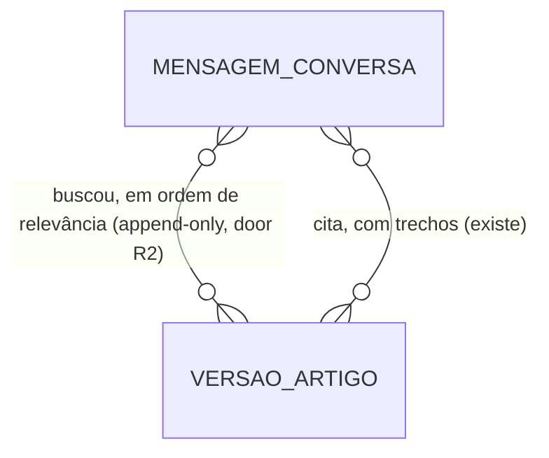

# RAG: o assistente busca os artigos relevantes em vez de receber o catálogo inteiro

## Problem

A cada mensagem do aluno, o servidor manda ao modelo todos os artigos ativos da instituição
(door 4 do `mvp-one`). O tamanho do prompt cresce na mesma proporção da base de orientações, e a
base de uma instituição real não fica nos 10 a 30 artigos para os quais isso foi pensado:
- cada mensagem paga a base inteira em tokens de entrada;
- a resposta demora mais;
- o modelo escolhe o artigo no meio de dezenas de textos parecidos.

Quando ele cita o artigo errado ou recorta mal o trecho, a conferência do servidor (door 19) barra
a resposta e o aluno recebe "não encontrei" mesmo com a orientação certa na base.

Não há medição ainda: a chave do provedor real não existe (pergunta 3 do `mvp-one`) e a base real
da Univag não chegou (pergunta 6). O que existe é a decisão do grupo de 02/11/2026 (AD-014): o
piloto na Univag só começa com o assistente buscando os artigos.

**O que muda quando isto estiver pronto:**
- O modelo recebe só os poucos artigos da instituição que mais se parecem com o que o aluno
  escreveu, buscados no próprio PostgreSQL.
- A busca acha "boletos" quando o artigo diz "boleto", e acha "nao consigo" quando o artigo diz
  "não consigo".
- Cada resposta guarda quais artigos foram buscados, para explicar depois um "não encontrei".
- O grupo mede a busca com as perguntas reais da Univag antes do piloto, sem gastar com o provedor
  de IA, e ajusta a base pelo que errou.

## Flow

Reusa o que o assistente já tem:
- o prompt e a conferência literal dos trechos e links (door 19), sem mudança;
- o filtro global por instituição (door 16);
- a regra de validade dos artigos (AC 150 do `mvp-one`);
- o comando do operador, que ganha um subcomando.

1. Mensagem do aluno -> `ConversaRotas` (exists) grava a mensagem e chama `Assistente.Responder`
   (exists).
2. `Assistente` (exists) monta a consulta com as últimas 3 mensagens do aluno na conversa e pede a
   `Busca` (new, door R1) até `Rag:K` versões ativas de artigo da instituição, ordenadas por
   relevância.
3. `Busca` consulta `versao_artigo` com a configuração de texto `pt_one` (door R1): só a versão
   atual de artigos `ATIVO` dentro da validade, da instituição da sessão.
4. `Assistente` (exists) manda ao provedor as regras fixas, os artigos buscados, as categorias
   ativas e as últimas 10 mensagens mascaradas, no lugar do catálogo inteiro.
5. `Assistente` (exists) confere a resposta só contra os artigos buscados (door 19) e grava a
   mensagem do assistente com as versões buscadas, em ordem (door R2), append-only (door 6).
6. Comando `instituicao avaliar-busca` (exists, ganha subcomando): lê um arquivo de perguntas com o
   artigo esperado, roda a mesma `Busca` para cada uma e imprime acertos e erros, sem chamar o
   provedor e sem gravar nada.

## Impact

| Front | What changes |
| --- | --- |
| domain | novo termo `Busca`: escolha de até `Rag:K` versões de artigo ativas da instituição para uma conversa, por semelhança de texto. Vive no assistente |
| domain | AC 34 e door 4 do `mvp-one` mudam de sentido: "os artigos ativos da instituição" vira "os artigos buscados para esta conversa". Hoje dependem do sentido antigo: `LlmRequisicaoTests.Corpo_so_traz_o_permitido` (C52), `ArtigoAdminTests.Ativar_entra_na_proxima_mensagem` e `Arquivar_sai_da_base_e_mantem_conversas` (C133, C134) e `ExtrasTests.Validade_do_artigo` (C195), que procuram artigos no corpo enviado ao provedor. As perguntas deles precisam ter palavras do artigo esperado. O plano novo reescreve esses checks em vez de apagá-los |
| domain | AC 102 do `mvp-one` ("ativar inclui o artigo na base da próxima mensagem") continua valendo como "o artigo ativado pode ser buscado na próxima mensagem" |
| domain | AC 37: uma `resposta` que cita um artigo ativo que não foi buscado vira `sem_base`, como já acontece com artigo inativo |
| custo do provedor | o catálogo deixa de ser um prefixo fixo do prompt, então o desconto de cache do DeepSeek passa a valer só para as regras e as categorias. Com dezenas de artigos, mandar 5 sai mais barato que mandar todos com desconto; com 10 artigos, pode sair igual ou mais caro |
| stored data | `mensagem_conversa` ganha as versões buscadas (door R2). As mensagens anteriores ficam vazias, porque foram respondidas com o catálogo inteiro; nada a migrar. A configuração `pt_one` e a extensão `unaccent` entram por migração e não mexem em linha nenhuma |

## Relations

Restrições difíceis de desfazer:
- as versões buscadas de uma mensagem do assistente não mudam depois de gravadas: a tabela é
  append-only, com trigger (door 6);
- toda versão buscada é da mesma instituição da mensagem (door 16).

## Surface

None - nothing consumed outside over HTTP. Nenhuma rota nova nem com assinatura alterada: as respostas de `POST /api/conversas` e
`POST /api/conversas/{id}/mensagens` continuam `resposta{tipo, texto}`, sem nenhum dado de artigo
(AC 40 do `mvp-one`).

Comando do operador, sem HTTP, rodado dentro do contêiner da `api/` como os outros
`instituicao`:
- uso: `instituicao avaliar-busca --slug <slug> --arquivo <caminho>`;
- arquivo: JSON `[{"pergunta": "...", "artigo": "..."}]`, em que `artigo` é o título da versão
  atual do artigo esperado;
- saída: uma linha por pergunta (acerto e posição, ou erro com os títulos buscados) e o total de
  acertos entre os `Rag:K` primeiros;
- código de saída: `0` para avaliação feita, `1` para erro de validação (critérios 12 e 14).

## Landing

| One-way door | Literal shape | Alternative rejected |
| --- | --- | --- |
| R1. Busca por texto no PostgreSQL | migração com `CREATE EXTENSION IF NOT EXISTS unaccent; CREATE TEXT SEARCH CONFIGURATION pt_one (COPY = portuguese); ALTER TEXT SEARCH CONFIGURATION pt_one ALTER MAPPING FOR hword, hword_part, word WITH unaccent, portuguese_stem;`. A busca usa `to_tsvector('pt_one', ...)` com peso `A` para título e perguntas e `B` para a resposta, consulta em OU entre as palavras, `ts_rank_cd` decrescente, empate pelo menor id de artigo. A imagem continua `postgres:18` | embeddings com `pgvector`: o DeepSeek não tem API de embeddings (`api-docs.deepseek.com` só documenta chat), então seria um segundo provedor recebendo as perguntas dos alunos, com a mesma questão de LGPD da pergunta 2 do `mvp-one`. Também troca a imagem por `pgvector/pgvector:pg18`, o que quebra a door 1 e o C19. `ILIKE`: não reduz palavras ao radical nem ordena por relevância. Elasticsearch ou Meilisearch: um serviço a mais para centenas de artigos. `plainto_tsquery` (todas as palavras obrigatórias): uma pergunta natural com uma palavra fora do artigo não acharia nada |
| R2. Registro do que foi buscado | coluna `versoes_buscadas bigint[]` em `mensagem_conversa`, em ordem de relevância, preenchida só nas mensagens do assistente, protegida pelo trigger append-only que a tabela já tem | tabela própria `busca_artigo`: uma linha por versão para um dado que só se lê junto com a mensagem. Não gravar: um "não encontrei" causado pela busca ficaria indistinguível de um causado pela conferência |
| R3. Substitui a door 4 do `mvp-one` na escolha dos artigos | entrada nova em `.specs/STATE.md` substituindo o "catálogo inteiro" da door 4. O resto da door 4 continua: formato OpenAI, modelo, `temperature` 0, máscara e saída JSON | manter o catálogo inteiro e só pré-filtrar acima de 100 artigos (o `shortcut:` atual): o piloto exige busca desde o primeiro dia (AD-014) |

- Nothing else in this change is hard to reverse

## Criteria

### S1: O assistente responde a partir dos artigos buscados (P1)

O modelo recebe só os artigos mais parecidos com a conversa, e tudo o que o `mvp-one` garante
sobre a resposta continua valendo.

**Acceptance Criteria**

1. WHEN o aluno envia uma mensagem THEN o sistema SHALL enviar ao provedor de IA só as versões de artigo devolvidas pela busca para a conversa, no máximo `Rag:K` (padrão 5), em vez de todos os artigos ativos da instituição.
2. The system SHALL montar a consulta da busca com as últimas 3 mensagens do aluno na conversa, de modo que a resposta "sim" a uma pergunta do assistente sobre o boleto ainda busque o artigo do boleto.
3. The system SHALL buscar sem diferenciar maiúsculas nem acentos e reduzindo as palavras ao radical em português: "nao consigo emitir os boletos" encontra o artigo "Como emitir o boleto do semestre".
4. The system SHALL ordenar a busca por relevância, com título e perguntas relacionadas pesando mais que a resposta: um artigo com "rematrícula" no título vem antes de um que só menciona "rematrícula" na resposta.
5. The system SHALL devolver da busca só a versão atual de artigos `ATIVO`, dentro da validade (`visivelDe`, `visivelAte`), da instituição da conversa.
6. IF nenhuma palavra da consulta aparece em artigo ativo da instituição THEN o sistema SHALL enviar ao provedor a lista de artigos vazia, e uma `resposta` do modelo SHALL virar `sem_base`.
7. IF a `resposta` do modelo citar um artigo ativo da instituição que não estava entre os buscados THEN o sistema SHALL tratá-la como `sem_base` e registrar `artigo_invalido` no log.
8. The system SHALL conferir os trechos e os links de uma `resposta` contra as versões buscadas, com a mesma regra literal da door 19 do `mvp-one`.
9. WHEN o sistema grava a mensagem do assistente THEN SHALL gravar, sem possibilidade de alteração, os ids das versões buscadas na ordem da busca, inclusive a lista vazia.
10. The system SHALL não entregar as versões buscadas em nenhuma resposta da API nem em nenhuma tela para quem acessa como aluno.
11. WHEN a busca termina THEN o sistema SHALL registrar no log a instituição, a conversa, a quantidade de versões buscadas, os ids delas e a duração em milissegundos, sem o texto das mensagens.

**Independent test:** com os artigos "Como emitir o boleto do semestre", "Faltas não são abonadas" e
"Rematrícula 2026/2", escrever "nao consigo emitir os boletos"; o corpo enviado ao provedor
falso traz o boleto e não traz faltas nem rematrícula, e a mensagem gravada guarda a versão do
boleto em primeiro. Escrever "oi"; o corpo vai sem artigos.

### S2: O grupo mede a busca com perguntas reais antes do piloto (P1)

Antes de ligar o piloto, o operador confere se a busca acha o artigo certo para as perguntas que
os alunos fazem de verdade.

**Acceptance Criteria**

12. WHEN o operador roda `instituicao avaliar-busca` com um arquivo válido THEN o comando SHALL imprimir, para cada pergunta, "acerto" com a posição do artigo esperado entre os buscados ou "erro" com os títulos buscados, depois o total `acertos/perguntas`, e sair com código 0.
13. The command SHALL usar a mesma busca do assistente (critérios 2 a 5), sem chamar o provedor de IA e sem gravar nada no banco.
14. IF o slug não existir, o arquivo não for JSON válido, uma pergunta estiver vazia ou um `artigo` não for título de artigo ativo da instituição THEN o comando SHALL imprimir o caminho e o motivo de cada item com erro na saída de erro e sair com código 1.

**Independent test:** um arquivo com 3 perguntas, duas que acham o artigo esperado e uma com
palavras que não estão em artigo nenhum; a saída mostra 2 acertos com a posição, 1 erro com os
títulos buscados e "2/3", e o provedor falso não recebe nenhuma chamada.

## Out of scope

| Excluded | Why |
| --- | --- |
| Busca semântica por embeddings (`pgvector`) | sem API de embeddings no DeepSeek, seria um segundo provedor recebendo dados dos alunos; volta à mesa se o `avaliar-busca` com a base real errar demais (pergunta 1) |
| Ler documentos inteiros (estatuto, regulamentos, PDFs) e quebrá-los em trechos | muda a regra de que a IA só fala o que um administrador aprovou como artigo (AD-012); fica para um plano próprio (pergunta 2) |
| Reordenar os resultados com um segundo modelo | dobra chamadas e custo para um ganho que ainda não foi medido |
| Mostrar ao atendente quais artigos foram buscados | o registro (critério 9) permite auditar pelo banco; a tela vem se o piloto pedir |
| `Rag:K` e pesos por instituição | configuração global, como os prazos e o provedor no `mvp-one` |
| Sinônimos ("2ª via" = "segunda via") | o `avaliar-busca` mostra quais faltam; o primeiro remédio é escrever a variação nas perguntas do artigo |

## Assumptions

| Assumption | Chosen default | Rationale | Confirmed? |
| --- | --- | --- | --- |
| O que entra na busca | só os artigos aprovados, como hoje | mantém a curadoria da AD-012; documentos brutos ficam fora (pergunta 2) | n |
| Técnica de busca | texto em português no PostgreSQL (door R1), sem embeddings | nenhum provedor ou imagem nova; o `avaliar-busca` diz se basta (pergunta 1) | n |
| Quantos artigos vão ao modelo | `Rag:K` = 5 | cobre o artigo certo e vizinhos parecidos sem voltar ao prompt grande; ajustável por configuração | n |
| Consulta | últimas 3 mensagens do aluno | uma resposta curta ("sim") herda o assunto; mais que isso traz assuntos velhos | n |
| Nota mínima | qualquer palavra em comum (`ts_rank_cd` > 0) | o limite de `K` já corta a cauda; uma nota mínima sem dados reais seria chute | n |
| Busca sem resultado | chama o provedor mesmo assim, com a lista de artigos vazia | o modelo ainda pode fazer uma pergunta de esclarecimento ("Sobre qual assunto?"), e uma `resposta` vira `sem_base` pela regra que já existe | n |
| Índice da busca | calcular o `to_tsvector` na consulta, sem coluna nem índice | centenas de versões por instituição; `shortcut:` com índice GIN quando passar de alguns milhares | n |
| Meta de acertos do `avaliar-busca` | nenhuma fixada no plano | é meta de serviço, não critério; o grupo decide com a base real (pergunta 3) | n |

**Open questions:**

| # | Kind | Question | Until answered |
| --- | --- | --- | --- |
| 1 | open | Busca só por texto no PostgreSQL ou também semântica, com embeddings de um segundo provedor? | vale a busca por texto (door R1); embeddings ficam fora do escopo |
| 2 | open | A base buscada inclui documentos da instituição, ou só os artigos aprovados? | só artigos |
| 3 | blocks go-live | Quem fornece as perguntas reais com o artigo esperado, e qual taxa de acertos libera o piloto? | o `avaliar-busca` roda só com perguntas de exemplo escritas pelo grupo |

## Observable

| Surface | Decision | Landing |
| --- | --- | --- |
| API `POST /api/conversas` e `POST /api/conversas/{id}/mensagens` | formato da resposta e códigos | existing - inalterados (Surface do `mvp-one`); critério 10 |
| API todas as rotas | quem pode chamar, versionamento, limite de taxa | n/a - nenhuma rota nova ou alterada |
| comando `instituicao avaliar-busca` | saída e verbosidade | AC 12: uma linha por pergunta e o total |
| comando `instituicao avaliar-busca` | flags e padrões | AC 12, AC 14: `--slug` e `--arquivo` obrigatórios, sem padrão; `K` vem de `Rag:K` como no assistente |
| comando `instituicao avaliar-busca` | códigos de saída | AC 12, AC 14: 0 e 1 |
| comando `instituicao avaliar-busca` | falha no meio | n/a - só lê; não há o que desfazer (AC 13) |
| texto do assistente | tom e profundidade | existing - regras fixas do prompt do `mvp-one`, sem mudança |
| coleção artigos buscados | critério e ordem | AC 4: relevância decrescente, empate pelo menor id de artigo (door R1) |
| coleção artigos buscados | duplicados | AC 5: uma versão por artigo, a atual |
| coleção artigos buscados | exceção que não cabe | AC 6: nenhum resultado |
| tela Assistente | estados vazio, carregando, erro | existing - inalterados (Observable do `mvp-one`) |

## Sources

- `.specs/STATE.md` AD-014 (02/11/2026): o piloto exige RAG; escopo e técnica ficam para este plano.
- `.specs/features/mvp-one/plan.md`, door 4 (catálogo no prompt), door 19 (conferência literal), AC 34, 37, 40, 102 e 150.
- `api-docs.deepseek.com` (consultado em 02/11/2026): só a API de chat está documentada, sem embeddings.
