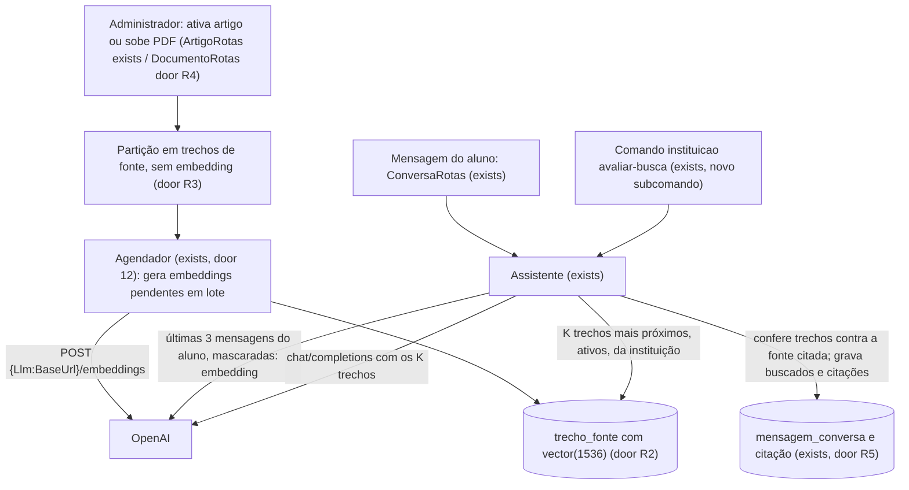
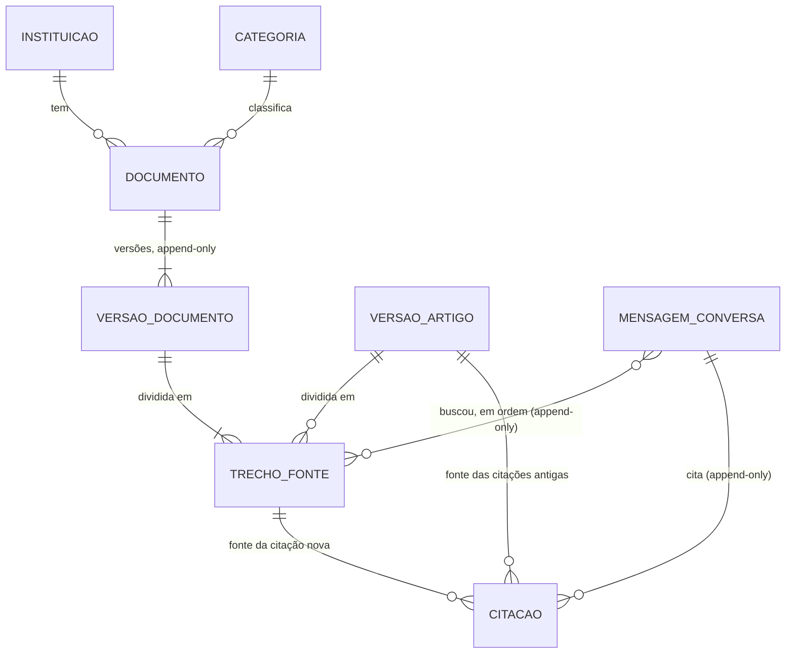

# RAG com OpenAI: o assistente busca, por significado, nos artigos e nos documentos da instituição

## Problem

A cada mensagem do aluno, o servidor manda ao modelo todos os artigos ativos da instituição
(door 4 do `mvp-one`). O tamanho do prompt cresce na mesma proporção da base, e a base real de uma
instituição não fica nos 10 a 30 artigos para os quais isso foi pensado:
- cada mensagem paga a base inteira em tokens de entrada;
- a resposta demora mais;
- o modelo escolhe no meio de dezenas de textos parecidos.

Quando ele cita a fonte errada ou recorta mal o trecho, a conferência do servidor (door 19) barra
a resposta e o aluno recebe "não encontrei" mesmo com a orientação certa na base.

Além disso, boa parte das regras de uma instituição não está em artigos: está no estatuto, nos
regulamentos e no calendário acadêmico, em PDF. Hoje o administrador precisaria reescrever esses
documentos em artigos para o assistente conhecê-los.

Não há medição ainda: a chave do provedor real não existe (pergunta 3 do `mvp-one`) e a base real
da Univag não chegou (pergunta 6). O que existe são as decisões do grupo de 02/11/2026:
- AD-014: o piloto na Univag só começa com o assistente buscando as fontes;
- trocar o DeepSeek pela OpenAI, porque a OpenAI tem API de embeddings e o DeepSeek não
  (`api-docs.deepseek.com` só documenta chat);
- buscar em artigos **e** em documentos da instituição.

**O que muda quando isto estiver pronto:**
- O assistente passa a usar a OpenAI, tanto para conversar quanto para gerar os embeddings da busca.
- O administrador sobe os PDFs da instituição (estatuto, regulamentos, calendário), e o texto deles
  vira fonte do assistente sem ninguém reescrevê-lo.
- A cada mensagem, o modelo recebe só os poucos trechos de artigos e documentos mais parecidos, em
  significado, com o que o aluno escreveu, buscados no próprio PostgreSQL com `pgvector`.
- Tudo o que o `mvp-one` garante sobre a resposta continua valendo para os documentos: cada trecho
  citado é conferido literalmente, o aluno nunca vê a fonte, e só atendente e administrador veem de
  qual documento veio.
- O grupo mede a busca com perguntas reais antes do piloto e ajusta a base pelo que errou.

## Flow

Reusa o que já existe:
- o prompt, a conferência literal (door 19) e o registro append-only (door 6) do assistente;
- o filtro global por instituição (door 16);
- o agendador (door 12) para gerar os embeddings fora da requisição, com a mesma regra de
  tentativas da fila de e-mail;
- a validação de arquivo pela assinatura e o armazenamento em `bytea` dos anexos (door 13);
- o comando do operador `instituicao` (exists).

1. O administrador ativa um artigo, edita um artigo ativo ou sobe uma versão de documento. A
   aplicação divide o texto em trechos de fonte (door R3) e grava os trechos sem embedding, na
   mesma transação.
2. A cada execução, o `Agendador` (exists) pega os trechos pendentes de todas as instituições em
   lotes, pede os embeddings à OpenAI (door R1) e grava o vetor de cada trecho (door R2). Se a
   chamada falha, soma uma tentativa e tenta de novo como os e-mails (2^n minutos, até 5).
3. Mensagem do aluno -> `ConversaRotas` (exists) -> `Assistente` (exists): as últimas 3 mensagens
   do aluno, mascaradas como as do chat (AC 34 do `mvp-one`), viram um embedding de consulta.
4. `Assistente` (exists) busca os `Rag:K` trechos mais próximos por distância de cosseno (door R2). Entram só
   trechos com embedding, de artigos `ATIVO` dentro da validade ou de documentos `ATIVO`, na versão
   atual, da instituição da conversa.
5. `Assistente` (exists) manda ao chat da OpenAI as regras fixas, os trechos buscados (cada um com um id de
   fonte), as categorias e as últimas 10 mensagens mascaradas. O modelo cita ids de fonte e copia
   trechos literais.
6. `Assistente` (exists) confere cada trecho copiado contra o texto do trecho de fonte citado (door 19), e
   cada link contra os links do artigo de origem. Grava a mensagem com os ids dos trechos buscados
   e as citações por trecho de fonte (door R5), append-only.
7. Comando `instituicao` (exists), subcomando novo `avaliar-busca`: roda os passos 3
   e 4 para cada pergunta de um arquivo e imprime acertos e erros, sem chamar o chat e sem gravar.

## Impact

| Front | What changes |
| --- | --- |
| domain | novo termo `Documento`: PDF da instituição (estatuto, regulamento, calendário) com versões, categoria e estado `ATIVO` ou `ARQUIVADO`. É fonte interna do assistente como o artigo: nunca é mostrado ao aluno (AD-012) |
| domain | novo termo `TrechoFonte`: pedaço de texto de uma versão de artigo ou de documento, com o embedding. É a unidade que a busca devolve e que o modelo cita. Não confundir com `TrechoOficial` (o texto que o modelo copia e o servidor confere), que continua existindo |
| domain | `Citação` muda de sentido: cita um trecho de fonte, que pertence a uma versão de artigo ou de documento, e não mais só uma versão de artigo. Hoje dependem do sentido antigo: o detalhe do chamado do atendente (fontes por resposta, AC 73), `GET /api/artigos/versoes/{id}`, o aviso "Este artigo foi atualizado" (AC 54), a origem `ARTIGO` da categoria (AC 61) e o ranking "por conversas" dos indicadores (S11). AC 61 passa a valer para "o último artigo ou documento citado" |
| domain | AC 34, AC 37 e door 4 do `mvp-one` mudam: o modelo recebe os trechos buscados, não o catálogo; o provedor padrão passa a ser a OpenAI. Os testes que procuram artigos no corpo enviado ao provedor (C52, C53, C133, C134, C195) são reescritos neste plano, não apagados |
| domain | AD-006 (provedor padrão DeepSeek) é substituída: a troca de provedor deixa de ser "só configuração", porque o corpo da requisição muda (`max_completion_tokens` no lugar de `max_tokens`, `reasoning_effort`) |
| infraestrutura | o `docker-compose.yml` troca `postgres:18` por `pgvector/pgvector:0.8.7-pg18` (door R2). C19 do `mvp-one`, que fixa `postgres:18`, é reescrito. Um banco que já existe continua: é o mesmo PostgreSQL 18 com a extensão a mais |
| LGPD | a OpenAI passa a receber as conversas (mascaradas) e o texto dos documentos. A política dela (consultada em 02/11/2026): dados da API não treinam modelos por padrão, ficam até 30 dias para monitoramento de abuso, e não há região de dados no Brasil. Continua sendo transferência internacional (art. 33): a pergunta 2 do `mvp-one` muda de DeepSeek para OpenAI |
| custo do provedor | `text-embedding-3-small` custa US$ 0,02 por milhão de tokens; `gpt-6-luna`, US$ 0,10 de entrada, 0,01 em cache e 0,50 de saída (preços de 02/11/2026). Cada mensagem passa a fazer duas chamadas (embedding e chat) |
| stored data | nada a migrar nas mensagens antigas: elas ficam sem trechos buscados. As citações antigas continuam apontando para a versão de artigo; as novas apontam para o trecho de fonte (door R5). Os artigos `ATIVO` que já existem ganham trechos pendentes na migração, e o agendador os indexa na primeira execução |

## Relations

Restrições difíceis de desfazer:
- todo trecho de fonte pertence a exatamente uma versão, de artigo ou de documento (door R3);
- toda citação aponta para um trecho de fonte ou, só nas antigas, para uma versão de artigo (door R5);
- versões de documento, trechos de fonte e citações não aceitam UPDATE nem DELETE, exceto a
  gravação do embedding num trecho que ainda não tem (door R3);
- o vetor tem 1536 dimensões em toda a instituição (door R2);
- tudo carrega `instituicao_id` com o filtro global (door 16).

## Surface

| Route | In | Out | Status |
| --- | --- | --- | --- |
| `GET /api/admin/documentos` | nada | lista de `id` · `titulo` · `categoria` · `estado` · `versao{numero, nomeArquivo, paginas, criadaEm}` · `indexacao` (`PENDENTE`, `INDEXADO`, `FALHOU`) | `200`, `401`, `403` |
| `POST /api/admin/documentos` | multipart `titulo`, `categoriaId`, `arquivo` (PDF) | documento | `201`, `400`, `403`, `413`, `415` |
| `POST /api/admin/documentos/{id}/versoes` | multipart `arquivo` (PDF) | documento | `201`, `400`, `403`, `404`, `409`, `413`, `415` |
| `POST /api/admin/documentos/{id}/arquivar` | nada | documento | `200`, `403`, `404`, `409` |
| `GET /api/documentos/versoes/{id}` (atendente e administrador) | nada | o PDF da versão citada | `200`, `401`, `404` |
| `GET /api/admin/artigos` | (existe) | ganha `indexacao` por artigo | `200`, `401`, `403` |
| `GET /api/chamados/{numero}` | (existe) | cada fonte do assistente, para a equipe, ganha `tipo` (`ARTIGO` ou `DOCUMENTO`) e o id da versão | `200`, `401`, `404` |

Comando do operador, sem HTTP, rodado dentro do contêiner da `api/` como os outros `instituicao`:
- uso: `instituicao avaliar-busca --slug <slug> --arquivo <caminho>`;
- arquivo: JSON `[{"pergunta": "...", "fonte": "..."}]`, em que `fonte` é o título de um artigo ou
  de um documento;
- saída: uma linha por pergunta (acerto e posição, ou erro com as fontes buscadas) e o total;
- código de saída: `0` para avaliação feita, `1` para erro de validação.

## Landing

| One-way door | Literal shape | Alternative rejected |
| --- | --- | --- |
| R1. Provedor OpenAI para chat e embeddings | Configuração: `Llm:BaseUrl` = `https://api.openai.com/v1`, `Llm:Modelo` = `gpt-6-luna`, `Llm:ModeloEmbeddings` = `text-embedding-3-small`, `Llm:ChaveApi` por variável de ambiente. Chat em `POST {Llm:BaseUrl}/chat/completions` com `response_format: {"type":"json_object"}`, `max_completion_tokens: 800` e `reasoning_effort: "none"`; `temperature` só se a chamada real aceitar (pergunta 1). Embeddings em `POST {Llm:BaseUrl}/embeddings` com `input` em lote e `encoding_format: "float"`. Os dois por `HttpClient`, sem SDK, como hoje | DeepSeek no chat e OpenAI só nos embeddings: dois provedores recebendo os dados dos alunos e dois contratos, e o grupo escolheu um só. SDK `OpenAI`: dependência para duas requisições. API Responses: reescreve o contrato da door 4, e o Chat Completions continua suportado |
| R2. Vetores no PostgreSQL com `pgvector` | Imagem `pgvector/pgvector:0.8.7-pg18`; migração com `CREATE EXTENSION IF NOT EXISTS vector`; pacote `Pgvector.EntityFrameworkCore` 0.3.0 (EF Core 10); coluna `embedding vector(1536)` em `trecho_fonte`; índice `USING hnsw (embedding vector_cosine_ops)`; busca `ORDER BY embedding <=> @consulta LIMIT @k` com o filtro da instituição. Trocar de modelo de embeddings ou de dimensão obriga a gerar todos os vetores de novo | Banco vetorial separado (Qdrant, Pinecone): mais um serviço, mais um processador de dados e o filtro por instituição fora do banco. Vetor em `float[]` com similaridade calculada em C#: carregaria todos os vetores da instituição a cada mensagem. Busca só por texto (`tsvector`): o grupo escolheu busca por significado |
| R3. Trecho de fonte | Tabela `trecho_fonte` com `versao_artigo_id` ou `versao_documento_id` (exatamente um, `CHECK`), `ordem`, `texto`, `embedding` (nulo até indexar), `tentativas`, `proxima_tentativa`. Artigo: um trecho com título, perguntas e resposta. Documento: trechos de até 1500 caracteres, cortados em fim de parágrafo ou de frase, com 200 de sobreposição. Trigger: recusa DELETE e recusa UPDATE de `texto` e de `embedding` já preenchido | Embedding gerado dentro da requisição do administrador: um PDF de 200 páginas segura a requisição por dezenas de segundos, e uma falha da OpenAI faria o upload falhar. Trecho por página: páginas de tamanho muito diferente e frases cortadas ao meio |
| R4. Documento e versão de documento | Tabelas `documento` (`titulo`, `categoria_id`, `estado` `ATIVO` ou `ARQUIVADO`) e `versao_documento` (`numero` único por documento, `nome_arquivo`, `conteudo bytea`, `texto` extraído, `paginas`), append-only como `versao_artigo`. PDF de até 20 MB, conferido pela assinatura `%PDF`; texto extraído com `PdfPig` 0.1.16 (Apache-2.0) | Guardar o PDF em disco ou em armazenamento de objetos: mesma decisão da door 13 para os anexos. Aceitar Word ou HTML: mais um extrator para cada formato; a instituição exporta PDF. OCR de PDF digitalizado: dependência pesada (Tesseract) para um caso que o administrador resolve exportando o PDF com texto |
| R5. Citação por trecho de fonte | `citacao_artigo` ganha `trecho_fonte_id`; `versao_artigo_id` passa a aceitar nulo; `CHECK (trecho_fonte_id IS NOT NULL OR versao_artigo_id IS NOT NULL)`. As citações novas gravam só o trecho de fonte; as antigas ficam como estão. `mensagem_conversa` ganha `trechos_buscados bigint[]`, em ordem de distância | Tabela nova de citação: duas tabelas para o mesmo papel e uma junção a mais em todo detalhe. Apagar as citações antigas e regravá-las: viola a door 6 |
| R6. Substitui a AD-006 e a parte "catálogo inteiro" da door 4 | Entradas novas em `.specs/STATE.md`: provedor padrão OpenAI, e busca por trechos no lugar do catálogo. O resto da door 4 continua: formato de chat, máscara, saída JSON com `tipo`, `texto`, trechos, `categoriaId` e `resumo` | Manter o DeepSeek: não tem embeddings |

- Nothing else in this change is hard to reverse

## Criteria

### S1: O assistente passa a usar a OpenAI (P1)

A troca de provedor, sozinha, sem mudar o que o aluno vê.

**Acceptance Criteria**

1. The system SHALL chamar o chat em `POST {Llm:BaseUrl}/chat/completions` com `model` = `Llm:Modelo` (padrão `gpt-6-luna`), `response_format` `json_object`, `max_completion_tokens` 800 e `reasoning_effort` `none`, sem o campo `max_tokens`.
2. WHEN uma chamada ao chat termina THEN o sistema SHALL registrar no log os tokens de entrada com cache lidos de `usage.prompt_tokens_details.cached_tokens`, além do que o AC 47 do `mvp-one` já registra.
3. IF a OpenAI responder com status 4xx ou 5xx, passar de 20 segundos ou devolver JSON inválido THEN o sistema SHALL agir como `sem_base` e registrar o motivo, como o AC 45 do `mvp-one`.

**Independent test:** com o provedor falso, uma mensagem gera uma requisição com os campos do
critério 1 e sem `max_tokens`; com a chave real, uma pergunta sobre o boleto recebe resposta
conferida.

### S2: O assistente busca por significado nos artigos (P1)

O modelo recebe só os trechos mais próximos da conversa, e tudo o que o `mvp-one` garante sobre a
resposta continua valendo.

**Acceptance Criteria**

4. WHEN um artigo é ativado ou um artigo ativo é editado THEN o sistema SHALL gravar, na mesma transação, um trecho de fonte pendente com o título, as perguntas e a resposta da versão atual.
5. WHEN o agendador executa THEN SHALL pedir à OpenAI os embeddings dos trechos pendentes de todas as instituições, em lotes de até 100 trechos, e gravar o vetor de cada um.
6. IF a chamada de embeddings falhar THEN o agendador SHALL somar 1 às tentativas dos trechos do lote, marcar a próxima para 2^tentativas minutos depois, registrar a falha no log com a instituição e, depois de 5 tentativas, parar e mostrar `indexacao` `FALHOU` ao administrador.
7. WHEN o aluno envia uma mensagem THEN o sistema SHALL gerar o embedding das últimas 3 mensagens do aluno na conversa, mascaradas como no AC 34 do `mvp-one`, e enviar ao chat só os `Rag:K` (padrão 5) trechos de fonte mais próximos por distância de cosseno.
8. The system SHALL buscar só trechos com embedding, da versão atual de artigos `ATIVO` dentro da validade (`visivelDe`, `visivelAte`) ou de documentos `ATIVO`, da instituição da conversa.
9. WHEN um artigo é arquivado THEN o sistema SHALL deixar de devolver os trechos dele na próxima busca, mantendo as conversas que o citaram.
10. IF nenhum trecho de fonte da instituição tiver embedding THEN o sistema SHALL enviar ao chat a lista de fontes vazia, e uma `resposta` do modelo SHALL virar `sem_base`.
11. IF a `resposta` do modelo citar um id de fonte que não estava entre os buscados THEN o sistema SHALL tratá-la como `sem_base` e registrar `fonte_invalida` no log.
12. The system SHALL conferir cada trecho copiado pelo modelo contra o texto do trecho de fonte citado, com a regra literal da door 19 do `mvp-one`, e cada link do texto contra os links do artigo de origem.
13. WHEN o sistema grava a mensagem do assistente THEN SHALL gravar, sem possibilidade de alteração, os ids dos trechos buscados em ordem de distância, inclusive a lista vazia, e as citações por trecho de fonte.
14. IF a chamada de embeddings da consulta falhar THEN o sistema SHALL agir como `sem_base` sem chamar o chat e registrar `busca_indisponivel` no log.
15. WHEN a busca termina THEN o sistema SHALL registrar no log a instituição, a conversa, os ids buscados, as distâncias e a duração em milissegundos, sem o texto das mensagens.

**Independent test:** com o provedor falso devolvendo vetores fixos, a pergunta mais próxima do
vetor do artigo do boleto faz o chat receber o trecho do boleto e não o das faltas; arquivar o
boleto tira o trecho da busca seguinte.

### S3: Documentos da instituição viram fonte do assistente (P1)

O administrador sobe os PDFs da instituição, e eles passam a responder como os artigos, sem nunca
aparecer para o aluno.

**Acceptance Criteria**

16. WHEN o administrador sobe um PDF de até 20 MB, com texto, título e categoria ativa THEN o sistema SHALL criar o documento `ATIVO` com a versão 1, extrair o texto e gravar, na mesma transação, os trechos de fonte pendentes, e responder 201.
17. The system SHALL dividir o texto de um documento em trechos de até 1500 caracteres, cortados em fim de parágrafo ou de frase, com 200 caracteres de sobreposição entre trechos vizinhos.
18. IF o arquivo não começar com `%PDF` THEN o sistema SHALL responder 415; IF passar de 20 MB THEN SHALL responder 413; IF o PDF não tiver texto extraível THEN SHALL responder 400 com `detail` "O PDF não tem texto. Exporte o documento com texto, não digitalizado."; IF faltar título ou a categoria não for ativa da instituição THEN SHALL responder 400. Em nenhum caso grava o documento.
19. WHEN o administrador sobe uma nova versão de um documento `ATIVO` THEN o sistema SHALL criar a versão seguinte, manter as anteriores e buscar só os trechos da versão atual a partir da indexação dela.
20. WHEN o administrador arquiva um documento THEN o sistema SHALL tirar os trechos dele da busca e manter as conversas que o citaram; IF o documento já estiver arquivado THEN SHALL responder 409, e IF o documento arquivado receber nova versão THEN SHALL responder 409.
21. WHEN uma resposta do assistente cita um trecho de documento THEN o detalhe do chamado SHALL mostrar à equipe o título do documento, o número da versão e o trecho confirmado, e `GET /api/documentos/versoes/{id}` SHALL devolver o PDF dessa versão a atendente e administrador.
22. The system SHALL não entregar título, texto, trechos, ids ou arquivo de documento em nenhuma resposta da API nem em nenhuma tela para quem acessa como aluno, e SHALL responder 404 ao aluno em `GET /api/documentos/versoes/{id}`.
23. WHEN o chamado é criado e a última fonte citada na conversa é de documento THEN o sistema SHALL usar a categoria do documento, com origem `ARTIGO`, como o AC 61 do `mvp-one` faz com o artigo.
24. The system SHALL mostrar na tela Documentos do administrador a lista com título, categoria, estado, versão, número de páginas e `indexacao`, com "Nenhum item cadastrado." quando vazia e confirmação em `Modal` antes de arquivar.

**Independent test:** subir o PDF "Regulamento de estágio" com "A carga horária mínima do estágio
é de 300 horas."; depois da indexação, a pergunta "quantas horas de estágio preciso?" faz o chat
receber esse trecho, a resposta é conferida contra ele, o aluno não vê nada do documento e o
atendente, no chamado transferido, vê o título e o trecho.

### S4: O grupo mede a busca com perguntas reais antes do piloto (P1)

**Acceptance Criteria**

25. WHEN o operador roda `instituicao avaliar-busca` com um arquivo válido THEN o comando SHALL imprimir, para cada pergunta, "acerto" com a posição da fonte esperada entre as buscadas ou "erro" com os títulos buscados, depois o total `acertos/perguntas`, e sair com código 0.
26. The command SHALL usar a mesma busca do assistente (critérios 7 e 8), sem chamar o chat e sem gravar nada no banco.
27. IF o slug não existir, o arquivo não for JSON válido, uma pergunta estiver vazia ou uma `fonte` não for título de artigo ou documento ativo da instituição THEN o comando SHALL imprimir o caminho e o motivo de cada item com erro na saída de erro e sair com código 1.

**Independent test:** um arquivo com 3 perguntas, duas que acham a fonte esperada e uma longe de
todas; a saída mostra 2 acertos com a posição, 1 erro com as fontes buscadas e "2/3", e o chat do
provedor falso não recebe nenhuma chamada.

## Out of scope

| Excluded | Why |
| --- | --- |
| OCR de PDF digitalizado | exige uma dependência pesada; o administrador exporta o PDF com texto (critério 18) |
| Word, HTML, planilhas e páginas da web como documento | um extrator por formato; a instituição exporta PDF |
| Busca híbrida (significado + texto exato) e reordenação por um segundo modelo | sem medição que mostre a necessidade; volta à mesa se o `avaliar-busca` errar siglas ou códigos |
| Mostrar ao aluno de qual documento veio a resposta, ou o link do PDF | os documentos são internos, como os artigos (AD-012) |
| Validade por data em documentos | arquivar e subir nova versão cobre o calendário de cada semestre |
| Mostrar ao atendente a lista de trechos buscados de cada resposta | o registro (critério 13) permite auditar pelo banco; a tela vem se o piloto pedir |
| Provedor, modelo e `Rag:K` por instituição | configuração global, como no `mvp-one` |
| Região de dados da OpenAI | não há região no Brasil; a escolha da região é configuração da conta, não do código (pergunta 2) |

## Assumptions

| Assumption | Chosen default | Rationale | Confirmed? |
| --- | --- | --- | --- |
| Provedor | OpenAI para chat e embeddings | decisão do grupo: a OpenAI tem API de embeddings, o DeepSeek não | y |
| O que entra na busca | artigos aprovados e documentos da instituição | decisão do grupo em 02/11/2026 | y |
| Técnica de busca | só por significado (embeddings) | decisão do grupo; busca híbrida fica fora do escopo | y |
| Modelo de chat | `gpt-6-luna` com `reasoning_effort` `none` | o mais barato da OpenAI (US$ 0,10 de entrada por milhão), e a tarefa é responder a partir de trechos curtos | n |
| Modelo de embeddings | `text-embedding-3-small`, 1536 dimensões | 6,5 vezes mais barato que o `large`; a dimensão é door (R2) | n |
| `temperature` | não enviar, até a chamada real confirmar que o `gpt-6-luna` aceita 0 com `reasoning_effort` `none` | a documentação não diz, e um parâmetro recusado vira 400, que vira `sem_base` em tudo (pergunta 1) | n |
| Quantos trechos vão ao modelo | `Rag:K` = 5 | cobre a fonte certa e vizinhas sem voltar ao prompt grande | n |
| Consulta | últimas 3 mensagens do aluno, mascaradas | uma resposta curta ("sim") herda o assunto, e a máscara vale para todo envio à OpenAI | n |
| Distância mínima | nenhuma; sempre os `K` mais próximos | sem dados reais, um corte seria chute; o `avaliar-busca` mostra as distâncias | n |
| Busca sem trechos indexados | chama o chat mesmo assim, com a lista vazia | o modelo ainda pode pedir esclarecimento, e uma `resposta` vira `sem_base` | n |
| Tamanho dos trechos de documento | até 1500 caracteres, 200 de sobreposição | cabe um parágrafo de regulamento com contexto; ajustável antes do piloto | n |
| Tamanho máximo de PDF | 20 MB | o dobro do limite de anexo; estatutos e regulamentos ficam bem abaixo | n |
| Lote de embeddings | até 100 trechos por chamada | poucas chamadas por documento, longe dos limites da API | n |

**Open questions:**

| # | Kind | Question | Until answered |
| --- | --- | --- | --- |
| 1 | blocks | O `gpt-6-luna` aceita `temperature: 0` com `reasoning_effort: "none"` no Chat Completions? A documentação não diz | o critério 1 vai sem `temperature`; responder exige uma chamada real com a chave |
| 2 | blocks go-live | A Univag aceita que conversas mascaradas e documentos sejam processados pela OpenAI, sem região no Brasil (LGPD art. 33)? | o assistente roda em teste; com alunos reais, só depois do aceite |
| 3 | blocks go-live | Quem cria a conta da OpenAI e coloca crédito? (substitui a pergunta 3 do `mvp-one`) | sem chave, a busca e o chat caem em `sem_base` |
| 4 | blocks go-live | Quem fornece as perguntas reais com a fonte esperada, e qual taxa de acertos libera o piloto? | o `avaliar-busca` roda só com perguntas de exemplo |
| 5 | blocks go-live | A Univag fornece os PDFs do estatuto, dos regulamentos e do calendário? | a demonstração usa documentos de exemplo |

## Observable

| Surface | Decision | Landing |
| --- | --- | --- |
| tela Documentos | estado vazio | AC 24 |
| tela Documentos | carregando e erro | existing - `Spinner` e `Alert` do `useAcao`, como as outras telas de administração |
| tela Documentos | não autorizado | existing - AC 104 do `mvp-one` (403 em `/api/admin/*`) |
| tela Documentos | ação destrutiva confirma antes | AC 24 |
| tela Documentos | densidade e ordem | AC 24; ordem por título |
| tela Artigos | estado da indexação | AC 6: `indexacao` em cada artigo |
| API `/api/admin/documentos*` | formato e códigos de erro | AC 18, AC 20; existing - `ProblemDetails` (door 8) |
| API `/api/admin/documentos*` e `GET /api/documentos/versoes/{id}` | quem pode chamar | AC 22; existing - AC 104 do `mvp-one` |
| API todas as rotas novas | versionamento e limite de taxa | n/a - a única consumidora é a SPA publicada junto; as rotas são de administrador autenticado |
| tarefa agendada (embeddings) | saída e falha no meio | AC 5, AC 6: um lote por chamada; o lote que falha não afeta os outros |
| comando `instituicao avaliar-busca` | saída, flags, códigos de saída | AC 25, AC 27 |
| comando `instituicao avaliar-busca` | falha no meio | n/a - só lê; não há o que desfazer (AC 26) |
| texto do assistente | tom e profundidade | existing - regras fixas do prompt do `mvp-one`, com "artigos" trocado por "fontes" |
| coleção trechos buscados | critério e ordem | AC 7: distância de cosseno crescente |
| coleção trechos buscados | duplicados | AC 8: só a versão atual de cada fonte |
| coleção trechos buscados | exceção que não cabe | AC 10: nada indexado |
| coleção trechos de documento | critério de corte | AC 17 |

## Sources

- `.specs/STATE.md` AD-014 e as decisões do grupo de 02/11/2026: OpenAI, artigos e documentos.
- `.specs/features/mvp-one/plan.md`: door 4, door 6, door 12, door 13, door 16, door 19 e os AC 34, 37, 40, 45, 47, 54, 61, 73, 104 e 150.
- Documentação oficial consultada em 02/11/2026: `api-docs.deepseek.com` (sem embeddings); `developers.openai.com/api/docs` (guia de embeddings, modelos, referência do Chat Completions, preços, dados); Docker Hub `pgvector/pgvector` (tag `0.8.7-pg18`); NuGet `Pgvector.EntityFrameworkCore` 0.3.0 e `PdfPig` 0.1.16.
