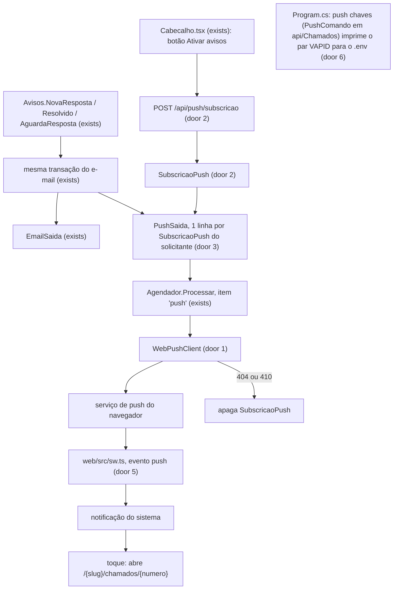
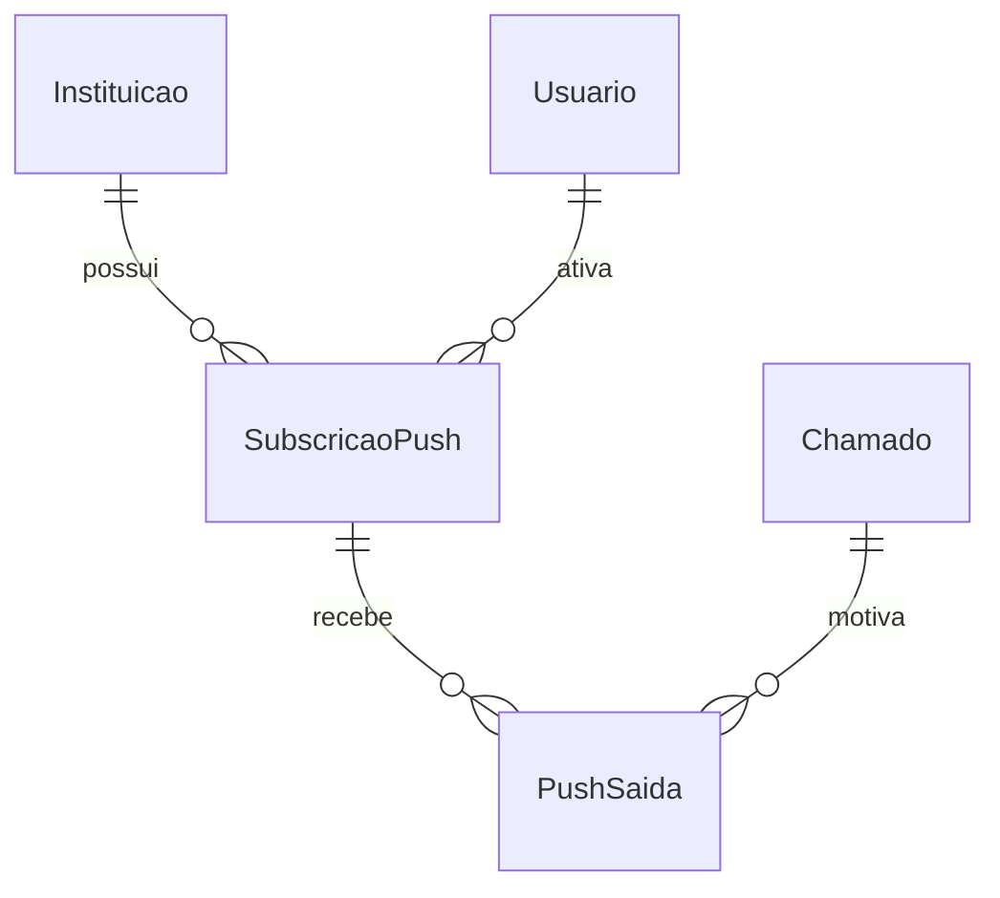

# Web Push

## Problem

Hoje o aluno só descobre que o chamado mudou se abrir o app ou o e-mail. O único aviso com o app fechado é o e-mail da fila `email_saida` (nova resposta, resolvido, aguarda sua resposta), que chega minutos depois, cai em caixa de spam e não aparece na tela do celular como um aviso do sistema. Quem paga é o aluno, que deixa o chamado parado em `AGUARDANDO_ALUNO` até o lembrete ou o encerramento automático, e o atendente, que reabre o que poderia ter sido respondido na hora. Não há número de conversão nem volume de suporte na fonte: o pedido vem do AD-022 e da decisão do usuário de 02/11/2026 ("Web Push pelo service worker do Vite PWA avisa o aluno com o app fechado; o e-mail fica").

Quando isto entrar, o aluno que ativou os avisos num aparelho recebe uma notificação do sistema, sem dado pessoal ("Seu chamado ONE-n foi atualizado."), nos mesmos eventos que já geram e-mail, e ao tocar nela o app abre no chamado.

## Flow

Reaproveita `Avisos` (decide os eventos), a fila com tentativas e `ProximaTentativa` do `Agendador` (o padrão de `email_saida`) e o `registerSW` que `main.tsx` já chama; nenhum caminho de envio direto novo.

## Impact

| Front | What changes |
| --- | --- |
| domain | novo termo: `SubscricaoPush` - inscrição de um navegador de um usuário para receber avisos; vive em `api/Dados/` por agregado (AD-024), com métodos de entidade (reatribuir ao usuário, registrar) e setters privados |
| domain | novo termo: `PushSaida` - aviso a enviar a uma subscrição, com tentativas e próxima tentativa como `EmailSaida`; métodos `RegistrarFalha` e `Concluir` na entidade |
| domain | termo existente: `Avisos` decidia só e-mail; passa a enfileirar também push dentro de `Enfileirar`, na mesma transação. Quem chama: `ResponderChamado`, `ResolverChamado`, `MarcarDuplicado` e `Agendador` (`Lembrar`, `ResolverSemResposta`); nenhum muda de assinatura |
| code | `Agendador.Processar` ganha o caso `push` e `LerFilas` ganha a leitura da nova fila; CA1502 deve continuar em 10 ou menos (o `switch` dos itens saiu de `Processar` para o método `Despachar`, que ganha o caso `push`) |
| tests | os retratos de rota em `api.Tests/Retratos/rotas.txt` ganham as 3 rotas novas; as linhas existentes não mudam |
| web build | `vite-plugin-pwa` passa de `generateSW` para `injectManifest`: o `sw.js` deixa de ser gerado pelo Workbox e passa a ser compilado de `web/src/sw.ts`; `precache_completo.py` (C10 de `interface-nova`) tem de continuar saindo com 0 sobre `api/wwwroot` |
| config | três chaves novas `Push:ChavePublica`, `Push:ChavePrivada`, `Push:Assunto` (variáveis `Push__*` no compose, valores no `.env`, nunca no git) |
| stored data | duas tabelas novas e uma migração; nada a migrar nas existentes |

## Relations

Constraints de mão única: `SubscricaoPush` tem endpoint único no banco inteiro (door 2); `PushSaida` some junto com a sua `SubscricaoPush` (door 3); as duas entidades carregam `instituicao_id` com o filtro global do AD-008.

## Surface

Todas autenticadas por cookie, na instituição do cookie.

| Route | In | Out | Status |
| --- | --- | --- | --- |
| `GET /api/push/chave` | nada | `chavePublica` | `200`, `401`, `404` (push não configurado) |
| `POST /api/push/subscricao` | `endpoint`, `chaves.p256dh`, `chaves.auth` | sem corpo | `204`, `400`, `401`, `404` (push não configurado) |
| `DELETE /api/push/subscricao` | `endpoint` | sem corpo | `204`, `400`, `401` |

Fora da API do navegador-para-servidor há um segundo contrato, o do payload lido pelo service worker (door 4).

## Landing

| One-way door | Literal shape | Alternative rejected |
| --- | --- | --- |
| 1. dependência NuGet | `WebPush` 1.0.13 (web-push-libs, MPL-2.0, alvo net8.0 e netstandard2.1, compatível com net10.0 na página do NuGet, dependência `Portable.BouncyCastle`). Uso: `new WebPushClient().SendNotificationAsync(new PushSubscription(endpoint, p256dh, auth), payload, new VapidDetails(assunto, publica, privada))`; falha vem como `WebPushException.StatusCode`; chaves com `VapidHelper.GenerateVapidKeys()` | VAPID e criptografia `aes128gcm` à mão: ECDSA, ECDH e HKDF escritos em casa é código de segurança sem revisão e sem ganho; a MPL-2.0 só obriga a devolver mudanças nos arquivos da própria biblioteca, que não serão alteradas |
| 2. tabela `subscricao_push` | índice único em `endpoint` (global, não por usuário); `POST` com endpoint existente reatribui usuário e instituição e atualiza as chaves; limite de 10 por usuário (a mais antiga cai) | único por `(usuario_id, endpoint)`: o mesmo navegador, depois de outro login, continuaria recebendo os avisos do usuário anterior |
| 3. fila `push_saida` | uma linha por subscrição: `subscricao_id` (apaga em cascata), `chamado_id`, `tentativas`, `proxima_tentativa`, `enviado_em`; drenada pelo `Agendador` com `MaxTentativas = 5` e espera `2^n` minutos, como `email_saida`; o payload não é guardado, é montado no envio a partir do número do chamado | envio direto após o commit: o processo cair entre o commit e o envio perde o aviso e não há nova tentativa; guardar o texto na linha: duplica dado que `chamado` já tem |
| 4. payload do push | JSON `{"titulo":"One","corpo":"Seu chamado ONE-12 foi atualizado.","url":"/univag/chamados/ONE-12"}`; chaves lidas pelo `sw.ts`, então renomear exige mexer nos dois lados | payload vazio e o service worker buscar o texto na API: soma uma rota autenticada e uma falha possível ao caminho que precisa ser o mais curto |
| 5. service worker `injectManifest` | `VitePWA({ strategies: 'injectManifest', srcDir: 'src', filename: 'sw.ts', registerType: 'autoUpdate', manifest: { ...atual }, injectManifest: { globPatterns: ['**/*.{js,css,html,png,svg,woff,woff2}'] } })`; `sw.ts` faz `precacheAndRoute(self.__WB_MANIFEST)`, mantém o fallback de navegação para `/index.html` com `/^\/api\//` negado, e trata `push` e `notificationclick`; o arquivo publicado continua `sw.js` na raiz, para os navegadores já registrados atualizarem | `generateSW` com `importScripts` de um `push.js` em `public/`: fica fora do TypeScript, do Vitest e do precache; foi a alternativa viva, descartada porque o usuário pediu a troca para `injectManifest` |
| 6. chaves VAPID | `Push__ChavePublica`, `Push__ChavePrivada`, `Push__Assunto` (`mailto:`) no `.env`, repassadas no `docker-compose.yml` como `${PUSH_CHAVE_PUBLICA:-}`; trocar o par invalida todas as subscrições | chaves no `appsettings.json`: a privada iria para o git |

- **Nota de 03/11/2026 (door 1, troca de biblioteca por decisão do usuário):** a `WebPush` 1.0.13 só envia `aesgcm` com `Authorization: WebPush` e `Crypto-Key` (medido); o plano pedia RFC 8291/8292. Troca para `Lib.Net.Http.WebPush` 3.3.1 (MIT, alvos net6.0/net5.0/netstandard2.0, roda em net10.0). Uso: `new PushServiceClient(httpClient).RequestPushMessageDeliveryAsync(new PushSubscription{Endpoint}+SetKey(P256DH/Auth), new PushMessage(json), new VapidAuthentication(publica, privada){Subject}, VapidAuthenticationScheme.Vapid, ct)`; falha vem como `PushServiceClientException.StatusCode`; a biblioteca não gera chaves, então o par VAPID sai de `ECDsa` P-256 em base64url (`ParVapid.Gerar`, usado pelo comando `push chaves` e pelos testes). A linha aprovada acima fica como foi escrita.
- **Nota de 03/11/2026 (door 5, lote 2):** `sw.ts` importa `workbox-core`, `workbox-precaching` e `workbox-routing` 7.4.1 (as versões que o `vite-plugin-pwa` já puxa por `workbox-build`), agora dependências diretas em `web/package.json`. O `sw.ts` tem de conter o texto literal `self.__WB_MANIFEST` (o `injectManifest` falha sem ele). O manifesto injetado grava `{"url":"..."}` com aspas; `precache_completo.py` aceita os dois formatos. O teste `interface.test.ts` que lia `navigateFallbackDenylist` em `vite.config.ts` passa a ler a mesma lista (`Negados`) no `sw.ts`, já que a opção do `generateSW` deixou de existir. O botão fica em `Autenticado.tsx` como ícone (sino) com `aria-label`, para caber na barra de 360 px; `DELETE` leva `?endpoint=` (lote 1).
- Ao aprovar este plano, registrar em `.specs/STATE.md` uma linha AD (próximo número livre) com as portas 1, 2, 3 e 5, porque alcançam as features seguintes.
- Nada mais nesta mudança é difícil de reverter.

## Criteria

### S1: o aluno ativa e desativa os avisos num aparelho (P1)

O navegador do aluno vira uma subscrição guardada no servidor, só depois de um toque dele.

**Acceptance Criteria**

1. WHEN um usuário autenticado chama `GET /api/push/chave` com `Push:ChavePublica` configurada THEN the system SHALL responder `200` com `chavePublica` igual à configurada.
2. IF `Push:ChavePublica` ou `Push:ChavePrivada` está vazia THEN the system SHALL responder `404` em `GET /api/push/chave` e em `POST /api/push/subscricao`.
3. WHEN um usuário autenticado envia `POST /api/push/subscricao` com `endpoint` https e as chaves `p256dh` e `auth` THEN the system SHALL gravar a `SubscricaoPush` com o usuário e a instituição do cookie e responder `204`.
4. IF o `endpoint` não é https, tem mais de 2048 caracteres, ou falta `p256dh` ou `auth` THEN the system SHALL responder `400` no formato de `ProblemDetails` já usado, sem gravar nada.
5. WHEN o `endpoint` enviado já existe, de qualquer usuário ou instituição THEN the system SHALL mover a subscrição para o usuário e a instituição do cookie e atualizar as chaves, mantendo uma só linha para ele.
6. WHEN um usuário passa a ter mais de 10 subscrições THEN the system SHALL apagar a mais antiga dele.
7. WHEN o usuário envia `DELETE /api/push/subscricao` com um `endpoint` seu THEN the system SHALL apagar a subscrição e responder `204`, e responder `204` também quando ela não existe ou é de outro usuário, sem apagar a de outro.
8. IF a chamada chega sem cookie válido THEN the system SHALL responder `401` nas três rotas.
9. The system SHALL nunca listar, enfileirar ou enviar para uma `SubscricaoPush` de outra instituição que a do item em processamento (filtro global do AD-008).

**Independent test:** chamar as três rotas com `curl` e o cookie do aluno e ver a linha entrar, ser movida e sair.

### S2: os mesmos eventos do e-mail enfileiram push (P1)

Onde `Avisos` enfileira e-mail, também nasce um aviso por aparelho.

**Acceptance Criteria**

10. WHEN `Avisos.NovaResposta`, `Avisos.Resolvido` ou `Avisos.AguardaResposta` enfileira o e-mail do solicitante THEN the system SHALL criar, na mesma transação, uma `PushSaida` para cada `SubscricaoPush` do solicitante, com `ProximaTentativa` igual a `agora`.
11. IF o solicitante não tem subscrição, ou o push não está configurado THEN the system SHALL criar o e-mail e nenhuma `PushSaida`.
12. IF a transação do evento falha THEN the system SHALL não deixar `PushSaida` nem `EmailSaida` criadas por ela.
13. WHEN o atendente é o autor da ação (responder, resolver, marcar duplicado) THEN the system SHALL avisar só o solicitante, nunca o atendente.

**Independent test:** responder um chamado como atendente e ver 1 `EmailSaida` e 1 `PushSaida` por aparelho do aluno.

### S3: o agendador envia, repete e limpa (P1)

**Acceptance Criteria**

14. WHEN o `Agendador` processa uma `PushSaida` pendente (`enviado_em` nulo, menos de 5 tentativas, `ProximaTentativa` vencida) THEN the system SHALL chamar o serviço de push do `endpoint` da subscrição com o JSON da door 4 e marcar `EnviadoEm = agora`.
15. The system SHALL montar o payload só com `titulo` fixo "One", `corpo` "Seu chamado {Numero} foi atualizado." e `url` "/{slug}/chamados/{Numero}", sem nome, e-mail, CPF, texto de mensagem nem assunto do chamado.
16. IF o serviço de push responde `404` ou `410` THEN the system SHALL apagar a `SubscricaoPush` (e com ela suas `PushSaida`) e não repetir.
17. IF o envio falha por outro motivo THEN the system SHALL incrementar `Tentativas`, definir `ProximaTentativa = agora + 2^Tentativas minutos` e, ao chegar a 5 tentativas, registrar um log de erro e parar.
18. IF a `PushSaida` já foi enviada entre a leitura do agendador e o processamento THEN the system SHALL não enviá-la de novo (gravação condicionada a `EnviadoEm` nulo).
19. IF o envio de um push falha ou demora THEN the system SHALL continuar processando os demais itens do ciclo, e-mails incluídos.
20. The system SHALL processar cada `PushSaida` com a instituição da própria linha como instituição atual.

**Independent test:** com o enviador simulado, rodar `Agendador.Executar` e ler a chamada capturada (endpoint, payload).

### S4: service worker, notificação e botão (P2)

**Acceptance Criteria**

21. WHEN o service worker recebe um evento `push` com o JSON da door 4 THEN the system SHALL exibir uma notificação com título `titulo`, texto `corpo` e `tag` igual ao número do chamado, de modo que um segundo aviso do mesmo chamado substitui o primeiro.
22. WHEN o aluno toca a notificação THEN the system SHALL fechá-la e focar uma janela aberta do app na `url`, ou abrir uma nova nessa `url` se não houver.
23. IF o evento `push` chega sem JSON legível THEN the system SHALL exibir a notificação com título "One" e corpo "Seu chamado foi atualizado.".
24. WHILE o navegador não tem `serviceWorker`, `PushManager` ou `Notification`, ou `GET /api/push/chave` responde `404`, o `Cabecalho` SHALL não mostrar o botão de avisos.
25. WHEN o aluno toca "Ativar avisos neste aparelho" THEN the system SHALL pedir a permissão do navegador nesse toque, e só então chamar `pushManager.subscribe({ userVisibleOnly: true, applicationServerKey })` e `POST /api/push/subscricao`; a permissão nunca é pedida no carregamento da página.
26. IF a permissão é negada THEN the system SHALL mostrar "Os avisos estão bloqueados neste navegador" e não chamar a API.
27. WHEN o aluno toca "Desativar avisos" THEN the system SHALL chamar `unsubscribe()` na subscrição local e `DELETE /api/push/subscricao`.
28. The system SHALL mostrar o botão só para quem tem o papel de aluno (solicitante).
29. The `sw.js` publicado SHALL incluir no precache todo arquivo estático do build e nenhuma URL `/api/`, e o fallback de navegação para `/index.html` SHALL continuar negando `/^\/api\//`.

**Independent test:** `npm --prefix web run build` e `python .specs/features/interface-nova/precache_completo.py api/wwwroot` saem com 0; no Vitest, o botão pede a permissão só no clique.

## Out of scope

| Excluded | Why |
| --- | --- |
| push para o atendente | hoje o atendente não recebe e-mail desses eventos; o AD-022 fala em aluno. Ver pergunta 1 |
| push de "chamado novo na fila" ou "transferido" | evento que não gera e-mail hoje; regra da menor mudança é espelhar o e-mail |
| preferências por tipo de evento ou horário silencioso | não pedido |
| painel admin de subscrições ou métricas de entrega | não pedido; o log do agendador basta |
| mostrar o texto da resposta ou do assunto na notificação | LGPD: o payload não leva dado pessoal (AC 15) |
| substituir o e-mail | decisão do usuário: o e-mail fica |
| tempo real com o app aberto | feature `tempo-real-signalr` |

## Assumptions

| Assumption | Chosen default | Rationale | Confirmed? |
| --- | --- | --- | --- |
| quais eventos disparam push | os três de `Avisos` (nova resposta, resolvido, aguarda sua resposta), só ao solicitante | menor regra: mesmos eventos do e-mail | y (usuário, 02/11/2026: só o aluno) |
| onde fica o botão | no `Cabecalho.tsx`, no menu do aluno, sem diálogo automático no primeiro login | a permissão só depois de gesto do usuário; tela nova seria escopo | n |
| geração das chaves em dev | comando de linha no padrão de `api/Comando/` que imprime o par de `VapidHelper.GenerateVapidKeys()` para colar no `.env`; os testes geram o par na fábrica de teste | nenhuma chave sobe para o git | n |
| enviador | uma classe fina em volta de `WebPushClient`, trocada por simulado em `OneFactory` | e2e e CI não alcançam o serviço de push real | n |
| sair da conta no aparelho | não desativa a subscrição; o próximo login ali a move (AC 5) | o payload não tem dado pessoal e o aviso só abre a tela de login | n |
| iOS | só funciona com o app instalado na tela inicial (limite da plataforma) e não é testado aqui | fora do que a banca usa | n |
| HTTPS | o contexto seguro vale em `localhost` (compose em `localhost:8080`); outro host na banca precisa de HTTPS | exigência da API de push do navegador | n |
| TTL e urgência da mensagem | padrão da biblioteca | sem requisito de produto | n |
| limpeza das linhas enviadas de `push_saida` | não há, como em `email_saida` | espelha o padrão atual | n |

**Open questions:** none - all resolved or logged above. Respondidas pelo usuário em 02/11/2026: (1) só o aluno recebe push, nos três eventos de `Avisos`; (2) o par VAPID de produção é gerado uma vez pelo comando de linha e fica no `.env` do servidor, fora do git; sem as chaves o push fica desligado (404) — isso continua `blocks go-live` até haver o `.env` do servidor da banca.

## Observable

| Surface | Decision | Landing |
| --- | --- | --- |
| API `GET /api/push/chave` | error shape and codes | AC 1, 2, 8 |
| API `POST /api/push/subscricao` | error shape and codes | AC 2, 4, 8 |
| API `DELETE /api/push/subscricao` | error shape and codes | AC 7, 8 |
| all new `/api/push/*` | who may call | AC 8, 9 |
| all new `/api/push/*` | versioning, rate limits | n/a - rotas internas do app, sem consumidor externo; o limite de 10 por usuário (AC 6) contém o crescimento e o rate limit global existente se aplica |
| API `POST /api/push/subscricao` | response shape | AC 3 (204 sem corpo, como as ações de chamado) |
| scheduled task `Agendador` item push | output and failure halfway | AC 14, 16, 17, 19 |
| scheduled task `Agendador` item push | verbosity and exit | existing - `log.LogWarning` por tentativa e `LogError` na desistência, como `Enviar` do e-mail |
| button "Ativar avisos" | empty and unsupported state | AC 24 |
| button "Ativar avisos" | loading state | n/a - a assinatura leva menos de um segundo e o botão fica desabilitado enquanto a chamada corre, sem tela de carregamento |
| button "Ativar avisos" | error and denied state | AC 26 |
| button "Ativar avisos" | unauthorised state | AC 28 |
| button "Desativar avisos" | destructive action confirms | n/a - desativar é reversível com um toque e não apaga dado do aluno |
| notification | content and next action | AC 15, 21, 22, 23 |

### Dimensions

Os nove pontos de varredura vão para `checks.md`, em `## Swept`; as respostas de plano são: validação (AC 4, 6), falha parcial (AC 12, 19), idempotência e repetição (AC 5, 17, 18), autorização (AC 8, 9), concorrência (AC 18), ciclo de vida do dado (AC 7, 16), dependência externa (AC 16, 17, 19), transições de estado (n/a - `PushSaida` só vai de pendente a enviada), observabilidade (logs do AC 17).

## Como a entrega real é provada

O Playwright não recebe push real. Prova: (1) xUnit com o enviador simulado confirma endpoint e JSON exatos que sairiam; (2) Vitest exercita os tratadores `push` e `notificationclick` do `sw.ts` extraídos como funções puras com um registro falso; (3) Vitest cobre o botão com `navigator.serviceWorker`, `PushManager` e `Notification` simulados; (4) `precache_completo.py` sobre o build. A chegada ponta a ponta no navegador real com a chave VAPID de verdade fica como verificação manual de go-live (pergunta 2), dita como não automatizada.

## Sources

- `.specs/STATE.md` AD-022 (Web Push pelo service worker do Vite PWA; e-mail fica), AD-008 (tenancy), AD-019 e AD-024 (Mediator e domínio rico), AD-025 (mutação suspensa).
- NuGet `WebPush` 1.0.13 e repositório web-push-libs/web-push-csharp (MPL-2.0; API de `WebPushClient`, `VapidDetails`, `WebPushException`); documentação do vite-plugin-pwa, guia `injectManifest` (`strategies`, `srcDir`, `filename`).
