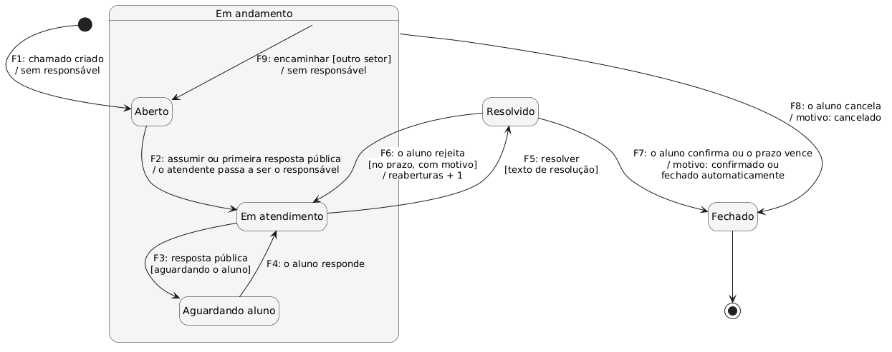
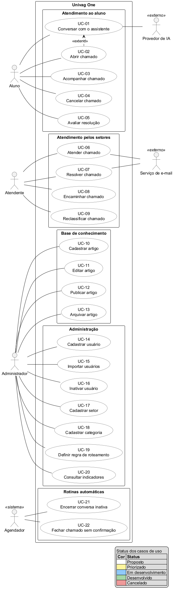

# Especificação do projeto

Este capítulo especifica o que o produto mínimo viável do One deve fazer. Ele parte do documento de requisitos e da especificação de regras de negócio do projeto e aplica as correções pedidas pelo professor em aula. A lista de requisitos funcionais começa pelo problema do aluno, a conversa com o assistente. As regras de acesso, de visibilidade e de autenticação passaram a ser requisitos não funcionais de segurança. Cada caso de uso tem uma especificação própria.

## Perfis de usuário

O Quadro 2.1 descreve os três perfis de usuário e os atores externos que aparecem nos casos de uso. Uma mesma pessoa pode ter mais de um perfil.

Quadro 2.1 — Perfis de usuário e atores externos

| Perfil ou ator | Tipo | Quem é | O que faz no sistema |
|---|---|---|---|
| Aluno | Perfil de usuário | Estudante matriculado em um curso da instituição | Conversa com o assistente, abre e acompanha chamados, responde, cancela, confirma ou rejeita resoluções |
| Atendente | Perfil de usuário | Funcionário de um setor, como a coordenação de curso ou a CAE | Vê a fila dos seus setores, assume, responde, encaminha, reclassifica e resolve chamados |
| Administrador | Perfil de usuário | Responsável pela configuração do sistema | Cadastra usuários, setores, categorias, regras de roteamento e artigos da base de conhecimento, e consulta os indicadores |
| Provedor de IA | Sistema externo | Serviço externo de inteligência artificial | Interpreta a pergunta do aluno e redige a resposta somente a partir dos artigos que o sistema envia (RF-02, RNF-03) |
| Serviço de e-mail | Sistema externo | Serviço de envio de e-mail | Envia ao aluno o e-mail de cada resposta pública de atendente e o da resolução (RF-22) |
| Agendador | Relógio do sistema | Rotina automática do próprio sistema | Encerra conversas inativas e fecha chamados resolvidos quando o prazo vence (UC-21 e UC-22) |

Fonte: elaborado pelos autores (2026).

## Requisitos funcionais

O Quadro 2.2 lista os requisitos funcionais do produto mínimo viável. A lista começa pelo que resolve o problema do aluno: a conversa com o assistente (RF-01 a RF-07). Depois vêm a abertura do chamado (RF-08 a RF-10), o roteamento (RF-11 a RF-14), o ciclo de vida e o atendimento do chamado (RF-15 a RF-23), a base de conhecimento (RF-24 a RF-26), os indicadores (RF-27) e a administração de usuários (RF-28 a RF-30). As regras de acesso, de visibilidade e de autenticação estão na seção Requisitos não funcionais (RNF-05 e RNF-12 a RNF-15).

A coluna Origem mostra de quais regras de negócio cada requisito vem. As regras estão na seção Regras de negócio: os códigos BR (por exemplo, BR-B1) e as transições de estado do chamado, de F1 a F9.

A coluna Prioridade segue o método MoSCoW:

- **Must**: obrigatório no produto mínimo viável; sem ele, o fluxo principal não funciona.
- **Should**: importante, mas o produto mínimo viável funciona sem ele.
- **Could**: desejável; entra se sobrar tempo.
- **Won't**: combinado que não entra nesta versão.

A coluna Status mostra em que ponto está cada requisito:

- **Proposto**: escrito e aceito, mas ainda não escolhido para uma entrega.
- **Priorizado**: escolhido para a próxima entrega.
- **Em desenvolvimento**: em implementação.
- **Desenvolvido**: implementado na aplicação, com *back-end*, e verificado.

Todos os requisitos são do produto mínimo viável, por isso todos estão como Must. Todos também estão como Proposto. O protótipo visual simula muitos deles no navegador, mas não tem *back-end*, então nenhum requisito está como Desenvolvido. O capítulo [Programação de funcionalidades](07-programacao-de-funcionalidades.md) mostra o que o protótipo cobre.

Quadro 2.2 — Requisitos funcionais

| ID | Requisito | Prioridade | Status | Origem |
|---|---|---|---|---|
| RF-01 | O sistema deve permitir que o aluno inicie uma conversa com o assistente com uma mensagem em texto livre; cada conversa pertence a um único aluno. | Must | Proposto | BR-B1 |
| RF-02 | O assistente deve responder somente com base em artigos publicados, nunca com conteúdo que não esteja em um artigo. | Must | Proposto | BR-B2 |
| RF-03 | Quando houver artigo correspondente, o assistente deve mostrar a resposta e perguntar "Isso resolveu?", com as opções Sim e Não. | Must | Proposto | BR-B3 |
| RF-04 | Quando não houver artigo correspondente, o assistente deve informar que não encontrou resposta e oferecer a abertura de chamado, sem mostrar artigo sem relação com a pergunta. | Must | Proposto | BR-B4 |
| RF-05 | O sistema deve encerrar cada conversa com exatamente um desfecho: resolvida pelo autoatendimento (o aluno respondeu Sim), escalada (chamado criado), recusada (o aluno não quis abrir chamado) ou abandonada (sem resposta dentro da janela de inatividade de 30 minutos, premissa Q6); a resposta Não leva à oferta de chamado. | Must | Proposto | BR-B5, BR-B6, BR-B7 |
| RF-06 | O sistema deve guardar uma cópia de cada resposta exibida na conversa, com o artigo, a versão e o texto, para que edições posteriores do artigo não alterem o histórico. | Must | Proposto | BR-B8 |
| RF-07 | O sistema deve permitir no máximo um chamado por conversa; um problema novo exige uma conversa nova. | Must | Proposto | BR-B9 |
| RF-08 | O sistema deve criar o chamado somente depois que o aluno confirmar a oferta, e permitir que ele acrescente uma descrição opcional. | Must | Proposto | BR-D1 |
| RF-09 | O sistema deve preencher o chamado automaticamente com o aluno solicitante, o curso e o semestre, a transcrição da conversa, os artigos exibidos, o título (primeira mensagem do aluno, truncada), a categoria (a do último artigo rejeitado ou, se nenhum artigo foi exibido, Não classificado) e o setor. | Must | Proposto | BR-D2, BR-D3, BR-D4 |
| RF-10 | O sistema deve numerar os chamados no formato ONE-n, de forma sequencial, única e sem reutilização, e mostrar o número ao aluno, junto com o chamado na lista dele. | Must | Proposto | BR-D5, BR-D6 |
| RF-11 | O sistema deve manter cada chamado em exatamente um setor o tempo todo. | Must | Proposto | BR-E1 |
| RF-12 | O sistema deve rotear o chamado uma única vez, na criação, pela regra da categoria (setor fixo ou coordenação do curso do aluno); se não houver regra, se o chamado for Não classificado ou se o curso não tiver coordenação configurada, o chamado vai para o setor de triagem. | Must | Proposto | BR-E2, BR-E3 |
| RF-13 | O sistema deve exigir exatamente um setor de triagem e recusar configurações sem ele. | Must | Proposto | BR-E4 |
| RF-14 | O sistema deve permitir que o atendente reclassifique o chamado sem mudá-lo de setor, mantendo a categoria original para os indicadores. | Must | Proposto | BR-E5 |
| RF-15 | O sistema deve controlar os estados Aberto, Em atendimento, Aguardando aluno, Resolvido e Fechado, aceitando somente as transições do Quadro 2.6 e recusando qualquer outra. | Must | Proposto | F1, F2, F3, F4, F5, F6, F7, F8, F9, BR-F1 |
| RF-16 | O sistema deve tratar o estado Fechado como final, sem aceitar novas mensagens. | Must | Proposto | BR-F2 |
| RF-17 | O sistema deve permitir que um atendente assuma um chamado atribuído a outro atendente do mesmo setor e registrar a troca. | Must | Proposto | BR-F3 |
| RF-18 | O sistema deve permitir que o aluno envie respostas públicas no seu chamado em qualquer estado diferente de Fechado, e que os atendentes enviem respostas públicas e notas internas. | Must | Proposto | BR-G1, BR-G2 |
| RF-19 | O sistema deve impedir a edição e a exclusão de mensagens já enviadas. | Must | Proposto | BR-G3 |
| RF-20 | O sistema deve encaminhar o chamado somente para um setor diferente do atual e com o motivo registrado como nota interna; o chamado volta a Aberto no setor de destino, sem responsável, e a contagem de encaminhamentos aumenta em 1. | Must | Proposto | BR-G4 |
| RF-21 | O sistema deve aceitar anexos nas respostas públicas do aluno e dos atendentes, dentro dos tipos e do tamanho permitidos (RNF-11). | Must | Proposto | BR-G5 |
| RF-22 | O sistema deve enviar e-mail ao aluno a cada resposta pública de atendente e na resolução, mostrar o estado atual do chamado no aplicativo e nunca enviar e-mail por nota interna. | Must | Proposto | BR-G6 |
| RF-23 | O sistema deve registrar no histórico do chamado, com autor, data e hora, cada criação, transição, atribuição, encaminhamento, reclassificação, resposta, nota e anexo; o histórico só recebe acréscimos. | Must | Proposto | BR-H1, BR-H2 |
| RF-24 | O sistema deve manter artigos com título, uma ou mais perguntas relacionadas, uma única categoria, resposta, *links* opcionais, situação, data da última atualização e autor da última atualização. | Must | Proposto | BR-C1, BR-C4 |
| RF-25 | O sistema deve permitir que o administrador crie, edite, publique e arquive artigos, nas situações rascunho, publicado e arquivado; só os publicados são usados pelo assistente. | Must | Proposto | BR-C2, BR-C3 |
| RF-26 | O sistema deve criar uma nova versão sempre que um artigo publicado for editado, mantendo nas conversas a versão que foi exibida. | Must | Proposto | BR-C5 |
| RF-27 | O sistema deve mostrar no painel, por período, os indicadores do Quadro 2.7: alunos ativos, conversas, taxas de autoatendimento, de escalonamento, de abandono e de perguntas sem artigo, chamados abertos e resolvidos, tempo até a primeira resposta, tempo de resolução, roteamento correto, reabertura, principais categorias e o indicador principal. | Must | Proposto | BR-I1 |
| RF-28 | O sistema deve permitir que o administrador cadastre usuários, um a um ou por importação de lista. | Must | Proposto | BR-A1 |
| RF-29 | O sistema deve permitir que o administrador atribua a cada usuário um ou mais perfis entre aluno, atendente e administrador; o aluno deve ter ao menos um curso, com o semestre, e o atendente, ao menos um setor. | Must | Proposto | BR-A2, BR-A3 |
| RF-30 | O sistema deve permitir que o administrador inative um usuário, mantendo o histórico dele intacto e atribuído a ele. | Must | Proposto | BR-A7 |

Fonte: elaborado pelos autores com base na especificação de regras de negócio do projeto (2026).

Os requisitos foram renumerados nesta versão. O Quadro 2.3 mostra, para cada identificador da versão anterior do documento de requisitos, o identificador novo. Dois requisitos antigos de acesso (RF-01 e RF-04) foram divididos: a operação do administrador continuou como requisito funcional, e a regra de acesso virou requisito não funcional de segurança. O antigo RF-03 (visibilidade por perfil) virou inteiro o RNF-13.

Quadro 2.3 — Correspondência entre os identificadores antigos e novos dos requisitos funcionais

| ID antigo | ID novo | Observação |
|---|---|---|
| RF-01 | RF-28 e RNF-12 | O cadastro pelo administrador virou o RF-28; a proibição de autocadastro virou requisito de segurança. |
| RF-02 | RF-29 | Atribuição de perfis e vínculos, agora escrita como operação do administrador. |
| RF-03 | RNF-13 | Regra de acesso por perfil e setor; virou requisito de segurança. |
| RF-04 | RF-30 e RNF-14 | A inativação pelo administrador virou o RF-30; o bloqueio do acesso virou requisito de segurança. |
| RF-05 | RF-01 | Início da conversa; agora abre a lista. |
| RF-06 | RF-02 | Sem mudança de conteúdo. |
| RF-07 | RF-03 | Sem mudança de conteúdo. |
| RF-08 | RF-04 | Sem mudança de conteúdo. |
| RF-09 | RF-05 | Acrescentado o valor da janela de inatividade (premissa Q6). |
| RF-10 | RF-06 | Sem mudança de conteúdo. |
| RF-11 | RF-07 | Sem mudança de conteúdo. |
| RF-12 | RF-24 | Sem mudança de conteúdo. |
| RF-13 | RF-25 | A restrição de que só o administrador mantém artigos foi para o RNF-13. |
| RF-14 | RF-26 | Sem mudança de conteúdo. |
| RF-15 | RF-08 | Sem mudança de conteúdo. |
| RF-16 | RF-09 | Sem mudança de conteúdo. |
| RF-17 | RF-10 | Sem mudança de conteúdo. |
| RF-18 | RF-11 | Sem mudança de conteúdo. |
| RF-19 | RF-12 | Sem mudança de conteúdo. |
| RF-20 | RF-13 | Sem mudança de conteúdo. |
| RF-21 | RF-14 | Sem mudança de conteúdo. |
| RF-22 | RF-15 | Referência ao quadro de transições atualizada. |
| RF-23 | RF-16 | Sem mudança de conteúdo. |
| RF-24 | RF-17 | Sem mudança de conteúdo. |
| RF-25 | RF-18 | A regra de que o aluno não vê notas internas foi para o RNF-13. |
| RF-26 | RF-19 | Sem mudança de conteúdo. |
| RF-27 | RF-20 | Sem mudança de conteúdo. |
| RF-28 | RF-21 | Sem mudança de conteúdo. |
| RF-29 | RF-22 | Sem mudança de conteúdo. |
| RF-30 | RF-23 | A regra de quem vê o histórico foi para o RNF-13. |
| RF-31 | RF-27 | Referência ao quadro de indicadores atualizada; a restrição do painel ao administrador foi para o RNF-13. |

Fonte: elaborado pelos autores (2026).

## Requisitos não funcionais

O Quadro 2.4 traz os requisitos não funcionais. A fonte de cada um é o manual da disciplina, uma lei, uma premissa, uma regra de negócio ou uma decisão do grupo. Os requisitos RNF-01 a RNF-11 mantêm os identificadores da versão anterior. Os requisitos RNF-12 a RNF-15 são novos: os três primeiros vieram dos antigos RF-01, RF-03 e RF-04, e o RNF-15 registra como a autenticação é feita. Os valores do RNF-02 são uma proposta do grupo e ainda precisam ser validados com a coordenação.

Quadro 2.4 — Requisitos não funcionais

| ID | Categoria | Requisito | Fonte |
|---|---|---|---|
| RNF-01 | Plataforma | O sistema deve ser uma aplicação web progressiva (PWA) instalável, com manifesto e *service worker*, com *front-end* SPA em React (Vite e vite-plugin-pwa) e *back-end* em ASP.NET Core Web API (C#/.NET) expondo uma API REST, usando o banco de dados PostgreSQL. | Manual do PEI, seção 2.1.4 (UNIVAG, 2026); decisão do grupo |
| RNF-02 | Compatibilidade | A interface deve funcionar sem rolagem horizontal em telas de 360 px a 1920 px de largura, nas 2 últimas versões do Chrome, do Edge, do Firefox e do Safari. | Tema do PEI IV; hoje a maior parte das mensagens chega pelo celular (linha de base no capítulo de contexto). Valores propostos pelo grupo; a validar com a coordenação |
| RNF-03 | Privacidade | O sistema deve exibir ao aluno, antes da primeira mensagem, um aviso visível de que as mensagens são processadas por um provedor externo de inteligência artificial; os anexos nunca são enviados a esse provedor. | Premissa Q13; LGPD (BRASIL, 2018) |
| RNF-04 | Proteção de dados | O tratamento de dados pessoais deve seguir a LGPD e coletar apenas os dados necessários ao atendimento: nome, e-mail, curso, semestre e setor. | LGPD (BRASIL, 2018); Manual do PEI, seção 3.3 (UNIVAG, 2026) |
| RNF-05 | Segurança | Toda requisição à API deve exigir usuário autenticado; a API deve recusar a requisição sem autenticação válida. | RNF-13 (antigo RF-03) |
| RNF-06 | Rastreabilidade | A aplicação não deve oferecer nenhum meio de alterar ou apagar chamados, mensagens e eventos do histórico; o prazo de retenção vai seguir a exigência do MEC, que ainda está pendente. | Exigência do MEC relatada pela coordenação; premissa Q15 |
| RNF-07 | Idioma | A interface e as mensagens do sistema devem estar em português do Brasil. | Público-alvo: alunos do Univag |
| RNF-08 | Integração | O produto mínimo viável não deve se integrar ao sistema acadêmico, ao Portal do Aluno nem ao Moodle; os artigos apenas indicam ao aluno o caminho no Portal do Aluno. | Escopo do produto |
| RNF-09 | Notificação | As notificações ao aluno devem ser feitas por e-mail, sem notificações *push*. | Escopo do produto |
| RNF-10 | Entrega | O código-fonte deve ficar em um repositório público no GitHub, e a documentação deve seguir as normas da ABNT. | Manual do PEI, Apêndices D e F (UNIVAG, 2026) |
| RNF-11 | Anexos | Os anexos devem ser arquivos PDF, JPG ou PNG, com até 10 MB cada. | Premissa Q9 |
| RNF-12 | Segurança | O sistema não deve ter autocadastro: só acessa o sistema quem foi cadastrado pelo administrador (RF-28). | BR-A1; premissa Q5 (antigo RF-01) |
| RNF-13 | Segurança | Cada perfil deve ver apenas o que lhe cabe: o aluno, as suas conversas e os seus chamados, sem as notas internas; o atendente, os chamados que estão nos seus setores, e ele perde o acesso quando o chamado é encaminhado para fora deles; o administrador, todos os chamados, todas as conversas e o painel de indicadores. Só o administrador cria, edita, publica e arquiva artigos. O servidor deve verificar essas regras em toda requisição, e não apenas a interface. | BR-A4, BR-A5, BR-A6, BR-C3, BR-G2, BR-H2; premissa Q12 (antigo RF-03) |
| RNF-14 | Segurança | O usuário inativado não deve conseguir acessar o sistema; o histórico dele continua intacto e atribuído a ele. | BR-A7 (antigo RF-04) |
| RNF-15 | Segurança | A autenticação deve ser feita com o ASP.NET Core Identity, e as senhas devem ser armazenadas como *hash*, nunca em texto puro. | Proposto pelo grupo; orientação do professor (aulas de 16/09 e 22/09) |

Fonte: elaborado pelos autores (2026).

O grupo ainda não definiu metas de desempenho e de disponibilidade. Quando forem definidas, elas entram no Quadro 2.4 com número e unidade. Metas de desempenho e de disponibilidade: [a preencher pelo grupo].

## Regras de negócio

As regras de negócio vêm da especificação de regras de negócio do projeto. Elas valem para qualquer configuração do piloto, como as categorias, os setores, as regras de roteamento e os artigos, que ainda vão sair do levantamento com a coordenação. O Quadro 2.5 resume as regras por grupo. Os códigos são os mesmos da coluna Origem do Quadro 2.2. As regras que dependem de uma questão em aberto citam a premissa adotada, descrita no capítulo de contexto.

Quadro 2.5 — Regras de negócio por grupo

| Grupo | ID | Regra |
|---|---|---|
| A. Identidade e acesso | BR-A1 | Só acessa o sistema quem foi cadastrado antes; não há autocadastro. O administrador cadastra os usuários, um a um ou por importação de lista (premissa Q5). |
| A. Identidade e acesso | BR-A2 | Um usuário tem um ou mais perfis entre aluno, atendente e administrador. |
| A. Identidade e acesso | BR-A3 | O cadastro do aluno tem ao menos um curso; o do atendente, ao menos um setor. |
| A. Identidade e acesso | BR-A4 | O aluno vê apenas as suas conversas e os seus chamados. |
| A. Identidade e acesso | BR-A5 | O atendente vê apenas os chamados que estão em um dos seus setores; quando o chamado é encaminhado para fora deles, ele perde o acesso. |
| A. Identidade e acesso | BR-A6 | O administrador vê todos os chamados, todas as conversas e o painel de indicadores. |
| A. Identidade e acesso | BR-A7 | O usuário inativado não acessa o sistema; os registros dele continuam intactos e atribuídos a ele. |
| B. Conversa com o assistente | BR-B1 | A conversa pertence a exatamente um aluno e começa com uma mensagem em texto livre. |
| B. Conversa com o assistente | BR-B2 | O assistente responde somente com base em artigos publicados. Ele usa IA para interpretar a pergunta, mas nunca dá uma resposta que não venha de um artigo. |
| B. Conversa com o assistente | BR-B3 | Quando existe artigo correspondente, o assistente mostra a resposta e pergunta "Isso resolveu?", com exatamente duas opções: Sim e Não. |
| B. Conversa com o assistente | BR-B4 | Quando nenhum artigo corresponde, o assistente informa que não encontrou resposta e oferece abrir um chamado; ele não mostra artigo sem relação com a pergunta. |
| B. Conversa com o assistente | BR-B5 | A resposta Sim encerra a conversa como resolvida pelo autoatendimento. |
| B. Conversa com o assistente | BR-B6 | A resposta Não leva à oferta de abrir um chamado. |
| B. Conversa com o assistente | BR-B7 | Toda conversa termina com exatamente um desfecho: resolvida pelo autoatendimento, escalada, recusada ou abandonada (sem resposta dentro da janela de inatividade de 30 minutos, premissa Q6). |
| B. Conversa com o assistente | BR-B8 | A conversa guarda uma cópia de cada resposta exibida, com o artigo, a versão e o texto. |
| B. Conversa com o assistente | BR-B9 | Uma conversa gera no máximo um chamado; um problema novo exige uma conversa nova. |
| C. Base de conhecimento | BR-C1 | O artigo tem título, uma ou mais perguntas relacionadas, categoria, resposta, *links* opcionais, situação, data e autor da última atualização. |
| C. Base de conhecimento | BR-C2 | A situação do artigo é rascunho, publicado ou arquivado; só os publicados são usados pelo assistente. |
| C. Base de conhecimento | BR-C3 | Só o administrador cria, edita, publica e arquiva artigos. |
| C. Base de conhecimento | BR-C4 | Todo artigo pertence a exatamente uma categoria. |
| C. Base de conhecimento | BR-C5 | Editar um artigo publicado cria uma nova versão; as conversas mantêm a versão que exibiram. |
| D. Conversa vira chamado | BR-D1 | O chamado só é criado depois que o aluno confirma a oferta; antes disso, ele pode acrescentar uma descrição opcional. |
| D. Conversa vira chamado | BR-D2 | O chamado recebe, sem o aluno digitar nada de novo: solicitante, curso do aluno, transcrição completa da conversa (somente leitura), artigos exibidos, título, categoria e setor. |
| D. Conversa vira chamado | BR-D3 | O título é a primeira mensagem do aluno, truncada em um tamanho fixo. |
| D. Conversa vira chamado | BR-D4 | A categoria é a do último artigo exibido e rejeitado; se nenhum artigo foi exibido, a categoria é Não classificado. |
| D. Conversa vira chamado | BR-D5 | O número do chamado tem o formato ONE-n, sequencial, único e nunca reutilizado. |
| D. Conversa vira chamado | BR-D6 | Na criação, o aluno vê o número do chamado, e o chamado aparece na lista dele. |
| E. Classificação e roteamento | BR-E1 | Todo chamado está em exatamente um setor o tempo todo. |
| E. Classificação e roteamento | BR-E2 | Uma regra de roteamento liga uma categoria a um setor fixo ou à coordenação do curso do aluno. |
| E. Classificação e roteamento | BR-E3 | O roteamento é avaliado uma vez, na criação do chamado. Categoria sem regra, categoria Não classificado ou curso sem coordenação configurada levam o chamado ao setor de triagem. |
| E. Classificação e roteamento | BR-E4 | Exatamente um setor é o setor de triagem; o sistema recusa configuração sem ele. |
| E. Classificação e roteamento | BR-E5 | O atendente pode reclassificar o chamado, isto é, mudar a categoria. Reclassificar não muda o setor; só o encaminhamento muda. A categoria original é mantida para os indicadores. |
| F. Ciclo de vida do chamado | BR-F1 | Qualquer transição de estado fora do Quadro 2.6 é recusada. |
| F. Ciclo de vida do chamado | BR-F2 | Fechado é estado final; o chamado fechado não aceita novas mensagens. |
| F. Ciclo de vida do chamado | BR-F3 | Um atendente pode assumir um chamado atribuído a outro atendente do mesmo setor, e a troca fica registrada (premissa Q8). |
| G. Atendimento do chamado | BR-G1 | O aluno pode enviar respostas públicas no seu chamado em qualquer estado diferente de Fechado. |
| G. Atendimento do chamado | BR-G2 | Os atendentes podem enviar respostas públicas e notas internas; o aluno nunca vê as notas internas. |
| G. Atendimento do chamado | BR-G3 | Mensagens não podem ser editadas nem excluídas depois de enviadas. |
| G. Atendimento do chamado | BR-G4 | Encaminhar exige um setor de destino diferente do atual e um motivo, guardado como nota interna. O chamado volta a Aberto no setor de destino, sem responsável, e a contagem de encaminhamentos aumenta em 1. |
| G. Atendimento do chamado | BR-G5 | O aluno e os atendentes podem anexar arquivos às respostas públicas, dentro dos tipos e do tamanho permitidos (premissa Q9). |
| G. Atendimento do chamado | BR-G6 | O aluno recebe um e-mail a cada resposta pública de atendente e na resolução, e o estado atual do chamado aparece sempre no aplicativo. Nota interna nunca gera e-mail. |
| H. Histórico e auditoria | BR-H1 | Toda criação, transição, atribuição, encaminhamento, reclassificação, resposta, nota e anexo é registrado com autor, data e hora. |
| H. Histórico e auditoria | BR-H2 | O histórico do chamado só recebe acréscimos e pode ser visto por quem vê o chamado; o aluno não vê as notas internas. |
| I. Indicadores | BR-I1 | Duas medidas não são feitas pelo sistema: se o aluno deixou de procurar outros canais e se as mensagens diretas à coordenação diminuíram. Elas são medidas no piloto, com a linha de base e uma pesquisa com os alunos. |

Fonte: elaborado pelos autores com base na especificação de regras de negócio do projeto (2026).

O chamado passa pelos estados Aberto, Em atendimento, Aguardando aluno, Resolvido e Fechado. O Quadro 2.6 lista as únicas transições aceitas (RF-15). O prazo de confirmação é de 7 dias corridos depois da resolução (premissa Q7).

Quadro 2.6 — Transições de estado do chamado

| Transição | De | Para | Gatilho | Quem executa | Regras |
|---|---|---|---|---|---|
| F1 | Nenhum (criação) | Aberto | Chamado criado | Sistema | Sem responsável |
| F2 | Aberto | Em atendimento | Assumir, ou primeira resposta pública | Atendente do setor | O atendente passa a ser o responsável |
| F3 | Em atendimento | Aguardando aluno | Resposta pública marcada como "aguardando o aluno" | Responsável | Nenhuma |
| F4 | Aguardando aluno | Em atendimento | O aluno responde | Aluno | Automática |
| F5 | Em atendimento | Resolvido | Resolver | Responsável | Texto de resolução obrigatório e visível ao aluno |
| F6 | Resolvido | Em atendimento | O aluno rejeita a resolução | Aluno | Só dentro do prazo de confirmação; motivo obrigatório; reaberturas + 1 |
| F7 | Resolvido | Fechado | O aluno confirma, ou o prazo de confirmação vence | Aluno ou sistema | Motivo de fechamento: confirmado ou fechado automaticamente |
| F8 | Aberto, Em atendimento ou Aguardando aluno | Fechado | O aluno cancela | Aluno | Motivo de fechamento: cancelado; justificativa opcional |
| F9 | Aberto, Em atendimento ou Aguardando aluno | Aberto, em outro setor | Encaminhar | Atendente do setor atual | Conforme o RF-20 |

Fonte: elaborado pelos autores com base na especificação de regras de negócio do projeto (2026).

A Figura 2.1 desenha as transições do Quadro 2.6 como um diagrama de estados. Cada seta traz o código da transição, o gatilho, a condição entre colchetes e o efeito depois da barra. Os estados Aberto, Em atendimento e Aguardando aluno ficam dentro do estado composto Em andamento, porque o cancelamento (F8) e o encaminhamento (F9) valem para os três. Por isso, cada uma dessas transições aparece uma vez só, saindo de Em andamento.

Figura 2.1 — Diagrama de estados do chamado

Fonte: elaborado pelos autores com base na especificação de regras de negócio do projeto (2026).

Os indicadores do painel (RF-27) seguem as definições do Quadro 2.7. Os tempos são medidos em tempo corrido, sem descontar o horário fora do expediente (premissa Q10). O filtro de período usa a data de início da conversa ou a data de criação do chamado. As duas medidas da regra BR-I1 ficam fora do sistema e são comparadas com a linha de base no piloto.

Quadro 2.7 — Definição dos indicadores

| Indicador | Definição |
|---|---|
| Alunos ativos | Alunos diferentes com pelo menos uma conversa no período |
| Conversas | Conversas iniciadas no período |
| Taxa de autoatendimento | Conversas resolvidas pelo autoatendimento divididas pelas conversas com desfecho |
| Taxa de escalonamento | Conversas escaladas divididas pelas conversas com desfecho |
| Taxa de abandono | Conversas abandonadas divididas pelas conversas com desfecho |
| Taxa de perguntas sem artigo | Conversas em que nenhum artigo correspondeu à pergunta, divididas pelas conversas |
| Chamados abertos | Chamados que não estão fechados no momento da consulta |
| Chamados resolvidos | Chamados que chegaram a Resolvido pelo menos uma vez no período |
| Tempo até a primeira resposta | Da criação do chamado até a primeira resposta pública de um atendente |
| Tempo de resolução | Da criação do chamado até a última transição para Resolvido |
| Roteamento correto | Chamados resolvidos sem encaminhamento divididos pelos chamados resolvidos |
| Taxa de reabertura | Chamados com pelo menos uma reabertura divididos pelos chamados resolvidos |
| Principais categorias | Classificação das categorias pelo número de conversas (categoria do artigo) e de chamados (categoria original) |
| Indicador principal | Conversas resolvidas pelo autoatendimento somadas aos chamados fechados como confirmados ou fechados automaticamente, sem reabertura, divididas pelas conversas com desfecho |

Fonte: elaborado pelos autores com base na especificação de regras de negócio do projeto (2026).

## Restrições

As restrições são condições impostas ao projeto de fora do produto: pela disciplina, pelo calendário ou pelo escopo combinado. O Quadro 2.8 lista as que estão documentadas.

Quadro 2.8 — Restrições do projeto

| Restrição | Fonte |
|---|---|
| A aplicação deve ser uma SPA e/ou um aplicativo híbrido, com *front-end* em Angular, React ou Vue e *back-end* com *web services* REST. O manual cita PHP, Java ou Node.js para o *back-end*; o grupo escolheu o ASP.NET Core (RNF-01), apoiado na seção 2.1.4 do manual, que aceita outras tecnologias, e ainda vai confirmar essa escolha com o professor orientador. | Manual do PEI, seção 2.1.4 e Apêndices D.1 a D.3 (UNIVAG, 2026) |
| O produto mínimo viável não se integra ao Moodle, ao Portal do Aluno, ao sistema acadêmico nem ao sistema financeiro (RNF-08). | Escopo do produto |
| O código-fonte fica em um repositório público no GitHub, e o documento final segue a estrutura do Apêndice D.5 e as normas da ABNT (RNF-10). | Manual do PEI, Apêndices D e F (UNIVAG, 2026) |
| O trabalho segue o calendário da disciplina: Relatório Periódico 3 em 16/10; apresentação das funcionalidades implementadas de 27/10 a 30/10; documentação no AVA em 30/10; primeira versão do projeto no AVA em 13/11; aplicação disponível para a banca em 20/11; projeto documentado e código-fonte no GitHub até 27/11. | Calendário do PEI IV (UNIVAG, 2026); a data do RP3 vem da tarefa publicada no AVA |
| O piloto é pequeno: uma instituição (o Univag), uma coordenação (a dos cursos de tecnologia), os alunos de Análise e Desenvolvimento de Sistemas, até três setores e de 10 a 30 artigos na base de conhecimento. | Escopo do produto |

Fonte: elaborado pelos autores com base no Manual do PEI (UNIVAG, 2026).

## Diagrama de casos de uso

A Figura 2.2 mostra os 22 casos de uso do produto mínimo viável e os atores ligados a eles por linhas simples. Os atores são os três perfis de usuário (Aluno, Atendente e Administrador), dois sistemas externos (Provedor de IA e Serviço de e-mail) e o Agendador, que encerra conversas e fecha chamados quando um prazo vence. Os casos de uso estão agrupados em cinco pacotes: Atendimento ao aluno, Atendimento pelos setores, Base de conhecimento, Administração e Rotinas automáticas. O caso de uso Abrir chamado estende Conversar com o assistente, porque só acontece quando a conversa não resolve a dúvida.

A cor de cada caso de uso mostra o status, conforme a legenda do diagrama: branco para Proposto, amarelo para Priorizado, azul para Em desenvolvimento, verde para Desenvolvido e vermelho para Cancelado. Todos os casos de uso estão como Proposto. Muitos deles já aparecem no protótipo visual, mas o protótipo não tem *back-end*, então nenhum está marcado como Desenvolvido.

Em relação à versão anterior, o caso de uso Autenticar-se foi retirado, porque a entrada no sistema não é um objetivo do usuário: ela é feita pelo ASP.NET Core Identity e está especificada como requisito não funcional (RNF-15, com RNF-05, RNF-12 e RNF-14). Os antigos casos de uso Gerenciar base de conhecimento, Gerenciar usuários e Configurar setores, categorias e roteamento viraram um caso de uso por operação. Os casos de uso que reuniam mais de uma operação, como Acompanhar chamado, Atender chamado e Encerrar conversas e chamados por prazo, também foram divididos.

Figura 2.2 — Diagrama de casos de uso

Fonte: elaborado pelos autores (2026).

O Quadro 2.9 lista os casos de uso novos, com os atores e o caso de uso da versão anterior de onde cada um saiu. O antigo UC-01 Autenticar-se não tem correspondente.

Quadro 2.9 — Casos de uso e correspondência com a versão anterior

| UC novo | Nome | Ator principal | Ator secundário | UC antigo |
|---|---|---|---|---|
| UC-01 | Conversar com o assistente | Aluno | Provedor de IA | UC-02 |
| UC-02 | Abrir chamado (estende o UC-01) | Aluno | Nenhum | UC-03 |
| UC-03 | Acompanhar chamado | Aluno | Nenhum | UC-04 (consulta e resposta) |
| UC-04 | Cancelar chamado | Aluno | Nenhum | UC-04 (fluxo alternativo 3a) |
| UC-05 | Avaliar resolução | Aluno | Nenhum | UC-04 (passo 5 e fluxo alternativo 5a) |
| UC-06 | Atender chamado | Atendente | Serviço de e-mail | UC-05 (passos 1 a 4) |
| UC-07 | Resolver chamado | Atendente | Serviço de e-mail | UC-05 (passo 5) |
| UC-08 | Encaminhar chamado | Atendente | Nenhum | UC-06 |
| UC-09 | Reclassificar chamado | Atendente | Nenhum | UC-07 |
| UC-10 | Cadastrar artigo | Administrador | Nenhum | UC-08 |
| UC-11 | Editar artigo | Administrador | Nenhum | UC-08 (passo 4) |
| UC-12 | Publicar artigo | Administrador | Nenhum | UC-08 (passo 3) |
| UC-13 | Arquivar artigo | Administrador | Nenhum | UC-08 (fluxo alternativo 3a) |
| UC-14 | Cadastrar usuário | Administrador | Nenhum | UC-09 |
| UC-15 | Importar usuários | Administrador | Nenhum | UC-09 |
| UC-16 | Inativar usuário | Administrador | Nenhum | UC-09 (fluxo alternativo 3a) |
| UC-17 | Cadastrar setor | Administrador | Nenhum | UC-10 (passo 1) |
| UC-18 | Cadastrar categoria | Administrador | Nenhum | UC-10 (passo 2) |
| UC-19 | Definir regra de roteamento | Administrador | Nenhum | UC-10 (passos 3 e 4) |
| UC-20 | Consultar indicadores | Administrador | Nenhum | UC-11 |
| UC-21 | Encerrar conversa inativa | Agendador | Nenhum | UC-12 (passo 2) |
| UC-22 | Fechar chamado sem confirmação | Agendador | Nenhum | UC-12 (passo 3) |

Fonte: elaborado pelos autores (2026).

## Especificações dos casos de uso

Os Quadros 2.10 a 2.31 trazem a especificação de cada caso de uso, na ordem do Quadro 2.9. Em todas elas, as pré-condições descrevem o estado dos dados que permite o caso de uso. O acesso do ator ao sistema e as permissões do seu perfil não aparecem como pré-condição, porque são garantidos pelos requisitos de segurança (RNF-05, RNF-13 e RNF-15). Os fluxos alternativos são escolhas do ator. Os fluxos de exceção são erros ou condições que o ator não escolheu. As pós-condições descrevem o estado dos dados depois da execução.

Quadro 2.10 — Especificação do caso de uso UC-01

| Identificador | UC-01 |
|---|---|
| Nome | Conversar com o assistente |
| Objetivo | Permitir que o aluno resolva a dúvida na hora, com a resposta de um artigo publicado pela instituição, sem precisar saber qual setor procurar. |
| Ator principal | Aluno |
| Ator secundário | Provedor de IA |
| Pré-condições | Nenhuma. |
| Fluxo principal | 1. Antes da primeira mensagem, o sistema exibe o aviso de que as mensagens são processadas por um provedor externo de IA (RNF-03). 2. O aluno descreve a dúvida em texto livre. 3. O sistema busca artigos publicados relacionados e envia a pergunta e esses artigos ao provedor de IA. 4. O sistema mostra a resposta baseada no artigo, guarda uma cópia dela com o artigo e a versão, e pergunta "Isso resolveu?", com as opções Sim e Não. 5. O aluno responde Sim. 6. O sistema encerra a conversa como resolvida pelo autoatendimento. |
| Fluxos alternativos | A1 (passo 5): O aluno responde Não. O sistema oferece abrir um chamado. Se o aluno aceitar, segue o UC-02; se recusar, a conversa termina como recusada. A2 (passo 5): O aluno deixa a conversa sem responder. Depois da janela de inatividade de 30 minutos (premissa Q6), a conversa termina como abandonada (UC-21). |
| Fluxos de exceção | E1 (passo 3): Nenhum artigo publicado corresponde à pergunta. O sistema informa que não encontrou resposta, não mostra artigo sem relação com a pergunta e oferece abrir um chamado (UC-02). |
| Pós-condições | A conversa pertence ao aluno, tem exatamente um desfecho (resolvida pelo autoatendimento, escalada, recusada ou abandonada) e guarda uma cópia de cada resposta exibida. |
| RFs relacionados | RF-01, RF-02, RF-03, RF-04, RF-05, RF-06 |

Fonte: elaborado pelos autores (2026).

Quadro 2.11 — Especificação do caso de uso UC-02

| Identificador | UC-02 |
|---|---|
| Nome | Abrir chamado |
| Objetivo | Garantir que a dúvida que o assistente não resolveu vire um pedido registrado e chegue ao setor responsável, sem que o aluno precise explicar tudo de novo. |
| Ator principal | Aluno |
| Ator secundário | Nenhum. |
| Pré-condições | Existe uma conversa do aluno sem desfecho, em que ele respondeu Não ou em que nenhum artigo correspondeu à pergunta, e essa conversa ainda não gerou chamado. |
| Fluxo principal | 1. O sistema oferece registrar o pedido como chamado. 2. O aluno acrescenta uma descrição, se quiser. 3. O aluno confirma. 4. O sistema cria o chamado no estado Aberto, sem responsável, com solicitante, curso e semestre, transcrição da conversa, artigos exibidos, título, categoria e número ONE-n. 5. O sistema aplica a regra de roteamento da categoria e coloca o chamado na fila do setor de destino. 6. O sistema mostra o número ao aluno, inclui o chamado na lista dele e encerra a conversa como escalada. |
| Fluxos alternativos | A1 (passo 3): O aluno não confirma. Nenhum chamado é criado, e a conversa termina como recusada. |
| Fluxos de exceção | E1 (passo 5): A categoria não tem regra de roteamento, o chamado ficou como Não classificado ou o curso do aluno não tem coordenação configurada. O sistema coloca o chamado no setor de triagem. |
| Pós-condições | Existe um chamado Aberto, sem responsável, em exatamente um setor, com a criação registrada no histórico; a conversa terminou como escalada. No fluxo A1, não existe chamado, e a conversa terminou como recusada. |
| RFs relacionados | RF-05, RF-07, RF-08, RF-09, RF-10, RF-11, RF-12, RF-15, RF-23 |

Fonte: elaborado pelos autores (2026).

Quadro 2.12 — Especificação do caso de uso UC-03

| Identificador | UC-03 |
|---|---|
| Nome | Acompanhar chamado |
| Objetivo | Permitir que o aluno saiba em que estado está o seu pedido e responda ao setor no mesmo lugar, sem procurar outro canal. |
| Ator principal | Aluno |
| Ator secundário | Nenhum. |
| Pré-condições | O aluno tem pelo menos um chamado. |
| Fluxo principal | 1. O aluno abre a lista dos seus chamados. 2. O sistema mostra o número e o estado de cada chamado. 3. O aluno escolhe um chamado, e o sistema mostra as respostas públicas, sem as notas internas. 4. O aluno envia uma resposta pública, com anexo opcional. 5. O sistema registra a resposta no histórico; se o chamado estava em Aguardando aluno, o sistema o devolve para Em atendimento. |
| Fluxos alternativos | A1 (passo 4): O aluno só consulta o chamado, sem responder. O caso de uso termina sem alteração. A2 (passo 4): O aluno decide cancelar o chamado. Segue o UC-04. A3 (passo 4): O chamado está Resolvido, e o aluno decide avaliar a resolução. Segue o UC-05. |
| Fluxos de exceção | E1 (passo 4): O chamado está Fechado. O sistema não aceita a resposta. E2 (passo 4): O anexo está fora dos tipos ou do tamanho permitidos (RNF-11). O sistema recusa o anexo. |
| Pós-condições | A resposta do aluno e o anexo, se houver, estão no histórico do chamado com autor, data e hora; o chamado que estava em Aguardando aluno está em Em atendimento. No fluxo A1, nenhum dado é alterado. |
| RFs relacionados | RF-15, RF-16, RF-18, RF-19, RF-21, RF-22, RF-23 |

Fonte: elaborado pelos autores (2026).

Quadro 2.13 — Especificação do caso de uso UC-04

| Identificador | UC-04 |
|---|---|
| Nome | Cancelar chamado |
| Objetivo | Permitir que o aluno encerre um pedido de que não precisa mais, para que o setor não gaste tempo com ele. |
| Ator principal | Aluno |
| Ator secundário | Nenhum. |
| Pré-condições | O aluno tem um chamado no estado Aberto, Em atendimento ou Aguardando aluno. |
| Fluxo principal | 1. O aluno pede o cancelamento do chamado. 2. O aluno informa uma justificativa, se quiser. 3. O sistema fecha o chamado com o motivo de fechamento "cancelado" e registra a ação no histórico. |
| Fluxos alternativos | Nenhum. |
| Fluxos de exceção | Nenhum. |
| Pós-condições | O chamado está Fechado, com o motivo de fechamento "cancelado", e não aceita novas mensagens; o cancelamento está no histórico com autor, data e hora. |
| RFs relacionados | RF-15, RF-16, RF-23 |

Fonte: elaborado pelos autores (2026).

Quadro 2.14 — Especificação do caso de uso UC-05

| Identificador | UC-05 |
|---|---|
| Nome | Avaliar resolução |
| Objetivo | Permitir que o aluno diga se o pedido foi mesmo resolvido, para que o chamado só seja fechado quando ele concorda e volte ao atendimento quando ele não concorda. |
| Ator principal | Aluno |
| Ator secundário | Nenhum. |
| Pré-condições | O aluno tem um chamado no estado Resolvido. |
| Fluxo principal | 1. O aluno lê o texto da resolução no chamado. 2. O aluno confirma a resolução. 3. O sistema fecha o chamado com o motivo de fechamento "confirmado" e registra a ação no histórico. |
| Fluxos alternativos | A1 (passo 2): O aluno rejeita a resolução e informa o motivo. O sistema devolve o chamado para Em atendimento, soma 1 à contagem de reaberturas e registra a ação no histórico. A2 (passo 2): O aluno não avalia a resolução. Quando o prazo de confirmação de 7 dias corridos vence (premissa Q7), o chamado é fechado automaticamente (UC-22). |
| Fluxos de exceção | E1 (passo A1): O aluno rejeita a resolução sem informar o motivo. O sistema recusa a rejeição. E2 (passo A1): O prazo de confirmação já venceu. O sistema não aceita a rejeição. |
| Pós-condições | O chamado está Fechado, com o motivo de fechamento "confirmado"; no fluxo A1, está Em atendimento, com a contagem de reaberturas somada em 1. A avaliação está no histórico com autor, data e hora. |
| RFs relacionados | RF-15, RF-16, RF-23 |

Fonte: elaborado pelos autores (2026).

Quadro 2.15 — Especificação do caso de uso UC-06

| Identificador | UC-06 |
|---|---|
| Nome | Atender chamado |
| Objetivo | Permitir que o atendente responda ao aluno com todo o contexto da conversa, sem pedir que ele repita o pedido. |
| Ator principal | Atendente |
| Ator secundário | Serviço de e-mail |
| Pré-condições | Existe um chamado Aberto, Em atendimento ou Aguardando aluno em um dos setores do atendente. |
| Fluxo principal | 1. O atendente abre a fila dos seus setores. 2. O atendente escolhe um chamado e o assume, ou envia a primeira resposta pública, e passa a ser o responsável; se o chamado estava Aberto, vai para Em atendimento (F2). 3. O atendente lê a transcrição da conversa, o curso e o semestre do aluno e os artigos exibidos. 4. O atendente envia uma resposta pública, com anexo opcional. 5. O sistema registra a resposta no histórico e envia um e-mail ao aluno pelo serviço de e-mail. |
| Fluxos alternativos | A1 (passo 2): O chamado está atribuído a outro atendente do mesmo setor, e o atendente decide assumi-lo. O sistema troca o responsável e registra a troca no histórico (premissa Q8). A2 (passo 4): O atendente registra uma nota interna em vez de uma resposta pública. A nota fica no histórico, o aluno não a vê, e nenhum e-mail é enviado. A3 (passo 4): O atendente marca a resposta pública como "aguardando o aluno". O chamado vai para Aguardando aluno. |
| Fluxos de exceção | E1 (passo 4): O anexo está fora dos tipos ou do tamanho permitidos (RNF-11). O sistema recusa o anexo. |
| Pós-condições | O atendente é o responsável pelo chamado, que está Em atendimento ou Aguardando aluno; cada resposta, nota, anexo e troca de responsável está no histórico com autor, data e hora. |
| RFs relacionados | RF-09, RF-15, RF-17, RF-18, RF-19, RF-21, RF-22, RF-23 |

Fonte: elaborado pelos autores (2026).

Quadro 2.16 — Especificação do caso de uso UC-07

| Identificador | UC-07 |
|---|---|
| Nome | Resolver chamado |
| Objetivo | Registrar a solução do pedido e avisar o aluno, para que ele possa confirmar ou rejeitar a resolução. |
| Ator principal | Atendente |
| Ator secundário | Serviço de e-mail |
| Pré-condições | Existe um chamado Em atendimento cujo responsável é o atendente. |
| Fluxo principal | 1. O atendente informa o texto da resolução. 2. O atendente resolve o chamado. 3. O sistema muda o chamado para Resolvido, mostra o texto da resolução ao aluno e registra a ação no histórico. 4. O sistema envia um e-mail ao aluno pelo serviço de e-mail. |
| Fluxos alternativos | Nenhum. |
| Fluxos de exceção | E1 (passo 2): A resolução está sem texto. O sistema recusa a resolução. |
| Pós-condições | O chamado está Resolvido, com o texto da resolução visível ao aluno, e o prazo de confirmação de 7 dias corridos começa a contar (premissa Q7). |
| RFs relacionados | RF-15, RF-22, RF-23 |

Fonte: elaborado pelos autores (2026).

Quadro 2.17 — Especificação do caso de uso UC-08

| Identificador | UC-08 |
|---|---|
| Nome | Encaminhar chamado |
| Objetivo | Levar o chamado ao setor que de fato resolve o pedido, quando ele chegou ao setor errado. |
| Ator principal | Atendente |
| Ator secundário | Nenhum. |
| Pré-condições | Existe um chamado Aberto, Em atendimento ou Aguardando aluno em um dos setores do atendente, e há pelo menos outro setor cadastrado. |
| Fluxo principal | 1. O atendente escolhe o setor de destino. 2. O atendente informa o motivo do encaminhamento. 3. O sistema registra o motivo como nota interna, move o chamado para Aberto no setor de destino, tira o responsável e soma 1 à contagem de encaminhamentos. 4. O sistema registra o encaminhamento no histórico. |
| Fluxos alternativos | Nenhum. |
| Fluxos de exceção | E1 (passo 1): O setor de destino é igual ao setor atual. O sistema recusa o encaminhamento. E2 (passo 2): O motivo está vazio. O sistema recusa o encaminhamento. |
| Pós-condições | O chamado está Aberto, sem responsável, em exatamente um setor, o de destino; a contagem de encaminhamentos aumentou em 1; os atendentes do setor anterior perdem o acesso a ele (RNF-13). |
| RFs relacionados | RF-11, RF-15, RF-20, RF-23 |

Fonte: elaborado pelos autores (2026).

Quadro 2.18 — Especificação do caso de uso UC-09

| Identificador | UC-09 |
|---|---|
| Nome | Reclassificar chamado |
| Objetivo | Corrigir a categoria do chamado quando a categoria automática não descreve bem o pedido, sem perder a categoria original usada nos indicadores. |
| Ator principal | Atendente |
| Ator secundário | Nenhum. |
| Pré-condições | Existe um chamado em um dos setores do atendente, e há outra categoria cadastrada. |
| Fluxo principal | 1. O atendente escolhe uma nova categoria. 2. O sistema altera a categoria atual, mantém a categoria original para os indicadores e registra a ação no histórico, sem mudar o chamado de setor. |
| Fluxos alternativos | A1 (passo 1): O atendente percebe que o chamado também precisa mudar de setor. Ele usa o UC-08, porque reclassificar não muda o setor. |
| Fluxos de exceção | Nenhum. |
| Pós-condições | A categoria atual mudou, a categoria original continua guardada, e o setor do chamado é o mesmo. |
| RFs relacionados | RF-14, RF-23 |

Fonte: elaborado pelos autores (2026).

Quadro 2.19 — Especificação do caso de uso UC-10

| Identificador | UC-10 |
|---|---|
| Nome | Cadastrar artigo |
| Objetivo | Colocar na base de conhecimento a resposta para uma dúvida frequente, para que o assistente possa usá-la depois de publicada. |
| Ator principal | Administrador |
| Ator secundário | Nenhum. |
| Pré-condições | Existe pelo menos uma categoria cadastrada. |
| Fluxo principal | 1. O administrador informa o título, uma ou mais perguntas relacionadas, a categoria, a resposta e, se quiser, *links*. 2. O sistema salva o artigo como rascunho, com a data e o autor da última atualização. |
| Fluxos alternativos | Nenhum. |
| Fluxos de exceção | E1 (passo 1): O artigo está sem categoria ou sem pergunta relacionada. O sistema recusa o cadastro. |
| Pós-condições | O artigo existe como rascunho e ainda não é usado pelo assistente. |
| RFs relacionados | RF-24, RF-25 |

Fonte: elaborado pelos autores (2026).

Quadro 2.20 — Especificação do caso de uso UC-11

| Identificador | UC-11 |
|---|---|
| Nome | Editar artigo |
| Objetivo | Manter a resposta de um artigo correta e atual, sem mudar o que já foi mostrado aos alunos. |
| Ator principal | Administrador |
| Ator secundário | Nenhum. |
| Pré-condições | Existe um artigo cadastrado. |
| Fluxo principal | 1. O administrador altera os dados do artigo. 2. O sistema salva a alteração e atualiza a data e o autor da última atualização. 3. Quando o artigo está publicado, o sistema cria uma nova versão e preserva a anterior. |
| Fluxos alternativos | Nenhum. |
| Fluxos de exceção | E1 (passo 1): O artigo fica sem categoria ou sem pergunta relacionada. O sistema recusa a alteração. |
| Pós-condições | O artigo tem os dados novos; se estava publicado, existe uma nova versão, e as conversas anteriores continuam com a versão que exibiram. |
| RFs relacionados | RF-06, RF-24, RF-25, RF-26 |

Fonte: elaborado pelos autores (2026).

Quadro 2.21 — Especificação do caso de uso UC-12

| Identificador | UC-12 |
|---|---|
| Nome | Publicar artigo |
| Objetivo | Liberar o artigo para que o assistente o use nas respostas aos alunos. |
| Ator principal | Administrador |
| Ator secundário | Nenhum. |
| Pré-condições | Existe um artigo em rascunho. |
| Fluxo principal | 1. O administrador publica o artigo. 2. O sistema muda a situação do artigo para publicado. |
| Fluxos alternativos | Nenhum. |
| Fluxos de exceção | Nenhum. |
| Pós-condições | O artigo está publicado e passa a ser usado pelo assistente. |
| RFs relacionados | RF-02, RF-25 |

Fonte: elaborado pelos autores (2026).

Quadro 2.22 — Especificação do caso de uso UC-13

| Identificador | UC-13 |
|---|---|
| Nome | Arquivar artigo |
| Objetivo | Tirar de uso um artigo que não vale mais, para que o assistente deixe de usá-lo sem apagar o que já foi mostrado aos alunos. |
| Ator principal | Administrador |
| Ator secundário | Nenhum. |
| Pré-condições | Existe um artigo publicado. |
| Fluxo principal | 1. O administrador arquiva o artigo. 2. O sistema muda a situação do artigo para arquivado. |
| Fluxos alternativos | Nenhum. |
| Fluxos de exceção | Nenhum. |
| Pós-condições | O artigo está arquivado e não é mais usado pelo assistente; as conversas que já o exibiram mantêm a cópia da resposta. |
| RFs relacionados | RF-02, RF-06, RF-25 |

Fonte: elaborado pelos autores (2026).

Quadro 2.23 — Especificação do caso de uso UC-14

| Identificador | UC-14 |
|---|---|
| Nome | Cadastrar usuário |
| Objetivo | Dar acesso ao One a uma pessoa da instituição, com os perfis e os vínculos de que ela precisa, já que não há autocadastro (RNF-12). |
| Ator principal | Administrador |
| Ator secundário | Nenhum. |
| Pré-condições | Quando o novo usuário for atendente, existe pelo menos um setor cadastrado. |
| Fluxo principal | 1. O administrador informa o nome e o e-mail da pessoa. 2. O administrador atribui um ou mais perfis entre aluno, atendente e administrador. 3. O administrador informa o curso e o semestre, se o usuário for aluno, e os setores, se for atendente. 4. O sistema cadastra o usuário. |
| Fluxos alternativos | Nenhum. |
| Fluxos de exceção | E1 (passo 3): O aluno está sem curso, ou o atendente está sem setor. O sistema recusa o cadastro. |
| Pós-condições | O usuário está cadastrado, com os perfis e os vínculos definidos, e pode acessar o One. |
| RFs relacionados | RF-28, RF-29 |

Fonte: elaborado pelos autores (2026).

Quadro 2.24 — Especificação do caso de uso UC-15

| Identificador | UC-15 |
|---|---|
| Nome | Importar usuários |
| Objetivo | Cadastrar de uma vez os usuários da lista entregue pela instituição, com os alunos já vinculados a curso e semestre, sem digitar um a um. |
| Ator principal | Administrador |
| Ator secundário | Nenhum. |
| Pré-condições | A instituição entregou a lista de alunos, com curso e semestre (premissas Q5 e Q19). |
| Fluxo principal | 1. O administrador envia a lista de usuários (formato do arquivo: [a preencher pelo grupo]). 2. O sistema lê, para cada usuário, o nome, o e-mail, os perfis, o curso e o semestre do aluno e os setores do atendente. 3. O sistema cadastra os usuários da lista. |
| Fluxos alternativos | Nenhum. |
| Fluxos de exceção | E1 (passo 2): Na lista há aluno sem curso ou atendente sem setor. O sistema recusa o cadastro desse usuário (tratamento das demais linhas da lista: [a preencher pelo grupo]). |
| Pós-condições | Os usuários da lista estão cadastrados, com os perfis e os vínculos informados. |
| RFs relacionados | RF-28, RF-29 |

Fonte: elaborado pelos autores (2026).

Quadro 2.25 — Especificação do caso de uso UC-16

| Identificador | UC-16 |
|---|---|
| Nome | Inativar usuário |
| Objetivo | Impedir o acesso de quem não deve mais usar o One, sem perder o histórico ligado a essa pessoa. |
| Ator principal | Administrador |
| Ator secundário | Nenhum. |
| Pré-condições | Existe um cadastro de usuário que ainda não foi inativado. |
| Fluxo principal | 1. O administrador inativa o usuário. 2. O sistema bloqueia o acesso do usuário e mantém o histórico dele intacto e atribuído a ele. |
| Fluxos alternativos | Nenhum. |
| Fluxos de exceção | Nenhum. |
| Pós-condições | O usuário está inativado e não acessa o sistema (RNF-14); as conversas, os chamados e as mensagens dele continuam no histórico, atribuídos a ele. |
| RFs relacionados | RF-30 |

Fonte: elaborado pelos autores (2026).

Quadro 2.26 — Especificação do caso de uso UC-17

| Identificador | UC-17 |
|---|---|
| Nome | Cadastrar setor |
| Objetivo | Criar a fila de chamados de uma unidade da instituição, como uma coordenação de curso ou a CAE, e definir qual setor recebe os chamados que nenhuma regra de roteamento cobre. |
| Ator principal | Administrador |
| Ator secundário | Nenhum. |
| Pré-condições | Nenhuma. |
| Fluxo principal | 1. O administrador informa o nome do setor. 2. O administrador indica se o setor é o setor de triagem. 3. O sistema salva o setor. |
| Fluxos alternativos | Nenhum. |
| Fluxos de exceção | E1 (passo 3): Nenhum setor fica marcado como setor de triagem, ou mais de um fica. O sistema recusa a configuração. |
| Pós-condições | O setor existe, com fila própria, e a configuração tem exatamente um setor de triagem. |
| RFs relacionados | RF-12, RF-13 |

Fonte: elaborado pelos autores (2026).

Quadro 2.27 — Especificação do caso de uso UC-18

| Identificador | UC-18 |
|---|---|
| Nome | Cadastrar categoria |
| Objetivo | Definir os tipos de pedido que organizam os artigos e os chamados e que servem de base para o roteamento e os indicadores. |
| Ator principal | Administrador |
| Ator secundário | Nenhum. |
| Pré-condições | Nenhuma. |
| Fluxo principal | 1. O administrador informa o nome da categoria. 2. O sistema salva a categoria. |
| Fluxos alternativos | Nenhum. |
| Fluxos de exceção | Nenhum. |
| Pós-condições | A categoria existe e pode ser usada em artigos, chamados e regras de roteamento; enquanto ela não tiver regra, os chamados dessa categoria vão para o setor de triagem. |
| RFs relacionados | RF-12, RF-24 |

Fonte: elaborado pelos autores (2026).

Quadro 2.28 — Especificação do caso de uso UC-19

| Identificador | UC-19 |
|---|---|
| Nome | Definir regra de roteamento |
| Objetivo | Fazer cada chamado chegar direto ao setor que resolve aquele tipo de pedido, sem passar pela triagem. |
| Ator principal | Administrador |
| Ator secundário | Nenhum. |
| Pré-condições | Existem a categoria e o setor de destino cadastrados. |
| Fluxo principal | 1. O administrador escolhe uma categoria. 2. O administrador define o destino: um setor fixo ou a coordenação do curso do aluno. 3. Quando o destino é a coordenação do curso, o administrador associa cada curso ao setor da sua coordenação. 4. O sistema salva a regra, que vale para os chamados criados a partir daí. |
| Fluxos alternativos | Nenhum. |
| Fluxos de exceção | Nenhum. |
| Pós-condições | A categoria tem uma regra de roteamento, e os novos chamados dessa categoria vão para o setor definido; os chamados de curso sem coordenação configurada continuam indo para o setor de triagem. |
| RFs relacionados | RF-12 |

Fonte: elaborado pelos autores (2026).

Quadro 2.29 — Especificação do caso de uso UC-20

| Identificador | UC-20 |
|---|---|
| Nome | Consultar indicadores |
| Objetivo | Mostrar à instituição se o One está resolvendo as dúvidas e quanto tempo os setores levam para atender, para decidir o que melhorar na base de conhecimento e no atendimento. |
| Ator principal | Administrador |
| Ator secundário | Nenhum. |
| Pré-condições | Nenhuma. |
| Fluxo principal | 1. O administrador escolhe o período. 2. O sistema calcula e mostra os indicadores do Quadro 2.7, em tempo corrido (premissa Q10). |
| Fluxos alternativos | Nenhum. |
| Fluxos de exceção | E1 (passo 2): Não há dados no período. O sistema mostra os indicadores zerados, com a indicação "sem dados". |
| Pós-condições | Nenhum dado é alterado. |
| RFs relacionados | RF-27 |

Fonte: elaborado pelos autores (2026).

Quadro 2.30 — Especificação do caso de uso UC-21

| Identificador | UC-21 |
|---|---|
| Nome | Encerrar conversa inativa |
| Objetivo | Dar desfecho às conversas que o aluno deixou sem resposta, para que as taxas de abandono e de autoatendimento fiquem corretas. |
| Ator principal | Agendador |
| Ator secundário | Nenhum. |
| Pré-condições | Existe conversa sem desfecho e sem resposta do aluno há mais tempo que a janela de inatividade de 30 minutos (premissa Q6). |
| Fluxo principal | 1. O agendador é executado no intervalo definido (intervalo: [a preencher pelo grupo]). 2. O sistema encerra como abandonadas as conversas sem resposta além da janela de inatividade. |
| Fluxos alternativos | Nenhum. |
| Fluxos de exceção | E1 (passo 2): O aluno respondeu antes da execução. O sistema não altera a conversa. |
| Pós-condições | As conversas inativas têm o desfecho "abandonada". |
| RFs relacionados | RF-05 |

Fonte: elaborado pelos autores (2026).

Quadro 2.31 — Especificação do caso de uso UC-22

| Identificador | UC-22 |
|---|---|
| Nome | Fechar chamado sem confirmação |
| Objetivo | Fechar os chamados resolvidos que o aluno não avaliou no prazo, para que nenhum chamado fique parado em Resolvido. |
| Ator principal | Agendador |
| Ator secundário | Nenhum. |
| Pré-condições | Existe chamado Resolvido há mais tempo que o prazo de confirmação de 7 dias corridos (premissa Q7), sem confirmação nem rejeição do aluno. |
| Fluxo principal | 1. O agendador é executado no intervalo definido (intervalo: [a preencher pelo grupo]). 2. O sistema fecha esses chamados com o motivo de fechamento "fechado automaticamente" e registra a ação no histórico. |
| Fluxos alternativos | Nenhum. |
| Fluxos de exceção | E1 (passo 2): O aluno confirmou ou rejeitou a resolução antes da execução. O sistema não altera o chamado. |
| Pós-condições | Os chamados estão Fechados, com o motivo de fechamento "fechado automaticamente", e o fechamento está no histórico. |
| RFs relacionados | RF-15, RF-16, RF-23 |

Fonte: elaborado pelos autores (2026).
