# Projeto de interface

Este capítulo mostra como o usuário percorre o One e apresenta as telas do protótipo visual. Os requisitos citados usam a numeração nova do capítulo de especificação do projeto.

## Fluxo principal

O fluxo principal começa na dúvida do aluno e termina nos indicadores do administrador. Os passos são:

1. O aluno entra no One com o perfil Aluno e abre o assistente acadêmico.
2. O aluno escreve a dúvida em texto livre, e isso inicia uma conversa (RF-01).
3. O assistente procura um artigo publicado na base de conhecimento. Ele só responde com o conteúdo de artigos publicados (RF-02) e mostra qual artigo usou (RF-06).
4. Se não houver artigo para a pergunta, o assistente avisa que não encontrou resposta e oferece abrir um chamado (RF-04).
5. Quando há resposta, o assistente pergunta "Isso resolveu?", com as opções Sim e Não (RF-03).
6. Se o aluno responde Sim, a conversa termina como resolvida pelo autoatendimento (RF-05).
7. Se o aluno responde Não, o assistente oferece abrir um chamado. O chamado só é criado depois que o aluno confirma (RF-08).
8. O chamado leva o contexto da conversa, e o aluno não precisa digitar tudo de novo (RF-09). Ele recebe um protocolo no formato ONE-n (RF-10). Cada conversa gera no máximo um chamado (RF-07).
9. O sistema envia o chamado para o setor certo pela categoria. Sem regra para a categoria, o chamado vai para o setor de triagem (RF-11, RF-12).
10. O atendente do setor vê o chamado na fila, assume o atendimento, responde ao aluno e registra notas internas que o aluno não vê (RF-15, RF-18).
11. Se o chamado é de outro setor, o atendente o encaminha e registra o motivo (RF-20).
12. O atendente resolve o chamado. O aluno confirma a resolução ou a rejeita (RF-15). O chamado fechado não aceita mais mudanças (RF-16).
13. Cada passo fica no histórico do chamado, que só recebe acréscimos (RF-23).
14. O administrador acompanha os indicadores do atendimento (RF-27) e mantém a base de conhecimento (RF-25).

A Figura 4.1 mostra o mesmo fluxo como um diagrama de atividades, com uma raia para cada ator: Aluno, One (sistema), Atendente e Administrador. O diagrama de casos de uso mostra quem faz cada operação, mas não a ordem entre elas; as raias mostram essa ordem e quem age em cada passo. Os losangos são as decisões, e cada saída traz a condição entre colchetes. O conector A indica que, quando o aluno rejeita a resolução, o chamado volta para o atendente.

Figura 4.1 — Diagrama de atividades do fluxo principal

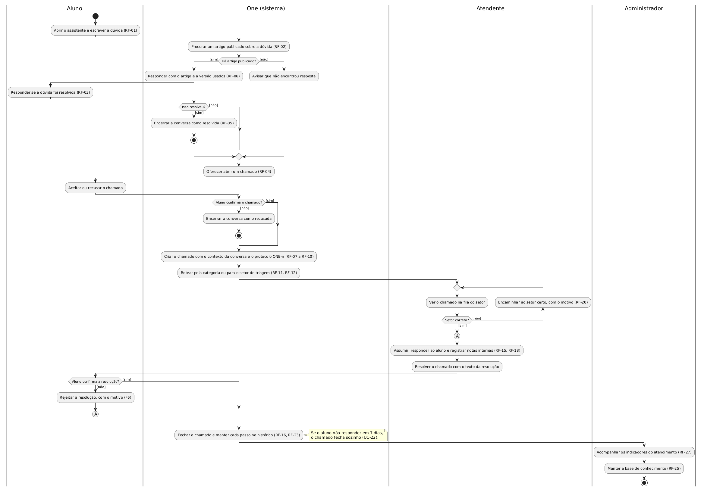

Fonte: elaborado pelos autores (2026).

## Protótipo

O protótipo é visual, navegável e de alta fidelidade. Ele foi feito só com front-end, em HTML5, CSS3, JavaScript sem framework e Bootstrap 5.3.3. Ele não tem back-end. Os dados são fictícios e ficam guardados no navegador (`localStorage`).

O protótipo tem três perfis de demonstração: Aluno, Atendente e Administrador. A tela de login apenas seleciona um desses perfis. Não há senha nem autenticação real, e as permissões são simuladas no navegador. Por isso, elas não são segurança real.

O assistente do protótipo não usa inteligência artificial. Ele compara palavras-chave da pergunta com os artigos publicados.

A interface tem tema claro e tema escuro. A escolha fica salva no navegador. O layout é responsivo e funciona no computador, no tablet e no celular.

O protótipo está publicado no GitHub Pages, no endereço <https://bitforgee.github.io/prototipo-v1-one/>. O código está neste repositório, em [`src/prototipo/`](../src/prototipo/), copiado da versão publicada (commit `e10c6d3` do repositório `Bitforgee/prototipo-v1-one`).

O protótipo é separado da arquitetura do MVP, que usa React no front-end e ASP.NET Core no back-end. Ele serve para demonstrar o fluxo de ponta a ponta antes da implementação.

## Telas

As capturas abaixo foram geradas a partir do protótipo e estão em ordem de uso. Elas seguem o fluxo principal: login, assistente, chamado, atendimento e administração.

A Figura 4.2 mostra a tela de login demonstrativo. O usuário escolhe um dos três perfis e entra sem senha. Esta tela não corresponde a um RF. A autenticação real é um requisito não funcional de segurança (RNF-15) e ainda não existe no protótipo.

Figura 4.2 — Seleção de perfil no login demonstrativo

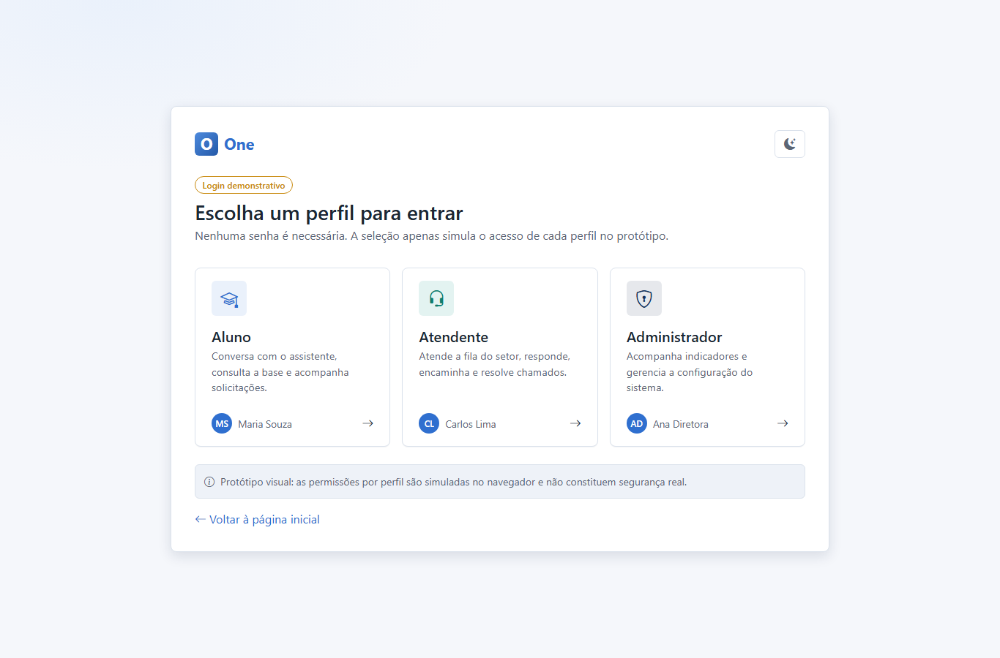

Fonte: elaborado pelos autores (2026).

A Figura 4.3 mostra o assistente acadêmico no computador. O aluno pergunta como emitir o boleto, e o assistente responde com o artigo KB-001, versão 2. Em seguida, ele pergunta "Isso resolveu sua dúvida?" com os botões Sim e Não. A tela ilustra RF-01, RF-02, RF-03 e RF-06.

Figura 4.3 — Assistente acadêmico no computador

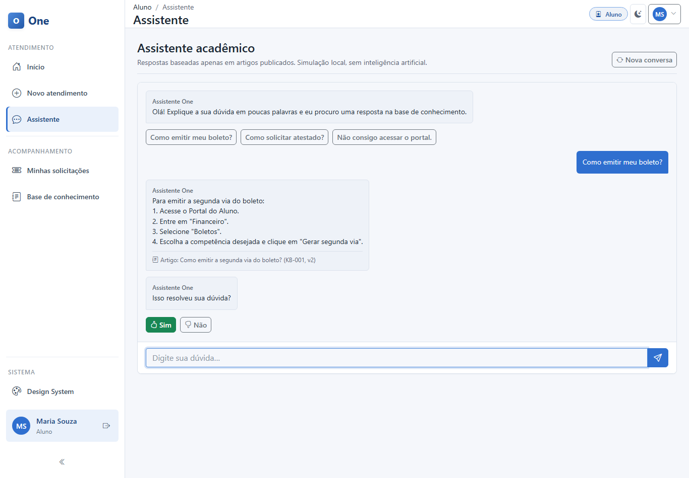

Fonte: elaborado pelos autores (2026).

A Figura 4.4 mostra o mesmo assistente na largura de um celular. O menu lateral vira um botão no topo, e o conteúdo ocupa a largura da tela. A conversa sugere perguntas frequentes para o aluno começar. A tela ilustra RF-01 no layout responsivo.

Figura 4.4 — Assistente acadêmico no celular

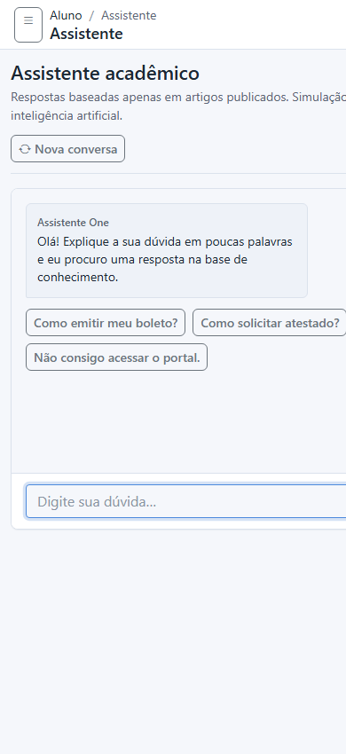

Fonte: elaborado pelos autores (2026).

A Figura 4.5 mostra a base de conhecimento vista pelo aluno. Ela lista só os artigos publicados, com categoria e data de atualização. O aluno pode buscar por palavra-chave e filtrar por categoria. A tela ilustra RF-24 e RF-25.

Figura 4.5 — Base de conhecimento do aluno

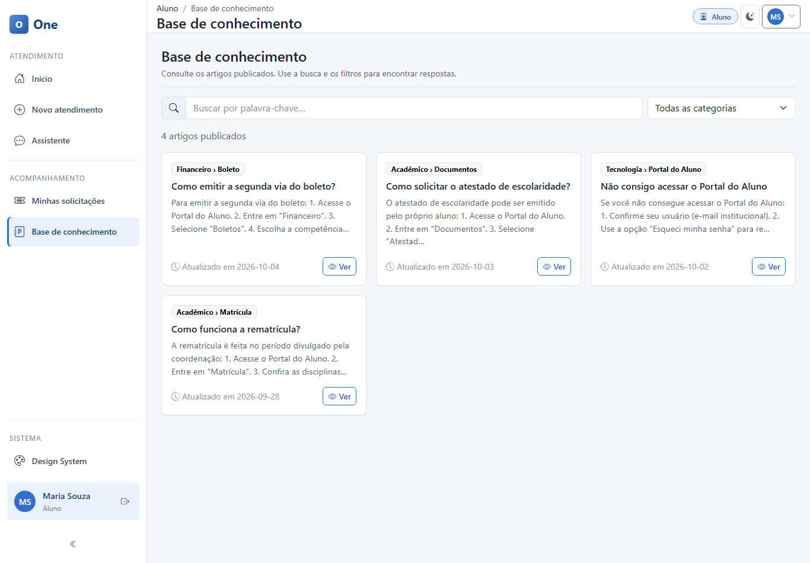

Fonte: elaborado pelos autores (2026).

A Figura 4.6 mostra o formulário de novo atendimento. O aluno informa o assunto, a categoria e uma descrição opcional. O setor de destino aparece preenchido de forma automática. O botão "Revisar e criar" pede a confirmação antes de criar o chamado. A tela ilustra RF-08 e RF-12.

Figura 4.6 — Abertura de um novo atendimento

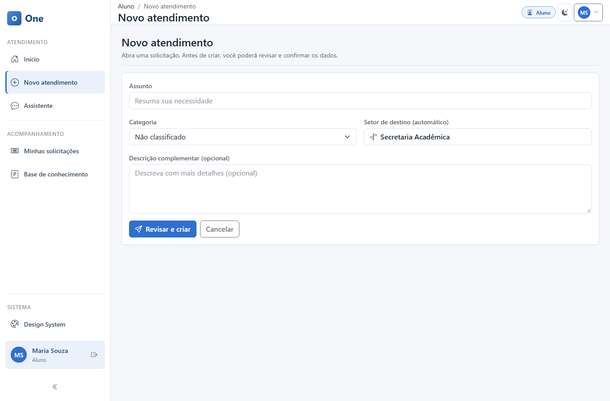

Fonte: elaborado pelos autores (2026).

A Figura 4.7 mostra a lista "Minhas solicitações". O aluno vê os próprios chamados com protocolo, assunto, categoria, setor, situação e data. Ele pode buscar por protocolo ou assunto e filtrar pela situação. A tela ilustra RF-10 e RF-11.

Figura 4.7 — Lista de solicitações do aluno

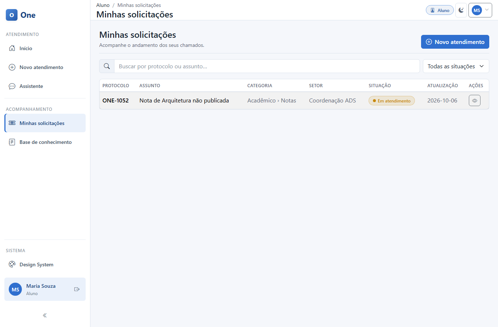

Fonte: elaborado pelos autores (2026).

A Figura 4.8 mostra o detalhe de um chamado para o aluno. A tela traz a situação, o histórico, os dados do chamado e um campo para responder. O aluno também pode cancelar o chamado. A tela ilustra RF-15, RF-18 e RF-23.

Figura 4.8 — Detalhe do chamado visto pelo aluno

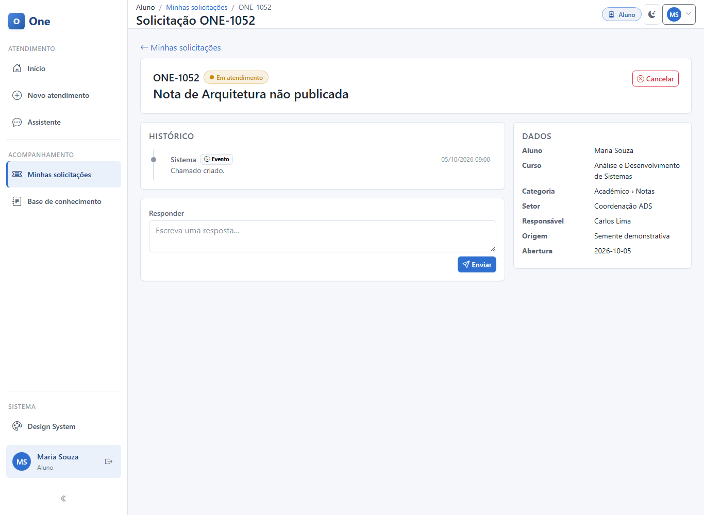

Fonte: elaborado pelos autores (2026).

A Figura 4.9 mostra a fila de chamados do atendente. O atendente vê apenas os chamados do próprio setor, com busca e filtro por situação. O menu lateral traz as visões "Em atendimento", "Aguardando aluno" e "Resolvidos". A tela ilustra RF-11 e RF-15.

Figura 4.9 — Fila de chamados do setor

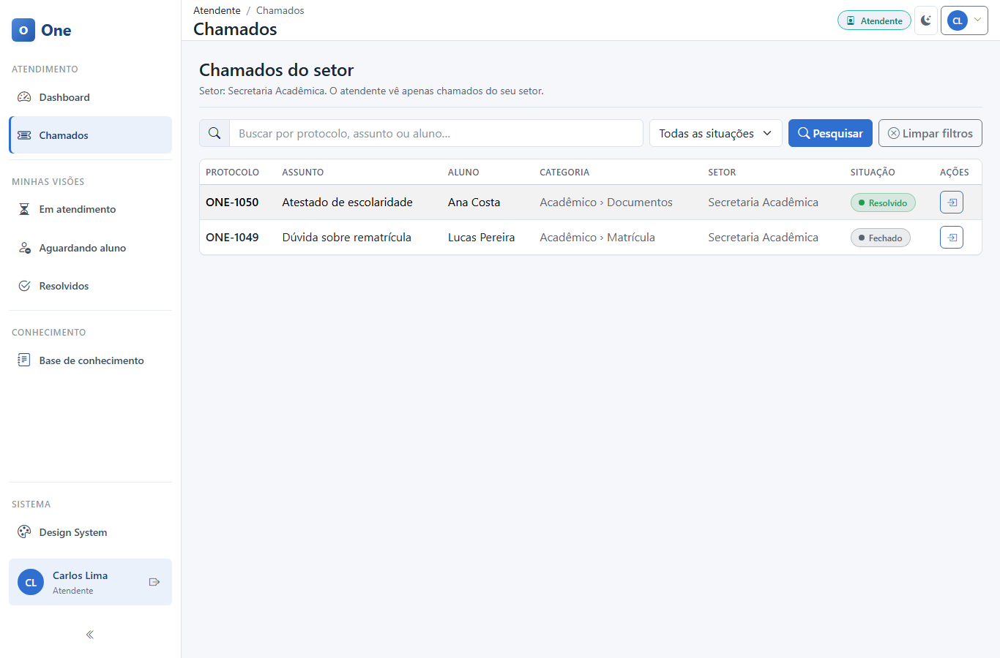

Fonte: elaborado pelos autores (2026).

A Figura 4.10 mostra o atendimento de um chamado no tema escuro. Só existe captura desta tela no tema escuro. O atendente escreve uma resposta pública ou marca a mensagem como nota interna, que o aluno não vê. Ele também pode marcar que aguarda a resposta do aluno. A tela ilustra RF-15, RF-18 e RF-23.

Figura 4.10 — Atendimento do chamado pelo atendente, no tema escuro

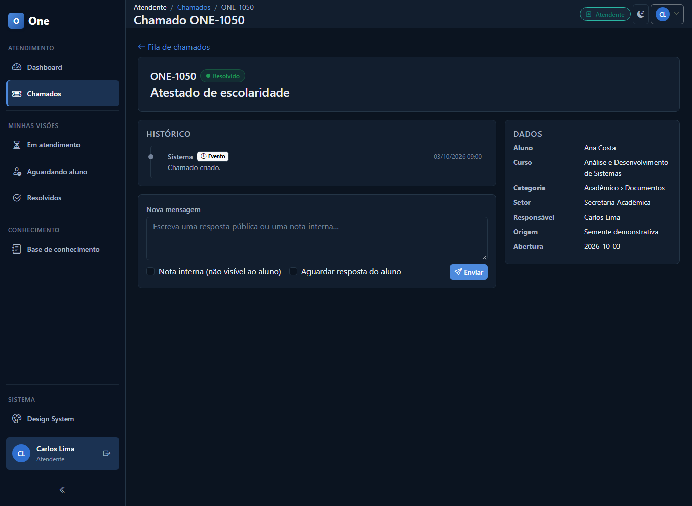

Fonte: elaborado pelos autores (2026).

A Figura 4.11 mostra a gestão da base de conhecimento pelo administrador. Cada artigo tem identificador, versão, categoria, situação e data. As situações são Publicado, Rascunho e Arquivado. O administrador cria artigos pelo botão "Novo artigo" e usa as ações da linha para editar, publicar e arquivar. Editar um artigo publicado gera uma nova versão. A tela ilustra RF-24, RF-25 e RF-26.

Figura 4.11 — Gestão da base de conhecimento

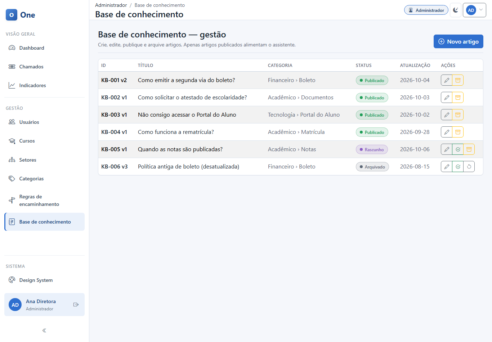

Fonte: elaborado pelos autores (2026).

A Figura 4.12 mostra o painel de indicadores do administrador. Ele traz o total de chamados, os abertos, o roteamento correto e a reabertura. Os gráficos mostram as principais categorias, os chamados por situação e os chamados por setor. Os dados são demonstrativos. A tela ilustra RF-27, de forma parcial.

Figura 4.12 — Painel de indicadores

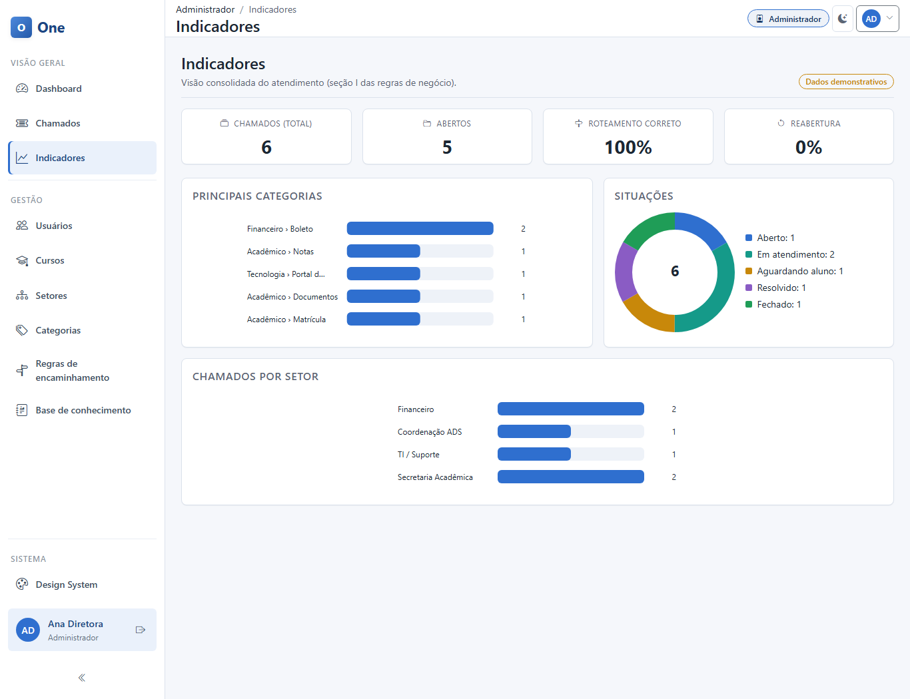

Fonte: elaborado pelos autores (2026).

## Validação com o cliente

O professor orientou, na aula de 06/10/2026, que cada grupo se sente com as pessoas do cliente e apresente o protótipo, em vez de apenas enviá-lo. Segundo ele, o protótipo deve ser validado antes de avançar para o desenvolvimento.

O roadmap do projeto prevê testes de usabilidade com tarefas reais, como "descubra como emitir seu atestado", sem explicar a interface ao usuário. Esses testes ainda não foram feitos.

Até a data deste documento, os arquivos do projeto não registram a apresentação do protótipo à coordenação.

- Data da apresentação do protótipo à coordenação: [a preencher pelo grupo]
- Participantes: [a preencher pelo grupo]
- Comentários e pedidos de ajuste da coordenação: [a preencher pelo grupo]
- Ajustes feitos no protótipo depois da validação: [a preencher pelo grupo]
