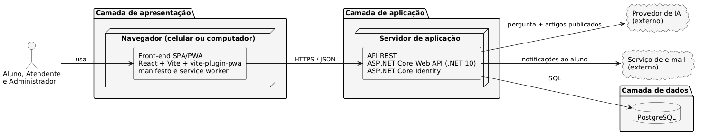
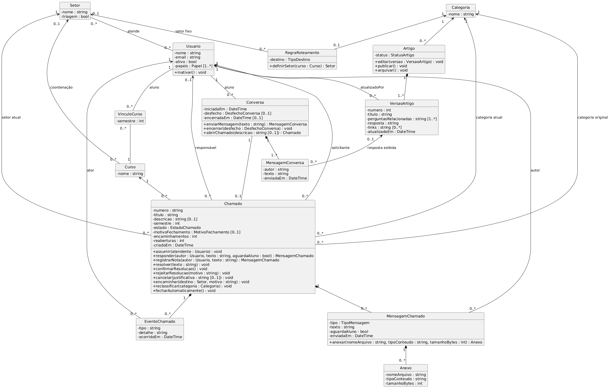
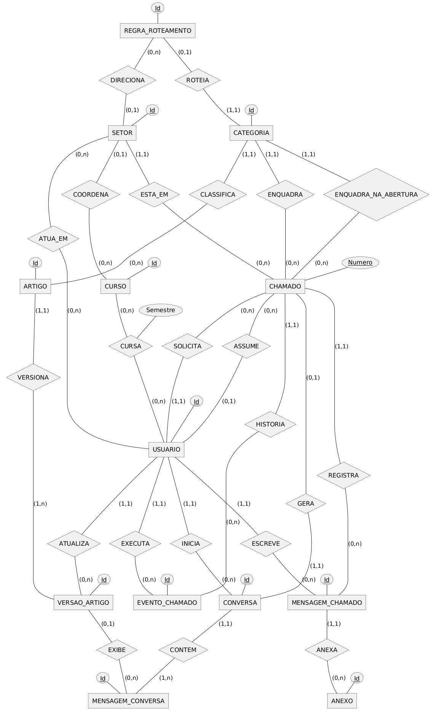
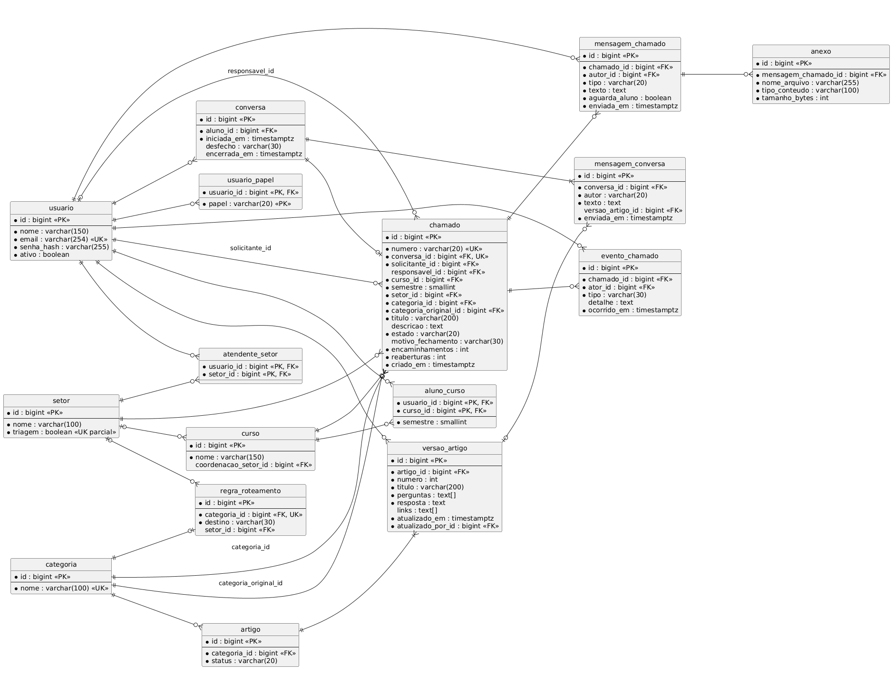

# Arquitetura da solução

Este capítulo mostra como o One é estruturado: a situação atual e a proposta, as camadas da solução, as classes do domínio, os modelos de dados, as tecnologias e a hospedagem.

## Arquitetura atual e proposta

Hoje não existe um sistema de atendimento. Os alunos falam com a coordenação pelo WhatsApp, por e-mail e pelo AVA, e nada disso fica registrado. Não há triagem dos pedidos nem dados sobre o que os alunos mais perguntam. Na semana anterior à segunda entrevista, foram cerca de 256 mensagens: 171 pelo WhatsApp, 70 por e-mail e 15 pelo AVA. A coordenadora atende uma demanda do começo ao fim, e as outras esperam. O que mais toma tempo é encontrar os dados do aluno, como curso e semestre. A Figura 1.1, no capítulo de contexto, mostra esse processo atual.

A arquitetura proposta coloca o One entre o aluno e os setores. O aluno faz a pergunta em uma aplicação web progressiva, e o assistente procura a resposta nos artigos publicados pela instituição. Se a resposta não resolver, a conversa vira um chamado registrado, que segue para o setor responsável já com a transcrição, o curso e o semestre do aluno. O atendente trata o chamado no mesmo sistema. Cada passo fica no histórico com autor, data e hora, e o administrador acompanha os indicadores.

A diferença é que hoje não há software no caminho: a mensagem vai de uma pessoa para outra e fica presa no canal em que chegou. Na proposta, todo pedido passa por um servidor e fica gravado em um banco de dados, e por isso pode ser roteado, acompanhado e medido. O atendimento pelo WhatsApp fica fora do produto mínimo viável, então os canais atuais continuam existindo durante o piloto. Como o professor observou em 06/10, a arquitetura proposta ainda pode mudar durante a execução do projeto.

## Visão geral da arquitetura

A Figura 5.1 mostra a arquitetura proposta. Ela tem três camadas: o front-end, que roda no navegador; a API REST, que roda no servidor; e o banco de dados. A API também se comunica com dois serviços externos, o provedor de IA e o serviço de e-mail. A fonte editável da figura está em `figuras/arquitetura.puml` (PlantUML).

Figura 5.1 — Arquitetura da solução

Fonte: elaborado pelos autores (2026).

**Front-end.** É uma SPA/PWA em React, criada com Vite e vite-plugin-pwa. O plugin gera o manifesto e o *service worker*, que tornam a aplicação instalável no celular e no computador (RNF-01). A interface ajusta o *layout* à largura da tela (RNF-02) e fica em português do Brasil (RNF-07). O front-end não acessa o banco nem os serviços externos: ele só conversa com a API.

**Comunicação.** O front-end chama a API por HTTPS e troca dados em JSON. A API segue o estilo REST.

**API REST.** É uma ASP.NET Core Web API, em C# sobre o .NET 10. Ela concentra as regras de negócio: a conversa com o assistente, a criação e o roteamento dos chamados, os estados do chamado, o histórico e os indicadores. Toda requisição à API deve exigir usuário autenticado. As regras de visibilidade por perfil e setor são verificadas no servidor, e não apenas na interface (RNF-05, RNF-13).

**Autenticação (proposta).** A autenticação usa o ASP.NET Core Identity, com as senhas armazenadas como *hash* (RNF-15). Só o administrador cria contas, sem autocadastro (RNF-12), e o usuário inativado não acessa o sistema (RNF-14).

**Banco de dados.** O PostgreSQL guarda os usuários, os setores, as categorias, os artigos e suas versões, as conversas, os chamados, as mensagens, os anexos e os eventos do histórico, conforme o modelo lógico (Figura 5.4). A aplicação não oferece nenhum meio de alterar ou apagar chamados, mensagens e eventos do histórico (RNF-06). O banco guarda o nome, o tipo e o tamanho de cada anexo; o local de armazenamento dos arquivos: [a preencher pelo grupo].

**Provedor de IA.** A API envia ao provedor a pergunta do aluno junto com artigos publicados, que são a única base permitida para a resposta (RF-02). Os anexos nunca são enviados ao provedor, e o aluno vê um aviso sobre esse uso antes da primeira mensagem (RNF-03). Provedor escolhido: [a preencher pelo grupo].

**Serviço de e-mail.** A API envia e-mail ao aluno a cada resposta pública de um atendente e na resolução do chamado, nunca por nota interna (RF-22). Não há notificações *push* (RNF-09). Serviço escolhido: [a preencher pelo grupo].

Um exemplo mostra o caminho de uma pergunta. O aluno escreve no front-end, que envia a mensagem à API. A API confere o usuário e o perfil, lê os artigos publicados no PostgreSQL e consulta o provedor de IA. Depois, grava a mensagem e uma cópia da resposta exibida (RF-06) e devolve a resposta ao front-end em JSON. Se o aluno aceitar abrir um chamado, a API cria o chamado, define o setor pela regra de roteamento (RF-12) e registra o evento no histórico.

Hoje o back-end tem só a base: o projeto `src/backend/One.Api` responde `Healthy` em `GET /health` e publica o documento OpenAPI em `/openapi/v1.json`, apenas no ambiente de desenvolvimento. O projeto `src/backend/One.Api.Tests` tem 4 testes automatizados. A pasta `src/frontend/` ainda não tem código, porque o grupo vai escolher entre TypeScript e JavaScript. O protótipo visual (capítulo 4, código em `src/prototipo/`) não segue esta arquitetura: ele roda só no navegador, com dados simulados no `localStorage`, sem back-end, sem IA e sem autenticação real.

## Diagrama de classes

A Figura 5.2 mostra as classes do domínio, com seus atributos e associações. A classe VinculoCurso guarda o semestre do aluno em cada curso (premissa Q19), e a classe MensagemConversa aponta para a versão do artigo que foi exibida, o que preserva o histórico mesmo quando o artigo é editado depois (RF-06). Os tipos enumerados usados nos atributos estão no Quadro 5.1.

Figura 5.2 — Diagrama de classes

Fonte: elaborado pelos autores (2026).

Quadro 5.1 — Tipos enumerados do diagrama de classes

| Tipo | Valores |
| --- | --- |
| Papel | ALUNO, ATENDENTE, ADMINISTRADOR |
| StatusArtigo | RASCUNHO, PUBLICADO, ARQUIVADO |
| DesfechoConversa | RESOLVIDA_AUTOATENDIMENTO, ESCALADA, RECUSADA, ABANDONADA |
| EstadoChamado | ABERTO, EM_ATENDIMENTO, AGUARDANDO_ALUNO, RESOLVIDO, FECHADO |
| MotivoFechamento | CONFIRMADO, FECHADO_AUTOMATICAMENTE, CANCELADO |
| TipoMensagem | RESPOSTA_PUBLICA, NOTA_INTERNA |
| TipoDestino | SETOR_FIXO, COORDENACAO_DO_CURSO |

Fonte: elaborado pelos autores (2026).

**Pendente:** na próxima iteração, o grupo vai acrescentar ao diagrama os métodos de cada classe. Na aula de 07/10, o professor observou que, sem os métodos, o diagrama parece a estrutura das tabelas do banco. Métodos de cada classe: [a preencher pelo grupo].

## Modelo conceitual

A Figura 5.3 traz o modelo conceitual de dados, na notação de entidades e relacionamentos, com a cardinalidade no formato (mínimo, máximo) e o identificador de cada entidade marcado pelo círculo preenchido. Nele, cada conversa gera no máximo um chamado, cada chamado fica em exatamente um setor e cada artigo tem uma ou mais versões. Para manter a figura legível, os demais atributos aparecem no diagrama de classes (Figura 5.2) e no modelo lógico (Figura 5.4).

Figura 5.3 — Modelo conceitual de dados

Fonte: elaborado pelos autores (2026).

## Modelo lógico

A Figura 5.4 mostra o modelo lógico para o banco de dados PostgreSQL, com as chaves primárias (PK), estrangeiras (FK) e únicas (UK). Os relacionamentos muitos-para-muitos do modelo conceitual viraram as tabelas `aluno_curso` e `atendente_setor`, e os perfis do usuário ficam na tabela `usuario_papel`. Algumas regras dos requisitos ficam garantidas pelo próprio banco. O número do chamado é único e gerado por sequência (RF-10). A chave única em `chamado.conversa_id` impede que uma conversa tenha mais de um chamado (RF-07). Um índice único parcial sobre `setor.triagem` impede que exista mais de um setor de triagem (RF-13).

Figura 5.4 — Modelo lógico de dados

Fonte: elaborado pelos autores (2026).

As fontes editáveis dos diagramas ficam ao lado das imagens: `figuras/classes.mmd` (Mermaid), `figuras/modelo-conceitual.drawio` (draw.io) e `figuras/modelo-logico.mmd` (Mermaid).

## Tecnologias utilizadas

O Quadro 5.2 lista as tecnologias do protótipo visual, as planejadas para o produto e as ferramentas de documentação. Só entram tecnologias já documentadas pelo grupo.

Quadro 5.2 — Tecnologias utilizadas

| Camada | Tecnologia | Uso |
| --- | --- | --- |
| Protótipo visual | HTML5 semântico | Estrutura das telas |
| Protótipo visual | CSS3 | *Design tokens*, temas claro e escuro e *layout* responsivo |
| Protótipo visual | JavaScript ES6+, com módulos nativos e sem *framework* | Navegação, regras simuladas e dados no `localStorage` do navegador |
| Protótipo visual | Bootstrap 5.3.3 e Bootstrap Icons 1.11.3, em arquivos locais | Componentes e ícones; o protótipo funciona *offline*, sem CDN |
| Testes do protótipo | Node.js (só a biblioteca padrão) e Google Chrome em modo *headless* | Testes unitários, de integração, de navegação, ponta a ponta, de console e de acessibilidade |
| Front-end (planejado) | React, Vite e vite-plugin-pwa | SPA/PWA instalável, com manifesto e *service worker* (RNF-01); linguagem, TypeScript ou JavaScript: [a preencher pelo grupo] |
| Back-end | ASP.NET Core Web API, C# e .NET 10 | API REST; hoje só `GET /health` e o documento OpenAPI |
| Testes do back-end | xUnit e Microsoft.AspNetCore.Mvc.Testing | 4 testes automatizados da API |
| Autenticação (proposta) | ASP.NET Core Identity | Contas de usuário e senhas armazenadas como *hash* (RNF-15) |
| Banco de dados (planejado) | PostgreSQL | Persistência dos dados do modelo lógico |
| Serviço externo | Provedor de IA: [a preencher pelo grupo] | Interpretar a pergunta do aluno a partir dos artigos publicados (RNF-03) |
| Serviço externo | Serviço de e-mail: [a preencher pelo grupo] | Notificar o aluno (RNF-09) |
| Documentação e diagramas | Markdown, PlantUML, draw.io e Mermaid | Documentos e diagramas, com a fonte de cada figura em `figuras/` |
| Versionamento e publicação | Git, GitHub, GitHub Actions e GitHub Pages | Repositórios públicos (RNF-10) e publicação do protótipo |
| Ambiente de desenvolvimento | Kiro IDE | Desenvolvimento do protótipo visual |

Fonte: elaborado pelos autores (2026).

A escolha do ASP.NET Core se apoia na seção 2.1.4 do Manual do PEI, que aceita outras tecnologias além de PHP, Java e Node.js (UNIVAG, 2026). O PostgreSQL é um banco relacional, e isso combina com o modelo de dados do One. As tabelas têm muitas relações entre si, e várias regras dos requisitos ficam garantidas por recursos do banco: chaves estrangeiras e únicas, a sequência do número ONE-n e o índice único parcial do setor de triagem. Na aula de 06/10, o professor lembrou que o banco relacional é o mais indicado quando os dados mudam com frequência e há relações entre vários registros.

## Hospedagem

O protótipo visual está publicado no GitHub Pages, em <https://bitforgee.github.io/prototipo-v1-one/>. A publicação é automática, pelo *workflow* do GitHub Actions `.github/workflows/deploy-pages.yml` do repositório `prototipo-v1-one`. Ele roda a cada *push* na branch `main` que altere a pasta `prototipo-visual/` ou o próprio *workflow*, e também pode ser disparado manualmente. Só a pasta `prototipo-visual/` é publicada; a documentação fica no repositório, mas não vira página do site. Como o protótipo não tem back-end, um serviço de arquivos estáticos como o GitHub Pages basta para ele.

O código-fonte fica neste repositório Git (RNF-10): a API em `src/backend/`, o front-end em `src/frontend/` e o protótipo em `src/prototipo/`. O repositório `Bitforgee/prototipo-v1-one` continua no GitHub só para publicar o site do protótipo.

A hospedagem do front-end React, da API e do banco PostgreSQL ainda não foi definida: [a preencher pelo grupo]. Pelo calendário da disciplina, a aplicação precisa estar disponível para a banca em 20/11.
