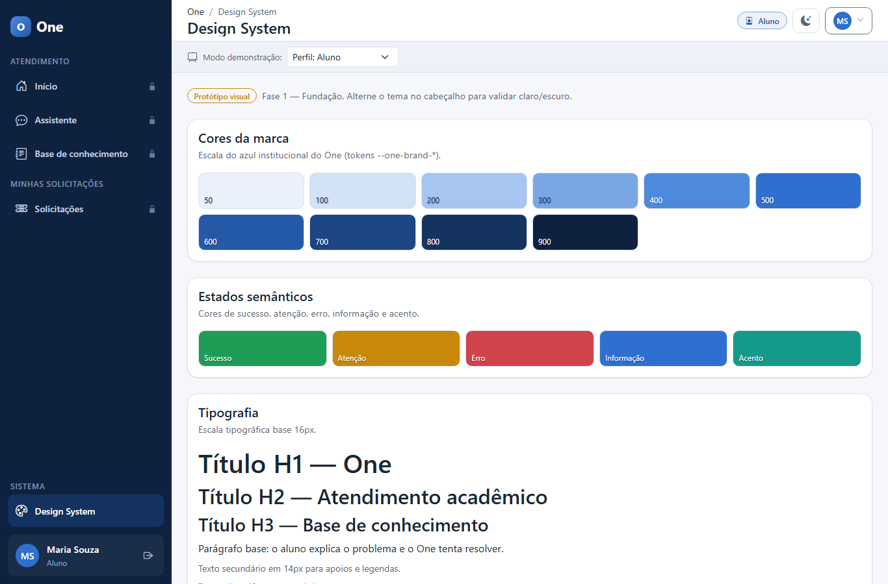
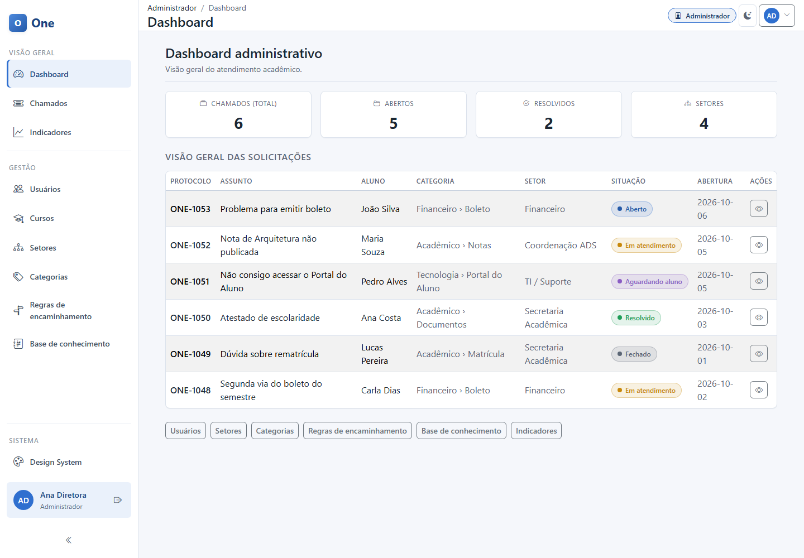
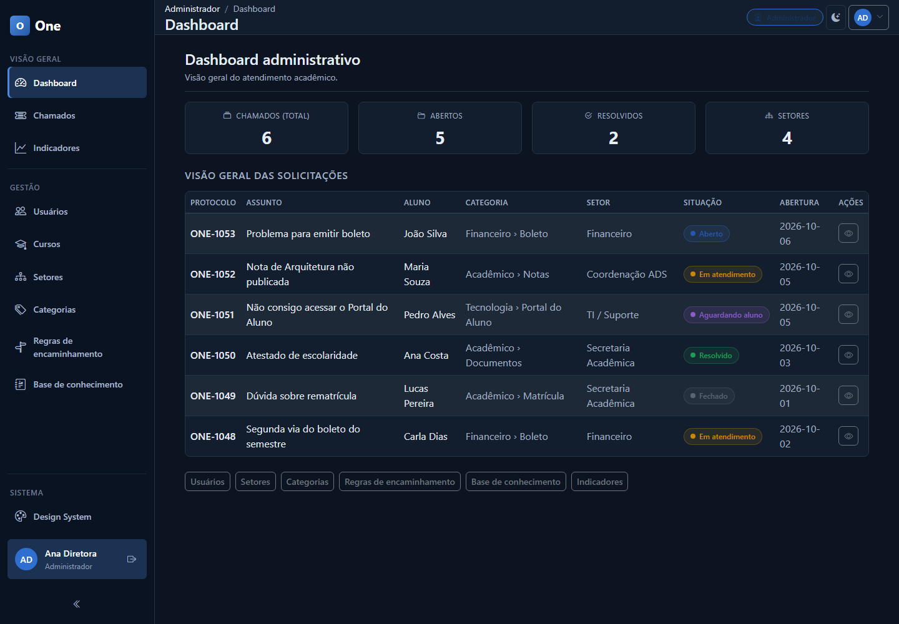

# Template padrão da aplicação

Este capítulo descreve o padrão visual do One: identidade, cores, temas, layout, componentes, responsividade, ícones e acessibilidade. O padrão foi definido no protótipo visual navegável, na pasta `prototipo-visual/` do repositório `prototipo-v1-one`. As informações vêm do README do protótipo e dos relatórios de reformulação visual, de responsividade e de homologação.

O protótipo usa HTML5 semântico, CSS3 e JavaScript ES6+ sem framework, com Bootstrap 5.3.3 e Bootstrap Icons 1.11.3. As duas bibliotecas ficam em arquivos locais, na pasta `vendor/`. Nenhuma dependência vem de CDN, e o protótipo funciona offline.

## Identidade visual

O One tem identidade visual própria. A organização das telas é inspirada no GLPI, um sistema de helpdesk: barra lateral agrupada, listas de chamados em tabela densa, badges de situação e visões por estado. Nenhum código, logotipo, marca ou imagem do GLPI foi copiado.

Arquivo do logotipo e justificativa da escolha das cores: [a preencher pelo grupo].

## Cores e design tokens

As cores, os espaçamentos, os raios e as sombras são definidos como design tokens, variáveis CSS com o prefixo `--one-`, no arquivo `css/variables.css`. Os componentes usam esses tokens em vez de cores fixas. Exemplos de tokens citados nos relatórios: `--one-sidebar-border`, `--one-timeline-interna-bg` e `--one-content-readable` (820px, a largura de leitura).

O próprio protótipo documenta o design system em uma página viva, o item **Design System** da barra lateral. Ela mostra as cores da marca, os estados semânticos, a tipografia, os botões, os cartões de métrica, os badges de estado do chamado, os chips de perfil e os formulários, nos temas claro e escuro.

A Figura 6.1 mostra essa página. A cor principal é uma escala de azul institucional, de 50 a 900 (tokens `--one-brand-*`). As cores de apoio são os estados semânticos: sucesso, atenção, erro, informação e acento. O texto base tem 16px, e o texto secundário, 14px. A página foi criada na Fase 1 do protótipo. Na captura, a barra lateral tem fundo azul escuro, o visual anterior à reformulação inspirada no GLPI. O visual atual aparece nas Figuras 6.2 e 6.3.

Figura 6.1 — Página Design System do protótipo, no tema claro

Fonte: elaborado pelos autores (2026).

Códigos hexadecimais da paleta: [a preencher pelo grupo].

## Temas claro e escuro

O protótipo tem tema claro e tema escuro. O tema fica no atributo `data-bs-theme` da tag `<html>`, o mesmo mecanismo do Bootstrap. A escolha do usuário fica salva no navegador e volta após recarregar a página. O parâmetro `?theme=dark` ou `?theme=light` força um tema para demonstração.

A reformulação visual removeu cores fixas que quebravam o tema escuro na barra lateral e no menu móvel. Depois disso, a coerência foi conferida componente por componente nos dois temas: barra lateral, cabeçalho, cartões, tabelas, filtros, formulários, modais, menus, linha do tempo, chat, badges e as telas inicial, de login e de erro.

## Layout padrão

Todas as telas internas usam o mesmo layout, chamado de app shell. Ele é uma grade com três áreas:

- **Barra lateral**: compacta e clara, com cerca de 248px. Os itens ficam agrupados por seção, com divisores, e o item ativo tem uma barra de destaque. A barra pode ser recolhida para 60px, mostrando só os ícones, com dicas acessíveis. A preferência fica salva no navegador.
- **Cabeçalho**: com 56px de altura, mostra o caminho da página (breadcrumb), o perfil, a troca de tema e o menu do usuário.
- **Conteúdo**: ocupa toda a largura que sobra ao lado da barra lateral.

As páginas seguem padrões comuns:

- Cabeçalho de página padronizado, com título e descrição.
- Tabelas como elemento principal das listas de chamados, com linhas alternadas e destaque ao passar o mouse.
- Barra de filtros acima da tabela, com busca, seleção de situação e os botões **Pesquisar** e **Limpar filtros**.
- Detalhe do chamado em duas colunas: conteúdo e histórico à esquerda (cerca de 70%), dados e ações à direita (cerca de 30%).
- Histórico em linha do tempo, com visual diferente para resposta pública, nota interna e evento do sistema.
- Painéis com uma faixa compacta de indicadores, uma tabela de prévia e atalhos em botões pequenos.

As telas inicial, de login e de erro (404 e 403) não usam o app shell. Elas ocupam a tela inteira.

As Figuras 6.2 e 6.3 mostram o layout padrão no painel do administrador, com a barra lateral expandida, nos dois temas.

Figura 6.2 — Layout padrão no painel do administrador, tema claro

Fonte: elaborado pelos autores (2026).

Figura 6.3 — Layout padrão no painel do administrador, tema escuro

Fonte: elaborado pelos autores (2026).

## Componentes

O Quadro 6.1 lista os componentes do Bootstrap usados no protótipo. O grupo não usa Tailwind nem outros frameworks de interface.

Quadro 6.1 — Componentes do Bootstrap usados no protótipo

| Componente | Uso |
| --- | --- |
| Grid (`container-fluid`, `row`, `col`) | Estrutura das páginas e da faixa de indicadores |
| Offcanvas | Menu lateral em telas pequenas |
| Table | Listas de chamados, artigos e cadastros |
| Forms | Campos, seleções e caixas de marcação |
| Card | Blocos de conteúdo e indicadores |
| Modal | Confirmações e visualização de artigos |
| Dropdown | Menu do usuário |
| Badge | Situação do chamado |
| Breadcrumb | Caminho da página no cabeçalho |
| Button | Ações, em tamanho normal, pequeno e com contorno |
| Alert e Toast | Mensagens ao usuário |

Fonte: elaborado pelos autores (2026), com base no relatório de reformulação visual do protótipo.

## Responsividade

O layout é fluido. O conteúdo ocupa toda a largura ao lado da barra lateral, com margens laterais que crescem com a tela. Só duas páginas de leitura usam uma largura menor, de 820px: o formulário "Novo atendimento" e o chat do assistente. As tabelas rolam dentro do próprio contêiner, sem criar rolagem horizontal na página. O Quadro 6.2 mostra como a barra lateral muda com a largura da tela.

Quadro 6.2 — Comportamento da barra lateral por largura de tela

| Largura da tela | Barra lateral |
| --- | --- |
| Abaixo de 992px | Fica oculta. O menu abre como Offcanvas e não ocupa largura fixa. |
| A partir de 992px | Fica visível, com 248px expandida ou 60px recolhida. O conteúdo acompanha a mudança. |

Fonte: elaborado pelos autores (2026), com base no relatório de responsividade do protótipo.

Segundo o relatório de responsividade, a largura da página foi medida em 10 larguras de tela, de 320px a 1920px, em 5 páginas, nos 2 temas e com a barra lateral expandida e recolhida. Foram 200 medições, sem nenhuma rolagem horizontal da página.

## Iconografia

Os ícones vêm do Bootstrap Icons 1.11.3. Eles aparecem nos itens da barra lateral, nos cartões de indicadores, nos botões de ação das tabelas e no cabeçalho.

## Acessibilidade

A base de acessibilidade do protótipo inclui:

- HTML semântico e um link para pular direto ao conteúdo.
- Foco visível em todos os controles.
- Rótulos ARIA nos controles e `aria-current` no item ativo da navegação.
- `aria-live` nas mensagens temporárias (toasts).
- Respeito à preferência do sistema por menos movimento (`prefers-reduced-motion`).

Segundo o relatório de homologação, a verificação automática de acessibilidade estrutural terminou com 0 avisos em 7 telas. Essa verificação não substitui o teste manual com leitor de tela. Por isso, o grupo não declara conformidade com a WCAG 2.2 AA.

## Uso no front-end do produto

O protótipo é um artefato separado e paralelo à arquitetura oficial do MVP, que usa React no front-end e ASP.NET Core no back-end.

Como o front-end em React vai reaproveitar esta identidade visual (tokens, temas e layout): [a preencher pelo grupo].
